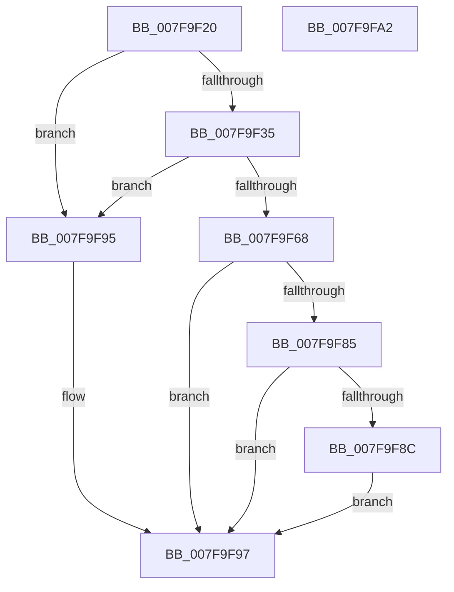

# MiAllocateMemoryBlock

- RVA: `0x007F9F20`–`0x007F9FA3` (길이 `131` bytes)
- VA: `0x00000001407F9F20`
- 실행 섹션: `PAGE`
- PDB 이름 있음: `예`; PDB Function 태그: `아니요`
- unwind 정보 RVA: `0x0005CAAC`
- 디코드: `42`개 명령, `131/131` bytes 표시
- 미해석 바이트: `0` (있으면 어셈블리에 `.byte`로 보존)

> 이 문서는 커널 이미지의 기계어와 PDB 기호를 분석해 생성했습니다. 4번과 5번은 함수 원형과 자료형을 바이너리 사용 방식에서 추정한 C 해석이며 원본 소스 복구 결과는 아닙니다.

## 1. Dependencies

- 직접 호출 지점: **1**; 고유 호출 대상: **1**
- 직접 호출자로 확인된 함수: **2**
- RIP 상대 이미지 참조: **0**

### Outgoing calls
- `0x007F9F7B` → [MiAllocatePool](../../text/35/MiAllocatePool_function_0035B540.md) (function, `0x0035B540`)

### Direct callers
- [MiAllocateInitialMemoryBlocks](MiAllocateInitialMemoryBlocks_function_007F9E34.md) at `0x007F9E92`
- [MiAllocateInitialMemoryBlocks](MiAllocateInitialMemoryBlocks_function_007F9E34.md) at `0x007F9ED9`
- [MiExtendMemoryBlocks](MiExtendMemoryBlocks_function_007FA454.md) at `0x007FA48B`
- [MiExtendMemoryBlocks](MiExtendMemoryBlocks_function_007FA454.md) at `0x007FA4D6`

### Static image references
- 디코드된 RIP-relative 메모리 참조가 없습니다.

## 2. Other-region calls and transfers

- 다른 실행 섹션으로 향하는 call: **1**
  - `0x007F9F7B` → [MiAllocatePool](../../text/35/MiAllocatePool_function_0035B540.md) (`PAGE` → `.text`)
- 별도 외부 분기/꼬리 이동을 확인하지 못했습니다.

## 3. Assembly (complete function range)

```asm
007F9F20  48 89 5C 24 08                  mov qword ptr [rsp + 8], rbx
007F9F25  57                              push rdi
007F9F26  48 83 EC 20                     sub rsp, 0x20
007F9F2A  8B DA                           mov ebx, edx
007F9F2C  41 8B F8                        mov edi, r8d
007F9F2F  8B 11                           mov edx, dword ptr [rcx]
007F9F31  3B DA                           cmp ebx, edx
007F9F33  76 60                           jbe 0x1407f9f95
007F9F35  8B CA                           mov ecx, edx
007F9F37  44 8B CA                        mov r9d, edx
007F9F3A  41 8B C0                        mov eax, r8d
007F9F3D  44 8B DB                        mov r11d, ebx
007F9F40  F7 D8                           neg eax
007F9F42  48 C7 C0 DF FF FF FF            mov rax, 0xffffffffffffffdf
007F9F49  4D 1B D2                        sbb r10, r10
007F9F4C  33 D2                           xor edx, edx
007F9F4E  41 83 E2 08                     and r10d, 8
007F9F52  49 83 C2 10                     add r10, 0x10
007F9F56  49 0F AF CA                     imul rcx, r10
007F9F5A  48 2B C1                        sub rax, rcx
007F9F5D  49 F7 F2                        div r10
007F9F60  49 03 C1                        add rax, r9
007F9F63  48 3B D8                        cmp rbx, rax
007F9F66  77 2D                           ja 0x1407f9f95
007F9F68  4D 0F AF DA                     imul r11, r10
007F9F6C  B9 40 00 00 00                  mov ecx, 0x40
007F9F71  41 B8 4D 6D 20 20               mov r8d, 0x20206d4d
007F9F77  49 8D 53 20                     lea rdx, [r11 + 0x20]
007F9F7B  E8 C0 15 B6 FF                  call 0x14035b540
007F9F80  48 85 C0                        test rax, rax
007F9F83  74 12                           je 0x1407f9f97
007F9F85  89 58 10                        mov dword ptr [rax + 0x10], ebx
007F9F88  85 FF                           test edi, edi
007F9F8A  74 0B                           je 0x1407f9f97
007F9F8C  48 C7 00 01 00 00 00            mov qword ptr [rax], 1
007F9F93  EB 02                           jmp 0x1407f9f97
007F9F95  33 C0                           xor eax, eax
007F9F97  48 8B 5C 24 30                  mov rbx, qword ptr [rsp + 0x30]
007F9F9C  48 83 C4 20                     add rsp, 0x20
007F9FA0  5F                              pop rdi
007F9FA1  C3                              ret
007F9FA2  CC                              int3
```

## 4. C-style interpretation (structured pseudocode)

```c
__int64 __fastcall MiAllocateMemoryBlock(__int64 a1, int a2, int a3)
{
    __int64 result;
    __int64 v_r10;
    __int64 v_r11;
    __int64 v_rsp;
    unsigned __int64 v_stack_p8;

    v_stack_p8 = v_rbx;
    v_rsp = (v_rsp) - (32);
    if (((unsigned int)((unsigned int)(a2))) <= ((unsigned int)((unsigned int)(*(unsigned int *)(a1))))) goto loc_007F9F95;
    result = (unsigned int)(-((unsigned int)(a3)));
    a2 = 0;
    v_r10 = (unsigned int)((v_r10) & (8));
    v_r10 = (v_r10) + (16);
    a1 = ((unsigned int)((unsigned int)((unsigned int)(*(unsigned int *)(a1))))) * (v_r10);
    result = (-33) - (a1);
    result = (result) + ((unsigned int)((unsigned int)((unsigned int)(*(unsigned int *)(a1)))));
    if (((unsigned int)(a2)) > result) goto loc_007F9F95;
    v_r11 = ((unsigned int)((unsigned int)((unsigned int)(a2)))) * (v_r10);
    result = MiAllocatePool(64, v_r11 + 32, (unsigned int)(0x20206D4DULL), (unsigned int)((unsigned int)((unsigned int)(*(unsigned int *)(a1)))));
    if (result == 0) goto loc_007F9F97;
    *(unsigned int *)(result + 16) = (unsigned int)((unsigned int)(a2));
    if ((unsigned int)((unsigned int)(a3)) == 0) goto loc_007F9F97;
    *(unsigned __int64 *)(result) = 1;
    goto loc_007F9F97;
loc_007F9F95:
    result = 0;
loc_007F9F97:
    v_rsp = (v_rsp) + (32);
    return result;
}
```

## 5. (Beta) C Style

```c
int64_t MiAllocateMemoryBlock(void *Arg1, int32_t Arg2, int32_t Arg3)
{
    uint8_t *arg1 = (uint8_t *)Arg1;

    int64_t result;
    int64_t local_r10;
    int64_t local_r11;
    int64_t local_rsp;
    uint64_t v_stack_p8;

    v_stack_p8 = local_rbx;
    local_rsp = (local_rsp) - (32);
    if (((uint32_t)((uint32_t)(Arg2))) <= ((uint32_t)((uint32_t)(*(uint32_t *)(arg1))))) goto loc_007F9F95;
    result = (uint32_t)(-((uint32_t)(Arg3)));
    Arg2 = 0;
    local_r10 = (uint32_t)((local_r10) & (8));
    local_r10 = (local_r10) + (16);
    Arg1 = ((uint32_t)((uint32_t)((uint32_t)(*(uint32_t *)(arg1))))) * (local_r10);
    result = (-33) - (Arg1);
    result = (result) + ((uint32_t)((uint32_t)((uint32_t)(*(uint32_t *)(arg1)))));
    if (((uint32_t)(Arg2)) > result) goto loc_007F9F95;
    local_r11 = ((uint32_t)((uint32_t)((uint32_t)(Arg2)))) * (local_r10);
    result = MiAllocatePool(64, local_r11 + 32, (uint32_t)(0x20206D4DULL), (uint32_t)((uint32_t)((uint32_t)(*(uint32_t *)(arg1)))));
    if (result == 0) goto loc_007F9F97;
    *(uint32_t *)(result + 0x10) = (uint32_t)((uint32_t)(Arg2));
    if ((uint32_t)((uint32_t)(Arg3)) == 0) goto loc_007F9F97;
    *(uint64_t *)(result) = 1;
    goto loc_007F9F97;
loc_007F9F95:
    result = 0;
loc_007F9F97:
    local_rsp = (local_rsp) + (32);
    return result;
}
```

### 관측된 메모리 오프셋

구조체 형식이 확인되지 않은 접근은 인자 기준의 오프셋으로만 기록했습니다.

| 기준 인자 | 오프셋 표현 | 폭 (bit) | 접근 |
|---|---:|---:|---|
| `Arg1` | `+ 0x0` | `32` | `R` |

## 6. Execution-region graph

[열기: 2D/3D 그래프와 함수 탐색 컨트롤 패널](../../../control-panel.html?section=page&rva=0x007F9F20&view=graph)

- 2D 그래프는 위에서 아래로 흐르고, 3D 그래프는 빈 공간을 드래그해 회전합니다. Shift+드래그는 이동, 휠은 확대·축소, 함수 노드 선택은 대상 보고서 이동입니다.

### Static fallback


