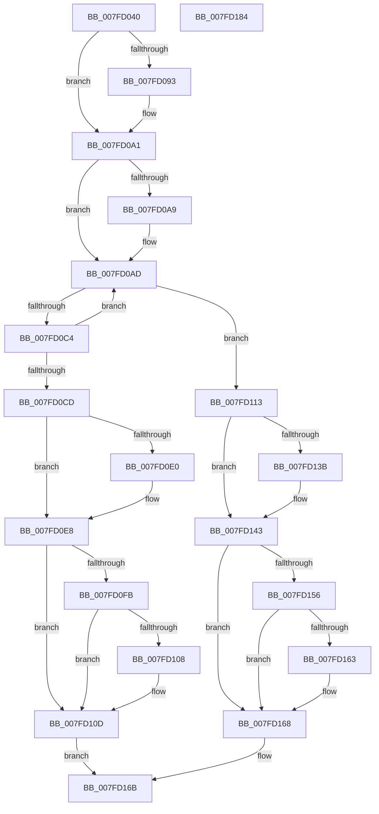

# MiAllocatePartitionId

- RVA: `0x007FD040`–`0x007FD185` (길이 `325` bytes)
- VA: `0x00000001407FD040`
- 실행 섹션: `PAGE`
- PDB 이름 있음: `예`; PDB Function 태그: `아니요`
- unwind 정보 RVA: `0x00060300`
- 디코드: `87`개 명령, `325/325` bytes 표시
- 미해석 바이트: `0` (있으면 어셈블리에 `.byte`로 보존)

> 이 문서는 커널 이미지의 기계어와 PDB 기호를 분석해 생성했습니다. 4번과 5번은 함수 원형과 자료형을 바이너리 사용 방식에서 추정한 C 해석이며 원본 소스 복구 결과는 아닙니다.

## 1. Dependencies

- 직접 호출 지점: **10**; 고유 호출 대상: **7**
- 직접 호출자로 확인된 함수: **1**
- RIP 상대 이미지 참조: **5**

### Outgoing calls
- `0x007FD082` → [KeAbPreAcquire](../../text/21/KeAbPreAcquire_function_00210230.md) (function, `0x00210230`)
- `0x007FD09C` → [ExfAcquirePushLockExclusiveEx](../../text/20/ExfAcquirePushLockExclusiveEx_function_0020FC90.md) (function, `0x0020FC90`)
- `0x007FD0BA` → [RtlFindClearBitsAndSet](../../text/3E/RtlFindClearBitsAndSet_function_003E0CD0.md) (function, `0x003E0CD0`)
- `0x007FD0C4` → [MiExpandPartitionIds](../80/MiExpandPartitionIds_function_0080D258.md) (function, `0x0080D258`)
- `0x007FD0E3` → [ExfTryToWakePushLock](../../text/26/ExfTryToWakePushLock_function_00265DD0.md) (function, `0x00265DD0`)
- `0x007FD0EB` → [KeAbPostRelease](../../text/2E/KeAbPostRelease_function_002E1600.md) (function, `0x002E1600`)
- `0x007FD108` → [KiCheckForKernelApcDelivery](../../text/2E/KiCheckForKernelApcDelivery_function_002E2C80.md) (function, `0x002E2C80`)
- `0x007FD13E` → [ExfTryToWakePushLock](../../text/26/ExfTryToWakePushLock_function_00265DD0.md) (function, `0x00265DD0`)
- `0x007FD146` → [KeAbPostRelease](../../text/2E/KeAbPostRelease_function_002E1600.md) (function, `0x002E1600`)
- `0x007FD163` → [KiCheckForKernelApcDelivery](../../text/2E/KiCheckForKernelApcDelivery_function_002E2C80.md) (function, `0x002E2C80`)

### Direct callers
- [MmCreatePartition](../80/MmCreatePartition_function_0080DC3C.md) at `0x0080DCC6`

### Static image references
- `0x007FD061` → RVA `0x00E30048` (`.data`; read)
- `0x007FD0AD` → RVA `0x00E30068` (`.data`; read)
- `0x007FD0D1` → RVA `0x00E30048` (`.data`; read/write)
- `0x007FD116` → RVA `0x00E30088` (`.data`; read)
- `0x007FD11D` → RVA `0x00E30094` (`.data`; write)

## 2. Other-region calls and transfers

- 다른 실행 섹션으로 향하는 call: **9**
  - `0x007FD082` → [KeAbPreAcquire](../../text/21/KeAbPreAcquire_function_00210230.md) (`PAGE` → `.text`)
  - `0x007FD09C` → [ExfAcquirePushLockExclusiveEx](../../text/20/ExfAcquirePushLockExclusiveEx_function_0020FC90.md) (`PAGE` → `.text`)
  - `0x007FD0BA` → [RtlFindClearBitsAndSet](../../text/3E/RtlFindClearBitsAndSet_function_003E0CD0.md) (`PAGE` → `.text`)
  - `0x007FD0E3` → [ExfTryToWakePushLock](../../text/26/ExfTryToWakePushLock_function_00265DD0.md) (`PAGE` → `.text`)
  - `0x007FD0EB` → [KeAbPostRelease](../../text/2E/KeAbPostRelease_function_002E1600.md) (`PAGE` → `.text`)
  - `0x007FD108` → [KiCheckForKernelApcDelivery](../../text/2E/KiCheckForKernelApcDelivery_function_002E2C80.md) (`PAGE` → `.text`)
  - `0x007FD13E` → [ExfTryToWakePushLock](../../text/26/ExfTryToWakePushLock_function_00265DD0.md) (`PAGE` → `.text`)
  - `0x007FD146` → [KeAbPostRelease](../../text/2E/KeAbPostRelease_function_002E1600.md) (`PAGE` → `.text`)
  - `0x007FD163` → [KiCheckForKernelApcDelivery](../../text/2E/KiCheckForKernelApcDelivery_function_002E2C80.md) (`PAGE` → `.text`)
- 별도 외부 분기/꼬리 이동을 확인하지 못했습니다.

## 3. Assembly (complete function range)

```asm
007FD040  48 89 5C 24 08                  mov qword ptr [rsp + 8], rbx
007FD045  48 89 6C 24 10                  mov qword ptr [rsp + 0x10], rbp
007FD04A  48 89 74 24 18                  mov qword ptr [rsp + 0x18], rsi
007FD04F  57                              push rdi
007FD050  41 56                           push r14
007FD052  41 57                           push r15
007FD054  48 83 EC 20                     sub rsp, 0x20
007FD058  65 48 8B 1C 25 88 01 00 00      mov rbx, qword ptr gs:[0x188]
007FD061  48 8D 2D E0 2F 63 00            lea rbp, [rip + 0x632fe0]
007FD068  48 8B F1                        mov rsi, rcx
007FD06B  41 BE 01 00 00 00               mov r14d, 1
007FD071  45 33 C0                        xor r8d, r8d
007FD074  33 D2                           xor edx, edx
007FD076  48 8B CD                        mov rcx, rbp
007FD079  66 44 29 B3 E6 01 00 00         sub word ptr [rbx + 0x1e6], r14w
007FD081  90                              nop
007FD082  E8 A9 31 A1 FF                  call 0x140210230
007FD087  F0 48 0F BA 6D 00 00            lock bts qword ptr [rbp], 0
007FD08E  48 8B F8                        mov rdi, rax
007FD091  73 0E                           jae 0x1407fd0a1
007FD093  4C 8B C5                        mov r8, rbp
007FD096  48 8B D0                        mov rdx, rax
007FD099  48 8B CD                        mov rcx, rbp
007FD09C  E8 EF 2B A1 FF                  call 0x14020fc90
007FD0A1  45 33 FF                        xor r15d, r15d
007FD0A4  48 85 FF                        test rdi, rdi
007FD0A7  74 04                           je 0x1407fd0ad
007FD0A9  44 88 77 0A                     mov byte ptr [rdi + 0xa], r14b
007FD0AD  48 8B 0D B4 2F 63 00            mov rcx, qword ptr [rip + 0x632fb4]
007FD0B4  45 33 C0                        xor r8d, r8d
007FD0B7  41 8B D6                        mov edx, r14d
007FD0BA  E8 11 3C BE FF                  call 0x1403e0cd0
007FD0BF  83 F8 FF                        cmp eax, -1
007FD0C2  75 4F                           jne 0x1407fd113
007FD0C4  E8 8F 01 01 00                  call 0x14080d258
007FD0C9  85 C0                           test eax, eax
007FD0CB  75 E0                           jne 0x1407fd0ad
007FD0CD  48 83 C8 FF                     or rax, 0xffffffffffffffff
007FD0D1  F0 48 0F C1 05 6E 2F 63 00      lock xadd qword ptr [rip + 0x632f6e], rax
007FD0DA  24 06                           and al, 6
007FD0DC  3C 02                           cmp al, 2
007FD0DE  75 08                           jne 0x1407fd0e8
007FD0E0  48 8B CD                        mov rcx, rbp
007FD0E3  E8 E8 8C A6 FF                  call 0x140265dd0
007FD0E8  48 8B CD                        mov rcx, rbp
007FD0EB  E8 10 45 AE FF                  call 0x1402e1600
007FD0F0  90                              nop
007FD0F1  66 44 01 B3 E6 01 00 00         add word ptr [rbx + 0x1e6], r14w
007FD0F9  75 12                           jne 0x1407fd10d
007FD0FB  48 8D 8B 98 00 00 00            lea rcx, [rbx + 0x98]
007FD102  90                              nop
007FD103  48 39 09                        cmp qword ptr [rcx], rcx
007FD106  74 05                           je 0x1407fd10d
007FD108  E8 73 5B AE FF                  call 0x1402e2c80
007FD10D  41 0F B7 C7                     movzx eax, r15w
007FD111  EB 58                           jmp 0x1407fd16b
007FD113  0F B7 F8                        movzx edi, ax
007FD116  48 8B 05 6B 2F 63 00            mov rax, qword ptr [rip + 0x632f6b]
007FD11D  44 88 35 70 2F 63 00            mov byte ptr [rip + 0x632f70], r14b
007FD124  48 89 34 F8                     mov qword ptr [rax + rdi*8], rsi
007FD128  48 83 C8 FF                     or rax, 0xffffffffffffffff
007FD12C  F0 48 0F C1 05 13 2F 63 00      lock xadd qword ptr [rip + 0x632f13], rax
007FD135  24 06                           and al, 6
007FD137  3C 02                           cmp al, 2
007FD139  75 08                           jne 0x1407fd143
007FD13B  48 8B CD                        mov rcx, rbp
007FD13E  E8 8D 8C A6 FF                  call 0x140265dd0
007FD143  48 8B CD                        mov rcx, rbp
007FD146  E8 B5 44 AE FF                  call 0x1402e1600
007FD14B  90                              nop
007FD14C  66 44 01 B3 E6 01 00 00         add word ptr [rbx + 0x1e6], r14w
007FD154  75 12                           jne 0x1407fd168
007FD156  48 8D 8B 98 00 00 00            lea rcx, [rbx + 0x98]
007FD15D  90                              nop
007FD15E  48 39 09                        cmp qword ptr [rcx], rcx
007FD161  74 05                           je 0x1407fd168
007FD163  E8 18 5B AE FF                  call 0x1402e2c80
007FD168  0F B7 C7                        movzx eax, di
007FD16B  48 8B 5C 24 40                  mov rbx, qword ptr [rsp + 0x40]
007FD170  48 8B 6C 24 48                  mov rbp, qword ptr [rsp + 0x48]
007FD175  48 8B 74 24 50                  mov rsi, qword ptr [rsp + 0x50]
007FD17A  48 83 C4 20                     add rsp, 0x20
007FD17E  41 5F                           pop r15
007FD180  41 5E                           pop r14
007FD182  5F                              pop rdi
007FD183  C3                              ret
007FD184  CC                              int3
```

## 4. C-style interpretation (structured pseudocode)

```c
__int64 __fastcall MiAllocatePartitionId(__int64 a1, int a2, int a3)
{
    __int64 result;
    __int64 v_r15;
    __int64 v_rsp;
    unsigned __int64 v_stack_p10;
    unsigned __int64 v_stack_p18;
    unsigned __int64 v_stack_p8;

    v_stack_p8 = v_rbx;
    v_stack_p10 = v_rbp;
    v_stack_p18 = v_rsi;
    v_rsp = (v_rsp) - (32);
    a3 = 0;
    a2 = 0;
    result = KeAbPreAcquire(v_rip + 6500320, a2, a3, a4);
    if (!(condition_is_above_or_equal)) {
        a3 = v_rip + 6500320;
        a2 = result;
        a1 = v_rip + 6500320;
        result = ExfAcquirePushLockExclusiveEx(a1, a2, a3, a4);
    }
    v_r15 = 0;
    if (result != 0) {
        *(unsigned __int8 *)(result + 10) = 1;
    }
    a3 = 0;
    result = RtlFindClearBitsAndSet(*(unsigned __int64 *)(v_rip + 6500276), 1, a3, a4);
    if (((unsigned int)(result)) != -1) goto loc_007FD113;
    result = MiExpandPartitionIds(*(unsigned __int64 *)(v_rip + 6500276), 1, a3, a4);
    if ((unsigned int)(result) != 0) goto loc_007FD0AD;
    result = (result) | (-1);
    result = (unsigned __int8)((result) & (6));
    if (((unsigned __int8)(result)) == 2) {
        a1 = v_rip + 6500320;
        result = ExfTryToWakePushLock(a1, 1, a3, a4);
    }
    result = KeAbPostRelease(v_rip + 6500320, 1, a3, a4);
    if (((unsigned __int8)(result)) != 2) goto loc_007FD10D;
    if ((*(unsigned __int64 *)(*(unsigned __int64 *)(gs_base + (0 + 392)) + 152)) != (*(unsigned __int64 *)(gs_base + (0 + 392)) + 152)) {
        result = KiCheckForKernelApcDelivery(*(unsigned __int64 *)(gs_base + (0 + 392)) + 152, 1, a3, a4);
    }
    goto loc_007FD16B;
loc_007FD113:
    *(unsigned __int8 *)(v_rip + 6500208) = 1;
    *(unsigned __int64 *)(*(unsigned __int64 *)(v_rip + 6500203) + 0 * 8) = a1;
    result = (*(unsigned __int64 *)(v_rip + 6500203)) | (-1);
    result = (unsigned __int8)((result) & (6));
    if (((unsigned __int8)(result)) == 2) {
        a1 = v_rip + 6500320;
        result = ExfTryToWakePushLock(a1, 1, a3, a4);
    }
    result = KeAbPostRelease(v_rip + 6500320, 1, a3, a4);
    if (((unsigned __int8)(result)) != 2) goto loc_007FD168;
    if ((*(unsigned __int64 *)(*(unsigned __int64 *)(gs_base + (0 + 392)) + 152)) != (*(unsigned __int64 *)(gs_base + (0 + 392)) + 152)) {
        result = KiCheckForKernelApcDelivery(*(unsigned __int64 *)(gs_base + (0 + 392)) + 152, 1, a3, a4);
    }
loc_007FD16B:
    v_rsp = (v_rsp) + (32);
    return 0;
}
```

## 5. (Beta) C Style

```c
int64_t MiAllocatePartitionId(int64_t Arg1, int32_t Arg2, int32_t Arg3)
{
    int64_t result;
    int64_t local_r15;
    int64_t local_rsp;
    uint64_t v_stack_p10;
    uint64_t v_stack_p18;
    uint64_t v_stack_p8;

    v_stack_p8 = local_rbx;
    v_stack_p10 = local_rbp;
    v_stack_p18 = local_rsi;
    local_rsp = (local_rsp) - (32);
    Arg3 = 0;
    Arg2 = 0;
    result = KeAbPreAcquire(v_rip + 6500320, Arg2, Arg3, a4);
    if (!(condition_is_above_or_equal)) {
        Arg3 = v_rip + 6500320;
        Arg2 = result;
        Arg1 = v_rip + 6500320;
        result = ExfAcquirePushLockExclusiveEx(Arg1, Arg2, Arg3, a4);
    }
    local_r15 = 0;
    if (result != 0) {
        *(uint8_t *)(result + 0xA) = 1;
    }
    Arg3 = 0;
    result = RtlFindClearBitsAndSet(*(uint64_t *)(v_rip + 0x632FB4), 1, Arg3, a4);
    if (((uint32_t)(result)) != -1) goto loc_007FD113;
    result = MiExpandPartitionIds(*(uint64_t *)(v_rip + 0x632FB4), 1, Arg3, a4);
    if ((uint32_t)(result) != 0) goto loc_007FD0AD;
    result = (result) | (-1);
    result = (uint8_t)((result) & (6));
    if (((uint8_t)(result)) == 2) {
        Arg1 = v_rip + 6500320;
        result = ExfTryToWakePushLock(Arg1, 1, Arg3, a4);
    }
    result = KeAbPostRelease(v_rip + 6500320, 1, Arg3, a4);
    if (((uint8_t)(result)) != 2) goto loc_007FD10D;
    if ((*(uint64_t *)(*(uint64_t *)(gs_base + (0 + 0x188)) + 0x98)) != (*(uint64_t *)(gs_base + (0 + 0x188)) + 152)) {
        result = KiCheckForKernelApcDelivery(*(uint64_t *)(gs_base + (0 + 0x188)) + 152, 1, Arg3, a4);
    }
    goto loc_007FD16B;
loc_007FD113:
    *(uint8_t *)(v_rip + 0x632F70) = 1;
    *(uint64_t *)(*(uint64_t *)(v_rip + 0x632F6B) + 0x0 * 8) = Arg1;
    result = (*(uint64_t *)(v_rip + 0x632F6B)) | (-1);
    result = (uint8_t)((result) & (6));
    if (((uint8_t)(result)) == 2) {
        Arg1 = v_rip + 6500320;
        result = ExfTryToWakePushLock(Arg1, 1, Arg3, a4);
    }
    result = KeAbPostRelease(v_rip + 6500320, 1, Arg3, a4);
    if (((uint8_t)(result)) != 2) goto loc_007FD168;
    if ((*(uint64_t *)(*(uint64_t *)(gs_base + (0 + 0x188)) + 0x98)) != (*(uint64_t *)(gs_base + (0 + 0x188)) + 152)) {
        result = KiCheckForKernelApcDelivery(*(uint64_t *)(gs_base + (0 + 0x188)) + 152, 1, Arg3, a4);
    }
loc_007FD16B:
    local_rsp = (local_rsp) + (32);
    return 0;
}
```

## 6. Execution-region graph

[열기: 2D/3D 그래프와 함수 탐색 컨트롤 패널](../../../control-panel.html?section=page&rva=0x007FD040&view=graph)

- 2D 그래프는 위에서 아래로 흐르고, 3D 그래프는 빈 공간을 드래그해 회전합니다. Shift+드래그는 이동, 휠은 확대·축소, 함수 노드 선택은 대상 보고서 이동입니다.

### Static fallback


