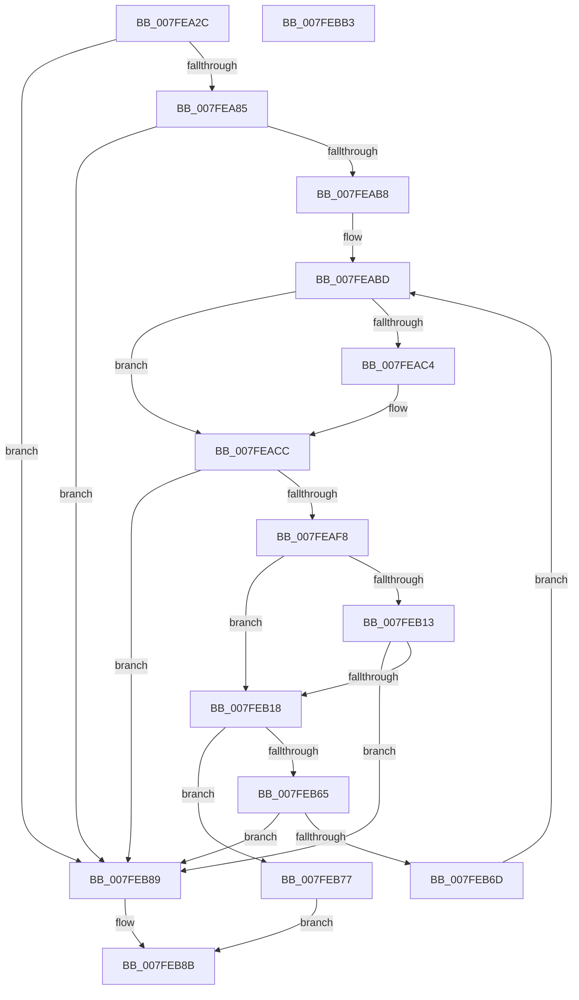

# MiAttemptPageFileExtension

- RVA: `0x007FEA2C`–`0x007FEBB4` (길이 `392` bytes)
- VA: `0x00000001407FEA2C`
- 실행 섹션: `PAGE`
- PDB 이름 있음: `예`; PDB Function 태그: `아니요`
- unwind 정보 RVA: `0x000D8100`
- 디코드: `110`개 명령, `392/392` bytes 표시
- 미해석 바이트: `0` (있으면 어셈블리에 `.byte`로 보존)

> 이 문서는 커널 이미지의 기계어와 PDB 기호를 분석해 생성했습니다. 4번과 5번은 함수 원형과 자료형을 바이너리 사용 방식에서 추정한 C 해석이며 원본 소스 복구 결과는 아닙니다.

## 1. Dependencies

- 직접 호출 지점: **4**; 고유 호출 대상: **4**
- 직접 호출자로 확인된 함수: **1**
- RIP 상대 이미지 참조: **1**

### Outgoing calls
- `0x007FEAAB` → [IopQueryXxxInformation](../8A/IopQueryXxxInformation_function_008A89D0.md) (function, `0x008A89D0`)
- `0x007FEB5C` → [IoSetInformation](../71/IoSetInformation_function_0071DBF0.md) (function, `0x0071DBF0`)
- `0x007FEB80` → [MiFinishPageFileExtension](../../text/4D/MiFinishPageFileExtension_function_004D5EB4.md) (function, `0x004D5EB4`)
- `0x007FEB92` → [_security_check_cookie](../../text/6A/_security_check_cookie_function_006AC640.md) (function, `0x006AC640`)

### Direct callers
- [MiExtendPagingFiles](MiExtendPagingFiles_function_007FFDD8.md) at `0x007FFE40`
- [MiExtendPagingFiles](MiExtendPagingFiles_function_007FFDD8.md) at `0x007FFF16`

### Static image references
- `0x007FEA4A` → RVA `0x00E0A740` (`.data`; read)

## 2. Other-region calls and transfers

- 다른 실행 섹션으로 향하는 call: **2**
  - `0x007FEB80` → [MiFinishPageFileExtension](../../text/4D/MiFinishPageFileExtension_function_004D5EB4.md) (`PAGE` → `.text`)
  - `0x007FEB92` → [_security_check_cookie](../../text/6A/_security_check_cookie_function_006AC640.md) (`PAGE` → `.text`)
- 별도 외부 분기/꼬리 이동을 확인하지 못했습니다.

## 3. Assembly (complete function range)

```asm
007FEA2C  48 89 5C 24 08                  mov qword ptr [rsp + 8], rbx
007FEA31  48 89 74 24 20                  mov qword ptr [rsp + 0x20], rsi
007FEA36  55                              push rbp
007FEA37  57                              push rdi
007FEA38  41 55                           push r13
007FEA3A  41 56                           push r14
007FEA3C  41 57                           push r15
007FEA3E  48 8D 6C 24 C9                  lea rbp, [rsp - 0x37]
007FEA43  48 81 EC 90 00 00 00            sub rsp, 0x90
007FEA4A  48 8B 05 EF BC 60 00            mov rax, qword ptr [rip + 0x60bcef]
007FEA51  48 33 C4                        xor rax, rsp
007FEA54  48 89 45 27                     mov qword ptr [rbp + 0x27], rax
007FEA58  4C 8B BA D8 00 00 00            mov r15, qword ptr [rdx + 0xd8]
007FEA5F  33 C0                           xor eax, eax
007FEA61  21 45 23                        and dword ptr [rbp + 0x23], eax
007FEA64  4C 8B E9                        mov r13, rcx
007FEA67  8B 0A                           mov ecx, dword ptr [rdx]
007FEA69  0F 57 C0                        xorps xmm0, xmm0
007FEA6C  48 89 45 FF                     mov qword ptr [rbp - 1], rax
007FEA70  4D 8B F0                        mov r14, r8
007FEA73  8B 42 04                        mov eax, dword ptr [rdx + 4]
007FEA76  48 8B FA                        mov rdi, rdx
007FEA79  0F 11 45 EF                     movups xmmword ptr [rbp - 0x11], xmm0
007FEA7D  3B C8                           cmp ecx, eax
007FEA7F  0F 84 04 01 00 00               je 0x1407feb89
007FEA85  48 8B 4A 18                     mov rcx, qword ptr [rdx + 0x18]
007FEA89  48 8D 45 E7                     lea rax, [rbp - 0x19]
007FEA8D  45 33 C9                        xor r9d, r9d
007FEA90  C6 44 24 30 00                  mov byte ptr [rsp + 0x30], 0
007FEA95  48 89 44 24 28                  mov qword ptr [rsp + 0x28], rax
007FEA9A  48 8D 45 EF                     lea rax, [rbp - 0x11]
007FEA9E  48 89 44 24 20                  mov qword ptr [rsp + 0x20], rax
007FEAA3  41 8D 51 03                     lea edx, [r9 + 3]
007FEAA7  45 8D 41 18                     lea r8d, [r9 + 0x18]
007FEAAB  E8 20 9F 0A 00                  call 0x1408a89d0
007FEAB0  85 C0                           test eax, eax
007FEAB2  0F 88 D1 00 00 00               js 0x1407feb89
007FEAB8  BE 00 40 00 00                  mov esi, 0x4000
007FEABD  8B D6                           mov edx, esi
007FEABF  4C 3B F2                        cmp r14, rdx
007FEAC2  72 08                           jb 0x1407feacc
007FEAC4  49 8B D6                        mov rdx, r14
007FEAC7  BE 00 10 00 00                  mov esi, 0x1000
007FEACC  44 8B 4F 04                     mov r9d, dword ptr [rdi + 4]
007FEAD0  8B 07                           mov eax, dword ptr [rdi]
007FEAD2  45 8B C1                        mov r8d, r9d
007FEAD5  8B 5D 03                        mov ebx, dword ptr [rbp + 3]
007FEAD8  44 2B C0                        sub r8d, eax
007FEADB  49 3B D0                        cmp rdx, r8
007FEADE  4C 0F 46 C2                     cmovbe r8, rdx
007FEAE2  0F AF 5D FF                     imul ebx, dword ptr [rbp - 1]
007FEAE6  48 0F AF 5D F7                  imul rbx, qword ptr [rbp - 9]
007FEAEB  48 81 FB 00 00 00 10            cmp rbx, 0x10000000
007FEAF2  0F 86 91 00 00 00               jbe 0x1407feb89
007FEAF8  48 81 C3 00 00 00 F0            add rbx, -0x10000000
007FEAFF  48 C1 EB 0C                     shr rbx, 0xc
007FEB03  49 3B D8                        cmp rbx, r8
007FEB06  49 0F 47 D8                     cmova rbx, r8
007FEB0A  F6 87 AC 00 00 00 10            test byte ptr [rdi + 0xac], 0x10
007FEB11  74 05                           je 0x1407feb18
007FEB13  49 3B DE                        cmp rbx, r14
007FEB16  72 71                           jb 0x1407feb89
007FEB18  8B 0F                           mov ecx, dword ptr [rdi]
007FEB1A  BA 14 00 00 00                  mov edx, 0x14
007FEB1F  8B 07                           mov eax, dword ptr [rdi]
007FEB21  48 03 CB                        add rcx, rbx
007FEB24  C1 E0 0C                        shl eax, 0xc
007FEB27  48 89 45 0F                     mov qword ptr [rbp + 0xf], rax
007FEB2B  49 8B C1                        mov rax, r9
007FEB2E  48 C1 E0 0C                     shl rax, 0xc
007FEB32  4C 8D 4D 07                     lea r9, [rbp + 7]
007FEB36  48 89 45 17                     mov qword ptr [rbp + 0x17], rax
007FEB3A  44 8D 42 0C                     lea r8d, [rdx + 0xc]
007FEB3E  41 8A 45 4F                     mov al, byte ptr [r13 + 0x4f]
007FEB42  F6 D0                           not al
007FEB44  48 C1 E1 0C                     shl rcx, 0xc
007FEB48  83 E0 20                        and eax, 0x20
007FEB4B  48 89 4D 07                     mov qword ptr [rbp + 7], rcx
007FEB4F  48 8B 4F 18                     mov rcx, qword ptr [rdi + 0x18]
007FEB53  83 C8 08                        or eax, 8
007FEB56  C1 E8 03                        shr eax, 3
007FEB59  89 45 1F                        mov dword ptr [rbp + 0x1f], eax
007FEB5C  E8 8F F0 F1 FF                  call 0x14071dbf0
007FEB61  85 C0                           test eax, eax
007FEB63  74 12                           je 0x1407feb77
007FEB65  81 FE 00 10 00 00               cmp esi, 0x1000
007FEB6B  74 1C                           je 0x1407feb89
007FEB6D  BE 00 10 00 00                  mov esi, 0x1000
007FEB72  E9 46 FF FF FF                  jmp 0x1407feabd
007FEB77  44 8B C3                        mov r8d, ebx
007FEB7A  48 8B D7                        mov rdx, rdi
007FEB7D  49 8B CF                        mov rcx, r15
007FEB80  E8 2F 73 CD FF                  call 0x1404d5eb4
007FEB85  8B C3                           mov eax, ebx
007FEB87  EB 02                           jmp 0x1407feb8b
007FEB89  33 C0                           xor eax, eax
007FEB8B  48 8B 4D 27                     mov rcx, qword ptr [rbp + 0x27]
007FEB8F  48 33 CC                        xor rcx, rsp
007FEB92  E8 A9 DA EA FF                  call 0x1406ac640
007FEB97  4C 8D 9C 24 90 00 00 00         lea r11, [rsp + 0x90]
007FEB9F  49 8B 5B 30                     mov rbx, qword ptr [r11 + 0x30]
007FEBA3  49 8B 73 48                     mov rsi, qword ptr [r11 + 0x48]
007FEBA7  49 8B E3                        mov rsp, r11
007FEBAA  41 5F                           pop r15
007FEBAC  41 5E                           pop r14
007FEBAE  41 5D                           pop r13
007FEBB0  5F                              pop rdi
007FEBB1  5D                              pop rbp
007FEBB2  C3                              ret
007FEBB3  CC                              int3
```

## 4. C-style interpretation (structured pseudocode)

```c
__int64 __fastcall MiAttemptPageFileExtension(__int64 a1, __int64 a2, __int64 a3, int a4)
{
    __int64 result;
    __int64 v_rbx;
    __int64 v_rsi;
    __int64 v_rsp;
    unsigned __int64 v_stack_m28;
    unsigned __int64 v_stack_m38;
    unsigned int v_stack_m3C;
    unsigned int v_stack_m40;
    unsigned __int64 v_stack_m48;
    unsigned __int64 v_stack_m50;
    unsigned __int64 v_stack_m58;
    unsigned int v_stack_m5C;
    unsigned __int64 v_stack_m5F;
    unsigned __int64 v_stack_m60;
    unsigned __int64 v_stack_m68;
    unsigned __int64 v_stack_m70;
    unsigned __int64 v_stack_m78;
    unsigned __int8 v_stack_m88;
    unsigned __int64 v_stack_m90;
    unsigned __int64 v_stack_m98;
    unsigned __int64 v_stack_p20;
    unsigned __int64 v_stack_p8;

    v_stack_p8 = v_rbx;
    v_stack_p20 = v_rsi;
    v_rsp = (v_rsp) - (144);
    result = (*(unsigned __int64 *)(v_rip + 6339823)) ^ (v_rsp);
    v_stack_m38 = result;
    result = 0;
    v_stack_m60 = 0;
    v_stack_m70 = v_xmm0;
    if (((unsigned int)((unsigned int)(*(unsigned int *)(a2)))) == ((unsigned int)((unsigned int)(*(unsigned int *)(a2 + 4))))) goto loc_007FEB89;
    a4 = 0;
    v_stack_m88 = 0;
    v_stack_m90 = v_stack_m78;
    v_stack_m98 = v_stack_m70;
    result = IopQueryXxxInformation(*(unsigned __int64 *)(a2 + 24), a4 + 3, a4 + 24, a4);
    if (sign_flag) goto loc_007FEB89;
loc_007FEABD:
    v_rsi = (unsigned int)(0x4000ULL);
    if (a3 >= ((unsigned int)((unsigned int)((unsigned int)(0x4000ULL))))) {
        a2 = a3;
        v_rsi = 0x1000ULL;
    }
    a3 = (unsigned int)(((unsigned int)((unsigned int)((unsigned int)(*(unsigned int *)(a2 + 4))))) - ((unsigned int)((unsigned int)(*(unsigned int *)(a2)))));
    if (a2 <= a3) { a3 = a2; }
    v_rbx = (unsigned int)(((unsigned int)(v_stack_m5C)) * (v_stack_m60));
    v_rbx = (v_rbx) * (v_stack_m68);
    if (v_rbx <= 0x10000000ULL) goto loc_007FEB89;
    v_rbx = (v_rbx) + (0xFFFFFFFFF0000000ULL);
    v_rbx = (v_rbx) >> (12);
    if (v_rbx > a3) { v_rbx = a3; }
    if (((*(unsigned __int8 *)(a2 + 172)) & (16)) == 0) goto loc_007FEB18;
    if (v_rbx < a3) goto loc_007FEB89;
loc_007FEB18:
    a1 = ((unsigned int)(*(unsigned int *)(a2))) + (v_rbx);
    result = (unsigned int)(((unsigned int)(*(unsigned int *)(a2))) << (12));
    v_stack_m50 = result;
    result = ((unsigned int)(*(unsigned int *)(a2 + 4))) << (12);
    v_stack_m48 = result;
    result = (unsigned __int8)(~(*(unsigned __int8 *)(a1 + 79)));
    a1 = (a1) << (12);
    result = (unsigned int)((result) & (32));
    v_stack_m58 = a1;
    result = (unsigned int)((result) | (8));
    result = (unsigned int)((result) >> (3));
    v_stack_m40 = (unsigned int)(result);
    result = IoSetInformation(*(unsigned __int64 *)(a2 + 24), 20, 20 + 12, v_stack_m58);
    if ((unsigned int)(result) == 0) goto loc_007FEB77;
    if (((unsigned int)(v_rsi)) == 0x1000ULL) goto loc_007FEB89;
    goto loc_007FEABD;
loc_007FEB77:
    result = MiFinishPageFileExtension(*(unsigned __int64 *)(a2 + 216), a2, (unsigned int)((unsigned int)(v_rbx)), v_stack_m58);
    goto loc_007FEB8B;
loc_007FEB89:
    result = 0;
loc_007FEB8B:
    a1 = (v_stack_m38) ^ (v_rsp);
    result = _security_check_cookie(a1, a2, (unsigned int)((unsigned int)(v_rbx)), v_stack_m58);
    return result;
}
```

## 5. (Beta) C Style

```c
int64_t MiAttemptPageFileExtension(void *Arg1, void *Arg2, int64_t Arg3, int32_t Arg4)
{
    uint8_t *arg1 = (uint8_t *)Arg1;
    uint8_t *arg2 = (uint8_t *)Arg2;

    int64_t result;
    int64_t local_rbx;
    int64_t local_rsi;
    int64_t local_rsp;
    uint64_t v_stack_m28;
    uint64_t v_stack_m38;
    uint32_t v_stack_m3C;
    uint32_t v_stack_m40;
    uint64_t v_stack_m48;
    uint64_t v_stack_m50;
    uint64_t v_stack_m58;
    uint32_t v_stack_m5C;
    uint64_t v_stack_m5F;
    uint64_t v_stack_m60;
    uint64_t v_stack_m68;
    uint64_t v_stack_m70;
    uint64_t v_stack_m78;
    uint8_t v_stack_m88;
    uint64_t v_stack_m90;
    uint64_t v_stack_m98;
    uint64_t v_stack_p20;
    uint64_t v_stack_p8;

    v_stack_p8 = local_rbx;
    v_stack_p20 = local_rsi;
    local_rsp = (local_rsp) - (144);
    result = (*(uint64_t *)(v_rip + 0x60BCEF)) ^ (local_rsp);
    v_stack_m38 = result;
    result = 0;
    v_stack_m60 = 0;
    v_stack_m70 = v_xmm0;
    if (((uint32_t)((uint32_t)(*(uint32_t *)(arg2)))) == ((uint32_t)((uint32_t)(*(uint32_t *)(arg2 + 0x4))))) goto loc_007FEB89;
    Arg4 = 0;
    v_stack_m88 = 0;
    v_stack_m90 = v_stack_m78;
    v_stack_m98 = v_stack_m70;
    result = IopQueryXxxInformation(*(uint64_t *)(arg2 + 0x18), Arg4 + 3, Arg4 + 24, Arg4);
    if (sign_flag) goto loc_007FEB89;
loc_007FEABD:
    local_rsi = (uint32_t)(0x4000ULL);
    if (Arg3 >= ((uint32_t)((uint32_t)((uint32_t)(0x4000ULL))))) {
        Arg2 = Arg3;
        local_rsi = 0x1000ULL;
    }
    Arg3 = (uint32_t)(((uint32_t)((uint32_t)((uint32_t)(*(uint32_t *)(arg2 + 0x4))))) - ((uint32_t)((uint32_t)(*(uint32_t *)(arg2)))));
    if (Arg2 <= Arg3) { Arg3 = Arg2; }
    local_rbx = (uint32_t)(((uint32_t)(v_stack_m5C)) * (v_stack_m60));
    local_rbx = (local_rbx) * (v_stack_m68);
    if (local_rbx <= 0x10000000ULL) goto loc_007FEB89;
    local_rbx = (local_rbx) + (0xFFFFFFFFF0000000ULL);
    local_rbx = (local_rbx) >> (12);
    if (local_rbx > Arg3) { local_rbx = Arg3; }
    if (((*(uint8_t *)(arg2 + 0xAC)) & (16)) == 0) goto loc_007FEB18;
    if (local_rbx < Arg3) goto loc_007FEB89;
loc_007FEB18:
    Arg1 = ((uint32_t)(*(uint32_t *)(arg2))) + (local_rbx);
    result = (uint32_t)(((uint32_t)(*(uint32_t *)(arg2))) << (12));
    v_stack_m50 = result;
    result = ((uint32_t)(*(uint32_t *)(arg2 + 0x4))) << (12);
    v_stack_m48 = result;
    result = (uint8_t)(~(*(uint8_t *)(arg1 + 0x4F)));
    Arg1 = (Arg1) << (12);
    result = (uint32_t)((result) & (32));
    v_stack_m58 = Arg1;
    result = (uint32_t)((result) | (8));
    result = (uint32_t)((result) >> (3));
    v_stack_m40 = (uint32_t)(result);
    result = IoSetInformation(*(uint64_t *)(arg2 + 0x18), 20, 20 + 12, v_stack_m58);
    if ((uint32_t)(result) == 0) goto loc_007FEB77;
    if (((uint32_t)(local_rsi)) == 0x1000ULL) goto loc_007FEB89;
    goto loc_007FEABD;
loc_007FEB77:
    result = MiFinishPageFileExtension(*(uint64_t *)(arg2 + 0xD8), Arg2, (uint32_t)((uint32_t)(local_rbx)), v_stack_m58);
    goto loc_007FEB8B;
loc_007FEB89:
    result = 0;
loc_007FEB8B:
    Arg1 = (v_stack_m38) ^ (local_rsp);
    result = _security_check_cookie(Arg1, Arg2, (uint32_t)((uint32_t)(local_rbx)), v_stack_m58);
    return result;
}
```

### 관측된 메모리 오프셋

구조체 형식이 확인되지 않은 접근은 인자 기준의 오프셋으로만 기록했습니다.

| 기준 인자 | 오프셋 표현 | 폭 (bit) | 접근 |
|---|---:|---:|---|
| `Arg1` | `+ 0x4F` | `8` | `R` |
| `Arg2` | `+ 0x0` | `32` | `R` |
| `Arg2` | `+ 0x4` | `32` | `R` |
| `Arg2` | `+ 0x18` | `64` | `R` |
| `Arg2` | `+ 0xAC` | `8` | `R` |
| `Arg2` | `+ 0xD8` | `64` | `R` |

## 6. Execution-region graph

[열기: 2D/3D 그래프와 함수 탐색 컨트롤 패널](../../../control-panel.html?section=page&rva=0x007FEA2C&view=graph)

- 2D 그래프는 위에서 아래로 흐르고, 3D 그래프는 빈 공간을 드래그해 회전합니다. Shift+드래그는 이동, 휠은 확대·축소, 함수 노드 선택은 대상 보고서 이동입니다.

### Static fallback


