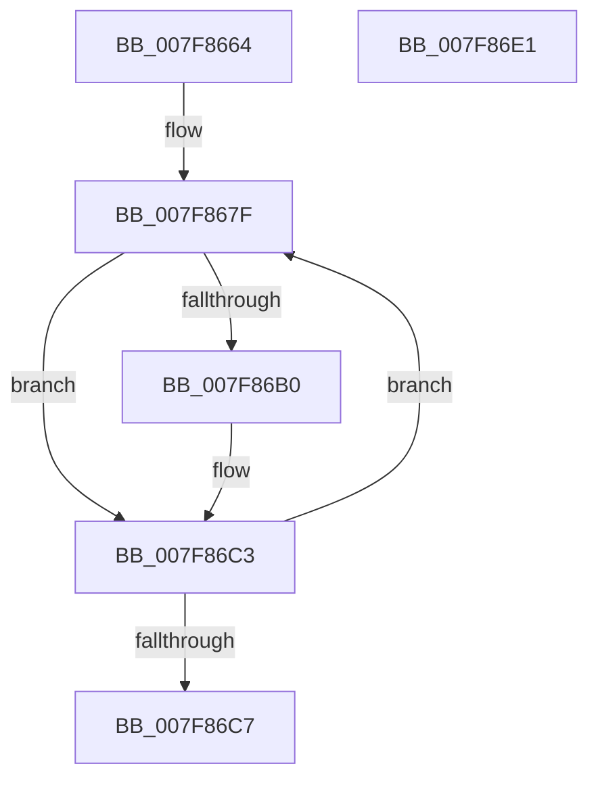

# MiBackSingleImageWithPagefile

- RVA: `0x007F8664`–`0x007F86E2` (길이 `126` bytes)
- VA: `0x00000001407F8664`
- 실행 섹션: `PAGE`
- PDB 이름 있음: `예`; PDB Function 태그: `아니요`
- unwind 정보 RVA: `0x0006E5F8`
- 디코드: `34`개 명령, `126/126` bytes 표시
- 미해석 바이트: `0` (있으면 어셈블리에 `.byte`로 보존)

> 이 문서는 커널 이미지의 기계어와 PDB 기호를 분석해 생성했습니다. 4번과 5번은 함수 원형과 자료형을 바이너리 사용 방식에서 추정한 C 해석이며 원본 소스 복구 결과는 아닙니다.

## 1. Dependencies

- 직접 호출 지점: **3**; 고유 호출 대상: **3**
- 직접 호출자로 확인된 함수: **2**
- RIP 상대 이미지 참조: **0**

### Outgoing calls
- `0x007F869F` → [MiSnapDriverRange](../A4/MiSnapDriverRange_function_00A4B328.md) (function, `0x00A4B328`)
- `0x007F86BE` → [MiMakeDriverPagesPrivate](../../text/38/MiMakeDriverPagesPrivate_function_00384C60.md) (function, `0x00384C60`)
- `0x007F86CA` → [MiGetBaseLoaderPortion](../../text/4D/MiGetBaseLoaderPortion_function_004D9D34.md) (function, `0x004D9D34`)

### Direct callers
- [MiBackSystemImageWithPagefile](MiBackSystemImageWithPagefile_function_007F86E8.md) at `0x007F8741`
- [MiConstructLoaderEntry](../AA/MiConstructLoaderEntry_function_00AAA264.md) at `0x00AAA752`

### Static image references
- 디코드된 RIP-relative 메모리 참조가 없습니다.

## 2. Other-region calls and transfers

- 다른 실행 섹션으로 향하는 call: **2**
  - `0x007F86BE` → [MiMakeDriverPagesPrivate](../../text/38/MiMakeDriverPagesPrivate_function_00384C60.md) (`PAGE` → `.text`)
  - `0x007F86CA` → [MiGetBaseLoaderPortion](../../text/4D/MiGetBaseLoaderPortion_function_004D9D34.md) (`PAGE` → `.text`)
- 별도 외부 분기/꼬리 이동을 확인하지 못했습니다.

## 3. Assembly (complete function range)

```asm
007F8664  48 89 5C 24 08                  mov qword ptr [rsp + 8], rbx
007F8669  57                              push rdi
007F866A  48 83 EC 30                     sub rsp, 0x30
007F866E  48 83 64 24 50 00               and qword ptr [rsp + 0x50], 0
007F8674  48 8B D9                        mov rbx, rcx
007F8677  48 83 64 24 48 00               and qword ptr [rsp + 0x48], 0
007F867D  33 FF                           xor edi, edi
007F867F  45 33 C9                        xor r9d, r9d
007F8682  48 8D 44 24 50                  lea rax, [rsp + 0x50]
007F8687  48 89 44 24 28                  mov qword ptr [rsp + 0x28], rax
007F868C  8B D7                           mov edx, edi
007F868E  48 8D 44 24 48                  lea rax, [rsp + 0x48]
007F8693  48 8B CB                        mov rcx, rbx
007F8696  48 89 44 24 20                  mov qword ptr [rsp + 0x20], rax
007F869B  45 8D 41 08                     lea r8d, [r9 + 8]
007F869F  E8 84 2C 25 00                  call 0x140a4b328
007F86A4  48 8B 54 24 48                  mov rdx, qword ptr [rsp + 0x48]
007F86A9  8B F8                           mov edi, eax
007F86AB  48 85 D2                        test rdx, rdx
007F86AE  74 13                           je 0x1407f86c3
007F86B0  4C 8B 44 24 50                  mov r8, qword ptr [rsp + 0x50]
007F86B5  41 B9 04 00 00 00               mov r9d, 4
007F86BB  48 8B CB                        mov rcx, rbx
007F86BE  E8 9D C5 B8 FF                  call 0x140384c60
007F86C3  85 FF                           test edi, edi
007F86C5  75 B8                           jne 0x1407f867f
007F86C7  48 8B CB                        mov rcx, rbx
007F86CA  E8 65 16 CE FF                  call 0x1404d9d34
007F86CF  48 8B 5C 24 40                  mov rbx, qword ptr [rsp + 0x40]
007F86D4  83 88 B8 00 00 00 10            or dword ptr [rax + 0xb8], 0x10
007F86DB  48 83 C4 30                     add rsp, 0x30
007F86DF  5F                              pop rdi
007F86E0  C3                              ret
007F86E1  CC                              int3
```

## 4. C-style interpretation (structured pseudocode)

```c
__int64 __fastcall MiBackSingleImageWithPagefile(__int64 a1, __int64 a2, __int64 a3, int a4)
{
    __int64 result;
    __int64 v_rdi;
    __int64 v_rsp;
    unsigned __int64 v_stack_m10;
    unsigned __int64 v_stack_m18;
    unsigned __int64 v_stack_p10;
    unsigned __int64 v_stack_p18;
    unsigned __int64 v_stack_p8;

    v_stack_p8 = v_rbx;
    v_rsp = (v_rsp) - (48);
    v_rdi = 0;
loc_007F867F:
    a4 = 0;
    v_stack_m10 = v_stack_p18;
    v_stack_m18 = v_stack_p10;
    result = MiSnapDriverRange(a1, 0, a4 + 8, a4);
    if (v_stack_p10 != 0) {
        a3 = v_stack_p18;
        a4 = 4;
        a1 = a1;
        result = MiMakeDriverPagesPrivate(a1, v_stack_p10, a3, a4);
    }
    if ((unsigned int)((unsigned int)((unsigned int)(result))) != 0) goto loc_007F867F;
    result = MiGetBaseLoaderPortion(a1, v_stack_p10, a3, a4);
    v_rsp = (v_rsp) + (48);
    return result;
}
```

## 5. (Beta) C Style

```c
int64_t MiBackSingleImageWithPagefile(int64_t Arg1, int64_t Arg2, int64_t Arg3, int32_t Arg4)
{
    int64_t result;
    int64_t local_rdi;
    int64_t local_rsp;
    uint64_t v_stack_m10;
    uint64_t v_stack_m18;
    uint64_t v_stack_p10;
    uint64_t v_stack_p18;
    uint64_t v_stack_p8;

    v_stack_p8 = local_rbx;
    local_rsp = (local_rsp) - (48);
    local_rdi = 0;
loc_007F867F:
    Arg4 = 0;
    v_stack_m10 = v_stack_p18;
    v_stack_m18 = v_stack_p10;
    result = MiSnapDriverRange(Arg1, 0, Arg4 + 8, Arg4);
    if (v_stack_p10 != 0) {
        Arg3 = v_stack_p18;
        Arg4 = 4;
        Arg1 = Arg1;
        result = MiMakeDriverPagesPrivate(Arg1, v_stack_p10, Arg3, Arg4);
    }
    if ((uint32_t)((uint32_t)((uint32_t)(result))) != 0) goto loc_007F867F;
    result = MiGetBaseLoaderPortion(Arg1, v_stack_p10, Arg3, Arg4);
    local_rsp = (local_rsp) + (48);
    return result;
}
```

## 6. Execution-region graph

[열기: 2D/3D 그래프와 함수 탐색 컨트롤 패널](../../../control-panel.html?section=page&rva=0x007F8664&view=graph)

- 2D 그래프는 위에서 아래로 흐르고, 3D 그래프는 빈 공간을 드래그해 회전합니다. Shift+드래그는 이동, 휠은 확대·축소, 함수 노드 선택은 대상 보고서 이동입니다.

### Static fallback


