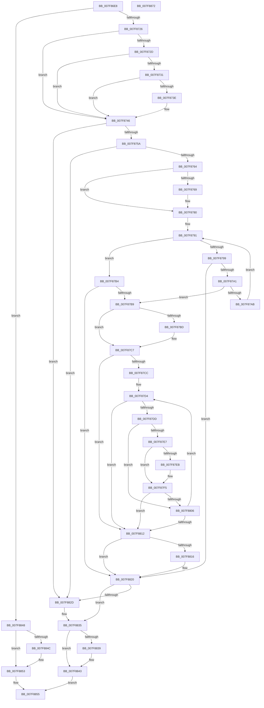

# MiBackSystemImageWithPagefile

- RVA: `0x007F86E8`–`0x007F8873` (길이 `395` bytes)
- VA: `0x00000001407F86E8`
- 실행 섹션: `PAGE`
- PDB 이름 있음: `예`; PDB Function 태그: `아니요`
- unwind 정보 RVA: `0x0008C20C`
- 디코드: `119`개 명령, `395/395` bytes 표시
- 미해석 바이트: `0` (있으면 어셈블리에 `.byte`로 보존)

> 이 문서는 커널 이미지의 기계어와 PDB 기호를 분석해 생성했습니다. 4번과 5번은 함수 원형과 자료형을 바이너리 사용 방식에서 추정한 C 해석이며 원본 소스 복구 결과는 아닙니다.

## 1. Dependencies

- 직접 호출 지점: **9**; 고유 호출 대상: **6**
- 직접 호출자로 확인된 함수: **2**
- RIP 상대 이미지 참조: **0**

### Outgoing calls
- `0x007F8710` → [MiGetBaseLoaderPortion](../../text/4D/MiGetBaseLoaderPortion_function_004D9D34.md) (function, `0x004D9D34`)
- `0x007F8735` → [MI_IS_PHYSICAL_ADDRESS](../../text/23/MI_IS_PHYSICAL_ADDRESS_function_0023B3A0.md) (function, `0x0023B3A0`)
- `0x007F8741` → [MiBackSingleImageWithPagefile](MiBackSingleImageWithPagefile_function_007F8664.md) (function, `0x007F8664`)
- `0x007F87C2` → [MiUnlockLoaderEntry](../../text/2A/MiUnlockLoaderEntry_function_002A3E28.md) (function, `0x002A3E28`)
- `0x007F87F0` → [MiLockLoaderEntry](../../text/2A/MiLockLoaderEntry_function_002A3EE0.md) (function, `0x002A3EE0`)
- `0x007F87FA` → [MiBackSystemImageWithPagefile](MiBackSystemImageWithPagefile_function_007F86E8.md) (function, `0x007F86E8`)
- `0x007F881B` → [MiLockLoaderEntry](../../text/2A/MiLockLoaderEntry_function_002A3EE0.md) (function, `0x002A3EE0`)
- `0x007F883E` → [MiUnlockLoaderEntry](../../text/2A/MiUnlockLoaderEntry_function_002A3E28.md) (function, `0x002A3E28`)
- `0x007F884E` → [MiUnlockLoaderEntry](../../text/2A/MiUnlockLoaderEntry_function_002A3E28.md) (function, `0x002A3E28`)

### Direct callers
- [FsRtlSetDriverBacking](../71/FsRtlSetDriverBacking_function_00716310.md) at `0x00716360`
- [MiBackSystemImageWithPagefile](MiBackSystemImageWithPagefile_function_007F86E8.md) at `0x007F87FA`

### Static image references
- 디코드된 RIP-relative 메모리 참조가 없습니다.

## 2. Other-region calls and transfers

- 다른 실행 섹션으로 향하는 call: **7**
  - `0x007F8710` → [MiGetBaseLoaderPortion](../../text/4D/MiGetBaseLoaderPortion_function_004D9D34.md) (`PAGE` → `.text`)
  - `0x007F8735` → [MI_IS_PHYSICAL_ADDRESS](../../text/23/MI_IS_PHYSICAL_ADDRESS_function_0023B3A0.md) (`PAGE` → `.text`)
  - `0x007F87C2` → [MiUnlockLoaderEntry](../../text/2A/MiUnlockLoaderEntry_function_002A3E28.md) (`PAGE` → `.text`)
  - `0x007F87F0` → [MiLockLoaderEntry](../../text/2A/MiLockLoaderEntry_function_002A3EE0.md) (`PAGE` → `.text`)
  - `0x007F881B` → [MiLockLoaderEntry](../../text/2A/MiLockLoaderEntry_function_002A3EE0.md) (`PAGE` → `.text`)
  - `0x007F883E` → [MiUnlockLoaderEntry](../../text/2A/MiUnlockLoaderEntry_function_002A3E28.md) (`PAGE` → `.text`)
  - `0x007F884E` → [MiUnlockLoaderEntry](../../text/2A/MiUnlockLoaderEntry_function_002A3E28.md) (`PAGE` → `.text`)
- 별도 외부 분기/꼬리 이동을 확인하지 못했습니다.

## 3. Assembly (complete function range)

```asm
007F86E8  48 8B C4                        mov rax, rsp
007F86EB  48 89 58 08                     mov qword ptr [rax + 8], rbx
007F86EF  48 89 68 10                     mov qword ptr [rax + 0x10], rbp
007F86F3  48 89 70 18                     mov qword ptr [rax + 0x18], rsi
007F86F7  57                              push rdi
007F86F8  41 54                           push r12
007F86FA  41 55                           push r13
007F86FC  41 56                           push r14
007F86FE  41 57                           push r15
007F8700  48 83 EC 30                     sub rsp, 0x30
007F8704  0F 57 C0                        xorps xmm0, xmm0
007F8707  8B EA                           mov ebp, edx
007F8709  0F 11 40 C8                     movups xmmword ptr [rax - 0x38], xmm0
007F870D  48 8B F9                        mov rdi, rcx
007F8710  E8 1F 16 CE FF                  call 0x1404d9d34
007F8715  4C 8B F0                        mov r14, rax
007F8718  8B 80 B8 00 00 00               mov eax, dword ptr [rax + 0xb8]
007F871E  A8 60                           test al, 0x60
007F8720  0F 85 22 01 00 00               jne 0x1407f8848
007F8726  48 83 79 70 00                  cmp qword ptr [rcx + 0x70], 0
007F872B  74 19                           je 0x1407f8746
007F872D  A8 10                           test al, 0x10
007F872F  75 15                           jne 0x1407f8746
007F8731  48 8B 49 30                     mov rcx, qword ptr [rcx + 0x30]
007F8735  E8 66 2C A4 FF                  call 0x14023b3a0
007F873A  85 C0                           test eax, eax
007F873C  75 08                           jne 0x1407f8746
007F873E  48 8B CF                        mov rcx, rdi
007F8741  E8 1E FF FF FF                  call 0x1407f8664
007F8746  48 8B 9F 88 00 00 00            mov rbx, qword ptr [rdi + 0x88]
007F874D  45 33 ED                        xor r13d, r13d
007F8750  48 83 FB 01                     cmp rbx, 1
007F8754  0F 84 D3 00 00 00               je 0x1407f882d
007F875A  48 83 FB FE                     cmp rbx, -2
007F875E  0F 84 C9 00 00 00               je 0x1407f882d
007F8764  F6 C3 01                        test bl, 1
007F8767  74 17                           je 0x1407f8780
007F8769  48 83 E3 FE                     and rbx, 0xfffffffffffffffe
007F876D  48 C7 44 24 20 01 00 00 00      mov qword ptr [rsp + 0x20], 1
007F8776  48 89 5C 24 28                  mov qword ptr [rsp + 0x28], rbx
007F877B  48 8D 5C 24 20                  lea rbx, [rsp + 0x20]
007F8780  41 83 8E B8 00 00 00 40         or dword ptr [r14 + 0xb8], 0x40
007F8788  48 8D 4B 08                     lea rcx, [rbx + 8]
007F878C  48 8B 13                        mov rdx, qword ptr [rbx]
007F878F  33 F6                           xor esi, esi
007F8791  48 8B C6                        mov rax, rsi
007F8794  48 3B F2                        cmp rsi, rdx
007F8797  73 1B                           jae 0x1407f87b4
007F8799  48 8B 01                        mov rax, qword ptr [rcx]
007F879C  48 85 C0                        test rax, rax
007F879F  74 7F                           je 0x1407f8820
007F87A1  48 83 B8 88 00 00 00 01         cmp qword ptr [rax + 0x88], 1
007F87A9  75 0E                           jne 0x1407f87b9
007F87AB  48 FF C6                        inc rsi
007F87AE  48 83 C1 08                     add rcx, 8
007F87B2  EB DD                           jmp 0x1407f8791
007F87B4  48 3B C2                        cmp rax, rdx
007F87B7  74 67                           je 0x1407f8820
007F87B9  85 ED                           test ebp, ebp
007F87BB  74 0A                           je 0x1407f87c7
007F87BD  33 D2                           xor edx, edx
007F87BF  48 8B CF                        mov rcx, rdi
007F87C2  E8 61 B6 AA FF                  call 0x1402a3e28
007F87C7  48 3B 33                        cmp rsi, qword ptr [rbx]
007F87CA  73 46                           jae 0x1407f8812
007F87CC  4C 8D 66 01                     lea r12, [rsi + 1]
007F87D0  4E 8D 24 E3                     lea r12, [rbx + r12*8]
007F87D4  4D 8B 3C 24                     mov r15, qword ptr [r12]
007F87D8  4D 85 FF                        test r15, r15
007F87DB  74 35                           je 0x1407f8812
007F87DD  49 83 BF 88 00 00 00 01         cmp qword ptr [r15 + 0x88], 1
007F87E5  74 1F                           je 0x1407f8806
007F87E7  85 ED                           test ebp, ebp
007F87E9  74 0A                           je 0x1407f87f5
007F87EB  33 D2                           xor edx, edx
007F87ED  49 8B CF                        mov rcx, r15
007F87F0  E8 EB B6 AA FF                  call 0x1402a3ee0
007F87F5  8B D5                           mov edx, ebp
007F87F7  49 8B CF                        mov rcx, r15
007F87FA  E8 E9 FE FF FF                  call 0x1407f86e8
007F87FF  44 8B E8                        mov r13d, eax
007F8802  85 C0                           test eax, eax
007F8804  78 0C                           js 0x1407f8812
007F8806  48 FF C6                        inc rsi
007F8809  49 83 C4 08                     add r12, 8
007F880D  48 3B 33                        cmp rsi, qword ptr [rbx]
007F8810  72 C2                           jb 0x1407f87d4
007F8812  85 ED                           test ebp, ebp
007F8814  74 0A                           je 0x1407f8820
007F8816  33 D2                           xor edx, edx
007F8818  48 8B CF                        mov rcx, rdi
007F881B  E8 C0 B6 AA FF                  call 0x1402a3ee0
007F8820  41 83 A6 B8 00 00 00 BF         and dword ptr [r14 + 0xb8], 0xffffffbf
007F8828  45 85 ED                        test r13d, r13d
007F882B  78 08                           js 0x1407f8835
007F882D  41 83 8E B8 00 00 00 20         or dword ptr [r14 + 0xb8], 0x20
007F8835  85 ED                           test ebp, ebp
007F8837  74 0A                           je 0x1407f8843
007F8839  33 D2                           xor edx, edx
007F883B  48 8B CF                        mov rcx, rdi
007F883E  E8 E5 B5 AA FF                  call 0x1402a3e28
007F8843  41 8B C5                        mov eax, r13d
007F8846  EB 0D                           jmp 0x1407f8855
007F8848  85 ED                           test ebp, ebp
007F884A  74 07                           je 0x1407f8853
007F884C  33 D2                           xor edx, edx
007F884E  E8 D5 B5 AA FF                  call 0x1402a3e28
007F8853  33 C0                           xor eax, eax
007F8855  48 8B 5C 24 60                  mov rbx, qword ptr [rsp + 0x60]
007F885A  48 8B 6C 24 68                  mov rbp, qword ptr [rsp + 0x68]
007F885F  48 8B 74 24 70                  mov rsi, qword ptr [rsp + 0x70]
007F8864  48 83 C4 30                     add rsp, 0x30
007F8868  41 5F                           pop r15
007F886A  41 5E                           pop r14
007F886C  41 5D                           pop r13
007F886E  41 5C                           pop r12
007F8870  5F                              pop rdi
007F8871  C3                              ret
007F8872  CC                              int3
```

## 4. C-style interpretation (structured pseudocode)

```c
__int64 __fastcall MiBackSystemImageWithPagefile(__int64 a1, int a2)
{
    __int64 result;
    __int64 v_r12;
    __int64 v_r13;
    __int64 v_rbx;
    __int64 v_rsi;
    __int64 v_rsp;
    unsigned __int64 v_stack_m30;
    unsigned __int64 v_stack_m38;
    unsigned __int64 v_stack_p10;
    unsigned __int64 v_stack_p18;
    unsigned __int64 v_stack_p8;

    *(unsigned __int64 *)(v_rsp + 8) = v_rbx;
    *(unsigned __int64 *)(v_rsp + 16) = v_rbp;
    *(unsigned __int64 *)(v_rsp + 24) = v_rsi;
    v_rsp = (v_rsp) - (48);
    *(unsigned __int64 *)(v_rsp - 56) = v_xmm0;
    result = MiGetBaseLoaderPortion(a1, a2, a3, a4);
    if ((((unsigned __int8)((unsigned int)(*(unsigned int *)(result + 184)))) & (96)) != 0) goto loc_007F8848;
    if ((*(unsigned __int64 *)(a1 + 112)) == 0) goto loc_007F8746;
    if ((((unsigned __int8)((unsigned int)(*(unsigned int *)(result + 184)))) & (16)) != 0) goto loc_007F8746;
    result = MI_IS_PHYSICAL_ADDRESS(*(unsigned __int64 *)(a1 + 48), a2, a3, a4);
    if ((unsigned int)(result) == 0) {
        a1 = a1;
        result = MiBackSingleImageWithPagefile(a1, a2, a3, a4);
    }
    v_r13 = 0;
    if ((*(unsigned __int64 *)(a1 + 136)) == 1) goto loc_007F882D;
    if ((*(unsigned __int64 *)(a1 + 136)) == -2) goto loc_007F882D;
    v_rbx = *(unsigned __int64 *)(a1 + 136);
    if ((((unsigned __int8)(*(unsigned __int64 *)(a1 + 136))) & (1)) != 0) {
        v_rbx = (*(unsigned __int64 *)(a1 + 136)) & (-2);
        v_stack_m38 = 1;
        v_stack_m30 = v_rbx;
        v_rbx = v_stack_m38;
    }
    v_rsi = 0;
loc_007F8791:
    if (0 >= (*(unsigned __int64 *)(v_rbx))) goto loc_007F87B4;
    if (*(unsigned __int64 *)(v_rbx + 8) == 0) goto loc_007F8820;
    if ((*(unsigned __int64 *)(*(unsigned __int64 *)(v_rbx + 8) + 136)) != 1) goto loc_007F87B9;
    v_rsi = (v_rsi) + 1;
    a1 = (v_rbx + 8) + (8);
    goto loc_007F8791;
loc_007F87B4:
    if ((*(unsigned __int64 *)(v_rbx + 8)) == (*(unsigned __int64 *)(v_rbx))) goto loc_007F8820;
loc_007F87B9:
    result = *(unsigned __int64 *)(v_rbx + 8);
    if ((unsigned int)((unsigned int)(a2)) != 0) {
        a2 = 0;
        a1 = a1;
        result = MiUnlockLoaderEntry(a1, a2, a3, a4);
    }
    if (v_rsi >= (*(unsigned __int64 *)(v_rbx))) goto loc_007F8812;
loc_007F87D4:
    if (*(unsigned __int64 *)(v_rbx + v_rsi + 1 * 8) == 0) goto loc_007F8812;
    if ((*(unsigned __int64 *)(*(unsigned __int64 *)(v_rbx + v_rsi + 1 * 8) + 136)) == 1) goto loc_007F8806;
    if ((unsigned int)((unsigned int)(a2)) != 0) {
        a2 = 0;
        a1 = *(unsigned __int64 *)(v_rbx + v_rsi + 1 * 8);
        result = MiLockLoaderEntry(a1, a2, a3, a4);
    }
    result = MiBackSystemImageWithPagefile(*(unsigned __int64 *)(v_rbx + v_rsi + 1 * 8), (unsigned int)((unsigned int)((unsigned int)(a2))), a3, a4);
    if (sign_flag) goto loc_007F8812;
loc_007F8806:
    v_rsi = (v_rsi) + 1;
    v_r12 = (v_rbx + v_rsi + 1 * 8) + (8);
    if (v_rsi < (*(unsigned __int64 *)(v_rbx))) goto loc_007F87D4;
loc_007F8812:
    if ((unsigned int)((unsigned int)(a2)) != 0) {
        a2 = 0;
        a1 = a1;
        result = MiLockLoaderEntry(a1, a2, a3, a4);
    }
    if (!(sign_flag)) {
    }
    if ((unsigned int)((unsigned int)(a2)) != 0) {
        a2 = 0;
        a1 = a1;
        result = MiUnlockLoaderEntry(a1, a2, a3, a4);
    }
    goto loc_007F8855;
loc_007F8848:
    result = (unsigned int)((unsigned int)((unsigned int)((unsigned int)(result))));
    if ((unsigned int)((unsigned int)(a2)) != 0) {
        a2 = 0;
        result = MiUnlockLoaderEntry(a1, a2, a3, a4);
    }
    result = 0;
loc_007F8855:
    v_rsp = (v_rsp) + (48);
    return result;
}
```

## 5. (Beta) C Style

```c
int64_t MiBackSystemImageWithPagefile(void *Arg1, int32_t Arg2)
{
    uint8_t *arg1 = (uint8_t *)Arg1;

    int64_t result;
    int64_t local_r12;
    int64_t local_r13;
    int64_t local_rbx;
    int64_t local_rsi;
    int64_t local_rsp;
    uint64_t v_stack_m30;
    uint64_t v_stack_m38;
    uint64_t v_stack_p10;
    uint64_t v_stack_p18;
    uint64_t v_stack_p8;

    *(uint64_t *)(local_rsp + 0x8) = local_rbx;
    *(uint64_t *)(local_rsp + 0x10) = local_rbp;
    *(uint64_t *)(local_rsp + 0x18) = local_rsi;
    local_rsp = (local_rsp) - (48);
    *(uint64_t *)(local_rsp - 0x38) = v_xmm0;
    result = MiGetBaseLoaderPortion(Arg1, Arg2, a3, a4);
    if ((((uint8_t)((uint32_t)(*(uint32_t *)(result + 0xB8)))) & (96)) != 0) goto loc_007F8848;
    if ((*(uint64_t *)(arg1 + 0x70)) == 0) goto loc_007F8746;
    if ((((uint8_t)((uint32_t)(*(uint32_t *)(result + 0xB8)))) & (16)) != 0) goto loc_007F8746;
    result = MI_IS_PHYSICAL_ADDRESS(*(uint64_t *)(arg1 + 0x30), Arg2, a3, a4);
    if ((uint32_t)(result) == 0) {
        Arg1 = Arg1;
        result = MiBackSingleImageWithPagefile(Arg1, Arg2, a3, a4);
    }
    local_r13 = 0;
    if ((*(uint64_t *)(arg1 + 0x88)) == 1) goto loc_007F882D;
    if ((*(uint64_t *)(arg1 + 0x88)) == -2) goto loc_007F882D;
    local_rbx = *(uint64_t *)(arg1 + 0x88);
    if ((((uint8_t)(*(uint64_t *)(arg1 + 0x88))) & (1)) != 0) {
        local_rbx = (*(uint64_t *)(arg1 + 0x88)) & (-2);
        v_stack_m38 = 1;
        v_stack_m30 = local_rbx;
        local_rbx = v_stack_m38;
    }
    local_rsi = 0;
loc_007F8791:
    if (0 >= (*(uint64_t *)(local_rbx))) goto loc_007F87B4;
    if (*(uint64_t *)(local_rbx + 0x8) == 0) goto loc_007F8820;
    if ((*(uint64_t *)(*(uint64_t *)(local_rbx + 0x8) + 0x88)) != 1) goto loc_007F87B9;
    local_rsi = (local_rsi) + 1;
    Arg1 = (local_rbx + 8) + (8);
    goto loc_007F8791;
loc_007F87B4:
    if ((*(uint64_t *)(local_rbx + 0x8)) == (*(uint64_t *)(local_rbx))) goto loc_007F8820;
loc_007F87B9:
    result = *(uint64_t *)(local_rbx + 0x8);
    if ((uint32_t)((uint32_t)(Arg2)) != 0) {
        Arg2 = 0;
        Arg1 = Arg1;
        result = MiUnlockLoaderEntry(Arg1, Arg2, a3, a4);
    }
    if (local_rsi >= (*(uint64_t *)(local_rbx))) goto loc_007F8812;
loc_007F87D4:
    if (*(uint64_t *)(local_rbx + local_rsi + 0x1 * 8) == 0) goto loc_007F8812;
    if ((*(uint64_t *)(*(uint64_t *)(local_rbx + local_rsi + 0x1 * 8) + 0x88)) == 1) goto loc_007F8806;
    if ((uint32_t)((uint32_t)(Arg2)) != 0) {
        Arg2 = 0;
        Arg1 = *(uint64_t *)(local_rbx + local_rsi + 0x1 * 8);
        result = MiLockLoaderEntry(Arg1, Arg2, a3, a4);
    }
    result = MiBackSystemImageWithPagefile(*(uint64_t *)(local_rbx + local_rsi + 0x1 * 8), (uint32_t)((uint32_t)((uint32_t)(Arg2))), a3, a4);
    if (sign_flag) goto loc_007F8812;
loc_007F8806:
    local_rsi = (local_rsi) + 1;
    local_r12 = (local_rbx + local_rsi + 1 * 8) + (8);
    if (local_rsi < (*(uint64_t *)(local_rbx))) goto loc_007F87D4;
loc_007F8812:
    if ((uint32_t)((uint32_t)(Arg2)) != 0) {
        Arg2 = 0;
        Arg1 = Arg1;
        result = MiLockLoaderEntry(Arg1, Arg2, a3, a4);
    }
    if (!(sign_flag)) {
    }
    if ((uint32_t)((uint32_t)(Arg2)) != 0) {
        Arg2 = 0;
        Arg1 = Arg1;
        result = MiUnlockLoaderEntry(Arg1, Arg2, a3, a4);
    }
    goto loc_007F8855;
loc_007F8848:
    result = (uint32_t)((uint32_t)((uint32_t)((uint32_t)(result))));
    if ((uint32_t)((uint32_t)(Arg2)) != 0) {
        Arg2 = 0;
        result = MiUnlockLoaderEntry(Arg1, Arg2, a3, a4);
    }
    result = 0;
loc_007F8855:
    local_rsp = (local_rsp) + (48);
    return result;
}
```

### 관측된 메모리 오프셋

구조체 형식이 확인되지 않은 접근은 인자 기준의 오프셋으로만 기록했습니다.

| 기준 인자 | 오프셋 표현 | 폭 (bit) | 접근 |
|---|---:|---:|---|
| `Arg1` | `+ 0x88` | `64` | `R` |

## 6. Execution-region graph

[열기: 2D/3D 그래프와 함수 탐색 컨트롤 패널](../../../control-panel.html?section=page&rva=0x007F86E8&view=graph)

- 2D 그래프는 위에서 아래로 흐르고, 3D 그래프는 빈 공간을 드래그해 회전합니다. Shift+드래그는 이동, 휠은 확대·축소, 함수 노드 선택은 대상 보고서 이동입니다.

### Static fallback


