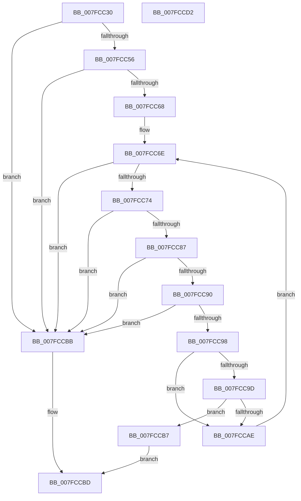

# MiCheckDosCalls

- RVA: `0x007FCC30`–`0x007FCCD3` (길이 `163` bytes)
- VA: `0x00000001407FCC30`
- 실행 섹션: `PAGE`
- PDB 이름 있음: `예`; PDB Function 태그: `아니요`
- unwind 정보 RVA: `0x000A5A38`
- 디코드: `49`개 명령, `163/163` bytes 표시
- 미해석 바이트: `0` (있으면 어셈블리에 `.byte`로 보존)

> 이 문서는 커널 이미지의 기계어와 PDB 기호를 분석해 생성했습니다. 4번과 5번은 함수 원형과 자료형을 바이너리 사용 방식에서 추정한 C 해석이며 원본 소스 복구 결과는 아닙니다.

## 1. Dependencies

- 직접 호출 지점: **0**; 고유 호출 대상: **0**
- 직접 호출자로 확인된 함수: **1**
- RIP 상대 이미지 참조: **0**

### Outgoing calls
- 직접 디코드된 call 명령이 없습니다.

### Direct callers
- [MiComputeBadImageHeaderType](../98/MiComputeBadImageHeaderType_function_00987668.md) at `0x00987697`

### Static image references
- 디코드된 RIP-relative 메모리 참조가 없습니다.

## 2. Other-region calls and transfers

- 다른 실행 섹션으로 향하는 call: **0**
- 별도 외부 분기/꼬리 이동을 확인하지 못했습니다.

## 3. Assembly (complete function range)

```asm
007FCC30  48 8B C4                        mov rax, rsp
007FCC33  48 89 58 08                     mov qword ptr [rax + 8], rbx
007FCC37  48 89 68 10                     mov qword ptr [rax + 0x10], rbp
007FCC3B  48 89 70 18                     mov qword ptr [rax + 0x18], rsi
007FCC3F  48 89 78 20                     mov qword ptr [rax + 0x20], rdi
007FCC43  44 0F B7 51 1E                  movzx r10d, word ptr [rcx + 0x1e]
007FCC48  33 F6                           xor esi, esi
007FCC4A  48 8B DA                        mov rbx, rdx
007FCC4D  4C 8B C9                        mov r9, rcx
007FCC50  66 45 85 D2                     test r10w, r10w
007FCC54  74 65                           je 0x1407fccbb
007FCC56  44 0F B7 41 28                  movzx r8d, word ptr [rcx + 0x28]
007FCC5B  4D 8D 1C 08                     lea r11, [r8 + rcx]
007FCC5F  4F 8D 04 50                     lea r8, [r8 + r10*2]
007FCC63  4C 3B C2                        cmp r8, rdx
007FCC66  77 53                           ja 0x1407fccbb
007FCC68  0F B7 D6                        movzx edx, si
007FCC6B  8D 6E 01                        lea ebp, [rsi + 1]
007FCC6E  66 41 3B D2                     cmp dx, r10w
007FCC72  73 47                           jae 0x1407fccbb
007FCC74  41 0F B7 79 2A                  movzx edi, word ptr [r9 + 0x2a]
007FCC79  41 0F B7 03                     movzx eax, word ptr [r11]
007FCC7D  03 F8                           add edi, eax
007FCC7F  44 8B C7                        mov r8d, edi
007FCC82  4C 3B C3                        cmp r8, rbx
007FCC85  73 34                           jae 0x1407fccbb
007FCC87  42 0F B6 0C 0F                  movzx ecx, byte ptr [rdi + r9]
007FCC8C  84 C9                           test cl, cl
007FCC8E  74 2B                           je 0x1407fccbb
007FCC90  8D 04 0F                        lea eax, [rdi + rcx]
007FCC93  48 3B C3                        cmp rax, rbx
007FCC96  73 23                           jae 0x1407fccbb
007FCC98  80 F9 08                        cmp cl, 8
007FCC9B  75 11                           jne 0x1407fccae
007FCC9D  48 B9 44 4F 53 43 41 4C 4C 53   movabs rcx, 0x534c4c4143534f44
007FCCA7  4A 39 4C 0F 01                  cmp qword ptr [rdi + r9 + 1], rcx
007FCCAC  74 09                           je 0x1407fccb7
007FCCAE  49 83 C3 02                     add r11, 2
007FCCB2  66 03 D5                        add dx, bp
007FCCB5  EB B7                           jmp 0x1407fcc6e
007FCCB7  8B C5                           mov eax, ebp
007FCCB9  EB 02                           jmp 0x1407fccbd
007FCCBB  33 C0                           xor eax, eax
007FCCBD  48 8B 5C 24 08                  mov rbx, qword ptr [rsp + 8]
007FCCC2  48 8B 6C 24 10                  mov rbp, qword ptr [rsp + 0x10]
007FCCC7  48 8B 74 24 18                  mov rsi, qword ptr [rsp + 0x18]
007FCCCC  48 8B 7C 24 20                  mov rdi, qword ptr [rsp + 0x20]
007FCCD1  C3                              ret
007FCCD2  CC                              int3
```

## 4. C-style interpretation (structured pseudocode)

```c
__int64 __fastcall MiCheckDosCalls(__int64 a1, __int64 a2)
{
    __int64 result;
    __int64 v_r11;
    __int64 v_rdi;
    __int64 v_rsi;
    unsigned __int64 v_stack_p10;
    unsigned __int64 v_stack_p18;
    unsigned __int64 v_stack_p20;
    unsigned __int64 v_stack_p8;

    *(unsigned __int64 *)(v_rsp + 8) = v_rbx;
    *(unsigned __int64 *)(v_rsp + 16) = v_rbp;
    *(unsigned __int64 *)(v_rsp + 24) = v_rsi;
    *(unsigned __int64 *)(v_rsp + 32) = v_rdi;
    v_rsi = 0;
    if ((unsigned __int16)(*(unsigned __int16 *)(a1 + 30)) == 0) goto loc_007FCCBB;
    if ((*(unsigned __int16 *)(a1 + 40) + *(unsigned __int16 *)(a1 + 30) * 2) > a2) goto loc_007FCCBB;
loc_007FCC6E:
    if (0 >= ((unsigned __int16)(*(unsigned __int16 *)(a1 + 30)))) goto loc_007FCCBB;
    v_rdi = (unsigned int)((*(unsigned __int16 *)(a1 + 42)) + ((unsigned int)(*(unsigned __int16 *)(*(unsigned __int16 *)(a1 + 40) + a1 * 1))));
    if (((unsigned int)((unsigned int)(v_rdi))) >= a2) goto loc_007FCCBB;
    if ((unsigned __int8)(*(unsigned __int8 *)(v_rdi + a1 * 1)) == 0) goto loc_007FCCBB;
    if ((v_rdi + *(unsigned __int8 *)(v_rdi + a1 * 1) * 1) >= a2) goto loc_007FCCBB;
    if (((unsigned __int8)(*(unsigned __int8 *)(v_rdi + a1 * 1))) != 8) goto loc_007FCCAE;
    if ((*(unsigned __int64 *)(v_rdi + a1 * 1 + 1)) == (*(unsigned __int8 *)(v_rdi + a1 * 1))) goto loc_007FCCB7;
loc_007FCCAE:
    v_r11 = (*(unsigned __int16 *)(a1 + 40) + a1 * 1) + (2);
    a2 = (unsigned __int16)((0) + ((unsigned __int16)(v_rsi + 1)));
    goto loc_007FCC6E;
loc_007FCCB7:
    goto loc_007FCCBD;
loc_007FCCBB:
    result = 0;
loc_007FCCBD:
    return result;
}
```

## 5. (Beta) C Style

```c
int64_t MiCheckDosCalls(void *Arg1, int64_t Arg2)
{
    uint8_t *arg1 = (uint8_t *)Arg1;

    int64_t result;
    int64_t local_r11;
    int64_t local_rdi;
    int64_t local_rsi;
    uint64_t v_stack_p10;
    uint64_t v_stack_p18;
    uint64_t v_stack_p20;
    uint64_t v_stack_p8;

    *(uint64_t *)(local_rsp + 0x8) = local_rbx;
    *(uint64_t *)(local_rsp + 0x10) = local_rbp;
    *(uint64_t *)(local_rsp + 0x18) = local_rsi;
    *(uint64_t *)(local_rsp + 0x20) = local_rdi;
    local_rsi = 0;
    if ((uint16_t)(*(uint16_t *)(arg1 + 0x1E)) == 0) goto loc_007FCCBB;
    if ((*(uint16_t *)(arg1 + 0x28) + *(uint16_t *)(arg1 + 0x1E) * 2) > Arg2) goto loc_007FCCBB;
loc_007FCC6E:
    if (0 >= ((uint16_t)(*(uint16_t *)(arg1 + 0x1E)))) goto loc_007FCCBB;
    local_rdi = (uint32_t)((*(uint16_t *)(arg1 + 0x2A)) + ((uint32_t)(*(uint16_t *)(*(uint16_t *)(arg1 + 0x28) + arg1 * 1))));
    if (((uint32_t)((uint32_t)(local_rdi))) >= Arg2) goto loc_007FCCBB;
    if ((uint8_t)(*(uint8_t *)(local_rdi + arg1 * 1)) == 0) goto loc_007FCCBB;
    if ((local_rdi + *(uint8_t *)(local_rdi + arg1 * 1) * 1) >= Arg2) goto loc_007FCCBB;
    if (((uint8_t)(*(uint8_t *)(local_rdi + arg1 * 1))) != 8) goto loc_007FCCAE;
    if ((*(uint64_t *)(local_rdi + arg1 * 1 + 0x1)) == (*(uint8_t *)(local_rdi + arg1 * 1))) goto loc_007FCCB7;
loc_007FCCAE:
    local_r11 = (*(uint16_t *)(arg1 + 0x28) + Arg1 * 1) + (2);
    Arg2 = (uint16_t)((0) + ((uint16_t)(local_rsi + 1)));
    goto loc_007FCC6E;
loc_007FCCB7:
    goto loc_007FCCBD;
loc_007FCCBB:
    result = 0;
loc_007FCCBD:
    return result;
}
```

### 관측된 메모리 오프셋

구조체 형식이 확인되지 않은 접근은 인자 기준의 오프셋으로만 기록했습니다.

| 기준 인자 | 오프셋 표현 | 폭 (bit) | 접근 |
|---|---:|---:|---|
| `Arg1` | `+ 0x1E` | `16` | `R` |
| `Arg1` | `+ 0x28` | `16` | `R` |
| `Arg1` | `+ 0x2A` | `16` | `R` |

## 6. Execution-region graph

[열기: 2D/3D 그래프와 함수 탐색 컨트롤 패널](../../../control-panel.html?section=page&rva=0x007FCC30&view=graph)

- 2D 그래프는 위에서 아래로 흐르고, 3D 그래프는 빈 공간을 드래그해 회전합니다. Shift+드래그는 이동, 휠은 확대·축소, 함수 노드 선택은 대상 보고서 이동입니다.

### Static fallback


