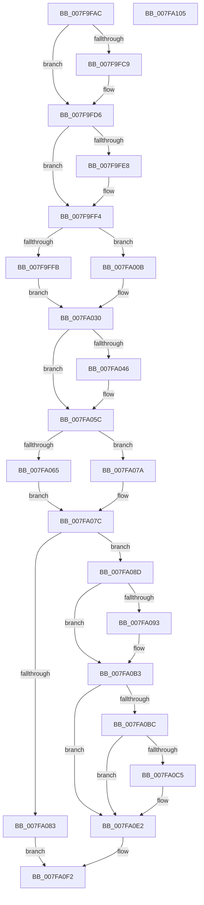

# MiCompleteMemoryAddition

- RVA: `0x007F9FAC`–`0x007FA106` (길이 `346` bytes)
- VA: `0x00000001407F9FAC`
- 실행 섹션: `PAGE`
- PDB 이름 있음: `예`; PDB Function 태그: `아니요`
- unwind 정보 RVA: `0x0006E5F8`
- 디코드: `91`개 명령, `346/346` bytes 표시
- 미해석 바이트: `0` (있으면 어셈블리에 `.byte`로 보존)

> 이 문서는 커널 이미지의 기계어와 PDB 기호를 분석해 생성했습니다. 4번과 5번은 함수 원형과 자료형을 바이너리 사용 방식에서 추정한 C 해석이며 원본 소스 복구 결과는 아닙니다.

## 1. Dependencies

- 직접 호출 지점: **10**; 고유 호출 대상: **8**
- 직접 호출자로 확인된 함수: **1**
- RIP 상대 이미지 참조: **2**

### Outgoing calls
- `0x007F9FB9` → [MiPerformMemoryChange](../../text/67/MiPerformMemoryChange_function_006733A8.md) (function, `0x006733A8`)
- `0x007F9FD1` → [MiComputeNodeMemory](../../text/67/MiComputeNodeMemory_function_00671AA4.md) (function, `0x00671AA4`)
- `0x007F9FEF` → [MiFinishChildPartitionHotAdd](../../text/69/MiFinishChildPartitionHotAdd_function_00690C00.md) (function, `0x00690C00`)
- `0x007FA033` → [MiUpdateLargePageBitMap](../../text/37/MiUpdateLargePageBitMap_function_0037619C.md) (function, `0x0037619C`)
- `0x007FA057` → [MiUpdateLargePageBitMap](../../text/37/MiUpdateLargePageBitMap_function_0037619C.md) (function, `0x0037619C`)
- `0x007FA070` → [MiHotRemoveHugeRange](../../text/67/MiHotRemoveHugeRange_function_00675DD0.md) (function, `0x00675DD0`)
- `0x007FA086` → [MiEnableNewPfns](../../text/67/MiEnableNewPfns_function_00671DD0.md) (function, `0x00671DD0`)
- `0x007FA0AE` → [MiIncreaseCommitLimits](../../text/68/MiIncreaseCommitLimits_function_0068CADC.md) (function, `0x0068CADC`)
- `0x007FA0DD` → [MiIncreaseCommitLimits](../../text/68/MiIncreaseCommitLimits_function_0068CADC.md) (function, `0x0068CADC`)
- `0x007FA0F5` → [MiNotifyMemoryChange](MiNotifyMemoryChange_function_007FAC8C.md) (function, `0x007FAC8C`)

### Direct callers
- [MiAddPhysicalMemory](MiAddPhysicalMemory_function_007F95FC.md) at `0x007F9871`

### Static image references
- `0x007F9FD6` → RVA `0x00E2ECF0` (`.data`; read/write)
- `0x007FA03B` → RVA `0x00E38D00` (`.data`; read)

## 2. Other-region calls and transfers

- 다른 실행 섹션으로 향하는 call: **9**
  - `0x007F9FB9` → [MiPerformMemoryChange](../../text/67/MiPerformMemoryChange_function_006733A8.md) (`PAGE` → `.text`)
  - `0x007F9FD1` → [MiComputeNodeMemory](../../text/67/MiComputeNodeMemory_function_00671AA4.md) (`PAGE` → `.text`)
  - `0x007F9FEF` → [MiFinishChildPartitionHotAdd](../../text/69/MiFinishChildPartitionHotAdd_function_00690C00.md) (`PAGE` → `.text`)
  - `0x007FA033` → [MiUpdateLargePageBitMap](../../text/37/MiUpdateLargePageBitMap_function_0037619C.md) (`PAGE` → `.text`)
  - `0x007FA057` → [MiUpdateLargePageBitMap](../../text/37/MiUpdateLargePageBitMap_function_0037619C.md) (`PAGE` → `.text`)
  - `0x007FA070` → [MiHotRemoveHugeRange](../../text/67/MiHotRemoveHugeRange_function_00675DD0.md) (`PAGE` → `.text`)
  - `0x007FA086` → [MiEnableNewPfns](../../text/67/MiEnableNewPfns_function_00671DD0.md) (`PAGE` → `.text`)
  - `0x007FA0AE` → [MiIncreaseCommitLimits](../../text/68/MiIncreaseCommitLimits_function_0068CADC.md) (`PAGE` → `.text`)
  - `0x007FA0DD` → [MiIncreaseCommitLimits](../../text/68/MiIncreaseCommitLimits_function_0068CADC.md) (`PAGE` → `.text`)
- 별도 외부 분기/꼬리 이동을 확인하지 못했습니다.

## 3. Assembly (complete function range)

```asm
007F9FAC  48 89 5C 24 08                  mov qword ptr [rsp + 8], rbx
007F9FB1  57                              push rdi
007F9FB2  48 83 EC 30                     sub rsp, 0x30
007F9FB6  48 8B D9                        mov rbx, rcx
007F9FB9  E8 EA 93 E7 FF                  call 0x1406733a8
007F9FBE  8B 43 28                        mov eax, dword ptr [rbx + 0x28]
007F9FC1  48 8D 7B 30                     lea rdi, [rbx + 0x30]
007F9FC5  A8 08                           test al, 8
007F9FC7  74 0D                           je 0x1407f9fd6
007F9FC9  48 8B 0F                        mov rcx, qword ptr [rdi]
007F9FCC  BA 01 00 00 00                  mov edx, 1
007F9FD1  E8 CE 7A E7 FF                  call 0x140671aa4
007F9FD6  F0 48 FF 05 12 4D 63 00         lock inc qword ptr [rip + 0x634d12]
007F9FDE  48 8D 53 68                     lea rdx, [rbx + 0x68]
007F9FE2  48 83 3A 00                     cmp qword ptr [rdx], 0
007F9FE6  74 0C                           je 0x1407f9ff4
007F9FE8  48 8D 7B 30                     lea rdi, [rbx + 0x30]
007F9FEC  48 8B 0F                        mov rcx, qword ptr [rdi]
007F9FEF  E8 0C 6C E9 FF                  call 0x140690c00
007F9FF4  8B 43 28                        mov eax, dword ptr [rbx + 0x28]
007F9FF7  84 C0                           test al, al
007F9FF9  79 10                           jns 0x1407fa00b
007F9FFB  48 8B 53 10                     mov rdx, qword ptr [rbx + 0x10]
007F9FFF  41 B9 01 00 00 00               mov r9d, 1
007FA005  4C 8B 43 20                     mov r8, qword ptr [rbx + 0x20]
007FA009  EB 25                           jmp 0x1407fa030
007FA00B  4C 8B 43 10                     mov r8, qword ptr [rbx + 0x10]
007FA00F  48 C7 C1 00 FE FF FF            mov rcx, 0xfffffffffffffe00
007FA016  49 8B D0                        mov rdx, r8
007FA019  49 81 C0 FF 01 00 00            add r8, 0x1ff
007FA020  4C 03 43 20                     add r8, qword ptr [rbx + 0x20]
007FA024  48 23 D1                        and rdx, rcx
007FA027  4C 23 C1                        and r8, rcx
007FA02A  4C 2B C2                        sub r8, rdx
007FA02D  45 33 C9                        xor r9d, r9d
007FA030  48 8B 0F                        mov rcx, qword ptr [rdi]
007FA033  E8 64 C1 B7 FF                  call 0x14037619c
007FA038  8B 43 28                        mov eax, dword ptr [rbx + 0x28]
007FA03B  48 8D 3D BE EC 63 00            lea rdi, [rip + 0x63ecbe]
007FA042  A8 08                           test al, 8
007FA044  74 16                           je 0x1407fa05c
007FA046  4C 8B 43 20                     mov r8, qword ptr [rbx + 0x20]
007FA04A  41 B9 01 00 00 00               mov r9d, 1
007FA050  48 8B 53 10                     mov rdx, qword ptr [rbx + 0x10]
007FA054  48 8B CF                        mov rcx, rdi
007FA057  E8 40 C1 B7 FF                  call 0x14037619c
007FA05C  F7 43 28 00 00 01 00            test dword ptr [rbx + 0x28], 0x10000
007FA063  74 15                           je 0x1407fa07a
007FA065  48 8B 53 20                     mov rdx, qword ptr [rbx + 0x20]
007FA069  45 33 C0                        xor r8d, r8d
007FA06C  48 8B 4B 10                     mov rcx, qword ptr [rbx + 0x10]
007FA070  E8 5B BD E7 FF                  call 0x140675dd0
007FA075  48 8B D0                        mov rdx, rax
007FA078  EB 02                           jmp 0x1407fa07c
007FA07A  33 D2                           xor edx, edx
007FA07C  8B 43 28                        mov eax, dword ptr [rbx + 0x28]
007FA07F  84 C0                           test al, al
007FA081  78 0A                           js 0x1407fa08d
007FA083  48 8B CB                        mov rcx, rbx
007FA086  E8 45 7D E7 FF                  call 0x140671dd0
007FA08B  EB 65                           jmp 0x1407fa0f2
007FA08D  0F BA E0 13                     bt eax, 0x13
007FA091  72 20                           jb 0x1407fa0b3
007FA093  48 8B 53 20                     mov rdx, qword ptr [rbx + 0x20]
007FA097  48 8B CF                        mov rcx, rdi
007FA09A  48 83 64 24 28 00               and qword ptr [rsp + 0x28], 0
007FA0A0  4C 8B CA                        mov r9, rdx
007FA0A3  4C 8B C2                        mov r8, rdx
007FA0A6  C7 44 24 20 01 00 00 00         mov dword ptr [rsp + 0x20], 1
007FA0AE  E8 29 2A E9 FF                  call 0x14068cadc
007FA0B3  48 8B 4B 30                     mov rcx, qword ptr [rbx + 0x30]
007FA0B7  48 3B CF                        cmp rcx, rdi
007FA0BA  74 26                           je 0x1407fa0e2
007FA0BC  F7 43 28 80 00 01 00            test dword ptr [rbx + 0x28], 0x10080
007FA0C3  74 1D                           je 0x1407fa0e2
007FA0C5  48 8B 53 20                     mov rdx, qword ptr [rbx + 0x20]
007FA0C9  48 83 64 24 28 00               and qword ptr [rsp + 0x28], 0
007FA0CF  4C 8B CA                        mov r9, rdx
007FA0D2  4C 8B C2                        mov r8, rdx
007FA0D5  C7 44 24 20 01 00 00 00         mov dword ptr [rsp + 0x20], 1
007FA0DD  E8 FA 29 E9 FF                  call 0x14068cadc
007FA0E2  48 8B 4B 30                     mov rcx, qword ptr [rbx + 0x30]
007FA0E6  48 8B 43 20                     mov rax, qword ptr [rbx + 0x20]
007FA0EA  F0 48 01 81 C0 4C 00 00         lock add qword ptr [rcx + 0x4cc0], rax
007FA0F2  48 8B CB                        mov rcx, rbx
007FA0F5  E8 92 0B 00 00                  call 0x1407fac8c
007FA0FA  48 8B 5C 24 40                  mov rbx, qword ptr [rsp + 0x40]
007FA0FF  48 83 C4 30                     add rsp, 0x30
007FA103  5F                              pop rdi
007FA104  C3                              ret
007FA105  CC                              int3
```

## 4. C-style interpretation (structured pseudocode)

```c
__int64 __fastcall MiCompleteMemoryAddition(__int64 a1)
{
    __int64 result;
    __int64 v_rdi;
    __int64 v_rsp;
    unsigned __int64 v_stack_m10;
    unsigned int v_stack_m18;
    unsigned __int64 v_stack_p8;

    v_stack_p8 = v_rbx;
    v_rsp = (v_rsp) - (48);
    result = MiPerformMemoryChange(a1, a2, a3, a4);
    result = (unsigned int)(*(unsigned int *)(a1 + 40));
    if ((((unsigned __int8)((unsigned int)(*(unsigned int *)(a1 + 40)))) & (8)) != 0) {
        a1 = *(unsigned __int64 *)(a1 + 48);
        a2 = 1;
        result = MiComputeNodeMemory(a1, a2, a3, a4);
    }
    v_rdi = a1 + 48;
    if ((*(unsigned __int64 *)(a1 + 104)) != 0) {
        v_rdi = a1 + 48;
        a1 = *(unsigned __int64 *)(v_rdi);
        result = MiFinishChildPartitionHotAdd(a1, a1 + 104, a3, a4);
    }
    if (!sign_flag) goto loc_007FA00B;
    goto loc_007FA030;
loc_007FA00B:
    a3 = (*(unsigned __int64 *)(a1 + 16)) + (511);
    a3 = (a3) + (*(unsigned __int64 *)(a1 + 32));
    a2 = (*(unsigned __int64 *)(a1 + 16)) & (-512);
    a3 = (a3) & (-512);
    a3 = (a3) - (a2);
    a4 = 0;
loc_007FA030:
    result = MiUpdateLargePageBitMap(*(unsigned __int64 *)(v_rdi), a2, a3, a4);
    result = (unsigned int)(*(unsigned int *)(a1 + 40));
    if ((((unsigned __int8)((unsigned int)(*(unsigned int *)(a1 + 40)))) & (8)) != 0) {
        a3 = *(unsigned __int64 *)(a1 + 32);
        a4 = 1;
        a2 = *(unsigned __int64 *)(a1 + 16);
        a1 = v_rip + 6548670;
        result = MiUpdateLargePageBitMap(a1, a2, a3, a4);
    }
    if (((*(unsigned int *)(a1 + 40)) & (0x10000ULL)) == 0) goto loc_007FA07A;
    a3 = 0;
    result = MiHotRemoveHugeRange(*(unsigned __int64 *)(a1 + 16), *(unsigned __int64 *)(a1 + 32), a3, a4);
    goto loc_007FA07C;
loc_007FA07A:
    a2 = 0;
loc_007FA07C:
    if (sign_flag) goto loc_007FA08D;
    result = MiEnableNewPfns(a1, a2, a3, a4);
    goto loc_007FA0F2;
loc_007FA08D:
    if (!(condition_is_below)) {
        a2 = *(unsigned __int64 *)(a1 + 32);
        a1 = v_rip + 6548670;
        a4 = a2;
        a3 = a2;
        v_stack_m18 = 1;
        result = MiIncreaseCommitLimits(a1, a2, a3, a4);
    }
    if ((*(unsigned __int64 *)(a1 + 48)) == (v_rip + 6548670)) goto loc_007FA0E2;
    if (((*(unsigned int *)(a1 + 40)) & (0x10080ULL)) != 0) {
        a2 = *(unsigned __int64 *)(a1 + 32);
        a4 = a2;
        a3 = a2;
        v_stack_m18 = 1;
        result = MiIncreaseCommitLimits(*(unsigned __int64 *)(a1 + 48), a2, a3, a4);
    }
loc_007FA0F2:
    result = MiNotifyMemoryChange(a1, a2, a3, a4);
    v_rsp = (v_rsp) + (48);
    return result;
}
```

## 5. (Beta) C Style

```c
int64_t MiCompleteMemoryAddition(void *Arg1)
{
    uint8_t *arg1 = (uint8_t *)Arg1;

    int64_t result;
    int64_t local_rdi;
    int64_t local_rsp;
    uint64_t v_stack_m10;
    uint32_t v_stack_m18;
    uint64_t v_stack_p8;

    v_stack_p8 = local_rbx;
    local_rsp = (local_rsp) - (48);
    result = MiPerformMemoryChange(Arg1, a2, a3, a4);
    result = (uint32_t)(*(uint32_t *)(arg1 + 0x28));
    if ((((uint8_t)((uint32_t)(*(uint32_t *)(arg1 + 0x28)))) & (8)) != 0) {
        Arg1 = *(uint64_t *)(arg1 + 0x30);
        a2 = 1;
        result = MiComputeNodeMemory(Arg1, a2, a3, a4);
    }
    local_rdi = Arg1 + 48;
    if ((*(uint64_t *)(arg1 + 0x68)) != 0) {
        local_rdi = Arg1 + 48;
        Arg1 = *(uint64_t *)(local_rdi);
        result = MiFinishChildPartitionHotAdd(Arg1, Arg1 + 104, a3, a4);
    }
    if (!sign_flag) goto loc_007FA00B;
    goto loc_007FA030;
loc_007FA00B:
    a3 = (*(uint64_t *)(arg1 + 0x10)) + (511);
    a3 = (a3) + (*(uint64_t *)(arg1 + 0x20));
    a2 = (*(uint64_t *)(arg1 + 0x10)) & (-512);
    a3 = (a3) & (-512);
    a3 = (a3) - (a2);
    a4 = 0;
loc_007FA030:
    result = MiUpdateLargePageBitMap(*(uint64_t *)(local_rdi), a2, a3, a4);
    result = (uint32_t)(*(uint32_t *)(arg1 + 0x28));
    if ((((uint8_t)((uint32_t)(*(uint32_t *)(arg1 + 0x28)))) & (8)) != 0) {
        a3 = *(uint64_t *)(arg1 + 0x20);
        a4 = 1;
        a2 = *(uint64_t *)(arg1 + 0x10);
        Arg1 = v_rip + 6548670;
        result = MiUpdateLargePageBitMap(Arg1, a2, a3, a4);
    }
    if (((*(uint32_t *)(arg1 + 0x28)) & (0x10000ULL)) == 0) goto loc_007FA07A;
    a3 = 0;
    result = MiHotRemoveHugeRange(*(uint64_t *)(arg1 + 0x10), *(uint64_t *)(arg1 + 0x20), a3, a4);
    goto loc_007FA07C;
loc_007FA07A:
    a2 = 0;
loc_007FA07C:
    if (sign_flag) goto loc_007FA08D;
    result = MiEnableNewPfns(Arg1, a2, a3, a4);
    goto loc_007FA0F2;
loc_007FA08D:
    if (!(condition_is_below)) {
        a2 = *(uint64_t *)(arg1 + 0x20);
        Arg1 = v_rip + 6548670;
        a4 = a2;
        a3 = a2;
        v_stack_m18 = 1;
        result = MiIncreaseCommitLimits(Arg1, a2, a3, a4);
    }
    if ((*(uint64_t *)(arg1 + 0x30)) == (v_rip + 6548670)) goto loc_007FA0E2;
    if (((*(uint32_t *)(arg1 + 0x28)) & (0x10080ULL)) != 0) {
        a2 = *(uint64_t *)(arg1 + 0x20);
        a4 = a2;
        a3 = a2;
        v_stack_m18 = 1;
        result = MiIncreaseCommitLimits(*(uint64_t *)(arg1 + 0x30), a2, a3, a4);
    }
loc_007FA0F2:
    result = MiNotifyMemoryChange(Arg1, a2, a3, a4);
    local_rsp = (local_rsp) + (48);
    return result;
}
```

### 관측된 메모리 오프셋

구조체 형식이 확인되지 않은 접근은 인자 기준의 오프셋으로만 기록했습니다.

| 기준 인자 | 오프셋 표현 | 폭 (bit) | 접근 |
|---|---:|---:|---|
| `Arg1` | `+ 0x0` | `64` | `R` |
| `Arg1` | `+ 0x10` | `64` | `R` |
| `Arg1` | `+ 0x20` | `64` | `R` |
| `Arg1` | `+ 0x28` | `32` | `R` |
| `Arg1` | `+ 0x30` | `64` | `R` |
| `Arg1` | `+ 0x68` | `64` | `R` |

## 6. Execution-region graph

[열기: 2D/3D 그래프와 함수 탐색 컨트롤 패널](../../../control-panel.html?section=page&rva=0x007F9FAC&view=graph)

- 2D 그래프는 위에서 아래로 흐르고, 3D 그래프는 빈 공간을 드래그해 회전합니다. Shift+드래그는 이동, 휠은 확대·축소, 함수 노드 선택은 대상 보고서 이동입니다.

### Static fallback


