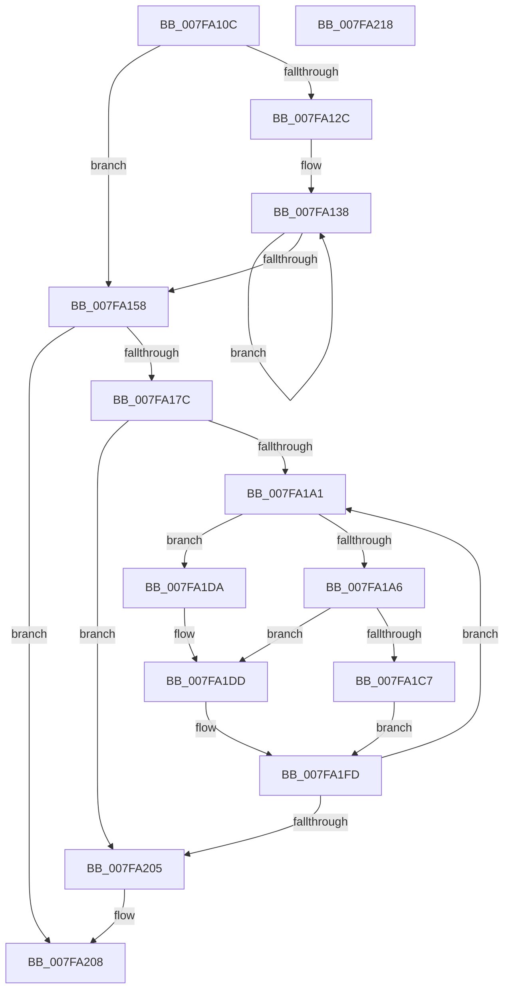

# MiConvertInitialMemoryBlock

- RVA: `0x007FA10C`–`0x007FA219` (길이 `269` bytes)
- VA: `0x00000001407FA10C`
- 실행 섹션: `PAGE`
- PDB 이름 있음: `예`; PDB Function 태그: `아니요`
- unwind 정보 RVA: `0x00060BC4`
- 디코드: `76`개 명령, `269/269` bytes 표시
- 미해석 바이트: `0` (있으면 어셈블리에 `.byte`로 보존)

> 이 문서는 커널 이미지의 기계어와 PDB 기호를 분석해 생성했습니다. 4번과 5번은 함수 원형과 자료형을 바이너리 사용 방식에서 추정한 C 해석이며 원본 소스 복구 결과는 아닙니다.

## 1. Dependencies

- 직접 호출 지점: **1**; 고유 호출 대상: **1**
- 직접 호출자로 확인된 함수: **2**
- RIP 상대 이미지 참조: **0**

### Outgoing calls
- `0x007FA16E` → [MiAllocatePool](../../text/35/MiAllocatePool_function_0035B540.md) (function, `0x0035B540`)

### Direct callers
- [MiMakePartitionMemoryBlock](../80/MiMakePartitionMemoryBlock_function_0080D94C.md) at `0x0080DADE`
- [MiInitializePhysicalMemoryBlocks](../../init/C6/MiInitializePhysicalMemoryBlocks_function_00C60920.md) at `0x00C60996`

### Static image references
- 디코드된 RIP-relative 메모리 참조가 없습니다.

## 2. Other-region calls and transfers

- 다른 실행 섹션으로 향하는 call: **1**
  - `0x007FA16E` → [MiAllocatePool](../../text/35/MiAllocatePool_function_0035B540.md) (`PAGE` → `.text`)
- 별도 외부 분기/꼬리 이동을 확인하지 못했습니다.

## 3. Assembly (complete function range)

```asm
007FA10C  48 89 5C 24 08                  mov qword ptr [rsp + 8], rbx
007FA111  48 89 74 24 10                  mov qword ptr [rsp + 0x10], rsi
007FA116  57                              push rdi
007FA117  48 83 EC 20                     sub rsp, 0x20
007FA11B  8B 02                           mov eax, dword ptr [rdx]
007FA11D  BF 01 00 00 00                  mov edi, 1
007FA122  48 8B DA                        mov rbx, rdx
007FA125  48 8B F1                        mov rsi, rcx
007FA128  3B C7                           cmp eax, edi
007FA12A  76 2C                           jbe 0x1407fa158
007FA12C  4C 8D 4A 20                     lea r9, [rdx + 0x20]
007FA130  4C 8D 42 10                     lea r8, [rdx + 0x10]
007FA134  44 8D 50 FF                     lea r10d, [rax - 1]
007FA138  49 8B 50 08                     mov rdx, qword ptr [r8 + 8]
007FA13C  8D 4F 01                        lea ecx, [rdi + 1]
007FA13F  49 03 10                        add rdx, qword ptr [r8]
007FA142  4D 8D 40 10                     lea r8, [r8 + 0x10]
007FA146  49 39 11                        cmp qword ptr [r9], rdx
007FA149  4D 8D 49 10                     lea r9, [r9 + 0x10]
007FA14D  0F 44 CF                        cmove ecx, edi
007FA150  8B F9                           mov edi, ecx
007FA152  49 83 EA 01                     sub r10, 1
007FA156  75 E0                           jne 0x1407fa138
007FA158  8D 57 FF                        lea edx, [rdi - 1]
007FA15B  B9 40 00 00 00                  mov ecx, 0x40
007FA160  48 83 C2 03                     add rdx, 3
007FA164  41 B8 4D 6D 4D 6C               mov r8d, 0x6c4d6d4d
007FA16A  48 C1 E2 04                     shl rdx, 4
007FA16E  E8 CD 13 B6 FF                  call 0x14035b540
007FA173  48 85 C0                        test rax, rax
007FA176  0F 84 8C 00 00 00               je 0x1407fa208
007FA17C  4C 8D 40 10                     lea r8, [rax + 0x10]
007FA180  48 C7 40 08 01 00 00 00         mov qword ptr [rax + 8], 1
007FA188  41 89 38                        mov dword ptr [r8], edi
007FA18B  45 33 DB                        xor r11d, r11d
007FA18E  48 89 30                        mov qword ptr [rax], rsi
007FA191  45 33 C9                        xor r9d, r9d
007FA194  48 8B 43 08                     mov rax, qword ptr [rbx + 8]
007FA198  49 89 40 08                     mov qword ptr [r8 + 8], rax
007FA19C  44 39 0B                        cmp dword ptr [rbx], r9d
007FA19F  76 64                           jbe 0x1407fa205
007FA1A1  45 85 C9                        test r9d, r9d
007FA1A4  74 34                           je 0x1407fa1da
007FA1A6  41 8D 49 FF                     lea ecx, [r9 - 1]
007FA1AA  41 8B D1                        mov edx, r9d
007FA1AD  48 03 C9                        add rcx, rcx
007FA1B0  45 8B D1                        mov r10d, r9d
007FA1B3  48 03 D2                        add rdx, rdx
007FA1B6  48 8B 44 CB 18                  mov rax, qword ptr [rbx + rcx*8 + 0x18]
007FA1BB  48 03 44 CB 10                  add rax, qword ptr [rbx + rcx*8 + 0x10]
007FA1C0  48 39 44 D3 10                  cmp qword ptr [rbx + rdx*8 + 0x10], rax
007FA1C5  75 16                           jne 0x1407fa1dd
007FA1C7  48 8B 44 D3 18                  mov rax, qword ptr [rbx + rdx*8 + 0x18]
007FA1CC  41 8D 4B FF                     lea ecx, [r11 - 1]
007FA1D0  48 03 C9                        add rcx, rcx
007FA1D3  49 01 44 C8 18                  add qword ptr [r8 + rcx*8 + 0x18], rax
007FA1D8  EB 23                           jmp 0x1407fa1fd
007FA1DA  45 33 D2                        xor r10d, r10d
007FA1DD  4D 03 D2                        add r10, r10
007FA1E0  41 8B D3                        mov edx, r11d
007FA1E3  48 03 D2                        add rdx, rdx
007FA1E6  41 FF C3                        inc r11d
007FA1E9  4A 8B 4C D3 10                  mov rcx, qword ptr [rbx + r10*8 + 0x10]
007FA1EE  49 89 4C D0 10                  mov qword ptr [r8 + rdx*8 + 0x10], rcx
007FA1F3  4A 8B 4C D3 18                  mov rcx, qword ptr [rbx + r10*8 + 0x18]
007FA1F8  49 89 4C D0 18                  mov qword ptr [r8 + rdx*8 + 0x18], rcx
007FA1FD  41 FF C1                        inc r9d
007FA200  44 3B 0B                        cmp r9d, dword ptr [rbx]
007FA203  72 9C                           jb 0x1407fa1a1
007FA205  49 8B C0                        mov rax, r8
007FA208  48 8B 5C 24 30                  mov rbx, qword ptr [rsp + 0x30]
007FA20D  48 8B 74 24 38                  mov rsi, qword ptr [rsp + 0x38]
007FA212  48 83 C4 20                     add rsp, 0x20
007FA216  5F                              pop rdi
007FA217  C3                              ret
007FA218  CC                              int3
```

## 4. C-style interpretation (structured pseudocode)

```c
__int64 __fastcall MiConvertInitialMemoryBlock(__int64 a1, __int64 a2)
{
    __int64 result;
    __int64 v_r10;
    __int64 v_r11;
    __int64 v_rsp;
    unsigned __int64 v_stack_p10;
    unsigned __int64 v_stack_p8;

    v_stack_p8 = v_rbx;
    v_stack_p10 = v_rsi;
    v_rsp = (v_rsp) - (32);
    if (((unsigned int)((unsigned int)(*(unsigned int *)(a2)))) <= 1) goto loc_007FA158;
loc_007FA138:
    a2 = (*(unsigned __int64 *)(a2 + 16 + 8)) + (*(unsigned __int64 *)(a2 + 16));
    a1 = 1 + 1;
    if ((*(unsigned __int64 *)(a2 + 32)) == a2) { a1 = 1; }
    v_r10 = ((unsigned int)(*(unsigned int *)(a2)) - 1) - (1);
    if (condition_is_not_equal) goto loc_007FA138;
loc_007FA158:
    a2 = ((unsigned int)((unsigned int)(a1)) - 1) + (3);
    a2 = (a2) << (4);
    result = MiAllocatePool(64, a2, (unsigned int)(0x6C4D6D4DULL), a2 + 32 + 16);
    if (result == 0) goto loc_007FA208;
    *(unsigned __int64 *)(result + 8) = 1;
    *(unsigned int *)(result + 16) = (unsigned int)((unsigned int)((unsigned int)(a1)));
    v_r11 = 0;
    *(unsigned __int64 *)(result) = a1;
    a4 = 0;
    *(unsigned __int64 *)(result + 16 + 8) = *(unsigned __int64 *)(a2 + 8);
    if ((*(unsigned int *)(a2)) <= 0) goto loc_007FA205;
loc_007FA1A1:
    if (0 == 0) goto loc_007FA1DA;
    a1 = (a4 - 1) + (a4 - 1);
    a2 = (0) + (0);
    result = (*(unsigned __int64 *)(a2 + a1 * 8 + 24)) + (*(unsigned __int64 *)(a2 + a1 * 8 + 16));
    if ((*(unsigned __int64 *)(a2 + a2 * 8 + 16)) != result) goto loc_007FA1DD;
    a1 = (v_r11 - 1) + (v_r11 - 1);
    goto loc_007FA1FD;
loc_007FA1DA:
    v_r10 = 0;
loc_007FA1DD:
    v_r10 = (v_r10) + (0);
    a2 = (0) + (0);
    v_r11 = (unsigned int)((v_r11) + 1);
    *(unsigned __int64 *)(result + 16 + a2 * 8 + 16) = *(unsigned __int64 *)(a2 + v_r10 * 8 + 16);
    *(unsigned __int64 *)(result + 16 + a2 * 8 + 24) = *(unsigned __int64 *)(a2 + v_r10 * 8 + 24);
loc_007FA1FD:
    a4 = (unsigned int)((a4) + 1);
    if (((unsigned int)(a4)) < (*(unsigned int *)(a2))) goto loc_007FA1A1;
loc_007FA205:
loc_007FA208:
    v_rsp = (v_rsp) + (32);
    return result + 16;
}
```

## 5. (Beta) C Style

```c
int64_t MiConvertInitialMemoryBlock(int64_t Arg1, void *Arg2)
{
    uint8_t *arg2 = (uint8_t *)Arg2;

    int64_t result;
    int64_t local_r10;
    int64_t local_r11;
    int64_t local_rsp;
    uint64_t v_stack_p10;
    uint64_t v_stack_p8;

    v_stack_p8 = local_rbx;
    v_stack_p10 = local_rsi;
    local_rsp = (local_rsp) - (32);
    if (((uint32_t)((uint32_t)(*(uint32_t *)(arg2)))) <= 1) goto loc_007FA158;
loc_007FA138:
    Arg2 = (*(uint64_t *)(arg2 + 0x10 + 0x8)) + (*(uint64_t *)(arg2 + 0x10));
    Arg1 = 1 + 1;
    if ((*(uint64_t *)(arg2 + 0x20)) == Arg2) { Arg1 = 1; }
    local_r10 = ((uint32_t)(*(uint32_t *)(arg2)) - 1) - (1);
    if (condition_is_not_equal) goto loc_007FA138;
loc_007FA158:
    Arg2 = ((uint32_t)((uint32_t)(Arg1)) - 1) + (3);
    Arg2 = (Arg2) << (4);
    result = MiAllocatePool(64, Arg2, (uint32_t)(0x6C4D6D4DULL), Arg2 + 32 + 16);
    if (result == 0) goto loc_007FA208;
    *(uint64_t *)(result + 0x8) = 1;
    *(uint32_t *)(result + 0x10) = (uint32_t)((uint32_t)((uint32_t)(Arg1)));
    local_r11 = 0;
    *(uint64_t *)(result) = Arg1;
    a4 = 0;
    *(uint64_t *)(result + 0x10 + 0x8) = *(uint64_t *)(arg2 + 0x8);
    if ((*(uint32_t *)(arg2)) <= 0) goto loc_007FA205;
loc_007FA1A1:
    if (0 == 0) goto loc_007FA1DA;
    Arg1 = (a4 - 1) + (a4 - 1);
    Arg2 = (0) + (0);
    result = (*(uint64_t *)(arg2 + Arg1 * 8 + 0x18)) + (*(uint64_t *)(arg2 + Arg1 * 8 + 0x10));
    if ((*(uint64_t *)(arg2 + arg2 * 8 + 0x10)) != result) goto loc_007FA1DD;
    Arg1 = (local_r11 - 1) + (local_r11 - 1);
    goto loc_007FA1FD;
loc_007FA1DA:
    local_r10 = 0;
loc_007FA1DD:
    local_r10 = (local_r10) + (0);
    Arg2 = (0) + (0);
    local_r11 = (uint32_t)((local_r11) + 1);
    *(uint64_t *)(result + 0x10 + arg2 * 8 + 0x10) = *(uint64_t *)(arg2 + local_r10 * 8 + 0x10);
    *(uint64_t *)(result + 0x10 + arg2 * 8 + 0x18) = *(uint64_t *)(arg2 + local_r10 * 8 + 0x18);
loc_007FA1FD:
    a4 = (uint32_t)((a4) + 1);
    if (((uint32_t)(a4)) < (*(uint32_t *)(arg2))) goto loc_007FA1A1;
loc_007FA205:
loc_007FA208:
    local_rsp = (local_rsp) + (32);
    return result + 16;
}
```

### 관측된 메모리 오프셋

구조체 형식이 확인되지 않은 접근은 인자 기준의 오프셋으로만 기록했습니다.

| 기준 인자 | 오프셋 표현 | 폭 (bit) | 접근 |
|---|---:|---:|---|
| `Arg2` | `+ 0x0` | `32` | `R` |
| `Arg2` | `+ 0x0` | `64` | `R` |
| `Arg2` | `+ 0x8` | `64` | `R` |
| `Arg2` | `+ 0x10` | `64` | `R` |
| `Arg2` | `+ 0x10 + r10*8` | `64` | `R` |
| `Arg2` | `+ 0x10 + rcx*8` | `64` | `R` |
| `Arg2` | `+ 0x10 + rdx*8` | `64` | `R` |
| `Arg2` | `+ 0x18 + r10*8` | `64` | `R` |
| `Arg2` | `+ 0x18 + rcx*8` | `64` | `R` |
| `Arg2` | `+ 0x18 + rdx*8` | `64` | `R` |
| `Arg2` | `+ 0x20` | `64` | `R` |

## 6. Execution-region graph

[열기: 2D/3D 그래프와 함수 탐색 컨트롤 패널](../../../control-panel.html?section=page&rva=0x007FA10C&view=graph)

- 2D 그래프는 위에서 아래로 흐르고, 3D 그래프는 빈 공간을 드래그해 회전합니다. Shift+드래그는 이동, 휠은 확대·축소, 함수 노드 선택은 대상 보고서 이동입니다.

### Static fallback


