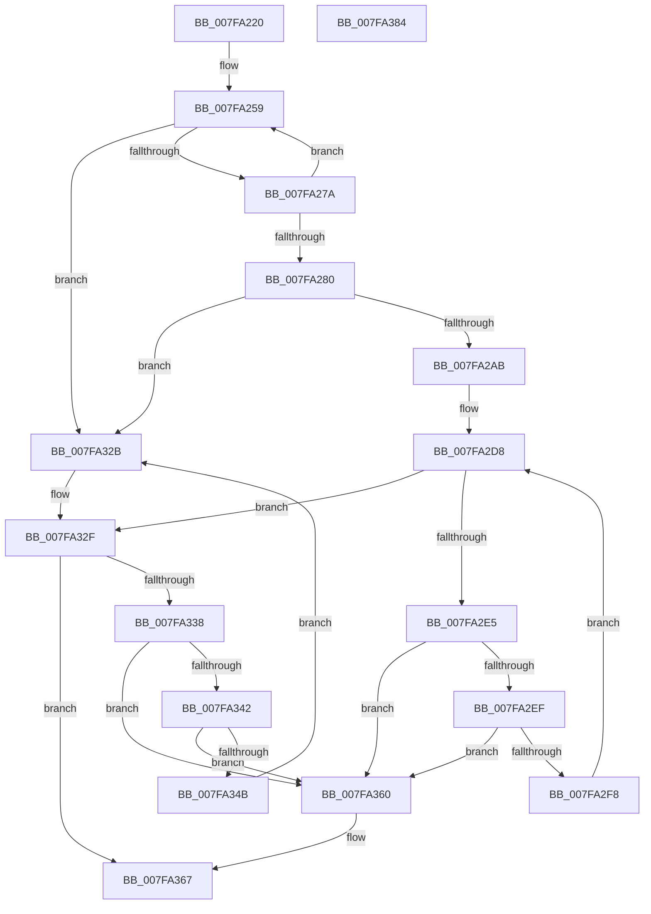

# MiCreateNodeLists

- RVA: `0x007FA220`–`0x007FA385` (길이 `357` bytes)
- VA: `0x00000001407FA220`
- 실행 섹션: `PAGE`
- PDB 이름 있음: `예`; PDB Function 태그: `아니요`
- unwind 정보 RVA: `0x000D7AD0`
- 디코드: `101`개 명령, `357/357` bytes 표시
- 미해석 바이트: `0` (있으면 어셈블리에 `.byte`로 보존)

> 이 문서는 커널 이미지의 기계어와 PDB 기호를 분석해 생성했습니다. 4번과 5번은 함수 원형과 자료형을 바이너리 사용 방식에서 추정한 C 해석이며 원본 소스 복구 결과는 아닙니다.

## 1. Dependencies

- 직접 호출 지점: **4**; 고유 호출 대상: **3**
- 직접 호출자로 확인된 함수: **2**
- RIP 상대 이미지 참조: **0**

### Outgoing calls
- `0x007FA26D` → [MiDescribePageRun](MiDescribePageRun_function_007FA38C.md) (function, `0x007FA38C`)
- `0x007FA29D` → [MiAllocatePool](../../text/35/MiAllocatePool_function_0035B540.md) (function, `0x0035B540`)
- `0x007FA324` → [ExFreePoolWithTag](../../poolcode/B8/ExFreePoolWithTag_function_00B82870.md) (function, `0x00B82870`)
- `0x007FA359` → [ExFreePoolWithTag](../../poolcode/B8/ExFreePoolWithTag_function_00B82870.md) (function, `0x00B82870`)

### Direct callers
- [MiMakePartitionMemoryBlock](../80/MiMakePartitionMemoryBlock_function_0080D94C.md) at `0x0080DAFF`
- [MiInitializePhysicalMemoryBlocks](../../init/C6/MiInitializePhysicalMemoryBlocks_function_00C60920.md) at `0x00C609B2`

### Static image references
- 디코드된 RIP-relative 메모리 참조가 없습니다.

## 2. Other-region calls and transfers

- 다른 실행 섹션으로 향하는 call: **3**
  - `0x007FA29D` → [MiAllocatePool](../../text/35/MiAllocatePool_function_0035B540.md) (`PAGE` → `.text`)
  - `0x007FA324` → [ExFreePoolWithTag](../../poolcode/B8/ExFreePoolWithTag_function_00B82870.md) (`PAGE` → `POOLCODE`)
  - `0x007FA359` → [ExFreePoolWithTag](../../poolcode/B8/ExFreePoolWithTag_function_00B82870.md) (`PAGE` → `POOLCODE`)
- 별도 외부 분기/꼬리 이동을 확인하지 못했습니다.

## 3. Assembly (complete function range)

```asm
007FA220  48 8B C4                        mov rax, rsp
007FA223  48 89 58 08                     mov qword ptr [rax + 8], rbx
007FA227  48 89 70 10                     mov qword ptr [rax + 0x10], rsi
007FA22B  48 89 78 18                     mov qword ptr [rax + 0x18], rdi
007FA22F  4C 89 70 20                     mov qword ptr [rax + 0x20], r14
007FA233  55                              push rbp
007FA234  48 8B EC                        mov rbp, rsp
007FA237  48 83 EC 40                     sub rsp, 0x40
007FA23B  48 8D 45 E0                     lea rax, [rbp - 0x20]
007FA23F  33 DB                           xor ebx, ebx
007FA241  48 89 45 E8                     mov qword ptr [rbp - 0x18], rax
007FA245  48 8B F2                        mov rsi, rdx
007FA248  48 8D 45 E0                     lea rax, [rbp - 0x20]
007FA24C  48 89 5D F0                     mov qword ptr [rbp - 0x10], rbx
007FA250  48 89 45 E0                     mov qword ptr [rbp - 0x20], rax
007FA254  4C 8B F1                        mov r14, rcx
007FA257  8B FB                           mov edi, ebx
007FA259  44 8B C7                        mov r8d, edi
007FA25C  48 8D 4D E0                     lea rcx, [rbp - 0x20]
007FA260  4D 03 C0                        add r8, r8
007FA263  4A 8B 54 C6 10                  mov rdx, qword ptr [rsi + r8*8 + 0x10]
007FA268  4E 8B 44 C6 18                  mov r8, qword ptr [rsi + r8*8 + 0x18]
007FA26D  E8 1A 01 00 00                  call 0x1407fa38c
007FA272  85 C0                           test eax, eax
007FA274  0F 88 B1 00 00 00               js 0x1407fa32b
007FA27A  FF C7                           inc edi
007FA27C  3B 3E                           cmp edi, dword ptr [rsi]
007FA27E  75 D9                           jne 0x1407fa259
007FA280  8B 55 F0                        mov edx, dword ptr [rbp - 0x10]
007FA283  41 B8 4D 6D 4D 6C               mov r8d, 0x6c4d6d4d
007FA289  8D 4A FF                        lea ecx, [rdx - 1]
007FA28C  48 8D 42 06                     lea rax, [rdx + 6]
007FA290  48 8D 14 48                     lea rdx, [rax + rcx*2]
007FA294  B9 40 00 00 00                  mov ecx, 0x40
007FA299  48 C1 E2 03                     shl rdx, 3
007FA29D  E8 9E 12 B6 FF                  call 0x14035b540
007FA2A2  48 85 C0                        test rax, rax
007FA2A5  0F 84 80 00 00 00               je 0x1407fa32b
007FA2AB  48 8D 58 10                     lea rbx, [rax + 0x10]
007FA2AF  48 C7 40 08 01 00 00 00         mov qword ptr [rax + 8], 1
007FA2B7  4C 89 30                        mov qword ptr [rax], r14
007FA2BA  8B 45 F0                        mov eax, dword ptr [rbp - 0x10]
007FA2BD  89 03                           mov dword ptr [rbx], eax
007FA2BF  8B 7D F0                        mov edi, dword ptr [rbp - 0x10]
007FA2C2  48 8B 46 08                     mov rax, qword ptr [rsi + 8]
007FA2C6  48 FF C7                        inc rdi
007FA2C9  48 C1 E7 04                     shl rdi, 4
007FA2CD  48 8D 73 10                     lea rsi, [rbx + 0x10]
007FA2D1  48 03 FB                        add rdi, rbx
007FA2D4  48 89 43 08                     mov qword ptr [rbx + 8], rax
007FA2D8  48 8B 4D E0                     mov rcx, qword ptr [rbp - 0x20]
007FA2DC  48 8D 45 E0                     lea rax, [rbp - 0x20]
007FA2E0  48 3B C8                        cmp rcx, rax
007FA2E3  74 4A                           je 0x1407fa32f
007FA2E5  48 8D 45 E0                     lea rax, [rbp - 0x20]
007FA2E9  48 39 41 08                     cmp qword ptr [rcx + 8], rax
007FA2ED  75 71                           jne 0x1407fa360
007FA2EF  48 8B 01                        mov rax, qword ptr [rcx]
007FA2F2  48 39 48 08                     cmp qword ptr [rax + 8], rcx
007FA2F6  75 68                           jne 0x1407fa360
007FA2F8  48 89 45 E0                     mov qword ptr [rbp - 0x20], rax
007FA2FC  48 8D 55 E0                     lea rdx, [rbp - 0x20]
007FA300  48 89 50 08                     mov qword ptr [rax + 8], rdx
007FA304  33 D2                           xor edx, edx
007FA306  48 8B 41 10                     mov rax, qword ptr [rcx + 0x10]
007FA30A  48 89 06                        mov qword ptr [rsi], rax
007FA30D  48 8B 41 18                     mov rax, qword ptr [rcx + 0x18]
007FA311  48 89 46 08                     mov qword ptr [rsi + 8], rax
007FA315  48 83 C6 10                     add rsi, 0x10
007FA319  48 8B 41 20                     mov rax, qword ptr [rcx + 0x20]
007FA31D  48 89 07                        mov qword ptr [rdi], rax
007FA320  48 83 C7 08                     add rdi, 8
007FA324  E8 47 85 38 00                  call 0x140b82870
007FA329  EB AD                           jmp 0x1407fa2d8
007FA32B  48 8B 4D E0                     mov rcx, qword ptr [rbp - 0x20]
007FA32F  48 8D 45 E0                     lea rax, [rbp - 0x20]
007FA333  48 3B C8                        cmp rcx, rax
007FA336  74 2F                           je 0x1407fa367
007FA338  48 8D 45 E0                     lea rax, [rbp - 0x20]
007FA33C  48 39 41 08                     cmp qword ptr [rcx + 8], rax
007FA340  75 1E                           jne 0x1407fa360
007FA342  48 8B 01                        mov rax, qword ptr [rcx]
007FA345  48 39 48 08                     cmp qword ptr [rax + 8], rcx
007FA349  75 15                           jne 0x1407fa360
007FA34B  48 8D 55 E0                     lea rdx, [rbp - 0x20]
007FA34F  48 89 45 E0                     mov qword ptr [rbp - 0x20], rax
007FA353  48 89 50 08                     mov qword ptr [rax + 8], rdx
007FA357  33 D2                           xor edx, edx
007FA359  E8 12 85 38 00                  call 0x140b82870
007FA35E  EB CB                           jmp 0x1407fa32b
007FA360  B9 03 00 00 00                  mov ecx, 3
007FA365  CD 29                           int 0x29
007FA367  48 8B 74 24 58                  mov rsi, qword ptr [rsp + 0x58]
007FA36C  48 8B C3                        mov rax, rbx
007FA36F  48 8B 5C 24 50                  mov rbx, qword ptr [rsp + 0x50]
007FA374  48 8B 7C 24 60                  mov rdi, qword ptr [rsp + 0x60]
007FA379  4C 8B 74 24 68                  mov r14, qword ptr [rsp + 0x68]
007FA37E  48 83 C4 40                     add rsp, 0x40
007FA382  5D                              pop rbp
007FA383  C3                              ret
007FA384  CC                              int3
```

## 4. C-style interpretation (structured pseudocode)

```c
__int64 __fastcall MiCreateNodeLists(__int64 a1, __int64 a2)
{
    __int64 result;
    __int64 v_rbx;
    __int64 v_rdi;
    __int64 v_rsi;
    __int64 v_rsp;
    unsigned __int64 v_stack_m18;
    unsigned __int64 v_stack_m20;
    unsigned __int64 v_stack_m28;
    unsigned __int64 v_stack_p10;
    unsigned __int64 v_stack_p18;
    unsigned __int64 v_stack_p20;
    unsigned __int64 v_stack_p8;

    *(unsigned __int64 *)(v_rsp + 8) = v_rbx;
    *(unsigned __int64 *)(v_rsp + 16) = v_rsi;
    *(unsigned __int64 *)(v_rsp + 24) = v_rdi;
    *(unsigned __int64 *)(v_rsp + 32) = v_r14;
    v_rsp = (v_rsp) - (64);
    v_rbx = 0;
    v_stack_m20 = v_stack_m28;
    v_stack_m18 = 0;
    v_stack_m28 = v_stack_m28;
loc_007FA259:
    a3 = (0) + (0);
    result = MiDescribePageRun(v_stack_m28, *(unsigned __int64 *)(a2 + a3 * 8 + 16), *(unsigned __int64 *)(a2 + a3 * 8 + 24), a4);
    if (sign_flag) goto loc_007FA32B;
    v_rdi = (unsigned int)((0) + 1);
    if (((unsigned int)(v_rdi)) != (*(unsigned int *)(a2))) goto loc_007FA259;
    a2 = ((unsigned int)(v_stack_m18) + 6 + (unsigned int)(v_stack_m18) - 1 * 2) << (3);
    result = MiAllocatePool(64, a2, (unsigned int)(0x6C4D6D4DULL), a4);
    if (result == 0) goto loc_007FA32B;
    *(unsigned __int64 *)(result + 8) = 1;
    *(unsigned __int64 *)(result) = a1;
    *(unsigned int *)(result + 16) = (unsigned int)((unsigned int)(v_stack_m18));
    v_rdi = ((unsigned int)(v_stack_m18)) + 1;
    v_rdi = (v_rdi) << (4);
    v_rdi = (v_rdi) + (result + 16);
    *(unsigned __int64 *)(result + 16 + 8) = *(unsigned __int64 *)(a2 + 8);
loc_007FA2D8:
    if (v_stack_m28 == v_stack_m28) goto loc_007FA32F;
    if ((*(unsigned __int64 *)(v_stack_m28 + 8)) != v_stack_m28) goto loc_007FA360;
    if ((*(unsigned __int64 *)(*(unsigned __int64 *)(v_stack_m28) + 8)) != v_stack_m28) goto loc_007FA360;
    v_stack_m28 = *(unsigned __int64 *)(v_stack_m28);
    *(unsigned __int64 *)(*(unsigned __int64 *)(v_stack_m28) + 8) = v_stack_m28;
    a2 = 0;
    *(unsigned __int64 *)(result + 16 + 16) = *(unsigned __int64 *)(v_stack_m28 + 16);
    *(unsigned __int64 *)(result + 16 + 16 + 8) = *(unsigned __int64 *)(v_stack_m28 + 24);
    v_rsi = (result + 16 + 16) + (16);
    *(unsigned __int64 *)(v_rdi) = *(unsigned __int64 *)(v_stack_m28 + 32);
    v_rdi = (v_rdi) + (8);
    result = ExFreePoolWithTag(v_stack_m28, a2, (unsigned int)(0x6C4D6D4DULL), a4);
    goto loc_007FA2D8;
loc_007FA32B:
loc_007FA32F:
    if (v_stack_m28 == v_stack_m28) goto loc_007FA367;
    if ((*(unsigned __int64 *)(v_stack_m28 + 8)) != v_stack_m28) goto loc_007FA360;
    if ((*(unsigned __int64 *)(*(unsigned __int64 *)(v_stack_m28) + 8)) != v_stack_m28) goto loc_007FA360;
    v_stack_m28 = *(unsigned __int64 *)(v_stack_m28);
    *(unsigned __int64 *)(*(unsigned __int64 *)(v_stack_m28) + 8) = v_stack_m28;
    a2 = 0;
    result = ExFreePoolWithTag(v_stack_m28, a2, (unsigned int)(0x6C4D6D4DULL), a4);
    goto loc_007FA32B;
loc_007FA360:
loc_007FA367:
    v_rsp = (v_rsp) + (64);
    return result + 16;
}
```

## 5. (Beta) C Style

```c
int64_t MiCreateNodeLists(int64_t Arg1, void *Arg2)
{
    uint8_t *arg2 = (uint8_t *)Arg2;

    int64_t result;
    int64_t local_rbx;
    int64_t local_rdi;
    int64_t local_rsi;
    int64_t local_rsp;
    uint64_t v_stack_m18;
    uint64_t v_stack_m20;
    uint64_t v_stack_m28;
    uint64_t v_stack_p10;
    uint64_t v_stack_p18;
    uint64_t v_stack_p20;
    uint64_t v_stack_p8;

    *(uint64_t *)(local_rsp + 0x8) = local_rbx;
    *(uint64_t *)(local_rsp + 0x10) = local_rsi;
    *(uint64_t *)(local_rsp + 0x18) = local_rdi;
    *(uint64_t *)(local_rsp + 0x20) = local_r14;
    local_rsp = (local_rsp) - (64);
    local_rbx = 0;
    v_stack_m20 = v_stack_m28;
    v_stack_m18 = 0;
    v_stack_m28 = v_stack_m28;
loc_007FA259:
    a3 = (0) + (0);
    result = MiDescribePageRun(v_stack_m28, *(uint64_t *)(arg2 + a3 * 8 + 0x10), *(uint64_t *)(arg2 + a3 * 8 + 0x18), a4);
    if (sign_flag) goto loc_007FA32B;
    local_rdi = (uint32_t)((0) + 1);
    if (((uint32_t)(local_rdi)) != (*(uint32_t *)(arg2))) goto loc_007FA259;
    Arg2 = ((uint32_t)(v_stack_m18) + 6 + (uint32_t)(v_stack_m18) - 1 * 2) << (3);
    result = MiAllocatePool(64, Arg2, (uint32_t)(0x6C4D6D4DULL), a4);
    if (result == 0) goto loc_007FA32B;
    *(uint64_t *)(result + 0x8) = 1;
    *(uint64_t *)(result) = Arg1;
    *(uint32_t *)(result + 0x10) = (uint32_t)((uint32_t)(v_stack_m18));
    local_rdi = ((uint32_t)(v_stack_m18)) + 1;
    local_rdi = (local_rdi) << (4);
    local_rdi = (local_rdi) + (result + 16);
    *(uint64_t *)(result + 0x10 + 0x8) = *(uint64_t *)(arg2 + 0x8);
loc_007FA2D8:
    if (v_stack_m28 == v_stack_m28) goto loc_007FA32F;
    if ((*(uint64_t *)(v_stack_m28 + 0x8)) != v_stack_m28) goto loc_007FA360;
    if ((*(uint64_t *)(*(uint64_t *)(v_stack_m28) + 0x8)) != v_stack_m28) goto loc_007FA360;
    v_stack_m28 = *(uint64_t *)(v_stack_m28);
    *(uint64_t *)(*(uint64_t *)(v_stack_m28) + 0x8) = v_stack_m28;
    Arg2 = 0;
    *(uint64_t *)(result + 0x10 + 0x10) = *(uint64_t *)(v_stack_m28 + 0x10);
    *(uint64_t *)(result + 0x10 + 0x10 + 0x8) = *(uint64_t *)(v_stack_m28 + 0x18);
    local_rsi = (result + 16 + 16) + (16);
    *(uint64_t *)(local_rdi) = *(uint64_t *)(v_stack_m28 + 0x20);
    local_rdi = (local_rdi) + (8);
    result = ExFreePoolWithTag(v_stack_m28, Arg2, (uint32_t)(0x6C4D6D4DULL), a4);
    goto loc_007FA2D8;
loc_007FA32B:
loc_007FA32F:
    if (v_stack_m28 == v_stack_m28) goto loc_007FA367;
    if ((*(uint64_t *)(v_stack_m28 + 0x8)) != v_stack_m28) goto loc_007FA360;
    if ((*(uint64_t *)(*(uint64_t *)(v_stack_m28) + 0x8)) != v_stack_m28) goto loc_007FA360;
    v_stack_m28 = *(uint64_t *)(v_stack_m28);
    *(uint64_t *)(*(uint64_t *)(v_stack_m28) + 0x8) = v_stack_m28;
    Arg2 = 0;
    result = ExFreePoolWithTag(v_stack_m28, Arg2, (uint32_t)(0x6C4D6D4DULL), a4);
    goto loc_007FA32B;
loc_007FA360:
loc_007FA367:
    local_rsp = (local_rsp) + (64);
    return result + 16;
}
```

### 관측된 메모리 오프셋

구조체 형식이 확인되지 않은 접근은 인자 기준의 오프셋으로만 기록했습니다.

| 기준 인자 | 오프셋 표현 | 폭 (bit) | 접근 |
|---|---:|---:|---|
| `Arg2` | `+ 0x0` | `32` | `R` |
| `Arg2` | `+ 0x8` | `64` | `R` |
| `Arg2` | `+ 0x10 + r8*8` | `64` | `R` |
| `Arg2` | `+ 0x18 + r8*8` | `64` | `R` |

## 6. Execution-region graph

[열기: 2D/3D 그래프와 함수 탐색 컨트롤 패널](../../../control-panel.html?section=page&rva=0x007FA220&view=graph)

- 2D 그래프는 위에서 아래로 흐르고, 3D 그래프는 빈 공간을 드래그해 회전합니다. Shift+드래그는 이동, 휠은 확대·축소, 함수 노드 선택은 대상 보고서 이동입니다.

### Static fallback


