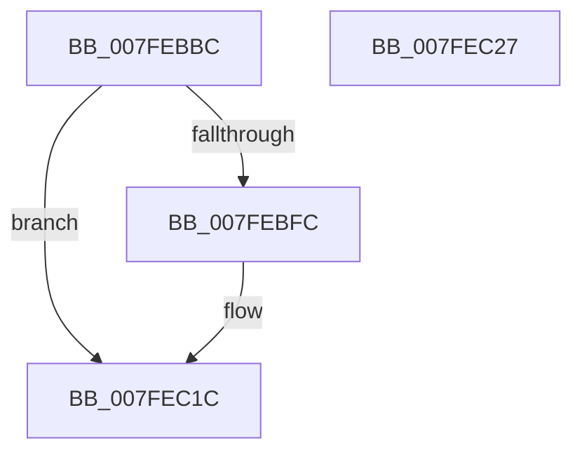

# MiCreatePageFileSpaceBitmaps

- RVA: `0x007FEBBC`–`0x007FEC28` (길이 `108` bytes)
- VA: `0x00000001407FEBBC`
- 실행 섹션: `PAGE`
- PDB 이름 있음: `예`; PDB Function 태그: `아니요`
- unwind 정보 RVA: `0x0005CAAC`
- 디코드: `32`개 명령, `108/108` bytes 표시
- 미해석 바이트: `0` (있으면 어셈블리에 `.byte`로 보존)

> 이 문서는 커널 이미지의 기계어와 PDB 기호를 분석해 생성했습니다. 4번과 5번은 함수 원형과 자료형을 바이너리 사용 방식에서 추정한 C 해석이며 원본 소스 복구 결과는 아닙니다.

## 1. Dependencies

- 직접 호출 지점: **1**; 고유 호출 대상: **1**
- 직접 호출자로 확인된 함수: **2**
- RIP 상대 이미지 참조: **0**

### Outgoing calls
- `0x007FEBEF` → [MiAllocatePool](../../text/35/MiAllocatePool_function_0035B540.md) (function, `0x0035B540`)

### Direct callers
- [MiAttemptChangePagingFileMaximum](../../text/67/MiAttemptChangePagingFileMaximum_function_0067FE7C.md) at `0x0067FEB3`
- [MiCreatePagefile](MiCreatePagefile_function_007FEC30.md) at `0x007FEF1E`

### Static image references
- 디코드된 RIP-relative 메모리 참조가 없습니다.

## 2. Other-region calls and transfers

- 다른 실행 섹션으로 향하는 call: **1**
  - `0x007FEBEF` → [MiAllocatePool](../../text/35/MiAllocatePool_function_0035B540.md) (`PAGE` → `.text`)
- 별도 외부 분기/꼬리 이동을 확인하지 못했습니다.

## 3. Assembly (complete function range)

```asm
007FEBBC  48 89 5C 24 08                  mov qword ptr [rsp + 8], rbx
007FEBC1  57                              push rdi
007FEBC2  48 83 EC 20                     sub rsp, 0x20
007FEBC6  F6 C1 3F                        test cl, 0x3f
007FEBC9  8B C1                           mov eax, ecx
007FEBCB  BB 00 00 00 00                  mov ebx, 0
007FEBD0  8B F9                           mov edi, ecx
007FEBD2  0F 95 C3                        setne bl
007FEBD5  B9 40 00 00 00                  mov ecx, 0x40
007FEBDA  C1 E8 06                        shr eax, 6
007FEBDD  41 B8 4D 6D 50 62               mov r8d, 0x62506d4d
007FEBE3  03 D8                           add ebx, eax
007FEBE5  C1 E3 03                        shl ebx, 3
007FEBE8  8D 14 5D 28 00 00 00            lea edx, [rbx*2 + 0x28]
007FEBEF  E8 4C C9 B5 FF                  call 0x14035b540
007FEBF4  48 8B D0                        mov rdx, rax
007FEBF7  48 85 C0                        test rax, rax
007FEBFA  74 20                           je 0x1407fec1c
007FEBFC  C7 00 01 00 00 00               mov dword ptr [rax], 1
007FEC02  48 8D 48 28                     lea rcx, [rax + 0x28]
007FEC06  48 89 48 10                     mov qword ptr [rax + 0x10], rcx
007FEC0A  89 78 08                        mov dword ptr [rax + 8], edi
007FEC0D  89 78 18                        mov dword ptr [rax + 0x18], edi
007FEC10  8B C3                           mov eax, ebx
007FEC12  48 03 C1                        add rax, rcx
007FEC15  48 89 42 20                     mov qword ptr [rdx + 0x20], rax
007FEC19  48 8B C2                        mov rax, rdx
007FEC1C  48 8B 5C 24 30                  mov rbx, qword ptr [rsp + 0x30]
007FEC21  48 83 C4 20                     add rsp, 0x20
007FEC25  5F                              pop rdi
007FEC26  C3                              ret
007FEC27  CC                              int3
```

## 4. C-style interpretation (structured pseudocode)

```c
__int64 __fastcall MiCreatePageFileSpaceBitmaps(int a1)
{
    __int64 result;
    __int64 v_rbx;
    __int64 v_rsp;
    unsigned __int64 v_stack_p8;

    v_stack_p8 = v_rbx;
    v_rsp = (v_rsp) - (32);
    v_rbx = ((((unsigned __int8)(a1)) & (63)) != 0) ? 1 : 0;
    result = (unsigned int)(((unsigned int)(a1)) >> (6));
    v_rbx = (unsigned int)((v_rbx) + ((unsigned int)(result)));
    v_rbx = (unsigned int)((v_rbx) << (3));
    result = MiAllocatePool(64, v_rbx * 2 + 40, (unsigned int)(0x62506D4DULL), a4);
    if (result != 0) {
        *(unsigned int *)(result) = 1;
        a1 = result + 40;
        *(unsigned __int64 *)(result + 16) = a1;
        *(unsigned int *)(result + 8) = (unsigned int)((unsigned int)(a1));
        *(unsigned int *)(result + 24) = (unsigned int)((unsigned int)(a1));
        result = (unsigned int)(v_rbx);
        result = (result) + (a1);
        *(unsigned __int64 *)(result + 32) = result;
        result = result;
    }
    v_rsp = (v_rsp) + (32);
    return result;
}
```

## 5. (Beta) C Style

```c
int64_t MiCreatePageFileSpaceBitmaps(int32_t Arg1)
{
    int64_t result;
    int64_t local_rbx;
    int64_t local_rsp;
    uint64_t v_stack_p8;

    v_stack_p8 = local_rbx;
    local_rsp = (local_rsp) - (32);
    local_rbx = ((((uint8_t)(Arg1)) & (63)) != 0) ? 1 : 0;
    result = (uint32_t)(((uint32_t)(Arg1)) >> (6));
    local_rbx = (uint32_t)((local_rbx) + ((uint32_t)(result)));
    local_rbx = (uint32_t)((local_rbx) << (3));
    result = MiAllocatePool(64, local_rbx * 2 + 40, (uint32_t)(0x62506D4DULL), a4);
    if (result != 0) {
        *(uint32_t *)(result) = 1;
        Arg1 = result + 40;
        *(uint64_t *)(result + 0x10) = Arg1;
        *(uint32_t *)(result + 0x8) = (uint32_t)((uint32_t)(Arg1));
        *(uint32_t *)(result + 0x18) = (uint32_t)((uint32_t)(Arg1));
        result = (uint32_t)(local_rbx);
        result = (result) + (Arg1);
        *(uint64_t *)(result + 0x20) = result;
        result = result;
    }
    local_rsp = (local_rsp) + (32);
    return result;
}
```

## 6. Execution-region graph

[열기: 2D/3D 그래프와 함수 탐색 컨트롤 패널](../../../control-panel.html?section=page&rva=0x007FEBBC&view=graph)

- 2D 그래프는 위에서 아래로 흐르고, 3D 그래프는 빈 공간을 드래그해 회전합니다. Shift+드래그는 이동, 휠은 확대·축소, 함수 노드 선택은 대상 보고서 이동입니다.

### Static fallback


