# MiCreatePagefile

- RVA: `0x007FEC30`–`0x007FEFEC` (길이 `956` bytes)
- VA: `0x00000001407FEC30`
- 실행 섹션: `PAGE`
- PDB 이름 있음: `예`; PDB Function 태그: `아니요`
- unwind 정보 RVA: `0x000D81B0`
- 디코드: `242`개 명령, `956/956` bytes 표시
- 미해석 바이트: `0` (있으면 어셈블리에 `.byte`로 보존)

> 이 문서는 커널 이미지의 기계어와 PDB 기호를 분석해 생성했습니다. 4번과 5번은 함수 원형과 자료형을 바이너리 사용 방식에서 추정한 C 해석이며 원본 소스 복구 결과는 아닙니다.

## 1. Dependencies

- 직접 호출 지점: **16**; 고유 호출 대상: **12**
- 직접 호출자로 확인된 함수: **3**
- RIP 상대 이미지 참조: **3**

### Outgoing calls
- `0x007FEC7E` → [memset](../../text/6C/memset_function_006C6C40.md) (function, `0x006C6C40`)
- `0x007FECBD` → [MiAllocatePool](../../text/35/MiAllocatePool_function_0035B540.md) (function, `0x0035B540`)
- `0x007FED29` → [InitializeSListHead](../../text/46/InitializeSListHead_function_00468A90.md) (function, `0x00468A90`)
- `0x007FED51` → [RtlInitUnicodeString](../../text/42/RtlInitUnicodeString_function_0042A780.md) (function, `0x0042A780`)
- `0x007FEE99` → [MiAllocatePool](../../text/35/MiAllocatePool_function_0035B540.md) (function, `0x0035B540`)
- `0x007FEEBE` → [MiAllocateModWriterEntry](../../text/47/MiAllocateModWriterEntry_function_0047A718.md) (function, `0x0047A718`)
- `0x007FEF05` → [MiReservePageHash](../../text/69/MiReservePageHash_function_00697B80.md) (function, `0x00697B80`)
- `0x007FEF1E` → [MiCreatePageFileSpaceBitmaps](MiCreatePageFileSpaceBitmaps_function_007FEBBC.md) (function, `0x007FEBBC`)
- `0x007FEF33` → [RtlSetAllBits](../../text/36/RtlSetAllBits_function_00362490.md) (function, `0x00362490`)
- `0x007FEF45` → [RtlClearBits](../../text/3E/RtlClearBits_function_003E1A90.md) (function, `0x003E1A90`)
- `0x007FEF51` → [RtlSetAllBits](../../text/36/RtlSetAllBits_function_00362490.md) (function, `0x00362490`)
- `0x007FEF67` → [RtlClearBits](../../text/3E/RtlClearBits_function_003E1A90.md) (function, `0x003E1A90`)
- `0x007FEF84` → [MiAllocatePool](../../text/35/MiAllocatePool_function_0035B540.md) (function, `0x0035B540`)
- `0x007FEF98` → [MiInitializePagefileBitmapsCache](../../text/3E/MiInitializePagefileBitmapsCache_function_003E5348.md) (function, `0x003E5348`)
- `0x007FEFB3` → [MiDeletePagefile](MiDeletePagefile_function_007FFB88.md) (function, `0x007FFB88`)
- `0x007FEFC5` → [_security_check_cookie](../../text/6A/_security_check_cookie_function_006AC640.md) (function, `0x006AC640`)

### Direct callers
- [MiCreatePagingFile](MiCreatePagingFile_function_007FEFF4.md) at `0x007FF72A`
- [MmStoreRegister](../80/MmStoreRegister_function_0080E6D8.md) at `0x0080E889`
- [MiCreateSpecialPurposeMemoryPageFile](../80/MiCreateSpecialPurposeMemoryPageFile_function_0080F444.md) at `0x0080F487`

### Static image references
- `0x007FEC4F` → RVA `0x00E0A740` (`.data`; read)
- `0x007FECF8` → RVA `0x00FC520C` (`ALMOSTRO`; read)
- `0x007FEE7D` → RVA `0x00FC6A80` (`ALMOSTRO`; read)

## 2. Other-region calls and transfers

- 다른 실행 섹션으로 향하는 call: **14**
  - `0x007FEC7E` → [memset](../../text/6C/memset_function_006C6C40.md) (`PAGE` → `.text`)
  - `0x007FECBD` → [MiAllocatePool](../../text/35/MiAllocatePool_function_0035B540.md) (`PAGE` → `.text`)
  - `0x007FED29` → [InitializeSListHead](../../text/46/InitializeSListHead_function_00468A90.md) (`PAGE` → `.text`)
  - `0x007FED51` → [RtlInitUnicodeString](../../text/42/RtlInitUnicodeString_function_0042A780.md) (`PAGE` → `.text`)
  - `0x007FEE99` → [MiAllocatePool](../../text/35/MiAllocatePool_function_0035B540.md) (`PAGE` → `.text`)
  - `0x007FEEBE` → [MiAllocateModWriterEntry](../../text/47/MiAllocateModWriterEntry_function_0047A718.md) (`PAGE` → `.text`)
  - `0x007FEF05` → [MiReservePageHash](../../text/69/MiReservePageHash_function_00697B80.md) (`PAGE` → `.text`)
  - `0x007FEF33` → [RtlSetAllBits](../../text/36/RtlSetAllBits_function_00362490.md) (`PAGE` → `.text`)
  - `0x007FEF45` → [RtlClearBits](../../text/3E/RtlClearBits_function_003E1A90.md) (`PAGE` → `.text`)
  - `0x007FEF51` → [RtlSetAllBits](../../text/36/RtlSetAllBits_function_00362490.md) (`PAGE` → `.text`)
  - `0x007FEF67` → [RtlClearBits](../../text/3E/RtlClearBits_function_003E1A90.md) (`PAGE` → `.text`)
  - `0x007FEF84` → [MiAllocatePool](../../text/35/MiAllocatePool_function_0035B540.md) (`PAGE` → `.text`)
  - `0x007FEF98` → [MiInitializePagefileBitmapsCache](../../text/3E/MiInitializePagefileBitmapsCache_function_003E5348.md) (`PAGE` → `.text`)
  - `0x007FEFC5` → [_security_check_cookie](../../text/6A/_security_check_cookie_function_006AC640.md) (`PAGE` → `.text`)
- 별도 외부 분기/꼬리 이동을 확인하지 못했습니다.

## 3. Assembly (complete function range)

```asm
007FEC30  48 89 5C 24 10                  mov qword ptr [rsp + 0x10], rbx
007FEC35  48 89 6C 24 18                  mov qword ptr [rsp + 0x18], rbp
007FEC3A  48 89 74 24 20                  mov qword ptr [rsp + 0x20], rsi
007FEC3F  57                              push rdi
007FEC40  41 54                           push r12
007FEC42  41 55                           push r13
007FEC44  41 56                           push r14
007FEC46  41 57                           push r15
007FEC48  48 81 EC 40 01 00 00            sub rsp, 0x140
007FEC4F  48 8B 05 EA BA 60 00            mov rax, qword ptr [rip + 0x60baea]
007FEC56  48 33 C4                        xor rax, rsp
007FEC59  48 89 84 24 30 01 00 00         mov qword ptr [rsp + 0x130], rax
007FEC61  49 8B F8                        mov rdi, r8
007FEC64  48 89 4C 24 28                  mov qword ptr [rsp + 0x28], rcx
007FEC69  48 8B DA                        mov rbx, rdx
007FEC6C  48 8D 4C 24 30                  lea rcx, [rsp + 0x30]
007FEC71  BD 00 01 00 00                  mov ebp, 0x100
007FEC76  33 D2                           xor edx, edx
007FEC78  44 8B C5                        mov r8d, ebp
007FEC7B  41 8B F1                        mov esi, r9d
007FEC7E  E8 BD 7F EC FF                  call 0x1406c6c40
007FEC83  44 8B AC 24 A8 01 00 00         mov r13d, dword ptr [rsp + 0x1a8]
007FEC8B  41 BF 02 00 00 00               mov r15d, 2
007FEC91  45 23 EF                        and r13d, r15d
007FEC94  41 B8 4D 6D 20 20               mov r8d, 0x20206d4d
007FEC9A  41 8B C5                        mov eax, r13d
007FEC9D  8B D5                           mov edx, ebp
007FEC9F  F7 D8                           neg eax
007FECA1  8B 84 24 A8 01 00 00            mov eax, dword ptr [rsp + 0x1a8]
007FECA8  41 8D 4F 3E                     lea ecx, [r15 + 0x3e]
007FECAC  45 1B E4                        sbb r12d, r12d
007FECAF  83 E0 04                        and eax, 4
007FECB2  41 83 E4 03                     and r12d, 3
007FECB6  89 44 24 20                     mov dword ptr [rsp + 0x20], eax
007FECBA  45 03 E7                        add r12d, r15d
007FECBD  E8 7E C8 B5 FF                  call 0x14035b540
007FECC2  33 ED                           xor ebp, ebp
007FECC4  4C 8D 74 24 30                  lea r14, [rsp + 0x30]
007FECC9  48 85 C0                        test rax, rax
007FECCC  4C 0F 45 F0                     cmovne r14, rax
007FECD0  8B 84 24 90 01 00 00            mov eax, dword ptr [rsp + 0x190]
007FECD7  41 89 36                        mov dword ptr [r14], esi
007FECDA  41 89 76 08                     mov dword ptr [r14 + 8], esi
007FECDE  41 2B F4                        sub esi, r12d
007FECE1  41 89 76 0C                     mov dword ptr [r14 + 0xc], esi
007FECE5  41 89 76 14                     mov dword ptr [r14 + 0x14], esi
007FECE9  49 89 5E 18                     mov qword ptr [r14 + 0x18], rbx
007FECED  49 89 BE C0 00 00 00            mov qword ptr [r14 + 0xc0], rdi
007FECF4  41 89 46 04                     mov dword ptr [r14 + 4], eax
007FECF8  8B 05 0E 65 7C 00               mov eax, dword ptr [rip + 0x7c650e]
007FECFE  41 89 46 5C                     mov dword ptr [r14 + 0x5c], eax
007FED02  45 85 ED                        test r13d, r13d
007FED05  74 05                           je 0x1407fed0c
007FED07  83 C8 FF                        or eax, 0xffffffff
007FED0A  EB 09                           jmp 0x1407fed15
007FED0C  8B 05 FA 64 7C 00               mov eax, dword ptr [rip + 0x7c64fa]
007FED12  C1 E0 02                        shl eax, 2
007FED15  48 8B 4C 24 28                  mov rcx, qword ptr [rsp + 0x28]
007FED1A  41 89 46 68                     mov dword ptr [r14 + 0x68], eax
007FED1E  49 89 8E D8 00 00 00            mov qword ptr [r14 + 0xd8], rcx
007FED25  49 8D 4E 30                     lea rcx, [r14 + 0x30]
007FED29  E8 62 9D C6 FF                  call 0x140468a90
007FED2E  48 8B 84 24 98 01 00 00         mov rax, qword ptr [rsp + 0x198]
007FED36  49 8D 4E 40                     lea rcx, [r14 + 0x40]
007FED3A  49 89 AE D0 00 00 00            mov qword ptr [r14 + 0xd0], rbp
007FED41  48 85 C0                        test rax, rax
007FED44  74 09                           je 0x1407fed4f
007FED46  0F 10 00                        movups xmm0, xmmword ptr [rax]
007FED49  F3 0F 7F 01                     movdqu xmmword ptr [rcx], xmm0
007FED4D  EB 07                           jmp 0x1407fed56
007FED4F  33 D2                           xor edx, edx
007FED51  E8 2A BA C2 FF                  call 0x14042a780
007FED56  8B 8C 24 A0 01 00 00            mov ecx, dword ptr [rsp + 0x1a0]
007FED5D  BB 20 00 00 00                  mov ebx, 0x20
007FED62  8B 74 24 20                     mov esi, dword ptr [rsp + 0x20]
007FED66  85 C9                           test ecx, ecx
007FED68  79 1F                           jns 0x1407fed89
007FED6A  41 0F B7 86 AC 00 00 00         movzx eax, word ptr [r14 + 0xac]
007FED72  8D 53 60                        lea edx, [rbx + 0x60]
007FED75  66 83 C8 10                     or ax, 0x10
007FED79  66 0B C3                        or ax, bx
007FED7C  66 0B C2                        or ax, dx
007FED7F  66 41 89 86 AC 00 00 00         mov word ptr [r14 + 0xac], ax
007FED87  EB 7C                           jmp 0x1407fee05
007FED89  45 85 ED                        test r13d, r13d
007FED8C  74 1F                           je 0x1407fedad
007FED8E  41 0F B7 86 AC 00 00 00         movzx eax, word ptr [r14 + 0xac]
007FED96  41 B9 40 00 00 00               mov r9d, 0x40
007FED9C  66 41 0B C1                     or ax, r9w
007FEDA0  66 0B C3                        or ax, bx
007FEDA3  66 41 89 86 AC 00 00 00         mov word ptr [r14 + 0xac], ax
007FEDAB  EB 5E                           jmp 0x1407fee0b
007FEDAD  85 F6                           test esi, esi
007FEDAF  74 33                           je 0x1407fede4
007FEDB1  41 0F B7 86 AC 00 00 00         movzx eax, word ptr [r14 + 0xac]
007FEDB9  BA 80 00 00 00                  mov edx, 0x80
007FEDBE  66 0B C3                        or ax, bx
007FEDC1  66 0B C2                        or ax, dx
007FEDC4  BA 00 08 00 00                  mov edx, 0x800
007FEDC9  66 0B C2                        or ax, dx
007FEDCC  66 41 89 86 AC 00 00 00         mov word ptr [r14 + 0xac], ax
007FEDD4  49 89 AE E0 00 00 00            mov qword ptr [r14 + 0xe0], rbp
007FEDDB  49 89 AE E8 00 00 00            mov qword ptr [r14 + 0xe8], rbp
007FEDE2  EB 21                           jmp 0x1407fee05
007FEDE4  0F BA E1 1E                     bt ecx, 0x1e
007FEDE8  73 08                           jae 0x1407fedf2
007FEDEA  66 41 09 9E AC 00 00 00         or word ptr [r14 + 0xac], bx
007FEDF2  0F BA E1 19                     bt ecx, 0x19
007FEDF6  73 0D                           jae 0x1407fee05
007FEDF8  BA 80 00 00 00                  mov edx, 0x80
007FEDFD  66 41 09 96 AC 00 00 00         or word ptr [r14 + 0xac], dx
007FEE05  41 B9 40 00 00 00               mov r9d, 0x40
007FEE0B  0F BA E1 18                     bt ecx, 0x18
007FEE0F  73 0D                           jae 0x1407fee1e
007FEE11  B8 00 04 00 00                  mov eax, 0x400
007FEE16  66 41 09 86 AC 00 00 00         or word ptr [r14 + 0xac], ax
007FEE1E  F6 84 24 A8 01 00 00 01         test byte ptr [rsp + 0x1a8], 1
007FEE26  74 0D                           je 0x1407fee35
007FEE28  B8 00 02 00 00                  mov eax, 0x200
007FEE2D  66 41 09 86 AC 00 00 00         or word ptr [r14 + 0xac], ax
007FEE35  8B C1                           mov eax, ecx
007FEE37  25 00 00 00 3C                  and eax, 0x3c000000
007FEE3C  74 0A                           je 0x1407fee48
007FEE3E  C1 E8 1A                        shr eax, 0x1a
007FEE41  41 89 86 A8 00 00 00            mov dword ptr [r14 + 0xa8], eax
007FEE48  48 8D 44 24 30                  lea rax, [rsp + 0x30]
007FEE4D  4C 3B F0                        cmp r14, rax
007FEE50  0F 84 4C 01 00 00               je 0x1407fefa2
007FEE56  8B 05 B0 63 7C 00               mov eax, dword ptr [rip + 0x7c63b0]
007FEE5C  89 44 24 20                     mov dword ptr [rsp + 0x20], eax
007FEE60  85 C9                           test ecx, ecx
007FEE62  79 08                           jns 0x1407fee6c
007FEE64  41 BF 01 00 00 00               mov r15d, 1
007FEE6A  EB 1D                           jmp 0x1407fee89
007FEE6C  45 85 ED                        test r13d, r13d
007FEE6F  74 08                           je 0x1407fee79
007FEE71  41 BF 04 00 00 00               mov r15d, 4
007FEE77  EB 10                           jmp 0x1407fee89
007FEE79  85 F6                           test esi, esi
007FEE7B  74 0C                           je 0x1407fee89
007FEE7D  44 8B 3D FC 7B 7C 00            mov r15d, dword ptr [rip + 0x7c7bfc]
007FEE84  45 85 FF                        test r15d, r15d
007FEE87  74 65                           je 0x1407feeee
007FEE89  41 8B D7                        mov edx, r15d
007FEE8C  41 B8 4D 6D 20 20               mov r8d, 0x20206d4d
007FEE92  48 C1 E2 03                     shl rdx, 3
007FEE96  49 8B C9                        mov rcx, r9
007FEE99  E8 A2 C6 B5 FF                  call 0x14035b540
007FEE9E  49 89 46 20                     mov qword ptr [r14 + 0x20], rax
007FEEA2  48 85 C0                        test rax, rax
007FEEA5  0F 84 F7 00 00 00               je 0x1407fefa2
007FEEAB  8B FD                           mov edi, ebp
007FEEAD  41 3B FF                        cmp edi, r15d
007FEEB0  73 3C                           jae 0x1407feeee
007FEEB2  8B 54 24 20                     mov edx, dword ptr [rsp + 0x20]
007FEEB6  45 33 C0                        xor r8d, r8d
007FEEB9  48 8B 4C 24 28                  mov rcx, qword ptr [rsp + 0x28]
007FEEBE  E8 55 B8 C7 FF                  call 0x14047a718
007FEEC3  48 85 C0                        test rax, rax
007FEEC6  0F 84 D6 00 00 00               je 0x1407fefa2
007FEECC  09 58 28                        or dword ptr [rax + 0x28], ebx
007FEECF  48 8B 4C 24 28                  mov rcx, qword ptr [rsp + 0x28]
007FEED4  48 89 48 38                     mov qword ptr [rax + 0x38], rcx
007FEED8  4C 89 70 40                     mov qword ptr [rax + 0x40], r14
007FEEDC  49 8B 4E 20                     mov rcx, qword ptr [r14 + 0x20]
007FEEE0  8B D7                           mov edx, edi
007FEEE2  48 89 04 D1                     mov qword ptr [rcx + rdx*8], rax
007FEEE6  41 FF 46 28                     inc dword ptr [r14 + 0x28]
007FEEEA  FF C7                           inc edi
007FEEEC  EB BF                           jmp 0x1407feead
007FEEEE  45 85 ED                        test r13d, r13d
007FEEF1  8B CD                           mov ecx, ebp
007FEEF3  8B C5                           mov eax, ebp
007FEEF5  0F 94 C1                        sete cl
007FEEF8  85 F6                           test esi, esi
007FEEFA  0F 44 C1                        cmove eax, ecx
007FEEFD  85 C0                           test eax, eax
007FEEFF  74 19                           je 0x1407fef1a
007FEF01  41 8B 4E 04                     mov ecx, dword ptr [r14 + 4]
007FEF05  E8 76 8C E9 FF                  call 0x140697b80
007FEF0A  48 85 C0                        test rax, rax
007FEF0D  0F 84 8F 00 00 00               je 0x1407fefa2
007FEF13  49 89 86 B8 00 00 00            mov qword ptr [r14 + 0xb8], rax
007FEF1A  41 8B 4E 04                     mov ecx, dword ptr [r14 + 4]
007FEF1E  E8 99 FC FF FF                  call 0x1407febbc
007FEF23  48 8B F8                        mov rdi, rax
007FEF26  48 85 C0                        test rax, rax
007FEF29  74 77                           je 0x1407fefa2
007FEF2B  48 8D 48 08                     lea rcx, [rax + 8]
007FEF2F  49 89 46 50                     mov qword ptr [r14 + 0x50], rax
007FEF33  E8 58 35 B6 FF                  call 0x140362490
007FEF38  45 8B 06                        mov r8d, dword ptr [r14]
007FEF3B  48 8D 4F 08                     lea rcx, [rdi + 8]
007FEF3F  45 2B C4                        sub r8d, r12d
007FEF42  41 8B D4                        mov edx, r12d
007FEF45  E8 46 2B BE FF                  call 0x1403e1a90
007FEF4A  48 83 C7 18                     add rdi, 0x18
007FEF4E  48 8B CF                        mov rcx, rdi
007FEF51  E8 3A 35 B6 FF                  call 0x140362490
007FEF56  45 85 ED                        test r13d, r13d
007FEF59  75 11                           jne 0x1407fef6c
007FEF5B  45 8B 06                        mov r8d, dword ptr [r14]
007FEF5E  41 8B D4                        mov edx, r12d
007FEF61  45 2B C4                        sub r8d, r12d
007FEF64  48 8B CF                        mov rcx, rdi
007FEF67  E8 24 2B BE FF                  call 0x1403e1a90
007FEF6C  45 89 66 58                     mov dword ptr [r14 + 0x58], r12d
007FEF70  45 85 ED                        test r13d, r13d
007FEF73  75 28                           jne 0x1407fef9d
007FEF75  BA 00 70 00 00                  mov edx, 0x7000
007FEF7A  41 8D 4D 40                     lea ecx, [r13 + 0x40]
007FEF7E  41 B8 4D 69 42 63               mov r8d, 0x6342694d
007FEF84  E8 B7 C5 B5 FF                  call 0x14035b540
007FEF89  49 89 86 A0 00 00 00            mov qword ptr [r14 + 0xa0], rax
007FEF90  48 85 C0                        test rax, rax
007FEF93  74 0D                           je 0x1407fefa2
007FEF95  49 8B CE                        mov rcx, r14
007FEF98  E8 AB 63 BE FF                  call 0x1403e5348
007FEF9D  49 8B C6                        mov rax, r14
007FEFA0  EB 18                           jmp 0x1407fefba
007FEFA2  48 8D 44 24 30                  lea rax, [rsp + 0x30]
007FEFA7  49 8B CE                        mov rcx, r14
007FEFAA  4C 3B F0                        cmp r14, rax
007FEFAD  40 0F 95 C5                     setne bpl
007FEFB1  8B D5                           mov edx, ebp
007FEFB3  E8 D0 0B 00 00                  call 0x1407ffb88
007FEFB8  33 C0                           xor eax, eax
007FEFBA  48 8B 8C 24 30 01 00 00         mov rcx, qword ptr [rsp + 0x130]
007FEFC2  48 33 CC                        xor rcx, rsp
007FEFC5  E8 76 D6 EA FF                  call 0x1406ac640
007FEFCA  4C 8D 9C 24 40 01 00 00         lea r11, [rsp + 0x140]
007FEFD2  49 8B 5B 38                     mov rbx, qword ptr [r11 + 0x38]
007FEFD6  49 8B 6B 40                     mov rbp, qword ptr [r11 + 0x40]
007FEFDA  49 8B 73 48                     mov rsi, qword ptr [r11 + 0x48]
007FEFDE  49 8B E3                        mov rsp, r11
007FEFE1  41 5F                           pop r15
007FEFE3  41 5E                           pop r14
007FEFE5  41 5D                           pop r13
007FEFE7  41 5C                           pop r12
007FEFE9  5F                              pop rdi
007FEFEA  C3                              ret
007FEFEB  CC                              int3
```

## 4. C-style interpretation (structured pseudocode)

```c
__int64 __fastcall MiCreatePagefile(__int64 a1, __int64 a2, __int64 a3, int a4, unsigned int a5, __int64 a6, unsigned int a7, unsigned __int8 a8)
{
    __int64 result;
    __int64 v_r12;
    __int64 v_r13;
    __int64 v_r14;
    __int64 v_rbp;
    __int64 v_rdi;
    __int64 v_rsi;
    __int64 v_rsp;
    unsigned __int64 v_stack_m138;
    unsigned __int64 v_stack_m140;
    unsigned int v_stack_m148;
    unsigned __int64 v_stack_m28;
    unsigned __int64 v_stack_m38;
    unsigned __int64 v_stack_p10;
    unsigned __int64 v_stack_p18;
    unsigned __int64 v_stack_p20;

    v_stack_p10 = v_rbx;
    v_stack_p18 = v_rbp;
    v_stack_p20 = v_rsi;
    v_rsp = (v_rsp) - (320);
    result = (*(unsigned __int64 *)(v_rip + 6339306)) ^ (v_rsp);
    v_stack_m38 = result;
    v_stack_m140 = a1;
    a2 = 0;
    result = memset(v_stack_m138, a2, 256, a4);
    v_r13 = (unsigned int)(((unsigned int)(a8)) & (2));
    result = (unsigned int)(-((unsigned int)((unsigned int)(v_r13))));
    result = (unsigned int)(((unsigned int)(a8)) & (4));
    v_r12 = (unsigned int)((v_r12) & (3));
    v_stack_m148 = (unsigned int)(result);
    v_r12 = (unsigned int)((v_r12) + (2));
    result = MiAllocatePool(2 + 62, 256, (unsigned int)(0x20206D4DULL), a4);
    v_rbp = 0;
    v_r14 = v_stack_m138;
    if (result != 0) { v_r14 = result; }
    *(unsigned int *)(v_r14) = (unsigned int)((unsigned int)(a4));
    *(unsigned int *)(v_r14 + 8) = (unsigned int)((unsigned int)(a4));
    v_rsi = (unsigned int)(((unsigned int)(a4)) - ((unsigned int)(v_r12)));
    *(unsigned int *)(v_r14 + 12) = (unsigned int)(v_rsi);
    *(unsigned int *)(v_r14 + 20) = (unsigned int)(v_rsi);
    *(unsigned __int64 *)(v_r14 + 24) = 0;
    *(unsigned __int64 *)(v_r14 + 192) = a3;
    *(unsigned int *)(v_r14 + 4) = (unsigned int)((unsigned int)(a5));
    *(unsigned int *)(v_r14 + 92) = (unsigned int)((unsigned int)(*(unsigned int *)(v_rip + 8152334)));
    if ((unsigned int)(v_r13) == 0) goto loc_007FED0C;
    result = (unsigned int)(((unsigned int)(*(unsigned int *)(v_rip + 8152334))) | (0xFFFFFFFFULL));
    goto loc_007FED15;
loc_007FED0C:
    result = (unsigned int)(((unsigned int)(*(unsigned int *)(v_rip + 8152314))) << (2));
loc_007FED15:
    *(unsigned int *)(v_r14 + 104) = (unsigned int)(result);
    *(unsigned __int64 *)(v_r14 + 216) = v_stack_m140;
    result = InitializeSListHead(v_r14 + 48, 256, (unsigned int)(0x20206D4DULL), a4);
    *(unsigned __int64 *)(v_r14 + 208) = 0;
    if (a6 == 0) goto loc_007FED4F;
    *(unsigned __int64 *)(v_r14 + 64) = v_xmm0;
    goto loc_007FED56;
loc_007FED4F:
    a2 = 0;
    result = RtlInitUnicodeString(v_r14 + 64, a2, (unsigned int)(0x20206D4DULL), a4);
loc_007FED56:
    if (!sign_flag) goto loc_007FED89;
    result = (unsigned __int16)((*(unsigned __int16 *)(v_r14 + 172)) | (16));
    result = (unsigned __int16)((result) | (32));
    result = (unsigned __int16)((result) | ((unsigned __int16)(32 + 96)));
    *(unsigned __int16 *)(v_r14 + 172) = (unsigned __int16)(result);
    goto loc_007FEE05;
loc_007FED89:
    if ((unsigned int)(v_r13) == 0) goto loc_007FEDAD;
    result = (unsigned __int16)((*(unsigned __int16 *)(v_r14 + 172)) | (64));
    result = (unsigned __int16)((result) | (32));
    *(unsigned __int16 *)(v_r14 + 172) = (unsigned __int16)(result);
    goto loc_007FEE0B;
loc_007FEDAD:
    if ((unsigned int)((unsigned int)(v_stack_m148)) == 0) goto loc_007FEDE4;
    result = (unsigned __int16)((*(unsigned __int16 *)(v_r14 + 172)) | (32));
    result = (unsigned __int16)((result) | (128));
    result = (unsigned __int16)((result) | ((unsigned __int16)((unsigned int)(0x800ULL))));
    *(unsigned __int16 *)(v_r14 + 172) = (unsigned __int16)(result);
    *(unsigned __int64 *)(v_r14 + 224) = 0;
    *(unsigned __int64 *)(v_r14 + 232) = 0;
    goto loc_007FEE05;
loc_007FEDE4:
    if (!(condition_is_above_or_equal)) {
    }
    if (!(condition_is_above_or_equal)) {
        a2 = 128;
    }
loc_007FEE0B:
    if (!(condition_is_above_or_equal)) {
        result = 0x400ULL;
    }
    if (((a8) & (1)) != 0) {
        result = 512;
    }
    result = (unsigned int)(((unsigned int)((unsigned int)((unsigned int)(a7)))) & (0x3C000000ULL));
    if (!(condition_is_equal)) {
        result = (unsigned int)((result) >> (26));
        *(unsigned int *)(v_r14 + 168) = (unsigned int)(result);
    }
    if (v_r14 == v_stack_m138) goto loc_007FEFA2;
    v_stack_m148 = (unsigned int)((unsigned int)(*(unsigned int *)(v_rip + 8151984)));
    if (!sign_flag) goto loc_007FEE6C;
    goto loc_007FEE89;
loc_007FEE6C:
    if ((unsigned int)(v_r13) == 0) goto loc_007FEE79;
    goto loc_007FEE89;
loc_007FEE79:
    if ((unsigned int)((unsigned int)(v_stack_m148)) == 0) goto loc_007FEE89;
    if ((unsigned int)((unsigned int)(*(unsigned int *)(v_rip + 8158204))) == 0) goto loc_007FEEEE;
loc_007FEE89:
    a2 = ((unsigned int)((unsigned int)((unsigned int)(*(unsigned int *)(v_rip + 8158204))))) << (3);
    result = MiAllocatePool(64, a2, (unsigned int)(0x20206D4DULL), 64);
    *(unsigned __int64 *)(v_r14 + 32) = result;
    if (result == 0) goto loc_007FEFA2;
loc_007FEEAD:
    if (0 >= ((unsigned int)((unsigned int)(*(unsigned int *)(v_rip + 8158204))))) goto loc_007FEEEE;
    a3 = 0;
    result = MiAllocateModWriterEntry(v_stack_m140, (unsigned int)(v_stack_m148), a3, 64);
    if (result == 0) goto loc_007FEFA2;
    *(unsigned __int64 *)(result + 56) = v_stack_m140;
    *(unsigned __int64 *)(result + 64) = v_r14;
    *(unsigned __int64 *)(*(unsigned __int64 *)(v_r14 + 32) + 0 * 8) = result;
    v_rdi = (unsigned int)((0) + 1);
    goto loc_007FEEAD;
loc_007FEEEE:
    a1 = ((unsigned int)(v_r13) == 0) ? 1 : 0;
    result = 0;
    if ((unsigned int)((unsigned int)(v_stack_m148)) == 0) { result = (unsigned int)(a1); }
    if ((unsigned int)(result) == 0) goto loc_007FEF1A;
    result = MiReservePageHash((unsigned int)(*(unsigned int *)(v_r14 + 4)), 0, a3, 64);
    if (result == 0) goto loc_007FEFA2;
    *(unsigned __int64 *)(v_r14 + 184) = result;
loc_007FEF1A:
    result = MiCreatePageFileSpaceBitmaps((unsigned int)(*(unsigned int *)(v_r14 + 4)), 0, a3, 64);
    if (result == 0) goto loc_007FEFA2;
    *(unsigned __int64 *)(v_r14 + 80) = result;
    result = RtlSetAllBits(result + 8, 0, a3, 64);
    a3 = (unsigned int)(((unsigned int)(*(unsigned int *)(v_r14))) - ((unsigned int)(v_r12)));
    result = RtlClearBits(result + 8, (unsigned int)((unsigned int)(v_r12)), a3, 64);
    v_rdi = (result) + (24);
    result = RtlSetAllBits(v_rdi, (unsigned int)((unsigned int)(v_r12)), a3, 64);
    if ((unsigned int)(v_r13) == 0) {
        a3 = *(unsigned int *)(v_r14);
        a2 = (unsigned int)(v_r12);
        a3 = (unsigned int)((a3) - ((unsigned int)(v_r12)));
        a1 = v_rdi;
        result = RtlClearBits(a1, a2, a3, 64);
    }
    *(unsigned int *)(v_r14 + 88) = (unsigned int)(v_r12);
    if ((unsigned int)(v_r13) != 0) goto loc_007FEF9D;
    result = MiAllocatePool(v_r13 + 64, (unsigned int)(0x7000ULL), (unsigned int)(0x6342694DULL), 64);
    *(unsigned __int64 *)(v_r14 + 160) = result;
    if (result == 0) goto loc_007FEFA2;
    result = MiInitializePagefileBitmapsCache(v_r14, (unsigned int)(0x7000ULL), (unsigned int)(0x6342694DULL), 64);
loc_007FEF9D:
    goto loc_007FEFBA;
loc_007FEFA2:
    v_rbp = (v_r14 != v_stack_m138) ? 1 : 0;
    result = MiDeletePagefile(v_r14, (unsigned int)((unsigned int)(v_rbp)), (unsigned int)(0x6342694DULL), 64);
    result = 0;
loc_007FEFBA:
    a1 = (v_stack_m38) ^ (v_rsp);
    result = _security_check_cookie(a1, (unsigned int)((unsigned int)(v_rbp)), (unsigned int)(0x6342694DULL), 64);
    return result;
}
```

## 5. (Beta) C Style

```c
int64_t MiCreatePagefile(int64_t Arg1, int64_t Arg2, int64_t Arg3, int32_t Arg4, uint32_t Arg5, int64_t Arg6, uint32_t Arg7, uint8_t Arg8)
{
    int64_t result;
    int64_t local_r12;
    int64_t local_r13;
    int64_t local_r14;
    int64_t local_rbp;
    int64_t local_rdi;
    int64_t local_rsi;
    int64_t local_rsp;
    uint64_t v_stack_m138;
    uint64_t v_stack_m140;
    uint32_t v_stack_m148;
    uint64_t v_stack_m28;
    uint64_t v_stack_m38;
    uint64_t v_stack_p10;
    uint64_t v_stack_p18;
    uint64_t v_stack_p20;

    v_stack_p10 = local_rbx;
    v_stack_p18 = local_rbp;
    v_stack_p20 = local_rsi;
    local_rsp = (local_rsp) - (320);
    result = (*(uint64_t *)(v_rip + 0x60BAEA)) ^ (local_rsp);
    v_stack_m38 = result;
    v_stack_m140 = Arg1;
    Arg2 = 0;
    result = memset(v_stack_m138, Arg2, 256, Arg4);
    local_r13 = (uint32_t)(((uint32_t)(Arg8)) & (2));
    result = (uint32_t)(-((uint32_t)((uint32_t)(local_r13))));
    result = (uint32_t)(((uint32_t)(Arg8)) & (4));
    local_r12 = (uint32_t)((local_r12) & (3));
    v_stack_m148 = (uint32_t)(result);
    local_r12 = (uint32_t)((local_r12) + (2));
    result = MiAllocatePool(2 + 62, 256, (uint32_t)(0x20206D4DULL), Arg4);
    local_rbp = 0;
    local_r14 = v_stack_m138;
    if (result != 0) { local_r14 = result; }
    *(uint32_t *)(local_r14) = (uint32_t)((uint32_t)(Arg4));
    *(uint32_t *)(local_r14 + 0x8) = (uint32_t)((uint32_t)(Arg4));
    local_rsi = (uint32_t)(((uint32_t)(Arg4)) - ((uint32_t)(local_r12)));
    *(uint32_t *)(local_r14 + 0xC) = (uint32_t)(local_rsi);
    *(uint32_t *)(local_r14 + 0x14) = (uint32_t)(local_rsi);
    *(uint64_t *)(local_r14 + 0x18) = 0;
    *(uint64_t *)(local_r14 + 0xC0) = Arg3;
    *(uint32_t *)(local_r14 + 0x4) = (uint32_t)((uint32_t)(Arg5));
    *(uint32_t *)(local_r14 + 0x5C) = (uint32_t)((uint32_t)(*(uint32_t *)(v_rip + 0x7C650E)));
    if ((uint32_t)(local_r13) == 0) goto loc_007FED0C;
    result = (uint32_t)(((uint32_t)(*(uint32_t *)(v_rip + 0x7C650E))) | (0xFFFFFFFFULL));
    goto loc_007FED15;
loc_007FED0C:
    result = (uint32_t)(((uint32_t)(*(uint32_t *)(v_rip + 0x7C64FA))) << (2));
loc_007FED15:
    *(uint32_t *)(local_r14 + 0x68) = (uint32_t)(result);
    *(uint64_t *)(local_r14 + 0xD8) = v_stack_m140;
    result = InitializeSListHead(local_r14 + 48, 256, (uint32_t)(0x20206D4DULL), Arg4);
    *(uint64_t *)(local_r14 + 0xD0) = 0;
    if (Arg6 == 0) goto loc_007FED4F;
    *(uint64_t *)(local_r14 + 0x40) = v_xmm0;
    goto loc_007FED56;
loc_007FED4F:
    Arg2 = 0;
    result = RtlInitUnicodeString(local_r14 + 64, Arg2, (uint32_t)(0x20206D4DULL), Arg4);
loc_007FED56:
    if (!sign_flag) goto loc_007FED89;
    result = (uint16_t)((*(uint16_t *)(local_r14 + 0xAC)) | (16));
    result = (uint16_t)((result) | (32));
    result = (uint16_t)((result) | ((uint16_t)(32 + 96)));
    *(uint16_t *)(local_r14 + 0xAC) = (uint16_t)(result);
    goto loc_007FEE05;
loc_007FED89:
    if ((uint32_t)(local_r13) == 0) goto loc_007FEDAD;
    result = (uint16_t)((*(uint16_t *)(local_r14 + 0xAC)) | (64));
    result = (uint16_t)((result) | (32));
    *(uint16_t *)(local_r14 + 0xAC) = (uint16_t)(result);
    goto loc_007FEE0B;
loc_007FEDAD:
    if ((uint32_t)((uint32_t)(v_stack_m148)) == 0) goto loc_007FEDE4;
    result = (uint16_t)((*(uint16_t *)(local_r14 + 0xAC)) | (32));
    result = (uint16_t)((result) | (128));
    result = (uint16_t)((result) | ((uint16_t)((uint32_t)(0x800ULL))));
    *(uint16_t *)(local_r14 + 0xAC) = (uint16_t)(result);
    *(uint64_t *)(local_r14 + 0xE0) = 0;
    *(uint64_t *)(local_r14 + 0xE8) = 0;
    goto loc_007FEE05;
loc_007FEDE4:
    if (!(condition_is_above_or_equal)) {
    }
    if (!(condition_is_above_or_equal)) {
        Arg2 = 128;
    }
loc_007FEE0B:
    if (!(condition_is_above_or_equal)) {
        result = 0x400ULL;
    }
    if (((Arg8) & (1)) != 0) {
        result = 512;
    }
    result = (uint32_t)(((uint32_t)((uint32_t)((uint32_t)(Arg7)))) & (0x3C000000ULL));
    if (!(condition_is_equal)) {
        result = (uint32_t)((result) >> (26));
        *(uint32_t *)(local_r14 + 0xA8) = (uint32_t)(result);
    }
    if (local_r14 == v_stack_m138) goto loc_007FEFA2;
    v_stack_m148 = (uint32_t)((uint32_t)(*(uint32_t *)(v_rip + 0x7C63B0)));
    if (!sign_flag) goto loc_007FEE6C;
    goto loc_007FEE89;
loc_007FEE6C:
    if ((uint32_t)(local_r13) == 0) goto loc_007FEE79;
    goto loc_007FEE89;
loc_007FEE79:
    if ((uint32_t)((uint32_t)(v_stack_m148)) == 0) goto loc_007FEE89;
    if ((uint32_t)((uint32_t)(*(uint32_t *)(v_rip + 0x7C7BFC))) == 0) goto loc_007FEEEE;
loc_007FEE89:
    Arg2 = ((uint32_t)((uint32_t)((uint32_t)(*(uint32_t *)(v_rip + 0x7C7BFC))))) << (3);
    result = MiAllocatePool(64, Arg2, (uint32_t)(0x20206D4DULL), 64);
    *(uint64_t *)(local_r14 + 0x20) = result;
    if (result == 0) goto loc_007FEFA2;
loc_007FEEAD:
    if (0 >= ((uint32_t)((uint32_t)(*(uint32_t *)(v_rip + 0x7C7BFC))))) goto loc_007FEEEE;
    Arg3 = 0;
    result = MiAllocateModWriterEntry(v_stack_m140, (uint32_t)(v_stack_m148), Arg3, 64);
    if (result == 0) goto loc_007FEFA2;
    *(uint64_t *)(result + 0x38) = v_stack_m140;
    *(uint64_t *)(result + 0x40) = local_r14;
    *(uint64_t *)(*(uint64_t *)(local_r14 + 0x20) + 0x0 * 8) = result;
    local_rdi = (uint32_t)((0) + 1);
    goto loc_007FEEAD;
loc_007FEEEE:
    Arg1 = ((uint32_t)(local_r13) == 0) ? 1 : 0;
    result = 0;
    if ((uint32_t)((uint32_t)(v_stack_m148)) == 0) { result = (uint32_t)(Arg1); }
    if ((uint32_t)(result) == 0) goto loc_007FEF1A;
    result = MiReservePageHash((uint32_t)(*(uint32_t *)(local_r14 + 0x4)), 0, Arg3, 64);
    if (result == 0) goto loc_007FEFA2;
    *(uint64_t *)(local_r14 + 0xB8) = result;
loc_007FEF1A:
    result = MiCreatePageFileSpaceBitmaps((uint32_t)(*(uint32_t *)(local_r14 + 0x4)), 0, Arg3, 64);
    if (result == 0) goto loc_007FEFA2;
    *(uint64_t *)(local_r14 + 0x50) = result;
    result = RtlSetAllBits(result + 8, 0, Arg3, 64);
    Arg3 = (uint32_t)(((uint32_t)(*(uint32_t *)(local_r14))) - ((uint32_t)(local_r12)));
    result = RtlClearBits(result + 8, (uint32_t)((uint32_t)(local_r12)), Arg3, 64);
    local_rdi = (result) + (24);
    result = RtlSetAllBits(local_rdi, (uint32_t)((uint32_t)(local_r12)), Arg3, 64);
    if ((uint32_t)(local_r13) == 0) {
        Arg3 = *(uint32_t *)(local_r14);
        Arg2 = (uint32_t)(local_r12);
        Arg3 = (uint32_t)((Arg3) - ((uint32_t)(local_r12)));
        Arg1 = local_rdi;
        result = RtlClearBits(Arg1, Arg2, Arg3, 64);
    }
    *(uint32_t *)(local_r14 + 0x58) = (uint32_t)(local_r12);
    if ((uint32_t)(local_r13) != 0) goto loc_007FEF9D;
    result = MiAllocatePool(local_r13 + 64, (uint32_t)(0x7000ULL), (uint32_t)(0x6342694DULL), 64);
    *(uint64_t *)(local_r14 + 0xA0) = result;
    if (result == 0) goto loc_007FEFA2;
    result = MiInitializePagefileBitmapsCache(local_r14, (uint32_t)(0x7000ULL), (uint32_t)(0x6342694DULL), 64);
loc_007FEF9D:
    goto loc_007FEFBA;
loc_007FEFA2:
    local_rbp = (local_r14 != v_stack_m138) ? 1 : 0;
    result = MiDeletePagefile(local_r14, (uint32_t)((uint32_t)(local_rbp)), (uint32_t)(0x6342694DULL), 64);
    result = 0;
loc_007FEFBA:
    Arg1 = (v_stack_m38) ^ (local_rsp);
    result = _security_check_cookie(Arg1, (uint32_t)((uint32_t)(local_rbp)), (uint32_t)(0x6342694DULL), 64);
    return result;
}
```

## 6. Execution-region graph

[열기: 2D/3D 그래프와 함수 탐색 컨트롤 패널](../../../control-panel.html?section=page&rva=0x007FEC30&view=graph)

- 2D 그래프는 위에서 아래로 흐르고, 3D 그래프는 빈 공간을 드래그해 회전합니다. Shift+드래그는 이동, 휠은 확대·축소, 함수 노드 선택은 대상 보고서 이동입니다.

### Static fallback

```mermaid
flowchart TD
  bb_007FEC30[BB_007FEC30]
  bb_007FED07[BB_007FED07]
  bb_007FED0C[BB_007FED0C]
  bb_007FED15[BB_007FED15]
  bb_007FED46[BB_007FED46]
  bb_007FED4F[BB_007FED4F]
  bb_007FED56[BB_007FED56]
  bb_007FED6A[BB_007FED6A]
  bb_007FED89[BB_007FED89]
  bb_007FED8E[BB_007FED8E]
  bb_007FEDAD[BB_007FEDAD]
  bb_007FEDB1[BB_007FEDB1]
  bb_007FEDE4[BB_007FEDE4]
  bb_007FEDEA[BB_007FEDEA]
  bb_007FEDF2[BB_007FEDF2]
  bb_007FEDF8[BB_007FEDF8]
  bb_007FEE05[BB_007FEE05]
  bb_007FEE0B[BB_007FEE0B]
  bb_007FEE11[BB_007FEE11]
  bb_007FEE1E[BB_007FEE1E]
  bb_007FEE28[BB_007FEE28]
  bb_007FEE35[BB_007FEE35]
  bb_007FEE3E[BB_007FEE3E]
  bb_007FEE48[BB_007FEE48]
  bb_007FEE56[BB_007FEE56]
  bb_007FEE64[BB_007FEE64]
  bb_007FEE6C[BB_007FEE6C]
  bb_007FEE71[BB_007FEE71]
  bb_007FEE79[BB_007FEE79]
  bb_007FEE7D[BB_007FEE7D]
  bb_007FEE89[BB_007FEE89]
  bb_007FEEAB[BB_007FEEAB]
  bb_007FEEAD[BB_007FEEAD]
  bb_007FEEB2[BB_007FEEB2]
  bb_007FEECC[BB_007FEECC]
  bb_007FEEEE[BB_007FEEEE]
  bb_007FEF01[BB_007FEF01]
  bb_007FEF13[BB_007FEF13]
  bb_007FEF1A[BB_007FEF1A]
  bb_007FEF2B[BB_007FEF2B]
  bb_007FEF5B[BB_007FEF5B]
  bb_007FEF6C[BB_007FEF6C]
  bb_007FEF75[BB_007FEF75]
  bb_007FEF95[BB_007FEF95]
  bb_007FEF9D[BB_007FEF9D]
  bb_007FEFA2[BB_007FEFA2]
  bb_007FEFBA[BB_007FEFBA]
  bb_007FEFEB[BB_007FEFEB]
  bb_007FEC30 -->|branch| bb_007FED0C
  bb_007FEC30 -->|fallthrough| bb_007FED07
  bb_007FED07 -->|branch| bb_007FED15
  bb_007FED0C -->|flow| bb_007FED15
  bb_007FED15 -->|branch| bb_007FED4F
  bb_007FED15 -->|fallthrough| bb_007FED46
  bb_007FED46 -->|branch| bb_007FED56
  bb_007FED4F -->|flow| bb_007FED56
  bb_007FED56 -->|branch| bb_007FED89
  bb_007FED56 -->|fallthrough| bb_007FED6A
  bb_007FED6A -->|branch| bb_007FEE05
  bb_007FED89 -->|branch| bb_007FEDAD
  bb_007FED89 -->|fallthrough| bb_007FED8E
  bb_007FED8E -->|branch| bb_007FEE0B
  bb_007FEDAD -->|branch| bb_007FEDE4
  bb_007FEDAD -->|fallthrough| bb_007FEDB1
  bb_007FEDB1 -->|branch| bb_007FEE05
  bb_007FEDE4 -->|branch| bb_007FEDF2
  bb_007FEDE4 -->|fallthrough| bb_007FEDEA
  bb_007FEDEA -->|flow| bb_007FEDF2
  bb_007FEDF2 -->|branch| bb_007FEE05
  bb_007FEDF2 -->|fallthrough| bb_007FEDF8
  bb_007FEDF8 -->|flow| bb_007FEE05
  bb_007FEE05 -->|flow| bb_007FEE0B
  bb_007FEE0B -->|branch| bb_007FEE1E
  bb_007FEE0B -->|fallthrough| bb_007FEE11
  bb_007FEE11 -->|flow| bb_007FEE1E
  bb_007FEE1E -->|branch| bb_007FEE35
  bb_007FEE1E -->|fallthrough| bb_007FEE28
  bb_007FEE28 -->|flow| bb_007FEE35
  bb_007FEE35 -->|branch| bb_007FEE48
  bb_007FEE35 -->|fallthrough| bb_007FEE3E
  bb_007FEE3E -->|flow| bb_007FEE48
  bb_007FEE48 -->|branch| bb_007FEFA2
  bb_007FEE48 -->|fallthrough| bb_007FEE56
  bb_007FEE56 -->|branch| bb_007FEE6C
  bb_007FEE56 -->|fallthrough| bb_007FEE64
  bb_007FEE64 -->|branch| bb_007FEE89
  bb_007FEE6C -->|branch| bb_007FEE79
  bb_007FEE6C -->|fallthrough| bb_007FEE71
  bb_007FEE71 -->|branch| bb_007FEE89
  bb_007FEE79 -->|branch| bb_007FEE89
  bb_007FEE79 -->|fallthrough| bb_007FEE7D
  bb_007FEE7D -->|branch| bb_007FEEEE
  bb_007FEE7D -->|fallthrough| bb_007FEE89
  bb_007FEE89 -->|branch| bb_007FEFA2
  bb_007FEE89 -->|fallthrough| bb_007FEEAB
  bb_007FEEAB -->|flow| bb_007FEEAD
  bb_007FEEAD -->|branch| bb_007FEEEE
  bb_007FEEAD -->|fallthrough| bb_007FEEB2
  bb_007FEEB2 -->|branch| bb_007FEFA2
  bb_007FEEB2 -->|fallthrough| bb_007FEECC
  bb_007FEECC -->|branch| bb_007FEEAD
  bb_007FEEEE -->|branch| bb_007FEF1A
  bb_007FEEEE -->|fallthrough| bb_007FEF01
  bb_007FEF01 -->|branch| bb_007FEFA2
  bb_007FEF01 -->|fallthrough| bb_007FEF13
  bb_007FEF13 -->|flow| bb_007FEF1A
  bb_007FEF1A -->|branch| bb_007FEFA2
  bb_007FEF1A -->|fallthrough| bb_007FEF2B
  bb_007FEF2B -->|branch| bb_007FEF6C
  bb_007FEF2B -->|fallthrough| bb_007FEF5B
  bb_007FEF5B -->|flow| bb_007FEF6C
  bb_007FEF6C -->|branch| bb_007FEF9D
  bb_007FEF6C -->|fallthrough| bb_007FEF75
  bb_007FEF75 -->|branch| bb_007FEFA2
  bb_007FEF75 -->|fallthrough| bb_007FEF95
  bb_007FEF95 -->|flow| bb_007FEF9D
  bb_007FEF9D -->|branch| bb_007FEFBA
  bb_007FEFA2 -->|flow| bb_007FEFBA
```


