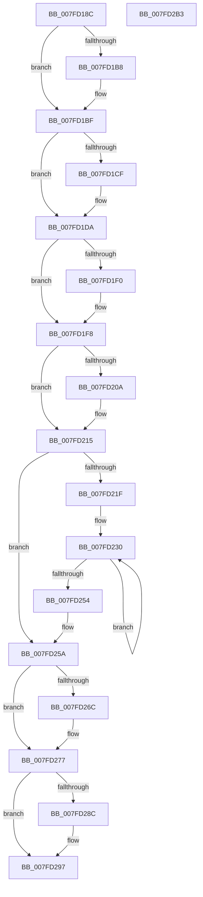

# MiCreatePartitionOffsets

- RVA: `0x007FD18C`–`0x007FD2B4` (길이 `296` bytes)
- VA: `0x00000001407FD18C`
- 실행 섹션: `PAGE`
- PDB 이름 있음: `예`; PDB Function 태그: `아니요`
- unwind 정보 RVA: `0x00060BC4`
- 디코드: `77`개 명령, `296/296` bytes 표시
- 미해석 바이트: `0` (있으면 어셈블리에 `.byte`로 보존)

> 이 문서는 커널 이미지의 기계어와 PDB 기호를 분석해 생성했습니다. 4번과 5번은 함수 원형과 자료형을 바이너리 사용 방식에서 추정한 C 해석이며 원본 소스 복구 결과는 아닙니다.

## 1. Dependencies

- 직접 호출 지점: **2**; 고유 호출 대상: **2**
- 직접 호출자로 확인된 함수: **2**
- RIP 상대 이미지 참조: **6**

### Outgoing calls
- `0x007FD277` → [MiComputePartitionHugeIoSpaceSize](../../text/67/MiComputePartitionHugeIoSpaceSize_function_006753D8.md) (function, `0x006753D8`)
- `0x007FD297` → [MiFreeCachedKernelShadowStackEntryCount](../../text/68/MiFreeCachedKernelShadowStackEntryCount_function_006863C0.md) (function, `0x006863C0`)

### Direct callers
- [MmCreatePartition](../80/MmCreatePartition_function_0080DC3C.md) at `0x0080DC7B`
- [MmCreatePartition](../80/MmCreatePartition_function_0080DC3C.md) at `0x0080DCB7`
- [MiCreatePfnDatabase](../../init/C5/MiCreatePfnDatabase_function_00C5F930.md) at `0x00C5F9F7`
- [MiCreatePfnDatabase](../../init/C5/MiCreatePfnDatabase_function_00C5F930.md) at `0x00C5FA65`

### Static image references
- `0x007FD19B` → RVA `0x00FC5000` (`ALMOSTRO`; read)
- `0x007FD1AC` → RVA `0x00E2DCCC` (`.data`; read)
- `0x007FD215` → RVA `0x00E2FFA0` (`.data`; read)
- `0x007FD21F` → RVA `0x00FC5002` (`ALMOSTRO`; read)
- `0x007FD226` → RVA `0x00E2DCC0` (`.data`; read)
- `0x007FD254` → RVA `0x00E2FFA0` (`.data`; write)

## 2. Other-region calls and transfers

- 다른 실행 섹션으로 향하는 call: **2**
  - `0x007FD277` → [MiComputePartitionHugeIoSpaceSize](../../text/67/MiComputePartitionHugeIoSpaceSize_function_006753D8.md) (`PAGE` → `.text`)
  - `0x007FD297` → [MiFreeCachedKernelShadowStackEntryCount](../../text/68/MiFreeCachedKernelShadowStackEntryCount_function_006863C0.md) (`PAGE` → `.text`)
- 별도 외부 분기/꼬리 이동을 확인하지 못했습니다.

## 3. Assembly (complete function range)

```asm
007FD18C  48 89 5C 24 08                  mov qword ptr [rsp + 8], rbx
007FD191  48 89 74 24 10                  mov qword ptr [rsp + 0x10], rsi
007FD196  57                              push rdi
007FD197  48 83 EC 20                     sub rsp, 0x20
007FD19B  44 0F B7 15 5D 7E 7C 00         movzx r10d, word ptr [rip + 0x7c7e5d]
007FD1A3  4C 8B C1                        mov r8, rcx
007FD1A6  41 8B CA                        mov ecx, r10d
007FD1A9  4C 8B CA                        mov r9, rdx
007FD1AC  0F AF 0D 19 0B 63 00            imul ecx, dword ptr [rip + 0x630b19]
007FD1B3  4D 85 C0                        test r8, r8
007FD1B6  74 07                           je 0x1407fd1bf
007FD1B8  49 89 90 D8 1B 00 00            mov qword ptr [r8 + 0x1bd8], rdx
007FD1BF  8D 14 8D 00 00 00 00            lea edx, [rcx*4]
007FD1C6  48 C1 E2 03                     shl rdx, 3
007FD1CA  4D 85 C0                        test r8, r8
007FD1CD  74 0B                           je 0x1407fd1da
007FD1CF  4A 8D 04 0A                     lea rax, [rdx + r9]
007FD1D3  49 89 80 F0 3F 00 00            mov qword ptr [r8 + 0x3ff0], rax
007FD1DA  48 83 C2 3F                     add rdx, 0x3f
007FD1DE  03 C9                           add ecx, ecx
007FD1E0  48 C1 E1 04                     shl rcx, 4
007FD1E4  48 03 D1                        add rdx, rcx
007FD1E7  48 83 E2 C0                     and rdx, 0xffffffffffffffc0
007FD1EB  4D 85 C0                        test r8, r8
007FD1EE  74 08                           je 0x1407fd1f8
007FD1F0  4A 8D 04 0A                     lea rax, [rdx + r9]
007FD1F4  49 89 40 10                     mov qword ptr [r8 + 0x10], rax
007FD1F8  49 69 C2 80 DF 00 00            imul rax, r10, 0xdf80
007FD1FF  4D 8B DA                        mov r11, r10
007FD202  48 03 D0                        add rdx, rax
007FD205  4D 85 C0                        test r8, r8
007FD208  74 0B                           je 0x1407fd215
007FD20A  4A 8D 04 0A                     lea rax, [rdx + r9]
007FD20E  49 89 80 E8 3F 00 00            mov qword ptr [r8 + 0x3fe8], rax
007FD215  8B 0D 85 2D 63 00               mov ecx, dword ptr [rip + 0x632d85]
007FD21B  85 C9                           test ecx, ecx
007FD21D  75 3B                           jne 0x1407fd25a
007FD21F  0F B6 3D DC 7D 7C 00            movzx edi, byte ptr [rip + 0x7c7ddc]
007FD226  48 8D 1D 93 0A 63 00            lea rbx, [rip + 0x630a93]
007FD22D  45 33 D2                        xor r10d, r10d
007FD230  41 83 FA 03                     cmp r10d, 3
007FD234  B8 08 00 00 00                  mov eax, 8
007FD239  8D 70 08                        lea esi, [rax + 8]
007FD23C  0F 45 C6                        cmovne eax, esi
007FD23F  41 FF C2                        inc r10d
007FD242  0F AF 03                        imul eax, dword ptr [rbx]
007FD245  48 8D 5B 04                     lea rbx, [rbx + 4]
007FD249  0F AF C7                        imul eax, edi
007FD24C  03 C8                           add ecx, eax
007FD24E  41 83 FA 03                     cmp r10d, 3
007FD252  76 DC                           jbe 0x1407fd230
007FD254  89 0D 46 2D 63 00               mov dword ptr [rip + 0x632d46], ecx
007FD25A  8B C1                           mov eax, ecx
007FD25C  49 0F AF C3                     imul rax, r11
007FD260  48 6B C0 58                     imul rax, rax, 0x58
007FD264  48 03 D0                        add rdx, rax
007FD267  4D 85 C0                        test r8, r8
007FD26A  74 0B                           je 0x1407fd277
007FD26C  4A 8D 04 0A                     lea rax, [rdx + r9]
007FD270  49 89 80 10 41 00 00            mov qword ptr [r8 + 0x4110], rax
007FD277  E8 5C 81 E7 FF                  call 0x1406753d8
007FD27C  48 8D 48 0F                     lea rcx, [rax + 0xf]
007FD280  48 03 CA                        add rcx, rdx
007FD283  48 83 E1 F0                     and rcx, 0xfffffffffffffff0
007FD287  4D 85 C0                        test r8, r8
007FD28A  74 0B                           je 0x1407fd297
007FD28C  4A 8D 04 09                     lea rax, [rcx + r9]
007FD290  49 89 80 C0 01 00 00            mov qword ptr [r8 + 0x1c0], rax
007FD297  E8 24 91 E8 FF                  call 0x1406863c0
007FD29C  48 8B 5C 24 30                  mov rbx, qword ptr [rsp + 0x30]
007FD2A1  48 8B 74 24 38                  mov rsi, qword ptr [rsp + 0x38]
007FD2A6  48 C1 E0 05                     shl rax, 5
007FD2AA  48 03 C1                        add rax, rcx
007FD2AD  48 83 C4 20                     add rsp, 0x20
007FD2B1  5F                              pop rdi
007FD2B2  C3                              ret
007FD2B3  CC                              int3
```

## 4. C-style interpretation (structured pseudocode)

```c
__int64 __fastcall MiCreatePartitionOffsets(__int64 a1, __int64 a2)
{
    __int64 result;
    __int64 v_r10;
    __int64 v_rsp;
    unsigned __int64 v_stack_p10;
    unsigned __int64 v_stack_p8;

    v_stack_p8 = v_rbx;
    v_stack_p10 = v_rsi;
    v_rsp = (v_rsp) - (32);
    a1 = (unsigned int)(((unsigned int)((unsigned int)(*(unsigned __int16 *)(v_rip + 8158813)))) * (*(unsigned int *)(v_rip + 6490905)));
    if (a1 != 0) {
        *(unsigned __int64 *)(a1 + 7128) = a2;
    }
    a2 = (a1 * 4) << (3);
    if (a1 != 0) {
        result = a2 + a2 * 1;
        *(unsigned __int64 *)(a1 + 16368) = result;
    }
    a2 = (a2) + (63);
    a1 = (unsigned int)((a1) + ((unsigned int)(a1)));
    a1 = (a1) << (4);
    a2 = (a2) + (a1);
    a2 = (a2) & (-64);
    if (a1 != 0) {
        result = a2 + a2 * 1;
        *(unsigned __int64 *)(a1 + 16) = result;
    }
    result = (result) * (*(unsigned __int16 *)(v_rip + 8158813));
    a2 = (a2) + (result);
    if (a1 != 0) {
        result = a2 + a2 * 1;
        *(unsigned __int64 *)(a1 + 16360) = result;
    }
    if ((unsigned int)((unsigned int)(*(unsigned int *)(v_rip + 6499717))) != 0) goto loc_007FD25A;
    v_r10 = 0;
loc_007FD230:
    result = 8;
    if (0 != 3) { result = (unsigned int)(8 + 8); }
    v_r10 = (unsigned int)((v_r10) + 1);
    result = (unsigned int)((result) * (*(unsigned int *)(v_rip + 6490771)));
    result = (unsigned int)((result) * ((unsigned int)(*(unsigned __int8 *)(v_rip + 8158684))));
    a1 = (unsigned int)(((unsigned int)(*(unsigned int *)(v_rip + 6499717))) + ((unsigned int)(result)));
    if (((unsigned int)(v_r10)) <= 3) goto loc_007FD230;
    *(unsigned int *)(v_rip + 6499654) = (unsigned int)(a1);
loc_007FD25A:
    result = ((unsigned int)((unsigned int)(a1))) * (*(unsigned __int16 *)(v_rip + 8158813));
    result = (result) * (result);
    a2 = (a2) + (result);
    if (a1 != 0) {
        result = a2 + a2 * 1;
        *(unsigned __int64 *)(a1 + 16656) = result;
    }
    result = MiComputePartitionHugeIoSpaceSize(a1, a2, a1, a2);
    a1 = (result + 15) + (a2);
    a1 = (a1) & (-16);
    if (a1 != 0) {
        result = a1 + a2 * 1;
        *(unsigned __int64 *)(a1 + 448) = result;
    }
    result = MiFreeCachedKernelShadowStackEntryCount(a1, a2, a1, a2);
    result = (result) << (5);
    result = (result) + (a1);
    v_rsp = (v_rsp) + (32);
    return result;
}
```

## 5. (Beta) C Style

```c
int64_t MiCreatePartitionOffsets(int64_t Arg1, int64_t Arg2)
{
    int64_t result;
    int64_t local_r10;
    int64_t local_rsp;
    uint64_t v_stack_p10;
    uint64_t v_stack_p8;

    v_stack_p8 = local_rbx;
    v_stack_p10 = local_rsi;
    local_rsp = (local_rsp) - (32);
    Arg1 = (uint32_t)(((uint32_t)((uint32_t)(*(uint16_t *)(v_rip + 0x7C7E5D)))) * (*(uint32_t *)(v_rip + 0x630B19)));
    if (Arg1 != 0) {
        *(uint64_t *)(Arg1 + 0x1BD8) = Arg2;
    }
    Arg2 = (Arg1 * 4) << (3);
    if (Arg1 != 0) {
        result = Arg2 + Arg2 * 1;
        *(uint64_t *)(Arg1 + 0x3FF0) = result;
    }
    Arg2 = (Arg2) + (63);
    Arg1 = (uint32_t)((Arg1) + ((uint32_t)(Arg1)));
    Arg1 = (Arg1) << (4);
    Arg2 = (Arg2) + (Arg1);
    Arg2 = (Arg2) & (-64);
    if (Arg1 != 0) {
        result = Arg2 + Arg2 * 1;
        *(uint64_t *)(Arg1 + 0x10) = result;
    }
    result = (result) * (*(uint16_t *)(v_rip + 0x7C7E5D));
    Arg2 = (Arg2) + (result);
    if (Arg1 != 0) {
        result = Arg2 + Arg2 * 1;
        *(uint64_t *)(Arg1 + 0x3FE8) = result;
    }
    if ((uint32_t)((uint32_t)(*(uint32_t *)(v_rip + 0x632D85))) != 0) goto loc_007FD25A;
    local_r10 = 0;
loc_007FD230:
    result = 8;
    if (0 != 3) { result = (uint32_t)(8 + 8); }
    local_r10 = (uint32_t)((local_r10) + 1);
    result = (uint32_t)((result) * (*(uint32_t *)(v_rip + 0x630A93)));
    result = (uint32_t)((result) * ((uint32_t)(*(uint8_t *)(v_rip + 0x7C7DDC))));
    Arg1 = (uint32_t)(((uint32_t)(*(uint32_t *)(v_rip + 0x632D85))) + ((uint32_t)(result)));
    if (((uint32_t)(local_r10)) <= 3) goto loc_007FD230;
    *(uint32_t *)(v_rip + 0x632D46) = (uint32_t)(Arg1);
loc_007FD25A:
    result = ((uint32_t)((uint32_t)(Arg1))) * (*(uint16_t *)(v_rip + 0x7C7E5D));
    result = (result) * (result);
    Arg2 = (Arg2) + (result);
    if (Arg1 != 0) {
        result = Arg2 + Arg2 * 1;
        *(uint64_t *)(Arg1 + 0x4110) = result;
    }
    result = MiComputePartitionHugeIoSpaceSize(Arg1, Arg2, Arg1, Arg2);
    Arg1 = (result + 15) + (Arg2);
    Arg1 = (Arg1) & (-16);
    if (Arg1 != 0) {
        result = Arg1 + Arg2 * 1;
        *(uint64_t *)(Arg1 + 0x1C0) = result;
    }
    result = MiFreeCachedKernelShadowStackEntryCount(Arg1, Arg2, Arg1, Arg2);
    result = (result) << (5);
    result = (result) + (Arg1);
    local_rsp = (local_rsp) + (32);
    return result;
}
```

## 6. Execution-region graph

[열기: 2D/3D 그래프와 함수 탐색 컨트롤 패널](../../../control-panel.html?section=page&rva=0x007FD18C&view=graph)

- 2D 그래프는 위에서 아래로 흐르고, 3D 그래프는 빈 공간을 드래그해 회전합니다. Shift+드래그는 이동, 휠은 확대·축소, 함수 노드 선택은 대상 보고서 이동입니다.

### Static fallback


