# MiDeletePagefile

- RVA: `0x007FFB88`–`0x007FFD2E` (길이 `422` bytes)
- VA: `0x00000001407FFB88`
- 실행 섹션: `PAGE`
- PDB 이름 있음: `예`; PDB Function 태그: `아니요`
- unwind 정보 RVA: `0x00061768`
- 디코드: `125`개 명령, `422/422` bytes 표시
- 미해석 바이트: `0` (있으면 어셈블리에 `.byte`로 보존)

> 이 문서는 커널 이미지의 기계어와 PDB 기호를 분석해 생성했습니다. 4번과 5번은 함수 원형과 자료형을 바이너리 사용 방식에서 추정한 C 해석이며 원본 소스 복구 결과는 아닙니다.

## 1. Dependencies

- 직접 호출 지점: **13**; 고유 호출 대상: **10**
- 직접 호출자로 확인된 함수: **5**
- RIP 상대 이미지 참조: **0**

### Outgoing calls
- `0x007FFBB1` → [MiFreeModWriterEntry](../../text/40/MiFreeModWriterEntry_function_00407AE8.md) (function, `0x00407AE8`)
- `0x007FFBC8` → [ExFreePoolWithTag](../../poolcode/B8/ExFreePoolWithTag_function_00B82870.md) (function, `0x00B82870`)
- `0x007FFBD6` → [CmSiFreeMemory](../../text/47/CmSiFreeMemory_function_00475D80.md) (function, `0x00475D80`)
- `0x007FFBEA` → [MiReleasePageHash](../../text/69/MiReleasePageHash_function_00697B20.md) (function, `0x00697B20`)
- `0x007FFBF2` → [MiFreePageFileHashPfns](../../text/2D/MiFreePageFileHashPfns_function_002DBEF8.md) (function, `0x002DBEF8`)
- `0x007FFC07` → [MiUpdatePageFileList](../../text/68/MiUpdatePageFileList_function_006803AC.md) (function, `0x006803AC`)
- `0x007FFC80` → [MiDeletePageFileMemoryExtents](../80/MiDeletePageFileMemoryExtents_function_0080F4F8.md) (function, `0x0080F4F8`)
- `0x007FFCBD` → [PiPagePathSetState](../72/PiPagePathSetState_function_0072BDE0.md) (function, `0x0072BDE0`)
- `0x007FFCD0` → [ObCloseHandle](../8A/ObCloseHandle_function_008A1870.md) (function, `0x008A1870`)
- `0x007FFCE3` → [ObfDereferenceObjectWithTag](../../text/2F/ObfDereferenceObjectWithTag_function_002F78E0.md) (function, `0x002F78E0`)
- `0x007FFCF3` → [ExFreePoolWithTag](../../poolcode/B8/ExFreePoolWithTag_function_00B82870.md) (function, `0x00B82870`)
- `0x007FFD06` → [ExFreePoolWithTag](../../poolcode/B8/ExFreePoolWithTag_function_00B82870.md) (function, `0x00B82870`)
- `0x007FFD15` → [ExFreePoolWithTag](../../poolcode/B8/ExFreePoolWithTag_function_00B82870.md) (function, `0x00B82870`)

### Direct callers
- [MiCreatePagefile](MiCreatePagefile_function_007FEC30.md) at `0x007FEFB3`
- [MiCreatePagingFile](MiCreatePagingFile_function_007FEFF4.md) at `0x007FF74F`
- [MiDeletePagingFiles](MiDeletePagingFiles_function_007FFD34.md) at `0x007FFD86`
- [MmStoreRegister](../80/MmStoreRegister_function_0080E6D8.md) at `0x0080E8DC`
- [MiCreateSpecialPurposeMemoryPageFile](../80/MiCreateSpecialPurposeMemoryPageFile_function_0080F444.md) at `0x0080F4C6`

### Static image references
- 디코드된 RIP-relative 메모리 참조가 없습니다.

## 2. Other-region calls and transfers

- 다른 실행 섹션으로 향하는 call: **10**
  - `0x007FFBB1` → [MiFreeModWriterEntry](../../text/40/MiFreeModWriterEntry_function_00407AE8.md) (`PAGE` → `.text`)
  - `0x007FFBC8` → [ExFreePoolWithTag](../../poolcode/B8/ExFreePoolWithTag_function_00B82870.md) (`PAGE` → `POOLCODE`)
  - `0x007FFBD6` → [CmSiFreeMemory](../../text/47/CmSiFreeMemory_function_00475D80.md) (`PAGE` → `.text`)
  - `0x007FFBEA` → [MiReleasePageHash](../../text/69/MiReleasePageHash_function_00697B20.md) (`PAGE` → `.text`)
  - `0x007FFBF2` → [MiFreePageFileHashPfns](../../text/2D/MiFreePageFileHashPfns_function_002DBEF8.md) (`PAGE` → `.text`)
  - `0x007FFC07` → [MiUpdatePageFileList](../../text/68/MiUpdatePageFileList_function_006803AC.md) (`PAGE` → `.text`)
  - `0x007FFCE3` → [ObfDereferenceObjectWithTag](../../text/2F/ObfDereferenceObjectWithTag_function_002F78E0.md) (`PAGE` → `.text`)
  - `0x007FFCF3` → [ExFreePoolWithTag](../../poolcode/B8/ExFreePoolWithTag_function_00B82870.md) (`PAGE` → `POOLCODE`)
  - `0x007FFD06` → [ExFreePoolWithTag](../../poolcode/B8/ExFreePoolWithTag_function_00B82870.md) (`PAGE` → `POOLCODE`)
  - `0x007FFD15` → [ExFreePoolWithTag](../../poolcode/B8/ExFreePoolWithTag_function_00B82870.md) (`PAGE` → `POOLCODE`)
- 별도 외부 분기/꼬리 이동을 확인하지 못했습니다.

## 3. Assembly (complete function range)

```asm
007FFB88  48 89 5C 24 08                  mov qword ptr [rsp + 8], rbx
007FFB8D  48 89 6C 24 18                  mov qword ptr [rsp + 0x18], rbp
007FFB92  56                              push rsi
007FFB93  57                              push rdi
007FFB94  41 56                           push r14
007FFB96  48 83 EC 20                     sub rsp, 0x20
007FFB9A  33 F6                           xor esi, esi
007FFB9C  44 8B F2                        mov r14d, edx
007FFB9F  48 8B D9                        mov rbx, rcx
007FFBA2  39 71 28                        cmp dword ptr [rcx + 0x28], esi
007FFBA5  76 16                           jbe 0x1407ffbbd
007FFBA7  48 8B 4B 20                     mov rcx, qword ptr [rbx + 0x20]
007FFBAB  33 D2                           xor edx, edx
007FFBAD  48 8B 0C F1                     mov rcx, qword ptr [rcx + rsi*8]
007FFBB1  E8 32 7F C0 FF                  call 0x140407ae8
007FFBB6  FF C6                           inc esi
007FFBB8  3B 73 28                        cmp esi, dword ptr [rbx + 0x28]
007FFBBB  72 EA                           jb 0x1407ffba7
007FFBBD  48 8B 4B 20                     mov rcx, qword ptr [rbx + 0x20]
007FFBC1  48 85 C9                        test rcx, rcx
007FFBC4  74 07                           je 0x1407ffbcd
007FFBC6  33 D2                           xor edx, edx
007FFBC8  E8 A3 2C 38 00                  call 0x140b82870
007FFBCD  48 8B 4B 50                     mov rcx, qword ptr [rbx + 0x50]
007FFBD1  48 85 C9                        test rcx, rcx
007FFBD4  74 05                           je 0x1407ffbdb
007FFBD6  E8 A5 61 C7 FF                  call 0x140475d80
007FFBDB  48 8B 8B B8 00 00 00            mov rcx, qword ptr [rbx + 0xb8]
007FFBE2  48 85 C9                        test rcx, rcx
007FFBE5  74 08                           je 0x1407ffbef
007FFBE7  8B 53 04                        mov edx, dword ptr [rbx + 4]
007FFBEA  E8 31 7F E9 FF                  call 0x140697b20
007FFBEF  48 8B CB                        mov rcx, rbx
007FFBF2  E8 01 C3 AD FF                  call 0x1402dbef8
007FFBF7  66 0F BA A3 AC 00 00 00 08      bt word ptr [rbx + 0xac], 8
007FFC00  73 0A                           jae 0x1407ffc0c
007FFC02  33 D2                           xor edx, edx
007FFC04  48 8B CB                        mov rcx, rbx
007FFC07  E8 A0 07 E8 FF                  call 0x1406803ac
007FFC0C  66 0F BA A3 AC 00 00 00 0B      bt word ptr [rbx + 0xac], 0xb
007FFC15  0F 83 91 00 00 00               jae 0x1407ffcac
007FFC1B  48 8D B3 E0 00 00 00            lea rsi, [rbx + 0xe0]
007FFC22  F6 46 08 01                     test byte ptr [rsi + 8], 1
007FFC26  48 8B 0E                        mov rcx, qword ptr [rsi]
007FFC29  74 08                           je 0x1407ffc33
007FFC2B  48 85 C9                        test rcx, rcx
007FFC2E  74 03                           je 0x1407ffc33
007FFC30  48 33 CE                        xor rcx, rsi
007FFC33  0F B6 6E 08                     movzx ebp, byte ptr [rsi + 8]
007FFC37  83 E5 01                        and ebp, 1
007FFC3A  48 85 C9                        test rcx, rcx
007FFC3D  74 50                           je 0x1407ffc8f
007FFC3F  48 8B 01                        mov rax, qword ptr [rcx]
007FFC42  48 85 C0                        test rax, rax
007FFC45  74 05                           je 0x1407ffc4c
007FFC47  48 8B D1                        mov rdx, rcx
007FFC4A  EB 0C                           jmp 0x1407ffc58
007FFC4C  48 8D 51 08                     lea rdx, [rcx + 8]
007FFC50  48 8B 02                        mov rax, qword ptr [rdx]
007FFC53  48 85 C0                        test rax, rax
007FFC56  74 12                           je 0x1407ffc6a
007FFC58  85 ED                           test ebp, ebp
007FFC5A  74 05                           je 0x1407ffc61
007FFC5C  48 33 C8                        xor rcx, rax
007FFC5F  EB 03                           jmp 0x1407ffc64
007FFC61  48 8B C8                        mov rcx, rax
007FFC64  48 83 22 00                     and qword ptr [rdx], 0
007FFC68  EB D5                           jmp 0x1407ffc3f
007FFC6A  48 8B 79 10                     mov rdi, qword ptr [rcx + 0x10]
007FFC6E  48 83 E7 FC                     and rdi, 0xfffffffffffffffc
007FFC72  85 ED                           test ebp, ebp
007FFC74  74 08                           je 0x1407ffc7e
007FFC76  48 85 FF                        test rdi, rdi
007FFC79  74 03                           je 0x1407ffc7e
007FFC7B  48 33 F9                        xor rdi, rcx
007FFC7E  33 D2                           xor edx, edx
007FFC80  E8 73 F8 00 00                  call 0x14080f4f8
007FFC85  48 85 FF                        test rdi, rdi
007FFC88  74 05                           je 0x1407ffc8f
007FFC8A  48 8B CF                        mov rcx, rdi
007FFC8D  EB B0                           jmp 0x1407ffc3f
007FFC8F  0F B6 46 08                     movzx eax, byte ptr [rsi + 8]
007FFC93  48 C7 06 00 00 00 00            mov qword ptr [rsi], 0
007FFC9A  48 C7 46 08 00 00 00 00         mov qword ptr [rsi + 8], 0
007FFCA2  0F BA E0 00                     bt eax, 0
007FFCA6  73 04                           jae 0x1407ffcac
007FFCA8  C6 46 08 01                     mov byte ptr [rsi + 8], 1
007FFCAC  66 0F BA A3 AC 00 00 00 09      bt word ptr [rbx + 0xac], 9
007FFCB5  73 0B                           jae 0x1407ffcc2
007FFCB7  48 8B 4B 18                     mov rcx, qword ptr [rbx + 0x18]
007FFCBB  33 D2                           xor edx, edx
007FFCBD  E8 1E C1 F2 FF                  call 0x14072bde0
007FFCC2  48 8B 8B C0 00 00 00            mov rcx, qword ptr [rbx + 0xc0]
007FFCC9  48 85 C9                        test rcx, rcx
007FFCCC  74 07                           je 0x1407ffcd5
007FFCCE  33 D2                           xor edx, edx
007FFCD0  E8 9B 1B 0A 00                  call 0x1408a1870
007FFCD5  48 8B 4B 18                     mov rcx, qword ptr [rbx + 0x18]
007FFCD9  48 85 C9                        test rcx, rcx
007FFCDC  74 0A                           je 0x1407ffce8
007FFCDE  BA 4D 6D 50 66                  mov edx, 0x66506d4d
007FFCE3  E8 F8 7B AF FF                  call 0x1402f78e0
007FFCE8  48 8B 4B 48                     mov rcx, qword ptr [rbx + 0x48]
007FFCEC  48 85 C9                        test rcx, rcx
007FFCEF  74 07                           je 0x1407ffcf8
007FFCF1  33 D2                           xor edx, edx
007FFCF3  E8 78 2B 38 00                  call 0x140b82870
007FFCF8  48 8B 8B A0 00 00 00            mov rcx, qword ptr [rbx + 0xa0]
007FFCFF  48 85 C9                        test rcx, rcx
007FFD02  74 07                           je 0x1407ffd0b
007FFD04  33 D2                           xor edx, edx
007FFD06  E8 65 2B 38 00                  call 0x140b82870
007FFD0B  45 85 F6                        test r14d, r14d
007FFD0E  74 0A                           je 0x1407ffd1a
007FFD10  33 D2                           xor edx, edx
007FFD12  48 8B CB                        mov rcx, rbx
007FFD15  E8 56 2B 38 00                  call 0x140b82870
007FFD1A  48 8B 5C 24 40                  mov rbx, qword ptr [rsp + 0x40]
007FFD1F  48 8B 6C 24 50                  mov rbp, qword ptr [rsp + 0x50]
007FFD24  48 83 C4 20                     add rsp, 0x20
007FFD28  41 5E                           pop r14
007FFD2A  5F                              pop rdi
007FFD2B  5E                              pop rsi
007FFD2C  C3                              ret
007FFD2D  CC                              int3
```

## 4. C-style interpretation (structured pseudocode)

```c
__int64 __fastcall MiDeletePagefile(__int64 a1, int a2)
{
    __int64 result;
    __int64 v_rbp;
    __int64 v_rdi;
    __int64 v_rsi;
    __int64 v_rsp;
    unsigned __int64 v_stack_p18;
    unsigned __int64 v_stack_p8;

    v_stack_p8 = v_rbx;
    v_stack_p18 = v_rbp;
    v_rsp = (v_rsp) - (32);
    v_rsi = 0;
    if ((*(unsigned int *)(a1 + 40)) <= 0) goto loc_007FFBBD;
loc_007FFBA7:
    a2 = 0;
    result = MiFreeModWriterEntry(*(unsigned __int64 *)(*(unsigned __int64 *)(a1 + 32) + v_rsi * 8), a2, a3, a4);
    v_rsi = (unsigned int)((v_rsi) + 1);
    if (((unsigned int)(v_rsi)) < (*(unsigned int *)(a1 + 40))) goto loc_007FFBA7;
loc_007FFBBD:
    if (*(unsigned __int64 *)(a1 + 32) != 0) {
        a2 = 0;
        result = ExFreePoolWithTag(*(unsigned __int64 *)(a1 + 32), a2, a3, a4);
    }
    if (*(unsigned __int64 *)(a1 + 80) != 0) {
        result = CmSiFreeMemory(*(unsigned __int64 *)(a1 + 80), a2, a3, a4);
    }
    if (*(unsigned __int64 *)(a1 + 184) != 0) {
        a2 = *(unsigned int *)(a1 + 4);
        result = MiReleasePageHash(*(unsigned __int64 *)(a1 + 184), a2, a3, a4);
    }
    result = MiFreePageFileHashPfns(a1, a2, a3, a4);
    if (!(condition_is_above_or_equal)) {
        a2 = 0;
        a1 = a1;
        result = MiUpdatePageFileList(a1, a2, a3, a4);
    }
    if (condition_is_above_or_equal) goto loc_007FFCAC;
    if (((*(unsigned __int8 *)(a1 + 224 + 8)) & (1)) == 0) goto loc_007FFC33;
    if (*(unsigned __int64 *)(a1 + 224) != 0) {
        a1 = (*(unsigned __int64 *)(a1 + 224)) ^ (a1 + 224);
    }
    v_rbp = (unsigned int)((*(unsigned __int8 *)(a1 + 224 + 8)) & (1));
    if (a1 == 0) goto loc_007FFC8F;
loc_007FFC3F:
    if (*(unsigned __int64 *)(a1) == 0) goto loc_007FFC4C;
    goto loc_007FFC58;
loc_007FFC4C:
    if (*(unsigned __int64 *)(a1 + 8) == 0) goto loc_007FFC6A;
loc_007FFC58:
    if ((unsigned int)(v_rbp) == 0) goto loc_007FFC61;
    a1 = (a1) ^ (*(unsigned __int64 *)(a1 + 8));
    goto loc_007FFC64;
loc_007FFC61:
loc_007FFC64:
    goto loc_007FFC3F;
loc_007FFC6A:
    v_rdi = (*(unsigned __int64 *)(*(unsigned __int64 *)(a1 + 8) + 16)) & (-4);
    if ((unsigned int)(v_rbp) == 0) goto loc_007FFC7E;
    if (v_rdi != 0) {
        v_rdi = (v_rdi) ^ (*(unsigned __int64 *)(a1 + 8));
    }
    a2 = 0;
    result = MiDeletePageFileMemoryExtents(*(unsigned __int64 *)(a1 + 8), a2, a3, a4);
    if (v_rdi == 0) goto loc_007FFC8F;
    goto loc_007FFC3F;
loc_007FFC8F:
    *(unsigned __int64 *)(a1 + 224) = 0;
    *(unsigned __int64 *)(a1 + 224 + 8) = 0;
    if (!(condition_is_above_or_equal)) {
        *(unsigned __int8 *)(a1 + 224 + 8) = 1;
    }
    result = *(unsigned __int8 *)(a1 + 224 + 8);
    if (!(condition_is_above_or_equal)) {
        a1 = *(unsigned __int64 *)(a1 + 24);
        a2 = 0;
        result = PiPagePathSetState(a1, a2, a3, a4);
    }
    if (*(unsigned __int64 *)(a1 + 192) != 0) {
        a2 = 0;
        result = ObCloseHandle(*(unsigned __int64 *)(a1 + 192), a2, a3, a4);
    }
    if (*(unsigned __int64 *)(a1 + 24) != 0) {
        a2 = 0x66506D4DULL;
        result = ObfDereferenceObjectWithTag(*(unsigned __int64 *)(a1 + 24), a2, a3, a4);
    }
    if (*(unsigned __int64 *)(a1 + 72) != 0) {
        a2 = 0;
        result = ExFreePoolWithTag(*(unsigned __int64 *)(a1 + 72), a2, a3, a4);
    }
    if (*(unsigned __int64 *)(a1 + 160) != 0) {
        a2 = 0;
        result = ExFreePoolWithTag(*(unsigned __int64 *)(a1 + 160), a2, a3, a4);
    }
    if ((unsigned int)((unsigned int)(a2)) != 0) {
        a2 = 0;
        a1 = a1;
        result = ExFreePoolWithTag(a1, a2, a3, a4);
    }
    v_rsp = (v_rsp) + (32);
    return result;
}
```

## 5. (Beta) C Style

```c
int64_t MiDeletePagefile(void *Arg1, int32_t Arg2)
{
    uint8_t *arg1 = (uint8_t *)Arg1;

    int64_t result;
    int64_t local_rbp;
    int64_t local_rdi;
    int64_t local_rsi;
    int64_t local_rsp;
    uint64_t v_stack_p18;
    uint64_t v_stack_p8;

    v_stack_p8 = local_rbx;
    v_stack_p18 = local_rbp;
    local_rsp = (local_rsp) - (32);
    local_rsi = 0;
    if ((*(uint32_t *)(arg1 + 0x28)) <= 0) goto loc_007FFBBD;
loc_007FFBA7:
    Arg2 = 0;
    result = MiFreeModWriterEntry(*(uint64_t *)(*(uint64_t *)(arg1 + 0x20) + local_rsi * 8), Arg2, a3, a4);
    local_rsi = (uint32_t)((local_rsi) + 1);
    if (((uint32_t)(local_rsi)) < (*(uint32_t *)(arg1 + 0x28))) goto loc_007FFBA7;
loc_007FFBBD:
    if (*(uint64_t *)(arg1 + 0x20) != 0) {
        Arg2 = 0;
        result = ExFreePoolWithTag(*(uint64_t *)(arg1 + 0x20), Arg2, a3, a4);
    }
    if (*(uint64_t *)(arg1 + 0x50) != 0) {
        result = CmSiFreeMemory(*(uint64_t *)(arg1 + 0x50), Arg2, a3, a4);
    }
    if (*(uint64_t *)(arg1 + 0xB8) != 0) {
        Arg2 = *(uint32_t *)(arg1 + 0x4);
        result = MiReleasePageHash(*(uint64_t *)(arg1 + 0xB8), Arg2, a3, a4);
    }
    result = MiFreePageFileHashPfns(Arg1, Arg2, a3, a4);
    if (!(condition_is_above_or_equal)) {
        Arg2 = 0;
        Arg1 = Arg1;
        result = MiUpdatePageFileList(Arg1, Arg2, a3, a4);
    }
    if (condition_is_above_or_equal) goto loc_007FFCAC;
    if (((*(uint8_t *)(arg1 + 0xE0 + 0x8)) & (1)) == 0) goto loc_007FFC33;
    if (*(uint64_t *)(arg1 + 0xE0) != 0) {
        Arg1 = (*(uint64_t *)(arg1 + 0xE0)) ^ (Arg1 + 224);
    }
    local_rbp = (uint32_t)((*(uint8_t *)(arg1 + 0xE0 + 0x8)) & (1));
    if (Arg1 == NULL) goto loc_007FFC8F;
loc_007FFC3F:
    if (*(uint64_t *)(arg1) == 0) goto loc_007FFC4C;
    goto loc_007FFC58;
loc_007FFC4C:
    if (*(uint64_t *)(arg1 + 0x8) == 0) goto loc_007FFC6A;
loc_007FFC58:
    if ((uint32_t)(local_rbp) == 0) goto loc_007FFC61;
    Arg1 = (Arg1) ^ (*(uint64_t *)(arg1 + 0x8));
    goto loc_007FFC64;
loc_007FFC61:
loc_007FFC64:
    goto loc_007FFC3F;
loc_007FFC6A:
    local_rdi = (*(uint64_t *)(*(uint64_t *)(arg1 + 0x8) + 0x10)) & (-4);
    if ((uint32_t)(local_rbp) == 0) goto loc_007FFC7E;
    if (local_rdi != 0) {
        local_rdi = (local_rdi) ^ (*(uint64_t *)(arg1 + 0x8));
    }
    Arg2 = 0;
    result = MiDeletePageFileMemoryExtents(*(uint64_t *)(arg1 + 0x8), Arg2, a3, a4);
    if (local_rdi == 0) goto loc_007FFC8F;
    goto loc_007FFC3F;
loc_007FFC8F:
    *(uint64_t *)(arg1 + 0xE0) = 0;
    *(uint64_t *)(arg1 + 0xE0 + 0x8) = 0;
    if (!(condition_is_above_or_equal)) {
        *(uint8_t *)(arg1 + 0xE0 + 0x8) = 1;
    }
    result = *(uint8_t *)(arg1 + 0xE0 + 0x8);
    if (!(condition_is_above_or_equal)) {
        Arg1 = *(uint64_t *)(arg1 + 0x18);
        Arg2 = 0;
        result = PiPagePathSetState(Arg1, Arg2, a3, a4);
    }
    if (*(uint64_t *)(arg1 + 0xC0) != 0) {
        Arg2 = 0;
        result = ObCloseHandle(*(uint64_t *)(arg1 + 0xC0), Arg2, a3, a4);
    }
    if (*(uint64_t *)(arg1 + 0x18) != 0) {
        Arg2 = 0x66506D4DULL;
        result = ObfDereferenceObjectWithTag(*(uint64_t *)(arg1 + 0x18), Arg2, a3, a4);
    }
    if (*(uint64_t *)(arg1 + 0x48) != 0) {
        Arg2 = 0;
        result = ExFreePoolWithTag(*(uint64_t *)(arg1 + 0x48), Arg2, a3, a4);
    }
    if (*(uint64_t *)(arg1 + 0xA0) != 0) {
        Arg2 = 0;
        result = ExFreePoolWithTag(*(uint64_t *)(arg1 + 0xA0), Arg2, a3, a4);
    }
    if ((uint32_t)((uint32_t)(Arg2)) != 0) {
        Arg2 = 0;
        Arg1 = Arg1;
        result = ExFreePoolWithTag(Arg1, Arg2, a3, a4);
    }
    local_rsp = (local_rsp) + (32);
    return result;
}
```

### 관측된 메모리 오프셋

구조체 형식이 확인되지 않은 접근은 인자 기준의 오프셋으로만 기록했습니다.

| 기준 인자 | 오프셋 표현 | 폭 (bit) | 접근 |
|---|---:|---:|---|
| `Arg1` | `+ 0x0` | `64` | `R` |
| `Arg1` | `+ 0x0` | `64` | `W` |
| `Arg1` | `+ 0x4` | `32` | `R` |
| `Arg1` | `+ 0x8` | `8` | `R` |
| `Arg1` | `+ 0x8` | `8` | `W` |
| `Arg1` | `+ 0x8` | `64` | `W` |
| `Arg1` | `+ 0x18` | `64` | `R` |
| `Arg1` | `+ 0x20` | `64` | `R` |
| `Arg1` | `+ 0x28` | `32` | `R` |
| `Arg1` | `+ 0x48` | `64` | `R` |
| `Arg1` | `+ 0x50` | `64` | `R` |
| `Arg1` | `+ 0xA0` | `64` | `R` |
| `Arg1` | `+ 0xAC` | `16` | `R` |
| `Arg1` | `+ 0xB8` | `64` | `R` |
| `Arg1` | `+ 0xC0` | `64` | `R` |
| `Arg1` | `+ 0xE0` | `64` | `R` |

## 6. Execution-region graph

[열기: 2D/3D 그래프와 함수 탐색 컨트롤 패널](../../../control-panel.html?section=page&rva=0x007FFB88&view=graph)

- 2D 그래프는 위에서 아래로 흐르고, 3D 그래프는 빈 공간을 드래그해 회전합니다. Shift+드래그는 이동, 휠은 확대·축소, 함수 노드 선택은 대상 보고서 이동입니다.

### Static fallback

```mermaid
flowchart TD
  bb_007FFB88[BB_007FFB88]
  bb_007FFBA7[BB_007FFBA7]
  bb_007FFBBD[BB_007FFBBD]
  bb_007FFBC6[BB_007FFBC6]
  bb_007FFBCD[BB_007FFBCD]
  bb_007FFBD6[BB_007FFBD6]
  bb_007FFBDB[BB_007FFBDB]
  bb_007FFBE7[BB_007FFBE7]
  bb_007FFBEF[BB_007FFBEF]
  bb_007FFC02[BB_007FFC02]
  bb_007FFC0C[BB_007FFC0C]
  bb_007FFC1B[BB_007FFC1B]
  bb_007FFC2B[BB_007FFC2B]
  bb_007FFC30[BB_007FFC30]
  bb_007FFC33[BB_007FFC33]
  bb_007FFC3F[BB_007FFC3F]
  bb_007FFC47[BB_007FFC47]
  bb_007FFC4C[BB_007FFC4C]
  bb_007FFC58[BB_007FFC58]
  bb_007FFC5C[BB_007FFC5C]
  bb_007FFC61[BB_007FFC61]
  bb_007FFC64[BB_007FFC64]
  bb_007FFC6A[BB_007FFC6A]
  bb_007FFC76[BB_007FFC76]
  bb_007FFC7B[BB_007FFC7B]
  bb_007FFC7E[BB_007FFC7E]
  bb_007FFC8A[BB_007FFC8A]
  bb_007FFC8F[BB_007FFC8F]
  bb_007FFCA8[BB_007FFCA8]
  bb_007FFCAC[BB_007FFCAC]
  bb_007FFCB7[BB_007FFCB7]
  bb_007FFCC2[BB_007FFCC2]
  bb_007FFCCE[BB_007FFCCE]
  bb_007FFCD5[BB_007FFCD5]
  bb_007FFCDE[BB_007FFCDE]
  bb_007FFCE8[BB_007FFCE8]
  bb_007FFCF1[BB_007FFCF1]
  bb_007FFCF8[BB_007FFCF8]
  bb_007FFD04[BB_007FFD04]
  bb_007FFD0B[BB_007FFD0B]
  bb_007FFD10[BB_007FFD10]
  bb_007FFD1A[BB_007FFD1A]
  bb_007FFD2D[BB_007FFD2D]
  bb_007FFB88 -->|branch| bb_007FFBBD
  bb_007FFB88 -->|fallthrough| bb_007FFBA7
  bb_007FFBA7 -->|branch| bb_007FFBA7
  bb_007FFBA7 -->|fallthrough| bb_007FFBBD
  bb_007FFBBD -->|branch| bb_007FFBCD
  bb_007FFBBD -->|fallthrough| bb_007FFBC6
  bb_007FFBC6 -->|flow| bb_007FFBCD
  bb_007FFBCD -->|branch| bb_007FFBDB
  bb_007FFBCD -->|fallthrough| bb_007FFBD6
  bb_007FFBD6 -->|flow| bb_007FFBDB
  bb_007FFBDB -->|branch| bb_007FFBEF
  bb_007FFBDB -->|fallthrough| bb_007FFBE7
  bb_007FFBE7 -->|flow| bb_007FFBEF
  bb_007FFBEF -->|branch| bb_007FFC0C
  bb_007FFBEF -->|fallthrough| bb_007FFC02
  bb_007FFC02 -->|flow| bb_007FFC0C
  bb_007FFC0C -->|branch| bb_007FFCAC
  bb_007FFC0C -->|fallthrough| bb_007FFC1B
  bb_007FFC1B -->|branch| bb_007FFC33
  bb_007FFC1B -->|fallthrough| bb_007FFC2B
  bb_007FFC2B -->|branch| bb_007FFC33
  bb_007FFC2B -->|fallthrough| bb_007FFC30
  bb_007FFC30 -->|flow| bb_007FFC33
  bb_007FFC33 -->|branch| bb_007FFC8F
  bb_007FFC33 -->|fallthrough| bb_007FFC3F
  bb_007FFC3F -->|branch| bb_007FFC4C
  bb_007FFC3F -->|fallthrough| bb_007FFC47
  bb_007FFC47 -->|branch| bb_007FFC58
  bb_007FFC4C -->|branch| bb_007FFC6A
  bb_007FFC4C -->|fallthrough| bb_007FFC58
  bb_007FFC58 -->|branch| bb_007FFC61
  bb_007FFC58 -->|fallthrough| bb_007FFC5C
  bb_007FFC5C -->|branch| bb_007FFC64
  bb_007FFC61 -->|flow| bb_007FFC64
  bb_007FFC64 -->|branch| bb_007FFC3F
  bb_007FFC6A -->|branch| bb_007FFC7E
  bb_007FFC6A -->|fallthrough| bb_007FFC76
  bb_007FFC76 -->|branch| bb_007FFC7E
  bb_007FFC76 -->|fallthrough| bb_007FFC7B
  bb_007FFC7B -->|flow| bb_007FFC7E
  bb_007FFC7E -->|branch| bb_007FFC8F
  bb_007FFC7E -->|fallthrough| bb_007FFC8A
  bb_007FFC8A -->|branch| bb_007FFC3F
  bb_007FFC8F -->|branch| bb_007FFCAC
  bb_007FFC8F -->|fallthrough| bb_007FFCA8
  bb_007FFCA8 -->|flow| bb_007FFCAC
  bb_007FFCAC -->|branch| bb_007FFCC2
  bb_007FFCAC -->|fallthrough| bb_007FFCB7
  bb_007FFCB7 -->|flow| bb_007FFCC2
  bb_007FFCC2 -->|branch| bb_007FFCD5
  bb_007FFCC2 -->|fallthrough| bb_007FFCCE
  bb_007FFCCE -->|flow| bb_007FFCD5
  bb_007FFCD5 -->|branch| bb_007FFCE8
  bb_007FFCD5 -->|fallthrough| bb_007FFCDE
  bb_007FFCDE -->|flow| bb_007FFCE8
  bb_007FFCE8 -->|branch| bb_007FFCF8
  bb_007FFCE8 -->|fallthrough| bb_007FFCF1
  bb_007FFCF1 -->|flow| bb_007FFCF8
  bb_007FFCF8 -->|branch| bb_007FFD0B
  bb_007FFCF8 -->|fallthrough| bb_007FFD04
  bb_007FFD04 -->|flow| bb_007FFD0B
  bb_007FFD0B -->|branch| bb_007FFD1A
  bb_007FFD0B -->|fallthrough| bb_007FFD10
  bb_007FFD10 -->|flow| bb_007FFD1A
```


