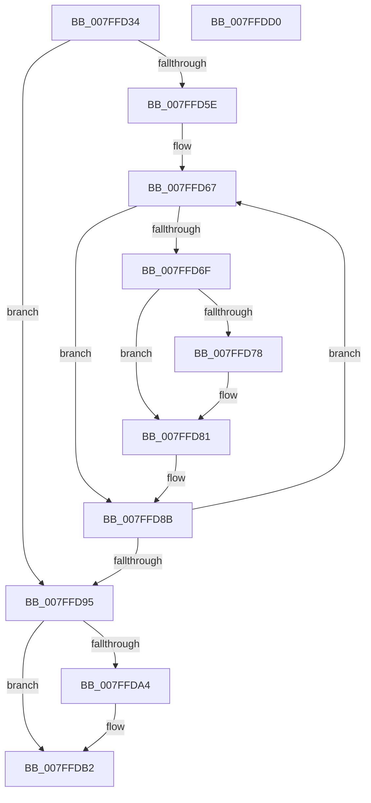

# MiDeletePagingFiles

- RVA: `0x007FFD34`–`0x007FFDD1` (길이 `157` bytes)
- VA: `0x00000001407FFD34`
- 실행 섹션: `PAGE`
- PDB 이름 있음: `예`; PDB Function 태그: `아니요`
- unwind 정보 RVA: `0x0005E6B4`
- 디코드: `44`개 명령, `157/157` bytes 표시
- 미해석 바이트: `0` (있으면 어셈블리에 `.byte`로 보존)

> 이 문서는 커널 이미지의 기계어와 PDB 기호를 분석해 생성했습니다. 4번과 5번은 함수 원형과 자료형을 바이너리 사용 방식에서 추정한 C 해석이며 원본 소스 복구 결과는 아닙니다.

## 1. Dependencies

- 직접 호출 지점: **2**; 고유 호출 대상: **2**
- 직접 호출자로 확인된 함수: **2**
- RIP 상대 이미지 참조: **0**

### Outgoing calls
- `0x007FFD86` → [MiDeletePagefile](MiDeletePagefile_function_007FFB88.md) (function, `0x007FFB88`)
- `0x007FFDAD` → [MiReturnCommit](../../text/24/MiReturnCommit_function_00248410.md) (function, `0x00248410`)

### Direct callers
- [MiDeletePartitionResources](../80/MiDeletePartitionResources_function_0080D074.md) at `0x0080D157`
- [MiShutdownSystem](../../pagelk/B7/MiShutdownSystem_function_00B73934.md) at `0x00B73B04`

### Static image references
- 디코드된 RIP-relative 메모리 참조가 없습니다.

## 2. Other-region calls and transfers

- 다른 실행 섹션으로 향하는 call: **1**
  - `0x007FFDAD` → [MiReturnCommit](../../text/24/MiReturnCommit_function_00248410.md) (`PAGE` → `.text`)
- 별도 외부 분기/꼬리 이동을 확인하지 못했습니다.

## 3. Assembly (complete function range)

```asm
007FFD34  48 8B C4                        mov rax, rsp
007FFD37  48 89 58 08                     mov qword ptr [rax + 8], rbx
007FFD3B  48 89 68 10                     mov qword ptr [rax + 0x10], rbp
007FFD3F  48 89 70 18                     mov qword ptr [rax + 0x18], rsi
007FFD43  48 89 78 20                     mov qword ptr [rax + 0x20], rdi
007FFD47  41 56                           push r14
007FFD49  48 83 EC 20                     sub rsp, 0x20
007FFD4D  8B 81 58 48 00 00               mov eax, dword ptr [rcx + 0x4858]
007FFD53  33 FF                           xor edi, edi
007FFD55  33 F6                           xor esi, esi
007FFD57  48 8B D9                        mov rbx, rcx
007FFD5A  85 C0                           test eax, eax
007FFD5C  74 37                           je 0x1407ffd95
007FFD5E  4C 8D B1 60 48 00 00            lea r14, [rcx + 0x4860]
007FFD65  8B E8                           mov ebp, eax
007FFD67  49 8B 0E                        mov rcx, qword ptr [r14]
007FFD6A  48 85 C9                        test rcx, rcx
007FFD6D  74 1C                           je 0x1407ffd8b
007FFD6F  F6 81 AC 00 00 00 50            test byte ptr [rcx + 0xac], 0x50
007FFD76  75 09                           jne 0x1407ffd81
007FFD78  8B 01                           mov eax, dword ptr [rcx]
007FFD7A  48 03 F0                        add rsi, rax
007FFD7D  48 83 C7 02                     add rdi, 2
007FFD81  BA 01 00 00 00                  mov edx, 1
007FFD86  E8 FD FD FF FF                  call 0x1407ffb88
007FFD8B  49 83 C6 08                     add r14, 8
007FFD8F  48 83 ED 01                     sub rbp, 1
007FFD93  75 D2                           jne 0x1407ffd67
007FFD95  C7 83 58 48 00 00 00 00 00 00   mov dword ptr [rbx + 0x4858], 0
007FFD9F  48 85 FF                        test rdi, rdi
007FFDA2  74 0E                           je 0x1407ffdb2
007FFDA4  45 33 C0                        xor r8d, r8d
007FFDA7  48 8B D7                        mov rdx, rdi
007FFDAA  48 8B CB                        mov rcx, rbx
007FFDAD  E8 5E 86 A4 FF                  call 0x140248410
007FFDB2  48 8B 5C 24 30                  mov rbx, qword ptr [rsp + 0x30]
007FFDB7  48 8B C6                        mov rax, rsi
007FFDBA  48 8B 74 24 40                  mov rsi, qword ptr [rsp + 0x40]
007FFDBF  48 8B 6C 24 38                  mov rbp, qword ptr [rsp + 0x38]
007FFDC4  48 8B 7C 24 48                  mov rdi, qword ptr [rsp + 0x48]
007FFDC9  48 83 C4 20                     add rsp, 0x20
007FFDCD  41 5E                           pop r14
007FFDCF  C3                              ret
007FFDD0  CC                              int3
```

## 4. C-style interpretation (structured pseudocode)

```c
__int64 __fastcall MiDeletePagingFiles(__int64 a1, __int64 a2, int a3)
{
    __int64 result;
    __int64 v_r14;
    __int64 v_rbp;
    __int64 v_rdi;
    __int64 v_rsi;
    __int64 v_rsp;
    unsigned __int64 v_stack_p10;
    unsigned __int64 v_stack_p18;
    unsigned __int64 v_stack_p20;
    unsigned __int64 v_stack_p8;

    *(unsigned __int64 *)(v_rsp + 8) = v_rbx;
    *(unsigned __int64 *)(v_rsp + 16) = v_rbp;
    *(unsigned __int64 *)(v_rsp + 24) = v_rsi;
    *(unsigned __int64 *)(v_rsp + 32) = v_rdi;
    v_rsp = (v_rsp) - (32);
    v_rdi = 0;
    v_rsi = 0;
    if ((unsigned int)((unsigned int)(*(unsigned int *)(a1 + 18520))) == 0) goto loc_007FFD95;
loc_007FFD67:
    if (*(unsigned __int64 *)(a1 + 18528) == 0) goto loc_007FFD8B;
    result = (unsigned int)(*(unsigned int *)(a1 + 18520));
    if (((*(unsigned __int8 *)(*(unsigned __int64 *)(a1 + 18528) + 172)) & (80)) == 0) {
        result = *(unsigned int *)(*(unsigned __int64 *)(a1 + 18528));
        v_rsi = (v_rsi) + (result);
        v_rdi = (v_rdi) + (2);
    }
    result = MiDeletePagefile(*(unsigned __int64 *)(a1 + 18528), 1, a3, a4);
loc_007FFD8B:
    v_r14 = (a1 + 18528) + (8);
    v_rbp = ((unsigned int)((unsigned int)((unsigned int)(*(unsigned int *)(a1 + 18520))))) - (1);
    if (condition_is_not_equal) goto loc_007FFD67;
loc_007FFD95:
    *(unsigned int *)(a1 + 18520) = 0;
    if (v_rdi != 0) {
        a3 = 0;
        a2 = v_rdi;
        a1 = a1;
        result = MiReturnCommit(a1, a2, a3, a4);
    }
    v_rsp = (v_rsp) + (32);
    return v_rsi;
}
```

## 5. (Beta) C Style

```c
int64_t MiDeletePagingFiles(void *Arg1, int64_t Arg2, int32_t Arg3)
{
    uint8_t *arg1 = (uint8_t *)Arg1;

    int64_t result;
    int64_t local_r14;
    int64_t local_rbp;
    int64_t local_rdi;
    int64_t local_rsi;
    int64_t local_rsp;
    uint64_t v_stack_p10;
    uint64_t v_stack_p18;
    uint64_t v_stack_p20;
    uint64_t v_stack_p8;

    *(uint64_t *)(local_rsp + 0x8) = local_rbx;
    *(uint64_t *)(local_rsp + 0x10) = local_rbp;
    *(uint64_t *)(local_rsp + 0x18) = local_rsi;
    *(uint64_t *)(local_rsp + 0x20) = local_rdi;
    local_rsp = (local_rsp) - (32);
    local_rdi = 0;
    local_rsi = 0;
    if ((uint32_t)((uint32_t)(*(uint32_t *)(arg1 + 0x4858))) == 0) goto loc_007FFD95;
loc_007FFD67:
    if (*(uint64_t *)(arg1 + 0x4860) == 0) goto loc_007FFD8B;
    result = (uint32_t)(*(uint32_t *)(arg1 + 0x4858));
    if (((*(uint8_t *)(*(uint64_t *)(arg1 + 0x4860) + 0xAC)) & (80)) == 0) {
        result = *(uint32_t *)(*(uint64_t *)(arg1 + 0x4860));
        local_rsi = (local_rsi) + (result);
        local_rdi = (local_rdi) + (2);
    }
    result = MiDeletePagefile(*(uint64_t *)(arg1 + 0x4860), 1, Arg3, a4);
loc_007FFD8B:
    local_r14 = (Arg1 + 18528) + (8);
    local_rbp = ((uint32_t)((uint32_t)((uint32_t)(*(uint32_t *)(arg1 + 0x4858))))) - (1);
    if (condition_is_not_equal) goto loc_007FFD67;
loc_007FFD95:
    *(uint32_t *)(arg1 + 0x4858) = 0;
    if (local_rdi != 0) {
        Arg3 = 0;
        Arg2 = local_rdi;
        Arg1 = Arg1;
        result = MiReturnCommit(Arg1, Arg2, Arg3, a4);
    }
    local_rsp = (local_rsp) + (32);
    return local_rsi;
}
```

### 관측된 메모리 오프셋

구조체 형식이 확인되지 않은 접근은 인자 기준의 오프셋으로만 기록했습니다.

| 기준 인자 | 오프셋 표현 | 폭 (bit) | 접근 |
|---|---:|---:|---|
| `Arg1` | `+ 0x0` | `64` | `R` |
| `Arg1` | `+ 0x4858` | `32` | `R` |
| `Arg1` | `+ 0x4858` | `32` | `W` |
| `Arg1` | `+ 0x4860` | `64` | `R` |

## 6. Execution-region graph

[열기: 2D/3D 그래프와 함수 탐색 컨트롤 패널](../../../control-panel.html?section=page&rva=0x007FFD34&view=graph)

- 2D 그래프는 위에서 아래로 흐르고, 3D 그래프는 빈 공간을 드래그해 회전합니다. Shift+드래그는 이동, 휠은 확대·축소, 함수 노드 선택은 대상 보고서 이동입니다.

### Static fallback


