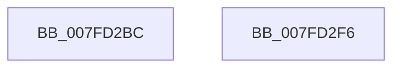

# MiDeletePartition

- RVA: `0x007FD2BC`–`0x007FD2F7` (길이 `59` bytes)
- VA: `0x00000001407FD2BC`
- 실행 섹션: `PAGE`
- PDB 이름 있음: `예`; PDB Function 태그: `아니요`
- unwind 정보 RVA: `0x0005CAAC`
- 디코드: `18`개 명령, `59/59` bytes 표시
- 미해석 바이트: `0` (있으면 어셈블리에 `.byte`로 보존)

> 이 문서는 커널 이미지의 기계어와 PDB 기호를 분석해 생성했습니다. 4번과 5번은 함수 원형과 자료형을 바이너리 사용 방식에서 추정한 C 해석이며 원본 소스 복구 결과는 아닙니다.

## 1. Dependencies

- 직접 호출 지점: **4**; 고유 호출 대상: **4**
- 직접 호출자로 확인된 함수: **2**
- RIP 상대 이미지 참조: **0**

### Outgoing calls
- `0x007FD2CC` → [MiDrainCrossPartitionUsage](../../text/69/MiDrainCrossPartitionUsage_function_00690984.md) (function, `0x00690984`)
- `0x007FD2D4` → [MiDeletePartitionResources](../80/MiDeletePartitionResources_function_0080D074.md) (function, `0x0080D074`)
- `0x007FD2DC` → [MiFreePartitionId](MiFreePartitionId_function_007FD300.md) (function, `0x007FD300`)
- `0x007FD2E6` → [ExFreePoolWithTag](../../poolcode/B8/ExFreePoolWithTag_function_00B82870.md) (function, `0x00B82870`)

### Direct callers
- [PspTeardownPartition](../78/PspTeardownPartition_function_00788480.md) at `0x007884C7`
- [MmCreatePartition](../80/MmCreatePartition_function_0080DC3C.md) at `0x0080DCFD`

### Static image references
- 디코드된 RIP-relative 메모리 참조가 없습니다.

## 2. Other-region calls and transfers

- 다른 실행 섹션으로 향하는 call: **2**
  - `0x007FD2CC` → [MiDrainCrossPartitionUsage](../../text/69/MiDrainCrossPartitionUsage_function_00690984.md) (`PAGE` → `.text`)
  - `0x007FD2E6` → [ExFreePoolWithTag](../../poolcode/B8/ExFreePoolWithTag_function_00B82870.md) (`PAGE` → `POOLCODE`)
- 별도 외부 분기/꼬리 이동을 확인하지 못했습니다.

## 3. Assembly (complete function range)

```asm
007FD2BC  48 89 5C 24 08                  mov qword ptr [rsp + 8], rbx
007FD2C1  57                              push rdi
007FD2C2  48 83 EC 20                     sub rsp, 0x20
007FD2C6  0F B7 19                        movzx ebx, word ptr [rcx]
007FD2C9  48 8B F9                        mov rdi, rcx
007FD2CC  E8 B3 36 E9 FF                  call 0x140690984
007FD2D1  48 8B CF                        mov rcx, rdi
007FD2D4  E8 9B FD 00 00                  call 0x14080d074
007FD2D9  0F B7 CB                        movzx ecx, bx
007FD2DC  E8 1F 00 00 00                  call 0x1407fd300
007FD2E1  33 D2                           xor edx, edx
007FD2E3  48 8B CF                        mov rcx, rdi
007FD2E6  E8 85 55 38 00                  call 0x140b82870
007FD2EB  48 8B 5C 24 30                  mov rbx, qword ptr [rsp + 0x30]
007FD2F0  48 83 C4 20                     add rsp, 0x20
007FD2F4  5F                              pop rdi
007FD2F5  C3                              ret
007FD2F6  CC                              int3
```

## 4. C-style interpretation (structured pseudocode)

```c
__int64 __fastcall MiDeletePartition(__int64 a1, int a2)
{
    __int64 result;
    __int64 v_rsp;
    unsigned __int64 v_stack_p8;

    v_stack_p8 = v_rbx;
    v_rsp = (v_rsp) - (32);
    result = MiDrainCrossPartitionUsage(a1, a2, a3, a4);
    result = MiDeletePartitionResources(a1, a2, a3, a4);
    result = MiFreePartitionId((unsigned __int16)(*(unsigned __int16 *)(a1)), a2, a3, a4);
    a2 = 0;
    result = ExFreePoolWithTag(a1, a2, a3, a4);
    v_rsp = (v_rsp) + (32);
    return result;
}
```

## 5. (Beta) C Style

```c
int64_t MiDeletePartition(void *Arg1, int32_t Arg2)
{
    uint8_t *arg1 = (uint8_t *)Arg1;

    int64_t result;
    int64_t local_rsp;
    uint64_t v_stack_p8;

    v_stack_p8 = local_rbx;
    local_rsp = (local_rsp) - (32);
    result = MiDrainCrossPartitionUsage(Arg1, Arg2, a3, a4);
    result = MiDeletePartitionResources(Arg1, Arg2, a3, a4);
    result = MiFreePartitionId((uint16_t)(*(uint16_t *)(arg1)), Arg2, a3, a4);
    Arg2 = 0;
    result = ExFreePoolWithTag(Arg1, Arg2, a3, a4);
    local_rsp = (local_rsp) + (32);
    return result;
}
```

### 관측된 메모리 오프셋

구조체 형식이 확인되지 않은 접근은 인자 기준의 오프셋으로만 기록했습니다.

| 기준 인자 | 오프셋 표현 | 폭 (bit) | 접근 |
|---|---:|---:|---|
| `Arg1` | `+ 0x0` | `16` | `R` |

## 6. Execution-region graph

[열기: 2D/3D 그래프와 함수 탐색 컨트롤 패널](../../../control-panel.html?section=page&rva=0x007FD2BC&view=graph)

- 2D 그래프는 위에서 아래로 흐르고, 3D 그래프는 빈 공간을 드래그해 회전합니다. Shift+드래그는 이동, 휠은 확대·축소, 함수 노드 선택은 대상 보고서 이동입니다.

### Static fallback


