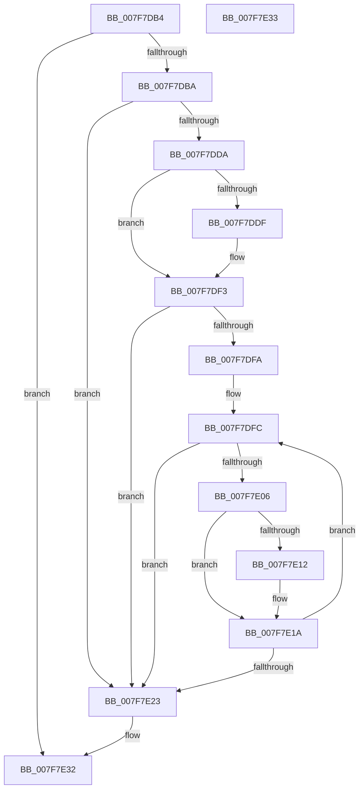

# MiDereferenceImports

- RVA: `0x007F7DB4`–`0x007F7E34` (길이 `128` bytes)
- VA: `0x00000001407F7DB4`
- 실행 섹션: `PAGE`
- PDB 이름 있음: `예`; PDB Function 태그: `아니요`
- unwind 정보 RVA: `0x000D2938`
- 디코드: `41`개 명령, `128/128` bytes 표시
- 미해석 바이트: `0` (있으면 어셈블리에 `.byte`로 보존)

> 이 문서는 커널 이미지의 기계어와 PDB 기호를 분석해 생성했습니다. 4번과 5번은 함수 원형과 자료형을 바이너리 사용 방식에서 추정한 C 해석이며 원본 소스 복구 결과는 아닙니다.

## 1. Dependencies

- 직접 호출 지점: **2**; 고유 호출 대상: **2**
- 직접 호출자로 확인된 함수: **2**
- RIP 상대 이미지 참조: **0**

### Outgoing calls
- `0x007F7E09` → [MiUnloadApproved](MiUnloadApproved_function_007F82A0.md) (function, `0x007F82A0`)
- `0x007F7E15` → [MiUnloadSystemImage](../AA/MiUnloadSystemImage_function_00AA2FD4.md) (function, `0x00AA2FD4`)

### Direct callers
- [MiUnloadSystemImage](../AA/MiUnloadSystemImage_function_00AA2FD4.md) at `0x00AA31CE`
- [sub_00B37A8C](../B3/Unknown_function_00B37A8C.md) at `0x00B37C84`

### Static image references
- 디코드된 RIP-relative 메모리 참조가 없습니다.

## 2. Other-region calls and transfers

- 다른 실행 섹션으로 향하는 call: **0**
- 별도 외부 분기/꼬리 이동을 확인하지 못했습니다.

## 3. Assembly (complete function range)

```asm
007F7DB4  48 83 F9 01                     cmp rcx, 1
007F7DB8  74 78                           je 0x1407f7e32
007F7DBA  48 8B C4                        mov rax, rsp
007F7DBD  48 89 58 08                     mov qword ptr [rax + 8], rbx
007F7DC1  48 89 70 10                     mov qword ptr [rax + 0x10], rsi
007F7DC5  57                              push rdi
007F7DC6  48 83 EC 30                     sub rsp, 0x30
007F7DCA  0F 57 C0                        xorps xmm0, xmm0
007F7DCD  48 8B D9                        mov rbx, rcx
007F7DD0  0F 11 40 E8                     movups xmmword ptr [rax - 0x18], xmm0
007F7DD4  48 83 F9 FE                     cmp rcx, -2
007F7DD8  74 49                           je 0x1407f7e23
007F7DDA  F6 C3 01                        test bl, 1
007F7DDD  74 14                           je 0x1407f7df3
007F7DDF  48 83 E3 FE                     and rbx, 0xfffffffffffffffe
007F7DE3  48 C7 40 E8 01 00 00 00         mov qword ptr [rax - 0x18], 1
007F7DEB  48 89 58 F0                     mov qword ptr [rax - 0x10], rbx
007F7DEF  48 8D 58 E8                     lea rbx, [rax - 0x18]
007F7DF3  33 FF                           xor edi, edi
007F7DF5  48 39 3B                        cmp qword ptr [rbx], rdi
007F7DF8  76 29                           jbe 0x1407f7e23
007F7DFA  33 C0                           xor eax, eax
007F7DFC  48 8B 74 C3 08                  mov rsi, qword ptr [rbx + rax*8 + 8]
007F7E01  48 85 F6                        test rsi, rsi
007F7E04  74 1D                           je 0x1407f7e23
007F7E06  48 8B CE                        mov rcx, rsi
007F7E09  E8 92 04 00 00                  call 0x1407f82a0
007F7E0E  85 C0                           test eax, eax
007F7E10  74 08                           je 0x1407f7e1a
007F7E12  48 8B CE                        mov rcx, rsi
007F7E15  E8 BA B1 2A 00                  call 0x140aa2fd4
007F7E1A  FF C7                           inc edi
007F7E1C  8B C7                           mov eax, edi
007F7E1E  48 3B 03                        cmp rax, qword ptr [rbx]
007F7E21  72 D9                           jb 0x1407f7dfc
007F7E23  48 8B 5C 24 40                  mov rbx, qword ptr [rsp + 0x40]
007F7E28  48 8B 74 24 48                  mov rsi, qword ptr [rsp + 0x48]
007F7E2D  48 83 C4 30                     add rsp, 0x30
007F7E31  5F                              pop rdi
007F7E32  C3                              ret
007F7E33  CC                              int3
```

## 4. C-style interpretation (structured pseudocode)

```c
__int64 __fastcall MiDereferenceImports(__int64 a1)
{
    __int64 result;
    __int64 v_rbx;
    __int64 v_rdi;
    __int64 v_rsp;
    unsigned __int64 v_stack_p10;
    unsigned __int64 v_stack_p8;

    if (a1 == 1) goto loc_007F7E32;
    *(unsigned __int64 *)(v_rsp + 8) = v_rbx;
    *(unsigned __int64 *)(v_rsp + 16) = v_rsi;
    v_rsp = (v_rsp) - (48);
    *(unsigned __int64 *)(v_rsp - 24) = v_xmm0;
    if (a1 == -2) goto loc_007F7E23;
    v_rbx = a1;
    if ((((unsigned __int8)(a1)) & (1)) != 0) {
        v_rbx = (a1) & (-2);
        *(unsigned __int64 *)(v_rsp - 24) = 1;
        *(unsigned __int64 *)(v_rsp - 16) = v_rbx;
        v_rbx = v_rsp - 24;
    }
    v_rdi = 0;
    if ((*(unsigned __int64 *)(v_rbx)) <= 0) goto loc_007F7E23;
    result = 0;
loc_007F7DFC:
    if (*(unsigned __int64 *)(v_rbx + result * 8 + 8) == 0) goto loc_007F7E23;
    result = MiUnloadApproved(*(unsigned __int64 *)(v_rbx + result * 8 + 8), a2, a3, a4);
    if ((unsigned int)(result) != 0) {
        a1 = *(unsigned __int64 *)(v_rbx + result * 8 + 8);
        result = MiUnloadSystemImage(a1, a2, a3, a4);
    }
    v_rdi = (unsigned int)((v_rdi) + 1);
    if (((unsigned int)((unsigned int)(v_rdi))) < (*(unsigned __int64 *)(v_rbx))) goto loc_007F7DFC;
loc_007F7E23:
    v_rsp = (v_rsp) + (48);
loc_007F7E32:
    return (unsigned int)((unsigned int)(v_rdi));
}
```

## 5. (Beta) C Style

```c
int64_t MiDereferenceImports(int64_t Arg1)
{
    int64_t result;
    int64_t local_rbx;
    int64_t local_rdi;
    int64_t local_rsp;
    uint64_t v_stack_p10;
    uint64_t v_stack_p8;

    if (Arg1 == 1) goto loc_007F7E32;
    *(uint64_t *)(local_rsp + 0x8) = local_rbx;
    *(uint64_t *)(local_rsp + 0x10) = local_rsi;
    local_rsp = (local_rsp) - (48);
    *(uint64_t *)(local_rsp - 0x18) = v_xmm0;
    if (Arg1 == -2) goto loc_007F7E23;
    local_rbx = Arg1;
    if ((((uint8_t)(Arg1)) & (1)) != 0) {
        local_rbx = (Arg1) & (-2);
        *(uint64_t *)(local_rsp - 0x18) = 1;
        *(uint64_t *)(local_rsp - 0x10) = local_rbx;
        local_rbx = local_rsp - 24;
    }
    local_rdi = 0;
    if ((*(uint64_t *)(local_rbx)) <= 0) goto loc_007F7E23;
    result = 0;
loc_007F7DFC:
    if (*(uint64_t *)(local_rbx + result * 8 + 0x8) == 0) goto loc_007F7E23;
    result = MiUnloadApproved(*(uint64_t *)(local_rbx + result * 8 + 0x8), a2, a3, a4);
    if ((uint32_t)(result) != 0) {
        Arg1 = *(uint64_t *)(local_rbx + result * 8 + 0x8);
        result = MiUnloadSystemImage(Arg1, a2, a3, a4);
    }
    local_rdi = (uint32_t)((local_rdi) + 1);
    if (((uint32_t)((uint32_t)(local_rdi))) < (*(uint64_t *)(local_rbx))) goto loc_007F7DFC;
loc_007F7E23:
    local_rsp = (local_rsp) + (48);
loc_007F7E32:
    return (uint32_t)((uint32_t)(local_rdi));
}
```

## 6. Execution-region graph

[열기: 2D/3D 그래프와 함수 탐색 컨트롤 패널](../../../control-panel.html?section=page&rva=0x007F7DB4&view=graph)

- 2D 그래프는 위에서 아래로 흐르고, 3D 그래프는 빈 공간을 드래그해 회전합니다. Shift+드래그는 이동, 휠은 확대·축소, 함수 노드 선택은 대상 보고서 이동입니다.

### Static fallback


