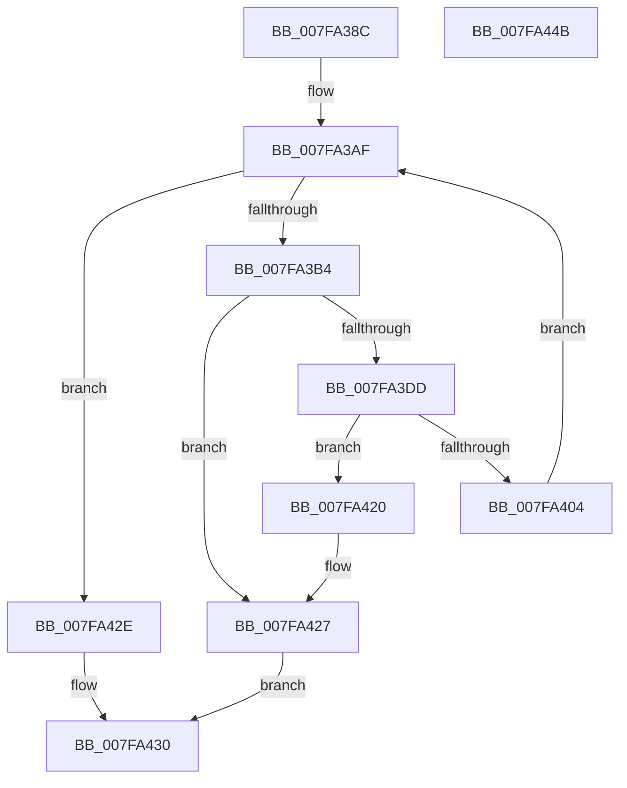

# MiDescribePageRun

- RVA: `0x007FA38C`–`0x007FA44C` (길이 `192` bytes)
- VA: `0x00000001407FA38C`
- 실행 섹션: `PAGE`
- PDB 이름 있음: `예`; PDB Function 태그: `아니요`
- unwind 정보 RVA: `0x0005E6B4`
- 디코드: `56`개 명령, `192/192` bytes 표시
- 미해석 바이트: `0` (있으면 어셈블리에 `.byte`로 보존)

> 이 문서는 커널 이미지의 기계어와 PDB 기호를 분석해 생성했습니다. 4번과 5번은 함수 원형과 자료형을 바이너리 사용 방식에서 추정한 C 해석이며 원본 소스 복구 결과는 아닙니다.

## 1. Dependencies

- 직접 호출 지점: **4**; 고유 호출 대상: **4**
- 직접 호출자로 확인된 함수: **2**
- RIP 상대 이미지 참조: **0**

### Outgoing calls
- `0x007FA3BA` → [MiRestrictRangeToNode](../../text/40/MiRestrictRangeToNode_function_0040199C.md) (function, `0x0040199C`)
- `0x007FA3D0` → [MiAllocatePool](../../text/35/MiAllocatePool_function_0035B540.md) (function, `0x0035B540`)
- `0x007FA3E8` → [MiPageToChannel](../../text/2B/MiPageToChannel_function_002B9B48.md) (function, `0x002B9B48`)
- `0x007FA3F3` → [MiPageToNode](../../text/33/MiPageToNode_function_00338CD0.md) (function, `0x00338CD0`)

### Direct callers
- [MiAllocateInitialMemoryBlocks](MiAllocateInitialMemoryBlocks_function_007F9E34.md) at `0x007F9EB4`
- [MiCreateNodeLists](MiCreateNodeLists_function_007FA220.md) at `0x007FA26D`

### Static image references
- 디코드된 RIP-relative 메모리 참조가 없습니다.

## 2. Other-region calls and transfers

- 다른 실행 섹션으로 향하는 call: **4**
  - `0x007FA3BA` → [MiRestrictRangeToNode](../../text/40/MiRestrictRangeToNode_function_0040199C.md) (`PAGE` → `.text`)
  - `0x007FA3D0` → [MiAllocatePool](../../text/35/MiAllocatePool_function_0035B540.md) (`PAGE` → `.text`)
  - `0x007FA3E8` → [MiPageToChannel](../../text/2B/MiPageToChannel_function_002B9B48.md) (`PAGE` → `.text`)
  - `0x007FA3F3` → [MiPageToNode](../../text/33/MiPageToNode_function_00338CD0.md) (`PAGE` → `.text`)
- 별도 외부 분기/꼬리 이동을 확인하지 못했습니다.

## 3. Assembly (complete function range)

```asm
007FA38C  48 8B C4                        mov rax, rsp
007FA38F  48 89 58 08                     mov qword ptr [rax + 8], rbx
007FA393  48 89 68 10                     mov qword ptr [rax + 0x10], rbp
007FA397  48 89 70 18                     mov qword ptr [rax + 0x18], rsi
007FA39B  48 89 78 20                     mov qword ptr [rax + 0x20], rdi
007FA39F  41 56                           push r14
007FA3A1  48 83 EC 20                     sub rsp, 0x20
007FA3A5  48 8B DA                        mov rbx, rdx
007FA3A8  4A 8D 2C 02                     lea rbp, [rdx + r8]
007FA3AC  48 8B F1                        mov rsi, rcx
007FA3AF  48 3B DD                        cmp rbx, rbp
007FA3B2  74 7A                           je 0x1407fa42e
007FA3B4  49 8B D0                        mov rdx, r8
007FA3B7  48 8B CB                        mov rcx, rbx
007FA3BA  E8 DD 75 C0 FF                  call 0x14040199c
007FA3BF  BA 28 00 00 00                  mov edx, 0x28
007FA3C4  41 B8 4D 6D 4E 6F               mov r8d, 0x6f4e6d4d
007FA3CA  4C 8B F0                        mov r14, rax
007FA3CD  8D 4A 18                        lea ecx, [rdx + 0x18]
007FA3D0  E8 6B 11 B6 FF                  call 0x14035b540
007FA3D5  48 8B F8                        mov rdi, rax
007FA3D8  48 85 C0                        test rax, rax
007FA3DB  74 4A                           je 0x1407fa427
007FA3DD  48 8B CB                        mov rcx, rbx
007FA3E0  48 89 58 10                     mov qword ptr [rax + 0x10], rbx
007FA3E4  4C 89 70 18                     mov qword ptr [rax + 0x18], r14
007FA3E8  E8 5B F7 AB FF                  call 0x1402b9b48
007FA3ED  48 8B CB                        mov rcx, rbx
007FA3F0  88 47 24                        mov byte ptr [rdi + 0x24], al
007FA3F3  E8 D8 E8 B3 FF                  call 0x140338cd0
007FA3F8  89 47 20                        mov dword ptr [rdi + 0x20], eax
007FA3FB  48 8B 46 08                     mov rax, qword ptr [rsi + 8]
007FA3FF  48 39 30                        cmp qword ptr [rax], rsi
007FA402  75 1C                           jne 0x1407fa420
007FA404  48 89 37                        mov qword ptr [rdi], rsi
007FA407  49 03 DE                        add rbx, r14
007FA40A  48 89 47 08                     mov qword ptr [rdi + 8], rax
007FA40E  4C 8B C5                        mov r8, rbp
007FA411  48 89 38                        mov qword ptr [rax], rdi
007FA414  48 89 7E 08                     mov qword ptr [rsi + 8], rdi
007FA418  FF 46 10                        inc dword ptr [rsi + 0x10]
007FA41B  4C 2B C3                        sub r8, rbx
007FA41E  EB 8F                           jmp 0x1407fa3af
007FA420  B9 03 00 00 00                  mov ecx, 3
007FA425  CD 29                           int 0x29
007FA427  B8 9A 00 00 C0                  mov eax, 0xc000009a
007FA42C  EB 02                           jmp 0x1407fa430
007FA42E  33 C0                           xor eax, eax
007FA430  48 8B 5C 24 30                  mov rbx, qword ptr [rsp + 0x30]
007FA435  48 8B 6C 24 38                  mov rbp, qword ptr [rsp + 0x38]
007FA43A  48 8B 74 24 40                  mov rsi, qword ptr [rsp + 0x40]
007FA43F  48 8B 7C 24 48                  mov rdi, qword ptr [rsp + 0x48]
007FA444  48 83 C4 20                     add rsp, 0x20
007FA448  41 5E                           pop r14
007FA44A  C3                              ret
007FA44B  CC                              int3
```

## 4. C-style interpretation (structured pseudocode)

```c
__int64 __fastcall MiDescribePageRun(__int64 a1, __int64 a2, __int64 a3)
{
    __int64 result;
    __int64 v_rbx;
    __int64 v_rsp;
    unsigned __int64 v_stack_p10;
    unsigned __int64 v_stack_p18;
    unsigned __int64 v_stack_p20;
    unsigned __int64 v_stack_p8;

    *(unsigned __int64 *)(v_rsp + 8) = v_rbx;
    *(unsigned __int64 *)(v_rsp + 16) = v_rbp;
    *(unsigned __int64 *)(v_rsp + 24) = v_rsi;
    *(unsigned __int64 *)(v_rsp + 32) = v_rdi;
    v_rsp = (v_rsp) - (32);
loc_007FA3AF:
    if (a2 == (a2 + a3 * 1)) goto loc_007FA42E;
    result = MiRestrictRangeToNode(a2, a3, a3, a4);
    result = MiAllocatePool(40 + 24, 40, (unsigned int)(0x6F4E6D4DULL), a4);
    if (result == 0) goto loc_007FA427;
    *(unsigned __int64 *)(result + 16) = a2;
    *(unsigned __int64 *)(result + 24) = result;
    result = MiPageToChannel(a2, 40, (unsigned int)(0x6F4E6D4DULL), a4);
    *(unsigned __int8 *)(result + 36) = (unsigned __int8)(result);
    result = MiPageToNode(a2, 40, (unsigned int)(0x6F4E6D4DULL), a4);
    *(unsigned int *)(result + 32) = (unsigned int)(result);
    if ((*(unsigned __int64 *)(*(unsigned __int64 *)(a1 + 8))) != a1) goto loc_007FA420;
    *(unsigned __int64 *)(result) = a1;
    v_rbx = (a2) + (result);
    *(unsigned __int64 *)(result + 8) = *(unsigned __int64 *)(a1 + 8);
    *(unsigned __int64 *)(*(unsigned __int64 *)(a1 + 8)) = result;
    *(unsigned __int64 *)(a1 + 8) = result;
    a3 = (a2 + a3 * 1) - (v_rbx);
    goto loc_007FA3AF;
loc_007FA420:
loc_007FA427:
    goto loc_007FA430;
loc_007FA42E:
    result = 0;
loc_007FA430:
    v_rsp = (v_rsp) + (32);
    return result;
}
```

## 5. (Beta) C Style

```c
int64_t MiDescribePageRun(void *Arg1, void *Arg2, int64_t Arg3)
{
    uint8_t *arg1 = (uint8_t *)Arg1;
    uint8_t *arg2 = (uint8_t *)Arg2;

    int64_t result;
    int64_t local_rbx;
    int64_t local_rsp;
    uint64_t v_stack_p10;
    uint64_t v_stack_p18;
    uint64_t v_stack_p20;
    uint64_t v_stack_p8;

    *(uint64_t *)(local_rsp + 0x8) = local_rbx;
    *(uint64_t *)(local_rsp + 0x10) = local_rbp;
    *(uint64_t *)(local_rsp + 0x18) = local_rsi;
    *(uint64_t *)(local_rsp + 0x20) = local_rdi;
    local_rsp = (local_rsp) - (32);
loc_007FA3AF:
    if (Arg2 == (Arg2 + Arg3 * 1)) goto loc_007FA42E;
    result = MiRestrictRangeToNode(Arg2, Arg3, Arg3, a4);
    result = MiAllocatePool(40 + 24, 40, (uint32_t)(0x6F4E6D4DULL), a4);
    if (result == 0) goto loc_007FA427;
    *(void **)(result + 0x10) = Arg2;
    *(uint64_t *)(result + 0x18) = result;
    result = MiPageToChannel(Arg2, 40, (uint32_t)(0x6F4E6D4DULL), a4);
    *(uint8_t *)(result + 0x24) = (uint8_t)(result);
    result = MiPageToNode(Arg2, 40, (uint32_t)(0x6F4E6D4DULL), a4);
    *(uint32_t *)(result + 0x20) = (uint32_t)(result);
    if ((*(uint64_t *)(*(uint64_t *)(arg1 + 0x8))) != Arg1) goto loc_007FA420;
    *(void **)(result) = Arg1;
    local_rbx = (Arg2) + (result);
    *(uint64_t *)(result + 0x8) = *(uint64_t *)(arg1 + 0x8);
    *(uint64_t *)(*(uint64_t *)(arg1 + 0x8)) = result;
    *(uint64_t *)(arg1 + 0x8) = result;
    Arg3 = (Arg2 + Arg3 * 1) - (local_rbx);
    goto loc_007FA3AF;
loc_007FA420:
loc_007FA427:
    goto loc_007FA430;
loc_007FA42E:
    result = 0;
loc_007FA430:
    local_rsp = (local_rsp) + (32);
    return result;
}
```

### 관측된 메모리 오프셋

구조체 형식이 확인되지 않은 접근은 인자 기준의 오프셋으로만 기록했습니다.

| 기준 인자 | 오프셋 표현 | 폭 (bit) | 접근 |
|---|---:|---:|---|
| `Arg1` | `+ 0x8` | `64` | `R` |
| `Arg1` | `+ 0x8` | `64` | `W` |
| `Arg1` | `+ 0x10` | `32` | `R/W` |
| `Arg2` | `+ 0x0 + r8*1` | `64` | `R` |

## 6. Execution-region graph

[열기: 2D/3D 그래프와 함수 탐색 컨트롤 패널](../../../control-panel.html?section=page&rva=0x007FA38C&view=graph)

- 2D 그래프는 위에서 아래로 흐르고, 3D 그래프는 빈 공간을 드래그해 회전합니다. Shift+드래그는 이동, 휠은 확대·축소, 함수 노드 선택은 대상 보고서 이동입니다.

### Static fallback


