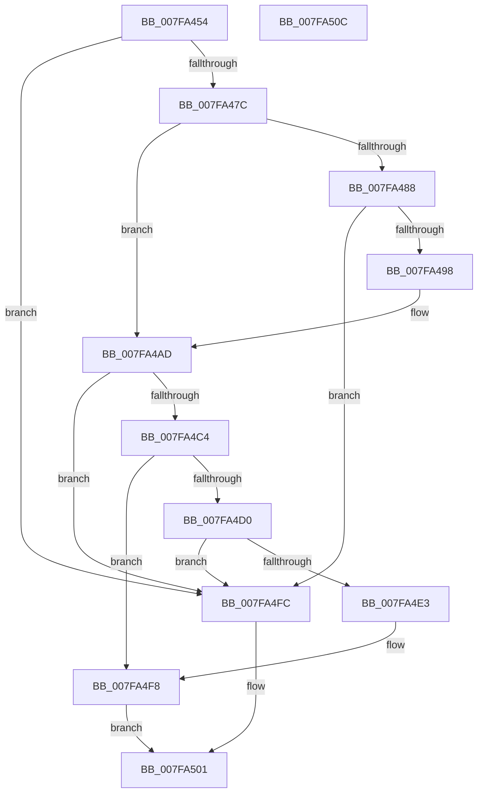

# MiExtendMemoryBlocks

- RVA: `0x007FA454`–`0x007FA50D` (길이 `185` bytes)
- VA: `0x00000001407FA454`
- 실행 섹션: `PAGE`
- PDB 이름 있음: `예`; PDB Function 태그: `아니요`
- unwind 정보 RVA: `0x0005CAAC`
- 디코드: `46`개 명령, `185/185` bytes 표시
- 미해석 바이트: `0` (있으면 어셈블리에 `.byte`로 보존)

> 이 문서는 커널 이미지의 기계어와 PDB 기호를 분석해 생성했습니다. 4번과 5번은 함수 원형과 자료형을 바이너리 사용 방식에서 추정한 C 해석이며 원본 소스 복구 결과는 아닙니다.

## 1. Dependencies

- 직접 호출 지점: **4**; 고유 호출 대상: **2**
- 직접 호출자로 확인된 함수: **1**
- RIP 상대 이미지 참조: **4**

### Outgoing calls
- `0x007FA48B` → [MiAllocateMemoryBlock](MiAllocateMemoryBlock_function_007F9F20.md) (function, `0x007F9F20`)
- `0x007FA4A1` → [ExFreePoolWithTag](../../poolcode/B8/ExFreePoolWithTag_function_00B82870.md) (function, `0x00B82870`)
- `0x007FA4D6` → [MiAllocateMemoryBlock](MiAllocateMemoryBlock_function_007F9F20.md) (function, `0x007F9F20`)
- `0x007FA4EC` → [ExFreePoolWithTag](../../poolcode/B8/ExFreePoolWithTag_function_00B82870.md) (function, `0x00B82870`)

### Direct callers
- [MiHonorExistingHotMemoryFlights](MiHonorExistingHotMemoryFlights_function_007FA514.md) at `0x007FA5FB`

### Static image references
- `0x007FA461` → RVA `0x00FC6B88` (`ALMOSTRO`; read)
- `0x007FA46A` → RVA `0x00E2ED10` (`.data`; read)
- `0x007FA4AD` → RVA `0x00E38D20` (`.data`; read)
- `0x007FA4B6` → RVA `0x00E2ED14` (`.data`; read)

## 2. Other-region calls and transfers

- 다른 실행 섹션으로 향하는 call: **2**
  - `0x007FA4A1` → [ExFreePoolWithTag](../../poolcode/B8/ExFreePoolWithTag_function_00B82870.md) (`PAGE` → `POOLCODE`)
  - `0x007FA4EC` → [ExFreePoolWithTag](../../poolcode/B8/ExFreePoolWithTag_function_00B82870.md) (`PAGE` → `POOLCODE`)
- 별도 외부 분기/꼬리 이동을 확인하지 못했습니다.

## 3. Assembly (complete function range)

```asm
007FA454  48 89 5C 24 08                  mov qword ptr [rsp + 8], rbx
007FA459  57                              push rdi
007FA45A  48 83 EC 20                     sub rsp, 0x20
007FA45E  48 8B D9                        mov rbx, rcx
007FA461  48 8B 0D 20 C7 7C 00            mov rcx, qword ptr [rip + 0x7cc720]
007FA468  8B 11                           mov edx, dword ptr [rcx]
007FA46A  03 15 A0 48 63 00               add edx, dword ptr [rip + 0x6348a0]
007FA470  3B 15 9A 48 63 00               cmp edx, dword ptr [rip + 0x63489a]
007FA476  0F 86 80 00 00 00               jbe 0x1407fa4fc
007FA47C  48 8B 83 A0 00 00 00            mov rax, qword ptr [rbx + 0xa0]
007FA483  39 50 10                        cmp dword ptr [rax + 0x10], edx
007FA486  73 25                           jae 0x1407fa4ad
007FA488  45 33 C0                        xor r8d, r8d
007FA48B  E8 90 FA FF FF                  call 0x1407f9f20
007FA490  48 8B F8                        mov rdi, rax
007FA493  48 85 C0                        test rax, rax
007FA496  74 64                           je 0x1407fa4fc
007FA498  48 8B 8B A0 00 00 00            mov rcx, qword ptr [rbx + 0xa0]
007FA49F  33 D2                           xor edx, edx
007FA4A1  E8 CA 83 38 00                  call 0x140b82870
007FA4A6  48 89 BB A0 00 00 00            mov qword ptr [rbx + 0xa0], rdi
007FA4AD  48 8B 0D 6C E8 63 00            mov rcx, qword ptr [rip + 0x63e86c]
007FA4B4  8B 11                           mov edx, dword ptr [rcx]
007FA4B6  03 15 58 48 63 00               add edx, dword ptr [rip + 0x634858]
007FA4BC  3B 15 52 48 63 00               cmp edx, dword ptr [rip + 0x634852]
007FA4C2  76 38                           jbe 0x1407fa4fc
007FA4C4  48 8B 83 A8 00 00 00            mov rax, qword ptr [rbx + 0xa8]
007FA4CB  39 50 10                        cmp dword ptr [rax + 0x10], edx
007FA4CE  73 28                           jae 0x1407fa4f8
007FA4D0  41 B8 01 00 00 00               mov r8d, 1
007FA4D6  E8 45 FA FF FF                  call 0x1407f9f20
007FA4DB  48 8B F8                        mov rdi, rax
007FA4DE  48 85 C0                        test rax, rax
007FA4E1  74 19                           je 0x1407fa4fc
007FA4E3  48 8B 8B A8 00 00 00            mov rcx, qword ptr [rbx + 0xa8]
007FA4EA  33 D2                           xor edx, edx
007FA4EC  E8 7F 83 38 00                  call 0x140b82870
007FA4F1  48 89 BB A8 00 00 00            mov qword ptr [rbx + 0xa8], rdi
007FA4F8  33 C0                           xor eax, eax
007FA4FA  EB 05                           jmp 0x1407fa501
007FA4FC  B8 9A 00 00 C0                  mov eax, 0xc000009a
007FA501  48 8B 5C 24 30                  mov rbx, qword ptr [rsp + 0x30]
007FA506  48 83 C4 20                     add rsp, 0x20
007FA50A  5F                              pop rdi
007FA50B  C3                              ret
007FA50C  CC                              int3
```

## 4. C-style interpretation (structured pseudocode)

```c
__int64 __fastcall MiExtendMemoryBlocks(__int64 a1, __int64 a2, int a3)
{
    __int64 result;
    __int64 v_rsp;
    unsigned __int64 v_stack_p8;

    v_stack_p8 = v_rbx;
    v_rsp = (v_rsp) - (32);
    a2 = (unsigned int)(((unsigned int)(*(unsigned int *)(*(unsigned __int64 *)(v_rip + 8177440)))) + (*(unsigned int *)(v_rip + 6506656)));
    if (((unsigned int)(a2)) <= (*(unsigned int *)(v_rip + 6506650))) goto loc_007FA4FC;
    if ((*(unsigned int *)(*(unsigned __int64 *)(a1 + 160) + 16)) >= ((unsigned int)(a2))) goto loc_007FA4AD;
    a3 = 0;
    result = MiAllocateMemoryBlock(*(unsigned __int64 *)(v_rip + 8177440), a2, a3, a4);
    if (result == 0) goto loc_007FA4FC;
    a2 = 0;
    result = ExFreePoolWithTag(*(unsigned __int64 *)(a1 + 160), a2, a3, a4);
    *(unsigned __int64 *)(a1 + 160) = result;
loc_007FA4AD:
    a2 = (unsigned int)(((unsigned int)(*(unsigned int *)(*(unsigned __int64 *)(v_rip + 6547564)))) + (*(unsigned int *)(v_rip + 6506584)));
    if (((unsigned int)(a2)) <= (*(unsigned int *)(v_rip + 6506578))) goto loc_007FA4FC;
    if ((*(unsigned int *)(*(unsigned __int64 *)(a1 + 168) + 16)) >= ((unsigned int)(a2))) goto loc_007FA4F8;
    result = MiAllocateMemoryBlock(*(unsigned __int64 *)(v_rip + 6547564), a2, 1, a4);
    if (result == 0) goto loc_007FA4FC;
    a2 = 0;
    result = ExFreePoolWithTag(*(unsigned __int64 *)(a1 + 168), a2, 1, a4);
    *(unsigned __int64 *)(a1 + 168) = result;
loc_007FA4F8:
    result = 0;
    goto loc_007FA501;
loc_007FA4FC:
loc_007FA501:
    v_rsp = (v_rsp) + (32);
    return (unsigned int)(0xC000009AULL);
}
```

## 5. (Beta) C Style

```c
int64_t MiExtendMemoryBlocks(void *Arg1, int64_t Arg2, int32_t Arg3)
{
    uint8_t *arg1 = (uint8_t *)Arg1;

    int64_t result;
    int64_t local_rsp;
    uint64_t v_stack_p8;

    v_stack_p8 = local_rbx;
    local_rsp = (local_rsp) - (32);
    Arg2 = (uint32_t)(((uint32_t)(*(uint32_t *)(*(uint64_t *)(v_rip + 0x7CC720)))) + (*(uint32_t *)(v_rip + 0x6348A0)));
    if (((uint32_t)(Arg2)) <= (*(uint32_t *)(v_rip + 0x63489A))) goto loc_007FA4FC;
    if ((*(uint32_t *)(*(uint64_t *)(arg1 + 0xA0) + 0x10)) >= ((uint32_t)(Arg2))) goto loc_007FA4AD;
    Arg3 = 0;
    result = MiAllocateMemoryBlock(*(uint64_t *)(v_rip + 0x7CC720), Arg2, Arg3, a4);
    if (result == 0) goto loc_007FA4FC;
    Arg2 = 0;
    result = ExFreePoolWithTag(*(uint64_t *)(arg1 + 0xA0), Arg2, Arg3, a4);
    *(uint64_t *)(arg1 + 0xA0) = result;
loc_007FA4AD:
    Arg2 = (uint32_t)(((uint32_t)(*(uint32_t *)(*(uint64_t *)(v_rip + 0x63E86C)))) + (*(uint32_t *)(v_rip + 0x634858)));
    if (((uint32_t)(Arg2)) <= (*(uint32_t *)(v_rip + 0x634852))) goto loc_007FA4FC;
    if ((*(uint32_t *)(*(uint64_t *)(arg1 + 0xA8) + 0x10)) >= ((uint32_t)(Arg2))) goto loc_007FA4F8;
    result = MiAllocateMemoryBlock(*(uint64_t *)(v_rip + 0x63E86C), Arg2, 1, a4);
    if (result == 0) goto loc_007FA4FC;
    Arg2 = 0;
    result = ExFreePoolWithTag(*(uint64_t *)(arg1 + 0xA8), Arg2, 1, a4);
    *(uint64_t *)(arg1 + 0xA8) = result;
loc_007FA4F8:
    result = 0;
    goto loc_007FA501;
loc_007FA4FC:
loc_007FA501:
    local_rsp = (local_rsp) + (32);
    return (uint32_t)(0xC000009AULL);
}
```

### 관측된 메모리 오프셋

구조체 형식이 확인되지 않은 접근은 인자 기준의 오프셋으로만 기록했습니다.

| 기준 인자 | 오프셋 표현 | 폭 (bit) | 접근 |
|---|---:|---:|---|
| `Arg1` | `+ 0xA0` | `64` | `R` |
| `Arg1` | `+ 0xA0` | `64` | `W` |
| `Arg1` | `+ 0xA8` | `64` | `R` |
| `Arg1` | `+ 0xA8` | `64` | `W` |

## 6. Execution-region graph

[열기: 2D/3D 그래프와 함수 탐색 컨트롤 패널](../../../control-panel.html?section=page&rva=0x007FA454&view=graph)

- 2D 그래프는 위에서 아래로 흐르고, 3D 그래프는 빈 공간을 드래그해 회전합니다. Shift+드래그는 이동, 휠은 확대·축소, 함수 노드 선택은 대상 보고서 이동입니다.

### Static fallback


