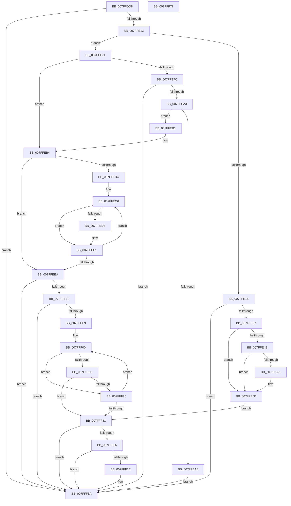

# MiExtendPagingFiles

- RVA: `0x007FFDD8`–`0x007FFF78` (길이 `416` bytes)
- VA: `0x00000001407FFDD8`
- 실행 섹션: `PAGE`
- PDB 이름 있음: `예`; PDB Function 태그: `아니요`
- unwind 정보 RVA: `0x0008C20C`
- 디코드: `119`개 명령, `416/416` bytes 표시
- 미해석 바이트: `0` (있으면 어셈블리에 `.byte`로 보존)

> 이 문서는 커널 이미지의 기계어와 PDB 기호를 분석해 생성했습니다. 4번과 5번은 함수 원형과 자료형을 바이너리 사용 방식에서 추정한 C 해석이며 원본 소스 복구 결과는 아닙니다.

## 1. Dependencies

- 직접 호출 지점: **4**; 고유 호출 대상: **3**
- 직접 호출자로 확인된 함수: **1**
- RIP 상대 이미지 참조: **0**

### Outgoing calls
- `0x007FFE40` → [MiAttemptPageFileExtension](MiAttemptPageFileExtension_function_007FEA2C.md) (function, `0x007FEA2C`)
- `0x007FFE56` → [MiUpdatePagingFileMinimum](../../text/68/MiUpdatePagingFileMinimum_function_00680498.md) (function, `0x00680498`)
- `0x007FFF16` → [MiAttemptPageFileExtension](MiAttemptPageFileExtension_function_007FEA2C.md) (function, `0x007FEA2C`)
- `0x007FFF55` → [MiIncreaseCommitLimits](../../text/68/MiIncreaseCommitLimits_function_0068CADC.md) (function, `0x0068CADC`)

### Direct callers
- [MiHandlePageFileSizeChanges](../../text/48/MiHandlePageFileSizeChanges_function_004811D0.md) at `0x00481357`

### Static image references
- 디코드된 RIP-relative 메모리 참조가 없습니다.

## 2. Other-region calls and transfers

- 다른 실행 섹션으로 향하는 call: **2**
  - `0x007FFE56` → [MiUpdatePagingFileMinimum](../../text/68/MiUpdatePagingFileMinimum_function_00680498.md) (`PAGE` → `.text`)
  - `0x007FFF55` → [MiIncreaseCommitLimits](../../text/68/MiIncreaseCommitLimits_function_0068CADC.md) (`PAGE` → `.text`)
- 별도 외부 분기/꼬리 이동을 확인하지 못했습니다.

## 3. Assembly (complete function range)

```asm
007FFDD8  48 89 5C 24 08                  mov qword ptr [rsp + 8], rbx
007FFDDD  48 89 6C 24 10                  mov qword ptr [rsp + 0x10], rbp
007FFDE2  48 89 74 24 18                  mov qword ptr [rsp + 0x18], rsi
007FFDE7  57                              push rdi
007FFDE8  41 54                           push r12
007FFDEA  41 55                           push r13
007FFDEC  41 56                           push r14
007FFDEE  41 57                           push r15
007FFDF0  48 83 EC 30                     sub rsp, 0x30
007FFDF4  4C 8B 71 18                     mov r14, qword ptr [rcx + 0x18]
007FFDF8  48 8B D9                        mov rbx, rcx
007FFDFB  48 8B 79 20                     mov rdi, qword ptr [rcx + 0x20]
007FFDFF  0F B6 41 4C                     movzx eax, byte ptr [rcx + 0x4c]
007FFE03  45 8B BE 58 48 00 00            mov r15d, dword ptr [r14 + 0x4858]
007FFE0A  45 85 FF                        test r15d, r15d
007FFE0D  0F 84 47 01 00 00               je 0x1407fff5a
007FFE13  41 3B C7                        cmp eax, r15d
007FFE16  73 59                           jae 0x1407ffe71
007FFE18  0F AE E8                        lfence
007FFE1B  4D 8B BC C6 60 48 00 00         mov r15, qword ptr [r14 + rax*8 + 0x4860]
007FFE23  41 8B 4F 04                     mov ecx, dword ptr [r15 + 4]
007FFE27  41 8B 07                        mov eax, dword ptr [r15]
007FFE2A  2B C8                           sub ecx, eax
007FFE2C  8B C1                           mov eax, ecx
007FFE2E  48 3B C7                        cmp rax, rdi
007FFE31  0F 82 23 01 00 00               jb 0x1407fff5a
007FFE37  4C 8B C7                        mov r8, rdi
007FFE3A  49 8B D7                        mov rdx, r15
007FFE3D  48 8B CB                        mov rcx, rbx
007FFE40  E8 E7 EB FF FF                  call 0x1407fea2c
007FFE45  8B F0                           mov esi, eax
007FFE47  85 C0                           test eax, eax
007FFE49  74 10                           je 0x1407ffe5b
007FFE4B  F6 43 4F 02                     test byte ptr [rbx + 0x4f], 2
007FFE4F  74 0A                           je 0x1407ffe5b
007FFE51  8B D6                           mov edx, esi
007FFE53  49 8B CF                        mov rcx, r15
007FFE56  E8 3D 06 E8 FF                  call 0x140680498
007FFE5B  41 F6 87 AC 00 00 00 50         test byte ptr [r15 + 0xac], 0x50
007FFE63  BD 00 00 00 00                  mov ebp, 0
007FFE68  40 0F 94 C5                     sete bpl
007FFE6C  E9 C0 00 00 00                  jmp 0x1407fff31
007FFE71  BD 01 00 00 00                  mov ebp, 1
007FFE76  40 84 69 4F                     test byte ptr [rcx + 0x4f], bpl
007FFE7A  75 38                           jne 0x1407ffeb4
007FFE7C  49 8B 8E 40 4B 00 00            mov rcx, qword ptr [r14 + 0x4b40]
007FFE83  49 8B 96 98 4C 00 00            mov rdx, qword ptr [r14 + 0x4c98]
007FFE8A  49 8B 86 00 42 00 00            mov rax, qword ptr [r14 + 0x4200]
007FFE91  48 03 C1                        add rax, rcx
007FFE94  48 03 C7                        add rax, rdi
007FFE97  48 8B F8                        mov rdi, rax
007FFE9A  48 3B C1                        cmp rax, rcx
007FFE9D  0F 82 B7 00 00 00               jb 0x1407fff5a
007FFEA3  48 3B C2                        cmp rax, rdx
007FFEA6  77 09                           ja 0x1407ffeb1
007FFEA8  48 89 6B 28                     mov qword ptr [rbx + 0x28], rbp
007FFEAC  E9 A9 00 00 00                  jmp 0x1407fff5a
007FFEB1  48 2B FA                        sub rdi, rdx
007FFEB4  45 33 C0                        xor r8d, r8d
007FFEB7  45 85 FF                        test r15d, r15d
007FFEBA  74 2E                           je 0x1407ffeea
007FFEBC  49 8D 96 60 48 00 00            lea rdx, [r14 + 0x4860]
007FFEC3  4D 8B D7                        mov r10, r15
007FFEC6  4C 8B 0A                        mov r9, qword ptr [rdx]
007FFEC9  41 F6 81 AC 00 00 00 50         test byte ptr [r9 + 0xac], 0x50
007FFED1  75 0E                           jne 0x1407ffee1
007FFED3  41 8B 49 04                     mov ecx, dword ptr [r9 + 4]
007FFED7  41 8B 01                        mov eax, dword ptr [r9]
007FFEDA  2B C8                           sub ecx, eax
007FFEDC  8B C1                           mov eax, ecx
007FFEDE  4C 03 C0                        add r8, rax
007FFEE1  48 83 C2 08                     add rdx, 8
007FFEE5  4C 2B D5                        sub r10, rbp
007FFEE8  75 DC                           jne 0x1407ffec6
007FFEEA  4C 3B C7                        cmp r8, rdi
007FFEED  72 6B                           jb 0x1407fff5a
007FFEEF  33 F6                           xor esi, esi
007FFEF1  45 33 ED                        xor r13d, r13d
007FFEF4  45 85 FF                        test r15d, r15d
007FFEF7  74 61                           je 0x1407fff5a
007FFEF9  4D 8D A6 60 48 00 00            lea r12, [r14 + 0x4860]
007FFF00  49 8B 14 24                     mov rdx, qword ptr [r12]
007FFF04  F6 82 AC 00 00 00 50            test byte ptr [rdx + 0xac], 0x50
007FFF0B  75 18                           jne 0x1407fff25
007FFF0D  4C 8B C7                        mov r8, rdi
007FFF10  48 8B CB                        mov rcx, rbx
007FFF13  4C 2B C6                        sub r8, rsi
007FFF16  E8 11 EB FF FF                  call 0x1407fea2c
007FFF1B  8B C0                           mov eax, eax
007FFF1D  48 03 F0                        add rsi, rax
007FFF20  48 3B F7                        cmp rsi, rdi
007FFF23  73 0C                           jae 0x1407fff31
007FFF25  44 03 ED                        add r13d, ebp
007FFF28  49 83 C4 08                     add r12, 8
007FFF2C  45 3B EF                        cmp r13d, r15d
007FFF2F  72 CF                           jb 0x1407fff00
007FFF31  48 85 F6                        test rsi, rsi
007FFF34  74 24                           je 0x1407fff5a
007FFF36  48 89 73 28                     mov qword ptr [rbx + 0x28], rsi
007FFF3A  85 ED                           test ebp, ebp
007FFF3C  74 1C                           je 0x1407fff5a
007FFF3E  48 83 64 24 28 00               and qword ptr [rsp + 0x28], 0
007FFF44  45 33 C9                        xor r9d, r9d
007FFF47  83 64 24 20 00                  and dword ptr [rsp + 0x20], 0
007FFF4C  45 33 C0                        xor r8d, r8d
007FFF4F  48 8B D6                        mov rdx, rsi
007FFF52  49 8B CE                        mov rcx, r14
007FFF55  E8 82 CB E8 FF                  call 0x14068cadc
007FFF5A  48 8B 5C 24 60                  mov rbx, qword ptr [rsp + 0x60]
007FFF5F  48 8B 6C 24 68                  mov rbp, qword ptr [rsp + 0x68]
007FFF64  48 8B 74 24 70                  mov rsi, qword ptr [rsp + 0x70]
007FFF69  48 83 C4 30                     add rsp, 0x30
007FFF6D  41 5F                           pop r15
007FFF6F  41 5E                           pop r14
007FFF71  41 5D                           pop r13
007FFF73  41 5C                           pop r12
007FFF75  5F                              pop rdi
007FFF76  C3                              ret
007FFF77  CC                              int3
```

## 4. C-style interpretation (structured pseudocode)

```c
__int64 __fastcall MiExtendPagingFiles(__int64 a1)
{
    __int64 result;
    __int64 v_r10;
    __int64 v_r12;
    __int64 v_r13;
    __int64 v_rbp;
    __int64 v_rdi;
    __int64 v_rsi;
    __int64 v_rsp;
    unsigned __int64 v_stack_m30;
    unsigned int v_stack_m38;
    unsigned __int64 v_stack_p10;
    unsigned __int64 v_stack_p18;
    unsigned __int64 v_stack_p8;

    v_stack_p8 = v_rbx;
    v_stack_p10 = v_rbp;
    v_stack_p18 = v_rsi;
    v_rsp = (v_rsp) - (48);
    if ((unsigned int)((unsigned int)(*(unsigned int *)(*(unsigned __int64 *)(a1 + 24) + 18520))) == 0) goto loc_007FFF5A;
    if (((unsigned int)(*(unsigned __int8 *)(a1 + 76))) >= ((unsigned int)((unsigned int)(*(unsigned int *)(*(unsigned __int64 *)(a1 + 24) + 18520))))) goto loc_007FFE71;
    a1 = (unsigned int)(((unsigned int)(*(unsigned int *)(*(unsigned __int64 *)(*(unsigned __int64 *)(a1 + 24) + *(unsigned __int8 *)(a1 + 76) * 8 + 18528) + 4))) - ((unsigned int)((unsigned int)(*(unsigned int *)(*(unsigned __int64 *)(*(unsigned __int64 *)(a1 + 24) + *(unsigned __int8 *)(a1 + 76) * 8 + 18528))))));
    if (((unsigned int)((unsigned int)(a1))) < (*(unsigned __int64 *)(a1 + 32))) goto loc_007FFF5A;
    result = MiAttemptPageFileExtension(a1, *(unsigned __int64 *)(*(unsigned __int64 *)(a1 + 24) + *(unsigned __int8 *)(a1 + 76) * 8 + 18528), *(unsigned __int64 *)(a1 + 32), a4);
    if ((unsigned int)(result) == 0) goto loc_007FFE5B;
    if (((*(unsigned __int8 *)(a1 + 79)) & (2)) != 0) {
        a2 = (unsigned int)((unsigned int)((unsigned int)(result)));
        a1 = *(unsigned __int64 *)(*(unsigned __int64 *)(a1 + 24) + *(unsigned __int8 *)(a1 + 76) * 8 + 18528);
        result = MiUpdatePagingFileMinimum(a1, a2, *(unsigned __int64 *)(a1 + 32), a4);
    }
    v_rbp = (((*(unsigned __int8 *)(*(unsigned __int64 *)(*(unsigned __int64 *)(a1 + 24) + *(unsigned __int8 *)(a1 + 76) * 8 + 18528) + 172)) & (80)) == 0) ? 1 : 0;
    goto loc_007FFF31;
loc_007FFE71:
    if (((*(unsigned __int8 *)(a1 + 79)) & (1)) != 0) goto loc_007FFEB4;
    result = (*(unsigned __int64 *)(*(unsigned __int64 *)(a1 + 24) + 16896)) + (*(unsigned __int64 *)(*(unsigned __int64 *)(a1 + 24) + 19264));
    result = (result) + (*(unsigned __int64 *)(a1 + 32));
    if (result < (*(unsigned __int64 *)(*(unsigned __int64 *)(a1 + 24) + 19264))) goto loc_007FFF5A;
    if (result > (*(unsigned __int64 *)(*(unsigned __int64 *)(a1 + 24) + 19608))) goto loc_007FFEB1;
    *(unsigned __int64 *)(a1 + 40) = 1;
    goto loc_007FFF5A;
loc_007FFEB1:
    v_rdi = (result) - (*(unsigned __int64 *)(*(unsigned __int64 *)(a1 + 24) + 19608));
loc_007FFEB4:
    a3 = 0;
    if ((unsigned int)(*(unsigned __int64 *)(*(unsigned __int64 *)(a1 + 24) + *(unsigned __int8 *)(a1 + 76) * 8 + 18528)) == 0) goto loc_007FFEEA;
loc_007FFEC6:
    if (((*(unsigned __int8 *)(*(unsigned __int64 *)(*(unsigned __int64 *)(a1 + 24) + 18528) + 172)) & (80)) == 0) {
        a1 = *(unsigned int *)(*(unsigned __int64 *)(*(unsigned __int64 *)(a1 + 24) + 18528) + 4);
        result = *(unsigned int *)(*(unsigned __int64 *)(*(unsigned __int64 *)(a1 + 24) + 18528));
        a1 = (unsigned int)((a1) - ((unsigned int)(result)));
        result = (unsigned int)(a1);
        a3 = (a3) + (result);
    }
    a2 = (*(unsigned __int64 *)(a1 + 24) + 18528) + (8);
    v_r10 = (*(unsigned __int64 *)(*(unsigned __int64 *)(a1 + 24) + *(unsigned __int8 *)(a1 + 76) * 8 + 18528)) - (1);
    if (condition_is_not_equal) goto loc_007FFEC6;
loc_007FFEEA:
    if (a3 < v_rdi) goto loc_007FFF5A;
    v_rsi = 0;
    v_r13 = 0;
    if ((unsigned int)(*(unsigned __int64 *)(*(unsigned __int64 *)(a1 + 24) + *(unsigned __int8 *)(a1 + 76) * 8 + 18528)) == 0) goto loc_007FFF5A;
loc_007FFF00:
    if (((*(unsigned __int8 *)(*(unsigned __int64 *)(*(unsigned __int64 *)(a1 + 24) + 18528) + 172)) & (80)) != 0) goto loc_007FFF25;
    a3 = (v_rdi) - (0);
    result = MiAttemptPageFileExtension(a1, *(unsigned __int64 *)(*(unsigned __int64 *)(a1 + 24) + 18528), a3, *(unsigned __int64 *)(*(unsigned __int64 *)(a1 + 24) + 18528));
    v_rsi = (v_rsi) + ((unsigned int)((unsigned int)(result)));
    if (v_rsi >= v_rdi) goto loc_007FFF31;
loc_007FFF25:
    v_r13 = (unsigned int)((v_r13) + (1));
    v_r12 = (*(unsigned __int64 *)(a1 + 24) + 18528) + (8);
    if (((unsigned int)(v_r13)) < ((unsigned int)(*(unsigned __int64 *)(*(unsigned __int64 *)(a1 + 24) + *(unsigned __int8 *)(a1 + 76) * 8 + 18528)))) goto loc_007FFF00;
loc_007FFF31:
    if (v_rsi == 0) goto loc_007FFF5A;
    *(unsigned __int64 *)(a1 + 40) = v_rsi;
    result = (unsigned int)((unsigned int)(result));
    if (1 != 0) {
        a4 = 0;
        a3 = 0;
        a2 = v_rsi;
        a1 = *(unsigned __int64 *)(a1 + 24);
        result = MiIncreaseCommitLimits(a1, a2, a3, a4);
    }
    v_rsp = (v_rsp) + (48);
    return result;
}
```

## 5. (Beta) C Style

```c
int64_t MiExtendPagingFiles(void *Arg1)
{
    uint8_t *arg1 = (uint8_t *)Arg1;

    int64_t result;
    int64_t local_r10;
    int64_t local_r12;
    int64_t local_r13;
    int64_t local_rbp;
    int64_t local_rdi;
    int64_t local_rsi;
    int64_t local_rsp;
    uint64_t v_stack_m30;
    uint32_t v_stack_m38;
    uint64_t v_stack_p10;
    uint64_t v_stack_p18;
    uint64_t v_stack_p8;

    v_stack_p8 = local_rbx;
    v_stack_p10 = local_rbp;
    v_stack_p18 = local_rsi;
    local_rsp = (local_rsp) - (48);
    if ((uint32_t)((uint32_t)(*(uint32_t *)(*(uint64_t *)(arg1 + 0x18) + 0x4858))) == 0) goto loc_007FFF5A;
    if (((uint32_t)(*(uint8_t *)(arg1 + 0x4C))) >= ((uint32_t)((uint32_t)(*(uint32_t *)(*(uint64_t *)(arg1 + 0x18) + 0x4858))))) goto loc_007FFE71;
    Arg1 = (uint32_t)(((uint32_t)(*(uint32_t *)(*(uint64_t *)(*(uint64_t *)(arg1 + 0x18) + *(uint8_t *)(arg1 + 0x4C) * 8 + 0x4860) + 0x4))) - ((uint32_t)((uint32_t)(*(uint32_t *)(*(uint64_t *)(*(uint64_t *)(arg1 + 0x18) + *(uint8_t *)(arg1 + 0x4C) * 8 + 0x4860))))));
    if (((uint32_t)((uint32_t)(Arg1))) < (*(uint64_t *)(arg1 + 0x20))) goto loc_007FFF5A;
    result = MiAttemptPageFileExtension(Arg1, *(uint64_t *)(*(uint64_t *)(arg1 + 0x18) + *(uint8_t *)(arg1 + 0x4C) * 8 + 0x4860), *(uint64_t *)(arg1 + 0x20), a4);
    if ((uint32_t)(result) == 0) goto loc_007FFE5B;
    if (((*(uint8_t *)(arg1 + 0x4F)) & (2)) != 0) {
        a2 = (uint32_t)((uint32_t)((uint32_t)(result)));
        Arg1 = *(uint64_t *)(*(uint64_t *)(arg1 + 0x18) + *(uint8_t *)(arg1 + 0x4C) * 8 + 0x4860);
        result = MiUpdatePagingFileMinimum(Arg1, a2, *(uint64_t *)(arg1 + 0x20), a4);
    }
    local_rbp = (((*(uint8_t *)(*(uint64_t *)(*(uint64_t *)(arg1 + 0x18) + *(uint8_t *)(arg1 + 0x4C) * 8 + 0x4860) + 0xAC)) & (80)) == 0) ? 1 : 0;
    goto loc_007FFF31;
loc_007FFE71:
    if (((*(uint8_t *)(arg1 + 0x4F)) & (1)) != 0) goto loc_007FFEB4;
    result = (*(uint64_t *)(*(uint64_t *)(arg1 + 0x18) + 0x4200)) + (*(uint64_t *)(*(uint64_t *)(arg1 + 0x18) + 0x4B40));
    result = (result) + (*(uint64_t *)(arg1 + 0x20));
    if (result < (*(uint64_t *)(*(uint64_t *)(arg1 + 0x18) + 0x4B40))) goto loc_007FFF5A;
    if (result > (*(uint64_t *)(*(uint64_t *)(arg1 + 0x18) + 0x4C98))) goto loc_007FFEB1;
    *(uint64_t *)(arg1 + 0x28) = 1;
    goto loc_007FFF5A;
loc_007FFEB1:
    local_rdi = (result) - (*(uint64_t *)(*(uint64_t *)(arg1 + 0x18) + 0x4C98));
loc_007FFEB4:
    a3 = 0;
    if ((uint32_t)(*(uint64_t *)(*(uint64_t *)(arg1 + 0x18) + *(uint8_t *)(arg1 + 0x4C) * 8 + 0x4860)) == 0) goto loc_007FFEEA;
loc_007FFEC6:
    if (((*(uint8_t *)(*(uint64_t *)(*(uint64_t *)(arg1 + 0x18) + 0x4860) + 0xAC)) & (80)) == 0) {
        Arg1 = *(uint32_t *)(*(uint64_t *)(*(uint64_t *)(arg1 + 0x18) + 0x4860) + 0x4);
        result = *(uint32_t *)(*(uint64_t *)(*(uint64_t *)(arg1 + 0x18) + 0x4860));
        Arg1 = (uint32_t)((Arg1) - ((uint32_t)(result)));
        result = (uint32_t)(Arg1);
        a3 = (a3) + (result);
    }
    a2 = (*(uint64_t *)(arg1 + 0x18) + 18528) + (8);
    local_r10 = (*(uint64_t *)(*(uint64_t *)(arg1 + 0x18) + *(uint8_t *)(arg1 + 0x4C) * 8 + 0x4860)) - (1);
    if (condition_is_not_equal) goto loc_007FFEC6;
loc_007FFEEA:
    if (a3 < local_rdi) goto loc_007FFF5A;
    local_rsi = 0;
    local_r13 = 0;
    if ((uint32_t)(*(uint64_t *)(*(uint64_t *)(arg1 + 0x18) + *(uint8_t *)(arg1 + 0x4C) * 8 + 0x4860)) == 0) goto loc_007FFF5A;
loc_007FFF00:
    if (((*(uint8_t *)(*(uint64_t *)(*(uint64_t *)(arg1 + 0x18) + 0x4860) + 0xAC)) & (80)) != 0) goto loc_007FFF25;
    a3 = (local_rdi) - (0);
    result = MiAttemptPageFileExtension(Arg1, *(uint64_t *)(*(uint64_t *)(arg1 + 0x18) + 0x4860), a3, *(uint64_t *)(*(uint64_t *)(arg1 + 0x18) + 0x4860));
    local_rsi = (local_rsi) + ((uint32_t)((uint32_t)(result)));
    if (local_rsi >= local_rdi) goto loc_007FFF31;
loc_007FFF25:
    local_r13 = (uint32_t)((local_r13) + (1));
    local_r12 = (*(uint64_t *)(arg1 + 0x18) + 18528) + (8);
    if (((uint32_t)(local_r13)) < ((uint32_t)(*(uint64_t *)(*(uint64_t *)(arg1 + 0x18) + *(uint8_t *)(arg1 + 0x4C) * 8 + 0x4860)))) goto loc_007FFF00;
loc_007FFF31:
    if (local_rsi == 0) goto loc_007FFF5A;
    *(uint64_t *)(arg1 + 0x28) = local_rsi;
    result = (uint32_t)((uint32_t)(result));
    if (1 != 0) {
        a4 = 0;
        a3 = 0;
        a2 = local_rsi;
        Arg1 = *(uint64_t *)(arg1 + 0x18);
        result = MiIncreaseCommitLimits(Arg1, a2, a3, a4);
    }
    local_rsp = (local_rsp) + (48);
    return result;
}
```

### 관측된 메모리 오프셋

구조체 형식이 확인되지 않은 접근은 인자 기준의 오프셋으로만 기록했습니다.

| 기준 인자 | 오프셋 표현 | 폭 (bit) | 접근 |
|---|---:|---:|---|
| `Arg1` | `+ 0x18` | `64` | `R` |
| `Arg1` | `+ 0x20` | `64` | `R` |
| `Arg1` | `+ 0x28` | `64` | `W` |
| `Arg1` | `+ 0x4C` | `8` | `R` |
| `Arg1` | `+ 0x4F` | `8` | `R` |

## 6. Execution-region graph

[열기: 2D/3D 그래프와 함수 탐색 컨트롤 패널](../../../control-panel.html?section=page&rva=0x007FFDD8&view=graph)

- 2D 그래프는 위에서 아래로 흐르고, 3D 그래프는 빈 공간을 드래그해 회전합니다. Shift+드래그는 이동, 휠은 확대·축소, 함수 노드 선택은 대상 보고서 이동입니다.

### Static fallback


