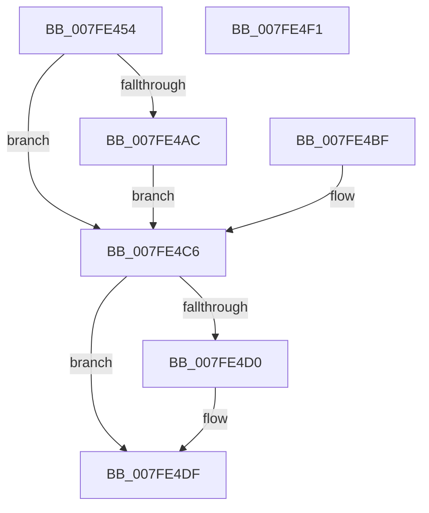

# MiFinalizeLagePageImageMapping

- RVA: `0x007FE454`–`0x007FE4F2` (길이 `158` bytes)
- VA: `0x00000001407FE454`
- 실행 섹션: `PAGE`
- PDB 이름 있음: `예`; PDB Function 태그: `아니요`
- unwind 정보 RVA: `0x000D7F94`
- 디코드: `42`개 명령, `158/158` bytes 표시
- 미해석 바이트: `0` (있으면 어셈블리에 `.byte`로 보존)

> 이 문서는 커널 이미지의 기계어와 PDB 기호를 분석해 생성했습니다. 4번과 5번은 함수 원형과 자료형을 바이너리 사용 방식에서 추정한 C 해석이며 원본 소스 복구 결과는 아닙니다.

## 1. Dependencies

- 직접 호출 지점: **3**; 고유 호출 대상: **3**
- 직접 호출자로 확인된 함수: **1**
- RIP 상대 이미지 참조: **0**

### Outgoing calls
- `0x007FE4A1` → [MiMapViewOfImageSection](../97/MiMapViewOfImageSection_function_0097E92C.md) (function, `0x0097E92C`)
- `0x007FE4B8` → [memcpy](../../text/6C/memcpy_function_006C6840.md) (function, `0x006C6840`)
- `0x007FE4DA` → [MiUnmapViewOfSection](../88/MiUnmapViewOfSection_function_0088A4C4.md) (function, `0x0088A4C4`)

### Direct callers
- [MiMapViewOfSection](../89/MiMapViewOfSection_function_00898F10.md) at `0x00899448`

### Static image references
- 디코드된 RIP-relative 메모리 참조가 없습니다.

## 2. Other-region calls and transfers

- 다른 실행 섹션으로 향하는 call: **1**
  - `0x007FE4B8` → [memcpy](../../text/6C/memcpy_function_006C6840.md) (`PAGE` → `.text`)
- 별도 외부 분기/꼬리 이동을 확인하지 못했습니다.

## 3. Assembly (complete function range)

```asm
007FE454  4C 8B DC                        mov r11, rsp
007FE457  49 89 5B 08                     mov qword ptr [r11 + 8], rbx
007FE45B  49 89 73 18                     mov qword ptr [r11 + 0x18], rsi
007FE45F  49 89 53 10                     mov qword ptr [r11 + 0x10], rdx
007FE463  57                              push rdi
007FE464  48 83 EC 50                     sub rsp, 0x50
007FE468  49 8B F0                        mov rsi, r8
007FE46B  48 8B DA                        mov rbx, rdx
007FE46E  49 83 63 E8 00                  and qword ptr [r11 - 0x18], 0
007FE473  C7 44 24 38 10 00 00 00         mov dword ptr [rsp + 0x38], 0x10
007FE47B  8B 84 24 90 00 00 00            mov eax, dword ptr [rsp + 0x90]
007FE482  89 44 24 30                     mov dword ptr [rsp + 0x30], eax
007FE486  8B 84 24 88 00 00 00            mov eax, dword ptr [rsp + 0x88]
007FE48D  89 44 24 28                     mov dword ptr [rsp + 0x28], eax
007FE491  48 8B 84 24 80 00 00 00         mov rax, qword ptr [rsp + 0x80]
007FE499  49 89 43 C8                     mov qword ptr [r11 - 0x38], rax
007FE49D  4D 8D 43 E8                     lea r8, [r11 - 0x18]
007FE4A1  E8 86 04 18 00                  call 0x14097e92c
007FE4A6  8B F8                           mov edi, eax
007FE4A8  85 C0                           test eax, eax
007FE4AA  78 1A                           js 0x1407fe4c6
007FE4AC  4C 8B 43 18                     mov r8, qword ptr [rbx + 0x18]
007FE4B0  48 8B 54 24 40                  mov rdx, qword ptr [rsp + 0x40]
007FE4B5  48 8B CE                        mov rcx, rsi
007FE4B8  E8 83 83 EC FF                  call 0x1406c6840
007FE4BD  EB 07                           jmp 0x1407fe4c6
007FE4BF  8B F8                           mov edi, eax
007FE4C1  48 8B 5C 24 68                  mov rbx, qword ptr [rsp + 0x68]
007FE4C6  48 8B 54 24 40                  mov rdx, qword ptr [rsp + 0x40]
007FE4CB  48 85 D2                        test rdx, rdx
007FE4CE  74 0F                           je 0x1407fe4df
007FE4D0  45 33 C9                        xor r9d, r9d
007FE4D3  45 33 C0                        xor r8d, r8d
007FE4D6  48 8B 4B 58                     mov rcx, qword ptr [rbx + 0x58]
007FE4DA  E8 E5 BF 08 00                  call 0x14088a4c4
007FE4DF  8B C7                           mov eax, edi
007FE4E1  48 8B 5C 24 60                  mov rbx, qword ptr [rsp + 0x60]
007FE4E6  48 8B 74 24 70                  mov rsi, qword ptr [rsp + 0x70]
007FE4EB  48 83 C4 50                     add rsp, 0x50
007FE4EF  5F                              pop rdi
007FE4F0  C3                              ret
007FE4F1  CC                              int3
```

## 4. C-style interpretation (structured pseudocode)

```c
__int64 __fastcall MiFinalizeLagePageImageMapping(__int64 a1, __int64 a2, __int64 a3, int a4, __int64 a5, unsigned int a6, unsigned int a7)
{
    __int64 result;
    __int64 v_rsp;
    unsigned __int64 v_stack_m18;
    unsigned int v_stack_m20;
    unsigned int v_stack_m28;
    unsigned int v_stack_m30;
    unsigned __int64 v_stack_p10;
    unsigned __int64 v_stack_p18;
    unsigned __int64 v_stack_p8;

    *(unsigned __int64 *)(v_rsp + 8) = v_rbx;
    *(unsigned __int64 *)(v_rsp + 24) = v_rsi;
    *(unsigned __int64 *)(v_rsp + 16) = a2;
    v_rsp = (v_rsp) - (80);
    v_stack_m20 = 16;
    v_stack_m28 = (unsigned int)((unsigned int)(a7));
    v_stack_m30 = (unsigned int)((unsigned int)(a6));
    *(unsigned __int64 *)(v_rsp - 56) = a5;
    result = MiMapViewOfImageSection(a1, a2, v_rsp - 24, a4);
    if (sign_flag) goto loc_007FE4C6;
    result = memcpy(a3, v_stack_m18, *(unsigned __int64 *)(a2 + 24), a4);
    goto loc_007FE4C6;
loc_007FE4C6:
    if (v_stack_m18 != 0) {
        a4 = 0;
        a3 = 0;
        a1 = *(unsigned __int64 *)(a2 + 88);
        result = MiUnmapViewOfSection(a1, v_stack_m18, a3, a4);
    }
    v_rsp = (v_rsp) + (80);
    return (unsigned int)((unsigned int)((unsigned int)((unsigned int)(result))));
}
```

## 5. (Beta) C Style

```c
int64_t MiFinalizeLagePageImageMapping(int64_t Arg1, void *Arg2, int64_t Arg3, int32_t Arg4, int64_t Arg5, uint32_t Arg6, uint32_t Arg7)
{
    uint8_t *arg2 = (uint8_t *)Arg2;

    int64_t result;
    int64_t local_rsp;
    uint64_t v_stack_m18;
    uint32_t v_stack_m20;
    uint32_t v_stack_m28;
    uint32_t v_stack_m30;
    uint64_t v_stack_p10;
    uint64_t v_stack_p18;
    uint64_t v_stack_p8;

    *(uint64_t *)(local_rsp + 0x8) = local_rbx;
    *(uint64_t *)(local_rsp + 0x18) = local_rsi;
    *(void **)(local_rsp + 0x10) = Arg2;
    local_rsp = (local_rsp) - (80);
    v_stack_m20 = 16;
    v_stack_m28 = (uint32_t)((uint32_t)(Arg7));
    v_stack_m30 = (uint32_t)((uint32_t)(Arg6));
    *(uint64_t *)(local_rsp - 0x38) = Arg5;
    result = MiMapViewOfImageSection(Arg1, Arg2, local_rsp - 24, Arg4);
    if (sign_flag) goto loc_007FE4C6;
    result = memcpy(Arg3, v_stack_m18, *(uint64_t *)(arg2 + 0x18), Arg4);
    goto loc_007FE4C6;
loc_007FE4C6:
    if (v_stack_m18 != 0) {
        Arg4 = 0;
        Arg3 = 0;
        Arg1 = *(uint64_t *)(arg2 + 0x58);
        result = MiUnmapViewOfSection(Arg1, v_stack_m18, Arg3, Arg4);
    }
    local_rsp = (local_rsp) + (80);
    return (uint32_t)((uint32_t)((uint32_t)((uint32_t)(result))));
}
```

### 관측된 메모리 오프셋

구조체 형식이 확인되지 않은 접근은 인자 기준의 오프셋으로만 기록했습니다.

| 기준 인자 | 오프셋 표현 | 폭 (bit) | 접근 |
|---|---:|---:|---|
| `Arg2` | `+ 0x18` | `64` | `R` |
| `Arg2` | `+ 0x58` | `64` | `R` |

## 6. Execution-region graph

[열기: 2D/3D 그래프와 함수 탐색 컨트롤 패널](../../../control-panel.html?section=page&rva=0x007FE454&view=graph)

- 2D 그래프는 위에서 아래로 흐르고, 3D 그래프는 빈 공간을 드래그해 회전합니다. Shift+드래그는 이동, 휠은 확대·축소, 함수 노드 선택은 대상 보고서 이동입니다.

### Static fallback


