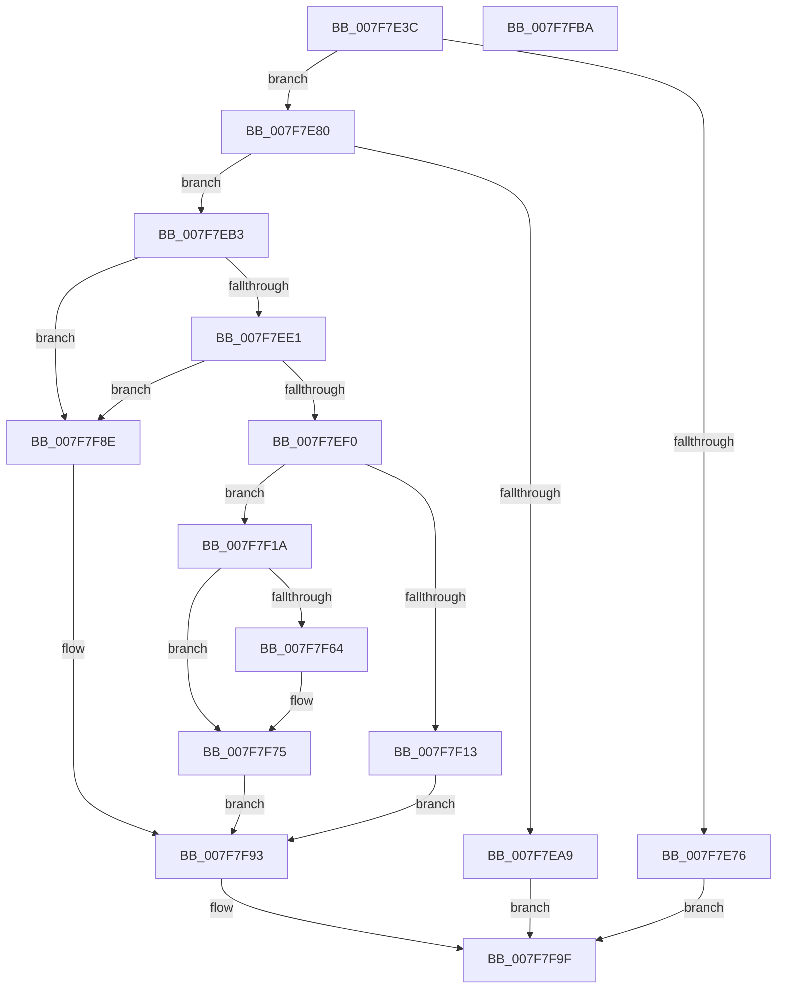

# MiFormDllRegistryPath

- RVA: `0x007F7E3C`–`0x007F7FBB` (길이 `383` bytes)
- VA: `0x00000001407F7E3C`
- 실행 섹션: `PAGE`
- PDB 이름 있음: `예`; PDB Function 태그: `아니요`
- unwind 정보 RVA: `0x0005D7BC`
- 디코드: `98`개 명령, `383/383` bytes 표시
- 미해석 바이트: `0` (있으면 어셈블리에 `.byte`로 보존)

> 이 문서는 커널 이미지의 기계어와 PDB 기호를 분석해 생성했습니다. 4번과 5번은 함수 원형과 자료형을 바이너리 사용 방식에서 추정한 C 해석이며 원본 소스 복구 결과는 아닙니다.

## 1. Dependencies

- 직접 호출 지점: **8**; 고유 호출 대상: **6**
- 직접 호출자로 확인된 함수: **1**
- RIP 상대 이미지 참조: **3**

### Outgoing calls
- `0x007F7E95` → [MiAllocatePool](../../text/35/MiAllocatePool_function_0035B540.md) (function, `0x0035B540`)
- `0x007F7EC6` → [memcpy](../../text/6C/memcpy_function_006C6840.md) (function, `0x006C6840`)
- `0x007F7F02` → [MiAllocatePool](../../text/35/MiAllocatePool_function_0035B540.md) (function, `0x0035B540`)
- `0x007F7F34` → [memcpy](../../text/6C/memcpy_function_006C6840.md) (function, `0x006C6840`)
- `0x007F7F43` → [RtlAppendUnicodeToString](../../text/40/RtlAppendUnicodeToString_function_0040F990.md) (function, `0x0040F990`)
- `0x007F7F5A` → [wcschr](../../text/50/wcschr_function_00501A60.md) (function, `0x00501A60`)
- `0x007F7F87` → [RtlAppendUnicodeStringToString](../../text/40/RtlAppendUnicodeStringToString_function_0040FA50.md) (function, `0x0040FA50`)
- `0x007F7F98` → [ExFreePoolWithTag](../../poolcode/B8/ExFreePoolWithTag_function_00B82870.md) (function, `0x00B82870`)

### Direct callers
- [MiIssueDllInitializeCall](MiIssueDllInitializeCall_function_007F8078.md) at `0x007F809E`

### Static image references
- `0x007F7ECB` → RVA `0x00FD9D28` (`PAGEDATA`; read)
- `0x007F7F2D` → RVA `0x00FD9D30` (`PAGEDATA`; read)
- `0x007F7F39` → RVA `0x00AFC990` (` ?? ::NNGAKEGL::`string'`; read)

## 2. Other-region calls and transfers

- 다른 실행 섹션으로 향하는 call: **8**
  - `0x007F7E95` → [MiAllocatePool](../../text/35/MiAllocatePool_function_0035B540.md) (`PAGE` → `.text`)
  - `0x007F7EC6` → [memcpy](../../text/6C/memcpy_function_006C6840.md) (`PAGE` → `.text`)
  - `0x007F7F02` → [MiAllocatePool](../../text/35/MiAllocatePool_function_0035B540.md) (`PAGE` → `.text`)
  - `0x007F7F34` → [memcpy](../../text/6C/memcpy_function_006C6840.md) (`PAGE` → `.text`)
  - `0x007F7F43` → [RtlAppendUnicodeToString](../../text/40/RtlAppendUnicodeToString_function_0040F990.md) (`PAGE` → `.text`)
  - `0x007F7F5A` → [wcschr](../../text/50/wcschr_function_00501A60.md) (`PAGE` → `.text`)
  - `0x007F7F87` → [RtlAppendUnicodeStringToString](../../text/40/RtlAppendUnicodeStringToString_function_0040FA50.md) (`PAGE` → `.text`)
  - `0x007F7F98` → [ExFreePoolWithTag](../../poolcode/B8/ExFreePoolWithTag_function_00B82870.md) (`PAGE` → `POOLCODE`)
- 별도 외부 분기/꼬리 이동을 확인하지 못했습니다.

## 3. Assembly (complete function range)

```asm
007F7E3C  48 8B C4                        mov rax, rsp
007F7E3F  48 89 58 08                     mov qword ptr [rax + 8], rbx
007F7E43  48 89 68 10                     mov qword ptr [rax + 0x10], rbp
007F7E47  48 89 70 18                     mov qword ptr [rax + 0x18], rsi
007F7E4B  48 89 78 20                     mov qword ptr [rax + 0x20], rdi
007F7E4F  41 56                           push r14
007F7E51  48 83 EC 30                     sub rsp, 0x30
007F7E55  0F 57 C0                        xorps xmm0, xmm0
007F7E58  0F 57 C9                        xorps xmm1, xmm1
007F7E5B  0F 11 40 E8                     movups xmmword ptr [rax - 0x18], xmm0
007F7E5F  4C 8B F2                        mov r14, rdx
007F7E62  48 8B E9                        mov rbp, rcx
007F7E65  0F 11 0A                        movups xmmword ptr [rdx], xmm1
007F7E68  0F B7 41 58                     movzx eax, word ptr [rcx + 0x58]
007F7E6C  44 8D 40 02                     lea r8d, [rax + 2]
007F7E70  66 44 3B C0                     cmp r8w, ax
007F7E74  77 0A                           ja 0x1407f7e80
007F7E76  B8 06 01 00 C0                  mov eax, 0xc0000106
007F7E7B  E9 1F 01 00 00                  jmp 0x1407f7f9f
007F7E80  66 44 89 44 24 22               mov word ptr [rsp + 0x22], r8w
007F7E86  B9 00 01 00 00                  mov ecx, 0x100
007F7E8B  41 0F B7 D0                     movzx edx, r8w
007F7E8F  41 B8 4D 6D 44 54               mov r8d, 0x54446d4d
007F7E95  E8 A6 36 B6 FF                  call 0x14035b540
007F7E9A  33 DB                           xor ebx, ebx
007F7E9C  48 89 44 24 28                  mov qword ptr [rsp + 0x28], rax
007F7EA1  48 8B F8                        mov rdi, rax
007F7EA4  48 85 C0                        test rax, rax
007F7EA7  75 0A                           jne 0x1407f7eb3
007F7EA9  B8 9A 00 00 C0                  mov eax, 0xc000009a
007F7EAE  E9 EC 00 00 00                  jmp 0x1407f7f9f
007F7EB3  0F B7 75 58                     movzx esi, word ptr [rbp + 0x58]
007F7EB7  48 8B CF                        mov rcx, rdi
007F7EBA  48 8B 55 60                     mov rdx, qword ptr [rbp + 0x60]
007F7EBE  44 8B C6                        mov r8d, esi
007F7EC1  66 89 74 24 20                  mov word ptr [rsp + 0x20], si
007F7EC6  E8 75 E9 EC FF                  call 0x1406c6840
007F7ECB  0F B7 0D 56 1E 7E 00            movzx ecx, word ptr [rip + 0x7e1e56]
007F7ED2  8D 04 31                        lea eax, [rcx + rsi]
007F7ED5  8D 14 31                        lea edx, [rcx + rsi]
007F7ED8  66 3B C1                        cmp ax, cx
007F7EDB  0F 86 AD 00 00 00               jbe 0x1407f7f8e
007F7EE1  8D 42 04                        lea eax, [rdx + 4]
007F7EE4  0F B7 C8                        movzx ecx, ax
007F7EE7  66 3B C2                        cmp ax, dx
007F7EEA  0F 86 9E 00 00 00               jbe 0x1407f7f8e
007F7EF0  8B D1                           mov edx, ecx
007F7EF2  66 41 89 46 02                  mov word ptr [r14 + 2], ax
007F7EF7  B9 40 00 00 00                  mov ecx, 0x40
007F7EFC  41 B8 4D 6D 44 54               mov r8d, 0x54446d4d
007F7F02  E8 39 36 B6 FF                  call 0x14035b540
007F7F07  49 89 46 08                     mov qword ptr [r14 + 8], rax
007F7F0B  48 8B C8                        mov rcx, rax
007F7F0E  48 85 C0                        test rax, rax
007F7F11  75 07                           jne 0x1407f7f1a
007F7F13  BB 9A 00 00 C0                  mov ebx, 0xc000009a
007F7F18  EB 79                           jmp 0x1407f7f93
007F7F1A  0F B7 05 07 1E 7E 00            movzx eax, word ptr [rip + 0x7e1e07]
007F7F21  66 41 89 06                     mov word ptr [r14], ax
007F7F25  44 0F B7 05 FB 1D 7E 00         movzx r8d, word ptr [rip + 0x7e1dfb]
007F7F2D  48 8B 15 FC 1D 7E 00            mov rdx, qword ptr [rip + 0x7e1dfc]
007F7F34  E8 07 E9 EC FF                  call 0x1406c6840
007F7F39  48 8D 15 50 4A 30 00            lea rdx, [rip + 0x304a50]
007F7F40  49 8B CE                        mov rcx, r14
007F7F43  E8 48 7A C1 FF                  call 0x14040f990
007F7F48  48 8B C6                        mov rax, rsi
007F7F4B  BA 2E 00 00 00                  mov edx, 0x2e
007F7F50  48 D1 E8                        shr rax, 1
007F7F53  48 8B CF                        mov rcx, rdi
007F7F56  66 89 1C 47                     mov word ptr [rdi + rax*2], bx
007F7F5A  E8 01 9B D0 FF                  call 0x140501a60
007F7F5F  48 85 C0                        test rax, rax
007F7F62  74 11                           je 0x1407f7f75
007F7F64  48 2B C7                        sub rax, rdi
007F7F67  48 D1 F8                        sar rax, 1
007F7F6A  66 03 C0                        add ax, ax
007F7F6D  0F B7 F0                        movzx esi, ax
007F7F70  66 89 44 24 20                  mov word ptr [rsp + 0x20], ax
007F7F75  0F B7 C6                        movzx eax, si
007F7F78  48 8D 54 24 20                  lea rdx, [rsp + 0x20]
007F7F7D  48 D1 E8                        shr rax, 1
007F7F80  49 8B CE                        mov rcx, r14
007F7F83  66 89 1C 47                     mov word ptr [rdi + rax*2], bx
007F7F87  E8 C4 7A C1 FF                  call 0x14040fa50
007F7F8C  EB 05                           jmp 0x1407f7f93
007F7F8E  BB 06 01 00 C0                  mov ebx, 0xc0000106
007F7F93  33 D2                           xor edx, edx
007F7F95  48 8B CF                        mov rcx, rdi
007F7F98  E8 D3 A8 38 00                  call 0x140b82870
007F7F9D  8B C3                           mov eax, ebx
007F7F9F  48 8B 5C 24 40                  mov rbx, qword ptr [rsp + 0x40]
007F7FA4  48 8B 6C 24 48                  mov rbp, qword ptr [rsp + 0x48]
007F7FA9  48 8B 74 24 50                  mov rsi, qword ptr [rsp + 0x50]
007F7FAE  48 8B 7C 24 58                  mov rdi, qword ptr [rsp + 0x58]
007F7FB3  48 83 C4 30                     add rsp, 0x30
007F7FB7  41 5E                           pop r14
007F7FB9  C3                              ret
007F7FBA  CC                              int3
```

## 4. C-style interpretation (structured pseudocode)

```c
__int64 __fastcall MiFormDllRegistryPath(__int64 a1, __int64 a2)
{
    __int64 result;
    __int64 v_rbx;
    __int64 v_rsi;
    __int64 v_rsp;
    unsigned __int64 v_stack_m10;
    unsigned __int16 v_stack_m16;
    unsigned __int16 v_stack_m18;
    unsigned __int64 v_stack_p10;
    unsigned __int64 v_stack_p18;
    unsigned __int64 v_stack_p20;
    unsigned __int64 v_stack_p8;

    *(unsigned __int64 *)(v_rsp + 8) = v_rbx;
    *(unsigned __int64 *)(v_rsp + 16) = v_rbp;
    *(unsigned __int64 *)(v_rsp + 24) = v_rsi;
    *(unsigned __int64 *)(v_rsp + 32) = v_rdi;
    v_rsp = (v_rsp) - (48);
    *(unsigned __int64 *)(v_rsp - 24) = v_xmm0;
    *(unsigned __int64 *)(a2) = v_xmm1;
    if (((unsigned __int16)(*(unsigned __int16 *)(a1 + 88) + 2)) > ((unsigned __int16)(*(unsigned __int16 *)(a1 + 88)))) goto loc_007F7E80;
    goto loc_007F7F9F;
loc_007F7E80:
    v_stack_m16 = (unsigned __int16)(*(unsigned __int16 *)(a1 + 88) + 2);
    result = MiAllocatePool(256, (unsigned __int16)(*(unsigned __int16 *)(a1 + 88) + 2), (unsigned int)(0x54446D4DULL), a4);
    v_rbx = 0;
    v_stack_m10 = result;
    if (result != 0) goto loc_007F7EB3;
    goto loc_007F7F9F;
loc_007F7EB3:
    v_stack_m18 = (unsigned __int16)(*(unsigned __int16 *)(a1 + 88));
    result = memcpy(result, *(unsigned __int64 *)(a1 + 96), (unsigned int)((unsigned int)(*(unsigned __int16 *)(a1 + 88))), a4);
    if (((unsigned __int16)(*(unsigned __int16 *)(v_rip + 8265302) + *(unsigned __int16 *)(a1 + 88) * 1)) <= ((unsigned __int16)(*(unsigned __int16 *)(v_rip + 8265302)))) goto loc_007F7F8E;
    if (((unsigned __int16)(*(unsigned __int16 *)(v_rip + 8265302) + *(unsigned __int16 *)(a1 + 88) * 1 + 4)) <= ((unsigned __int16)(*(unsigned __int16 *)(v_rip + 8265302) + *(unsigned __int16 *)(a1 + 88) * 1))) goto loc_007F7F8E;
    *(unsigned __int16 *)(a2 + 2) = (unsigned __int16)(*(unsigned __int16 *)(v_rip + 8265302) + *(unsigned __int16 *)(a1 + 88) * 1 + 4);
    result = MiAllocatePool(64, (unsigned int)((unsigned int)((unsigned __int16)(*(unsigned __int16 *)(v_rip + 8265302) + *(unsigned __int16 *)(a1 + 88) * 1 + 4))), (unsigned int)(0x54446D4DULL), a4);
    *(unsigned __int64 *)(a2 + 8) = result;
    if (result != 0) goto loc_007F7F1A;
    goto loc_007F7F93;
loc_007F7F1A:
    *(unsigned __int16 *)(a2) = (unsigned __int16)(*(unsigned __int16 *)(v_rip + 8265223));
    result = memcpy(result, *(unsigned __int64 *)(v_rip + 8265212), *(unsigned __int16 *)(v_rip + 8265211), a4);
    result = RtlAppendUnicodeToString(a2, v_rip + 3164752, *(unsigned __int16 *)(v_rip + 8265211), a4);
    result = (*(unsigned __int16 *)(a1 + 88)) >> (1);
    *(unsigned __int16 *)(result + result * 2) = (unsigned __int16)((unsigned int)(0xC000009AULL));
    result = wcschr(result, 46, *(unsigned __int16 *)(v_rip + 8265211), a4);
    v_rsi = *(unsigned __int16 *)(a1 + 88);
    if (result != 0) {
        result = (result) - (result);
        result = (result) >> (1);
        result = (unsigned __int16)((result) + ((unsigned __int16)(result)));
        v_rsi = (unsigned __int16)(result);
        v_stack_m18 = (unsigned __int16)(result);
    }
    result = ((unsigned __int16)(v_rsi)) >> (1);
    *(unsigned __int16 *)(result + result * 2) = (unsigned __int16)((unsigned int)(0xC000009AULL));
    result = RtlAppendUnicodeStringToString(a2, v_stack_m18, *(unsigned __int16 *)(v_rip + 8265211), a4);
    goto loc_007F7F93;
loc_007F7F8E:
loc_007F7F93:
    a2 = 0;
    result = ExFreePoolWithTag(result, a2, *(unsigned __int16 *)(v_rip + 8265211), a4);
loc_007F7F9F:
    v_rsp = (v_rsp) + (48);
    return (unsigned int)((unsigned int)((unsigned int)(0xC0000106ULL)));
}
```

## 5. (Beta) C Style

```c
int64_t MiFormDllRegistryPath(void *Arg1, void *Arg2)
{
    uint8_t *arg1 = (uint8_t *)Arg1;
    uint8_t *arg2 = (uint8_t *)Arg2;

    int64_t result;
    int64_t local_rbx;
    int64_t local_rsi;
    int64_t local_rsp;
    uint64_t v_stack_m10;
    uint16_t v_stack_m16;
    uint16_t v_stack_m18;
    uint64_t v_stack_p10;
    uint64_t v_stack_p18;
    uint64_t v_stack_p20;
    uint64_t v_stack_p8;

    *(uint64_t *)(local_rsp + 0x8) = local_rbx;
    *(uint64_t *)(local_rsp + 0x10) = local_rbp;
    *(uint64_t *)(local_rsp + 0x18) = local_rsi;
    *(uint64_t *)(local_rsp + 0x20) = local_rdi;
    local_rsp = (local_rsp) - (48);
    *(uint64_t *)(local_rsp - 0x18) = v_xmm0;
    *(uint64_t *)(arg2) = v_xmm1;
    if (((uint16_t)(*(uint16_t *)(arg1 + 0x58) + 2)) > ((uint16_t)(*(uint16_t *)(arg1 + 0x58)))) goto loc_007F7E80;
    goto loc_007F7F9F;
loc_007F7E80:
    v_stack_m16 = (uint16_t)(*(uint16_t *)(arg1 + 0x58) + 2);
    result = MiAllocatePool(256, (uint16_t)(*(uint16_t *)(arg1 + 0x58) + 2), (uint32_t)(0x54446D4DULL), a4);
    local_rbx = 0;
    v_stack_m10 = result;
    if (result != 0) goto loc_007F7EB3;
    goto loc_007F7F9F;
loc_007F7EB3:
    v_stack_m18 = (uint16_t)(*(uint16_t *)(arg1 + 0x58));
    result = memcpy(result, *(uint64_t *)(arg1 + 0x60), (uint32_t)((uint32_t)(*(uint16_t *)(arg1 + 0x58))), a4);
    if (((uint16_t)(*(uint16_t *)(v_rip + 0x7E1E56) + *(uint16_t *)(arg1 + 0x58) * 1)) <= ((uint16_t)(*(uint16_t *)(v_rip + 0x7E1E56)))) goto loc_007F7F8E;
    if (((uint16_t)(*(uint16_t *)(v_rip + 0x7E1E56) + *(uint16_t *)(arg1 + 0x58) * 1 + 4)) <= ((uint16_t)(*(uint16_t *)(v_rip + 0x7E1E56) + *(uint16_t *)(arg1 + 0x58) * 1))) goto loc_007F7F8E;
    *(uint16_t *)(arg2 + 0x2) = (uint16_t)(*(uint16_t *)(v_rip + 0x7E1E56) + *(uint16_t *)(arg1 + 0x58) * 1 + 4);
    result = MiAllocatePool(64, (uint32_t)((uint32_t)((uint16_t)(*(uint16_t *)(v_rip + 0x7E1E56) + *(uint16_t *)(arg1 + 0x58) * 1 + 4))), (uint32_t)(0x54446D4DULL), a4);
    *(uint64_t *)(arg2 + 0x8) = result;
    if (result != 0) goto loc_007F7F1A;
    goto loc_007F7F93;
loc_007F7F1A:
    *(uint16_t *)(arg2) = (uint16_t)(*(uint16_t *)(v_rip + 0x7E1E07));
    result = memcpy(result, *(uint64_t *)(v_rip + 0x7E1DFC), *(uint16_t *)(v_rip + 0x7E1DFB), a4);
    result = RtlAppendUnicodeToString(Arg2, v_rip + 3164752, *(uint16_t *)(v_rip + 0x7E1DFB), a4);
    result = (*(uint16_t *)(arg1 + 0x58)) >> (1);
    *(uint16_t *)(result + result * 2) = (uint16_t)((uint32_t)(0xC000009AULL));
    result = wcschr(result, 46, *(uint16_t *)(v_rip + 0x7E1DFB), a4);
    local_rsi = *(uint16_t *)(arg1 + 0x58);
    if (result != 0) {
        result = (result) - (result);
        result = (result) >> (1);
        result = (uint16_t)((result) + ((uint16_t)(result)));
        local_rsi = (uint16_t)(result);
        v_stack_m18 = (uint16_t)(result);
    }
    result = ((uint16_t)(local_rsi)) >> (1);
    *(uint16_t *)(result + result * 2) = (uint16_t)((uint32_t)(0xC000009AULL));
    result = RtlAppendUnicodeStringToString(Arg2, v_stack_m18, *(uint16_t *)(v_rip + 0x7E1DFB), a4);
    goto loc_007F7F93;
loc_007F7F8E:
loc_007F7F93:
    Arg2 = 0;
    result = ExFreePoolWithTag(result, Arg2, *(uint16_t *)(v_rip + 0x7E1DFB), a4);
loc_007F7F9F:
    local_rsp = (local_rsp) + (48);
    return (uint32_t)((uint32_t)((uint32_t)(0xC0000106ULL)));
}
```

### 관측된 메모리 오프셋

구조체 형식이 확인되지 않은 접근은 인자 기준의 오프셋으로만 기록했습니다.

| 기준 인자 | 오프셋 표현 | 폭 (bit) | 접근 |
|---|---:|---:|---|
| `Arg1` | `+ 0x58` | `16` | `R` |
| `Arg1` | `+ 0x60` | `64` | `R` |
| `Arg2` | `+ 0x0` | `16` | `W` |
| `Arg2` | `+ 0x0` | `128` | `R` |
| `Arg2` | `+ 0x2` | `16` | `W` |
| `Arg2` | `+ 0x8` | `64` | `W` |

## 6. Execution-region graph

[열기: 2D/3D 그래프와 함수 탐색 컨트롤 패널](../../../control-panel.html?section=page&rva=0x007F7E3C&view=graph)

- 2D 그래프는 위에서 아래로 흐르고, 3D 그래프는 빈 공간을 드래그해 회전합니다. Shift+드래그는 이동, 휠은 확대·축소, 함수 노드 선택은 대상 보고서 이동입니다.

### Static fallback


