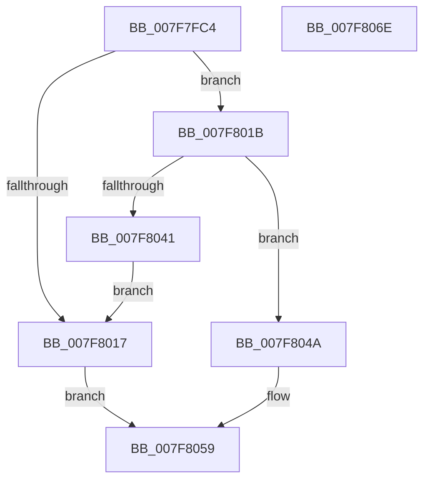

# MiFormFullImageName

- RVA: `0x007F7FC4`–`0x007F806F` (길이 `171` bytes)
- VA: `0x00000001407F7FC4`
- 실행 섹션: `PAGE`
- PDB 이름 있음: `예`; PDB Function 태그: `아니요`
- unwind 정보 RVA: `0x0005C954`
- 디코드: `49`개 명령, `171/171` bytes 표시
- 미해석 바이트: `0` (있으면 어셈블리에 `.byte`로 보존)

> 이 문서는 커널 이미지의 기계어와 PDB 기호를 분석해 생성했습니다. 4번과 5번은 함수 원형과 자료형을 바이너리 사용 방식에서 추정한 C 해석이며 원본 소스 복구 결과는 아닙니다.

## 1. Dependencies

- 직접 호출 지점: **4**; 고유 호출 대상: **4**
- 직접 호출자로 확인된 함수: **1**
- RIP 상대 이미지 참조: **0**

### Outgoing calls
- `0x007F8004` → [MiAllocatePool](../../text/35/MiAllocatePool_function_0035B540.md) (function, `0x0035B540`)
- `0x007F8029` → [memcpy](../../text/6C/memcpy_function_006C6840.md) (function, `0x006C6840`)
- `0x007F8034` → [RtlAppendStringToString](../A9/RtlAppendStringToString_function_00A97740.md) (function, `0x00A97740`)
- `0x007F8043` → [ExFreePoolWithTag](../../poolcode/B8/ExFreePoolWithTag_function_00B82870.md) (function, `0x00B82870`)

### Direct callers
- [sub_00B37A8C](../B3/Unknown_function_00B37A8C.md) at `0x00B37B65`
- [sub_00B37A8C](../B3/Unknown_function_00B37A8C.md) at `0x00B37BCF`
- [sub_00B37A8C](../B3/Unknown_function_00B37A8C.md) at `0x00B37C01`

### Static image references
- 디코드된 RIP-relative 메모리 참조가 없습니다.

## 2. Other-region calls and transfers

- 다른 실행 섹션으로 향하는 call: **3**
  - `0x007F8004` → [MiAllocatePool](../../text/35/MiAllocatePool_function_0035B540.md) (`PAGE` → `.text`)
  - `0x007F8029` → [memcpy](../../text/6C/memcpy_function_006C6840.md) (`PAGE` → `.text`)
  - `0x007F8043` → [ExFreePoolWithTag](../../poolcode/B8/ExFreePoolWithTag_function_00B82870.md) (`PAGE` → `POOLCODE`)
- 별도 외부 분기/꼬리 이동을 확인하지 못했습니다.

## 3. Assembly (complete function range)

```asm
007F7FC4  48 89 5C 24 08                  mov qword ptr [rsp + 8], rbx
007F7FC9  48 89 6C 24 10                  mov qword ptr [rsp + 0x10], rbp
007F7FCE  48 89 74 24 18                  mov qword ptr [rsp + 0x18], rsi
007F7FD3  57                              push rdi
007F7FD4  48 83 EC 20                     sub rsp, 0x20
007F7FD8  0F B7 02                        movzx eax, word ptr [rdx]
007F7FDB  48 8B F2                        mov rsi, rdx
007F7FDE  44 0F B7 09                     movzx r9d, word ptr [rcx]
007F7FE2  66 83 C0 02                     add ax, 2
007F7FE6  66 44 03 C8                     add r9w, ax
007F7FEA  49 8B D8                        mov rbx, r8
007F7FED  41 0F B7 D1                     movzx edx, r9w
007F7FF1  48 8B F9                        mov rdi, rcx
007F7FF4  66 41 89 50 02                  mov word ptr [r8 + 2], dx
007F7FF9  B9 00 01 00 00                  mov ecx, 0x100
007F7FFE  41 B8 4D 6D 44 54               mov r8d, 0x54446d4d
007F8004  E8 37 35 B6 FF                  call 0x14035b540
007F8009  33 ED                           xor ebp, ebp
007F800B  48 89 43 08                     mov qword ptr [rbx + 8], rax
007F800F  48 8B C8                        mov rcx, rax
007F8012  48 85 C0                        test rax, rax
007F8015  75 04                           jne 0x1407f801b
007F8017  33 C0                           xor eax, eax
007F8019  EB 3E                           jmp 0x1407f8059
007F801B  0F B7 07                        movzx eax, word ptr [rdi]
007F801E  66 89 03                        mov word ptr [rbx], ax
007F8021  44 0F B7 07                     movzx r8d, word ptr [rdi]
007F8025  48 8B 57 08                     mov rdx, qword ptr [rdi + 8]
007F8029  E8 12 E8 EC FF                  call 0x1406c6840
007F802E  48 8B D6                        mov rdx, rsi
007F8031  48 8B CB                        mov rcx, rbx
007F8034  E8 07 F7 29 00                  call 0x140a97740
007F8039  48 8B 4B 08                     mov rcx, qword ptr [rbx + 8]
007F803D  85 C0                           test eax, eax
007F803F  79 09                           jns 0x1407f804a
007F8041  33 D2                           xor edx, edx
007F8043  E8 28 A8 38 00                  call 0x140b82870
007F8048  EB CD                           jmp 0x1407f8017
007F804A  0F B7 03                        movzx eax, word ptr [rbx]
007F804D  48 D1 E8                        shr rax, 1
007F8050  66 89 2C 41                     mov word ptr [rcx + rax*2], bp
007F8054  B8 01 00 00 00                  mov eax, 1
007F8059  48 8B 5C 24 30                  mov rbx, qword ptr [rsp + 0x30]
007F805E  48 8B 6C 24 38                  mov rbp, qword ptr [rsp + 0x38]
007F8063  48 8B 74 24 40                  mov rsi, qword ptr [rsp + 0x40]
007F8068  48 83 C4 20                     add rsp, 0x20
007F806C  5F                              pop rdi
007F806D  C3                              ret
007F806E  CC                              int3
```

## 4. C-style interpretation (structured pseudocode)

```c
__int64 __fastcall MiFormFullImageName(__int64 a1, __int64 a2, __int64 a3)
{
    __int64 result;
    __int64 v_rbp;
    __int64 v_rsp;
    unsigned __int64 v_stack_p10;
    unsigned __int64 v_stack_p18;
    unsigned __int64 v_stack_p8;

    v_stack_p8 = v_rbx;
    v_stack_p10 = v_rbp;
    v_stack_p18 = v_rsi;
    v_rsp = (v_rsp) - (32);
    result = (unsigned __int16)((*(unsigned __int16 *)(a2)) + (2));
    a4 = (unsigned __int16)((*(unsigned __int16 *)(a1)) + ((unsigned __int16)(result)));
    *(unsigned __int16 *)(a3 + 2) = (unsigned __int16)((unsigned __int16)(a4));
    result = MiAllocatePool(256, (unsigned __int16)(a4), (unsigned int)(0x54446D4DULL), a4);
    v_rbp = 0;
    *(unsigned __int64 *)(a3 + 8) = result;
    if (result != 0) goto loc_007F801B;
loc_007F8017:
    result = 0;
    goto loc_007F8059;
loc_007F801B:
    *(unsigned __int16 *)(a3) = (unsigned __int16)(*(unsigned __int16 *)(a1));
    result = memcpy(result, *(unsigned __int64 *)(a1 + 8), *(unsigned __int16 *)(a1), a4);
    result = RtlAppendStringToString(a3, a2, *(unsigned __int16 *)(a1), a4);
    if (!sign_flag) goto loc_007F804A;
    a2 = 0;
    result = ExFreePoolWithTag(*(unsigned __int64 *)(a3 + 8), a2, *(unsigned __int16 *)(a1), a4);
    goto loc_007F8017;
loc_007F804A:
    result = (*(unsigned __int16 *)(a3)) >> (1);
    *(unsigned __int16 *)(*(unsigned __int64 *)(a3 + 8) + result * 2) = 0;
loc_007F8059:
    v_rsp = (v_rsp) + (32);
    return 1;
}
```

## 5. (Beta) C Style

```c
int64_t MiFormFullImageName(void *Arg1, void *Arg2, void *Arg3)
{
    uint8_t *arg1 = (uint8_t *)Arg1;
    uint8_t *arg2 = (uint8_t *)Arg2;
    uint8_t *arg3 = (uint8_t *)Arg3;

    int64_t result;
    int64_t local_rbp;
    int64_t local_rsp;
    uint64_t v_stack_p10;
    uint64_t v_stack_p18;
    uint64_t v_stack_p8;

    v_stack_p8 = local_rbx;
    v_stack_p10 = local_rbp;
    v_stack_p18 = local_rsi;
    local_rsp = (local_rsp) - (32);
    result = (uint16_t)((*(uint16_t *)(arg2)) + (2));
    a4 = (uint16_t)((*(uint16_t *)(arg1)) + ((uint16_t)(result)));
    *(uint16_t *)(arg3 + 0x2) = (uint16_t)((uint16_t)(a4));
    result = MiAllocatePool(256, (uint16_t)(a4), (uint32_t)(0x54446D4DULL), a4);
    local_rbp = 0;
    *(uint64_t *)(arg3 + 0x8) = result;
    if (result != 0) goto loc_007F801B;
loc_007F8017:
    result = 0;
    goto loc_007F8059;
loc_007F801B:
    *(uint16_t *)(arg3) = (uint16_t)(*(uint16_t *)(arg1));
    result = memcpy(result, *(uint64_t *)(arg1 + 0x8), *(uint16_t *)(arg1), a4);
    result = RtlAppendStringToString(Arg3, Arg2, *(uint16_t *)(arg1), a4);
    if (!sign_flag) goto loc_007F804A;
    Arg2 = 0;
    result = ExFreePoolWithTag(*(uint64_t *)(arg3 + 0x8), Arg2, *(uint16_t *)(arg1), a4);
    goto loc_007F8017;
loc_007F804A:
    result = (*(uint16_t *)(arg3)) >> (1);
    *(uint16_t *)(*(uint64_t *)(arg3 + 0x8) + result * 2) = 0;
loc_007F8059:
    local_rsp = (local_rsp) + (32);
    return 1;
}
```

### 관측된 메모리 오프셋

구조체 형식이 확인되지 않은 접근은 인자 기준의 오프셋으로만 기록했습니다.

| 기준 인자 | 오프셋 표현 | 폭 (bit) | 접근 |
|---|---:|---:|---|
| `Arg1` | `+ 0x0` | `16` | `R` |
| `Arg1` | `+ 0x8` | `64` | `R` |
| `Arg2` | `+ 0x0` | `16` | `R` |
| `Arg3` | `+ 0x0` | `16` | `R` |
| `Arg3` | `+ 0x0` | `16` | `W` |
| `Arg3` | `+ 0x2` | `16` | `W` |
| `Arg3` | `+ 0x8` | `64` | `R` |
| `Arg3` | `+ 0x8` | `64` | `W` |

## 6. Execution-region graph

[열기: 2D/3D 그래프와 함수 탐색 컨트롤 패널](../../../control-panel.html?section=page&rva=0x007F7FC4&view=graph)

- 2D 그래프는 위에서 아래로 흐르고, 3D 그래프는 빈 공간을 드래그해 회전합니다. Shift+드래그는 이동, 휠은 확대·축소, 함수 노드 선택은 대상 보고서 이동입니다.

### Static fallback


