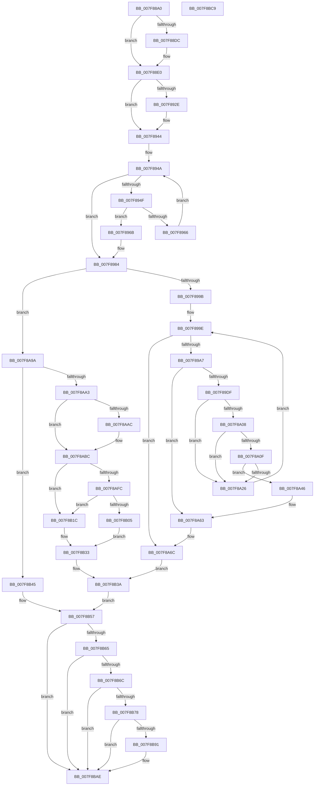

# MiFreeInitializationCode

- RVA: `0x007F88A0`–`0x007F8BCA` (길이 `810` bytes)
- VA: `0x00000001407F88A0`
- 실행 섹션: `PAGE`
- PDB 이름 있음: `예`; PDB Function 태그: `아니요`
- unwind 정보 RVA: `0x000D7770`
- 디코드: `217`개 명령, `810/810` bytes 표시
- 미해석 바이트: `0` (있으면 어셈블리에 `.byte`로 보존)

> 이 문서는 커널 이미지의 기계어와 PDB 기호를 분석해 생성했습니다. 4번과 5번은 함수 원형과 자료형을 바이너리 사용 방식에서 추정한 C 해석이며 원본 소스 복구 결과는 아닙니다.

## 1. Dependencies

- 직접 호출 지점: **18**; 고유 호출 대상: **15**
- 직접 호출자로 확인된 함수: **3**
- RIP 상대 이미지 참조: **11**

### Outgoing calls
- `0x007F891A` → [MiGetPteAddress](../../text/43/MiGetPteAddress_function_0043E130.md) (function, `0x0043E130`)
- `0x007F8931` → [MiGetExtendedLoaderBitmap](../../text/4F/MiGetExtendedLoaderBitmap_function_004FCC74.md) (function, `0x004FCC74`)
- `0x007F893F` → [RtlClearBits](../../text/3E/RtlClearBits_function_003E1A90.md) (function, `0x003E1A90`)
- `0x007F897F` → [RtlSetBitsEx](../../text/3B/RtlSetBitsEx_function_003B6570.md) (function, `0x003B6570`)
- `0x007F898E` → [MI_IS_PHYSICAL_ADDRESS](../../text/23/MI_IS_PHYSICAL_ADDRESS_function_0023B3A0.md) (function, `0x0023B3A0`)
- `0x007F89AA` → [MiVaToPfnEx](../../text/23/MiVaToPfnEx_function_0023A1A0.md) (function, `0x0023A1A0`)
- `0x007F8A1D` → [KeReservePrivilegedPages](../../text/4B/KeReservePrivilegedPages_function_004BEAE8.md) (function, `0x004BEAE8`)
- `0x007F8A2F` → [MiFreeLargeInitializationCodePages](../../text/67/MiFreeLargeInitializationCodePages_function_00670080.md) (function, `0x00670080`)
- `0x007F8A5D` → [KeBugCheckEx](../../text/4F/KeBugCheckEx_function_004FD660.md) (function, `0x004FD660`)
- `0x007F8A66` → [MiBadRefCount](../../text/24/MiBadRefCount_function_00246E08.md) (function, `0x00246E08`)
- `0x007F8AAC` → [MiSectionControlArea](../../text/29/MiSectionControlArea_function_00294CB0.md) (function, `0x00294CB0`)
- `0x007F8AB4` → [MiGetControlAreaPartition](../../text/43/MiGetControlAreaPartition_function_0043E560.md) (function, `0x0043E560`)
- `0x007F8AE3` → [MiDecommitPages](../../text/24/MiDecommitPages_function_00241BD0.md) (function, `0x00241BD0`)
- `0x007F8B3E` → [MiUnmapReturnCharges](../AA/MiUnmapReturnCharges_function_00AA6C40.md) (function, `0x00AA6C40`)
- `0x007F8B52` → [MiFreeBootDriverPages](../../init/C7/MiFreeBootDriverPages_function_00C7695C.md) (function, `0x00C7695C`)
- `0x007F8B6F` → [MI_IS_PHYSICAL_ADDRESS](../../text/23/MI_IS_PHYSICAL_ADDRESS_function_0023B3A0.md) (function, `0x0023B3A0`)
- `0x007F8B88` → [KeReservePrivilegedPages](../../text/4B/KeReservePrivilegedPages_function_004BEAE8.md) (function, `0x004BEAE8`)
- `0x007F8BA8` → [KeBugCheckEx](../../text/4F/KeBugCheckEx_function_004FD660.md) (function, `0x004FD660`)

### Direct callers
- [MiFreeDriverInitialization](../A4/MiFreeDriverInitialization_function_00A4B120.md) at `0x00A4B1D1`
- [MiFreeKernelPadSections](../../init/C6/MiFreeKernelPadSections_function_00C6B5CC.md) at `0x00C6B6E5`
- [MiFreeKernelPadSections](../../init/C6/MiFreeKernelPadSections_function_00C6B5CC.md) at `0x00C6B760`
- [MmDiscardDriverSection](../../init/C6/MmDiscardDriverSection_function_00C6C8D0.md) at `0x00C6C955`

### Static image references
- `0x007F894F` → RVA `0x00E2CB40` (`.data`; read)
- `0x007F896F` → RVA `0x00E2D948` (`.data`; read)
- `0x007F8987` → RVA `0x00E38D00` (`.data`; read)
- `0x007F89FA` → RVA `0x00FC6A88` (`ALMOSTRO`; read)
- `0x007F8A71` → RVA `0x00E2D968` (`.data`; read/write)
- `0x007F8A7E` → RVA `0x00E376D8` (`.data`; read/write)
- `0x007F8AF3` → RVA `0x00FC6B28` (`ALMOSTRO`; read)
- `0x007F8AFC` → RVA `0x00FC6B98` (`ALMOSTRO`; read)
- `0x007F8B09` → RVA `0x00E376F0` (`.data`; read/write)
- `0x007F8B12` → RVA `0x00E2D974` (`.data`; read/write)
- `0x007F8B2C` → RVA `0x00E2D970` (`.data`; read/write)

## 2. Other-region calls and transfers

- 다른 실행 섹션으로 향하는 call: **17**
  - `0x007F891A` → [MiGetPteAddress](../../text/43/MiGetPteAddress_function_0043E130.md) (`PAGE` → `.text`)
  - `0x007F8931` → [MiGetExtendedLoaderBitmap](../../text/4F/MiGetExtendedLoaderBitmap_function_004FCC74.md) (`PAGE` → `.text`)
  - `0x007F893F` → [RtlClearBits](../../text/3E/RtlClearBits_function_003E1A90.md) (`PAGE` → `.text`)
  - `0x007F897F` → [RtlSetBitsEx](../../text/3B/RtlSetBitsEx_function_003B6570.md) (`PAGE` → `.text`)
  - `0x007F898E` → [MI_IS_PHYSICAL_ADDRESS](../../text/23/MI_IS_PHYSICAL_ADDRESS_function_0023B3A0.md) (`PAGE` → `.text`)
  - `0x007F89AA` → [MiVaToPfnEx](../../text/23/MiVaToPfnEx_function_0023A1A0.md) (`PAGE` → `.text`)
  - `0x007F8A1D` → [KeReservePrivilegedPages](../../text/4B/KeReservePrivilegedPages_function_004BEAE8.md) (`PAGE` → `.text`)
  - `0x007F8A2F` → [MiFreeLargeInitializationCodePages](../../text/67/MiFreeLargeInitializationCodePages_function_00670080.md) (`PAGE` → `.text`)
  - `0x007F8A5D` → [KeBugCheckEx](../../text/4F/KeBugCheckEx_function_004FD660.md) (`PAGE` → `.text`)
  - `0x007F8A66` → [MiBadRefCount](../../text/24/MiBadRefCount_function_00246E08.md) (`PAGE` → `.text`)
  - `0x007F8AAC` → [MiSectionControlArea](../../text/29/MiSectionControlArea_function_00294CB0.md) (`PAGE` → `.text`)
  - `0x007F8AB4` → [MiGetControlAreaPartition](../../text/43/MiGetControlAreaPartition_function_0043E560.md) (`PAGE` → `.text`)
  - `0x007F8AE3` → [MiDecommitPages](../../text/24/MiDecommitPages_function_00241BD0.md) (`PAGE` → `.text`)
  - `0x007F8B52` → [MiFreeBootDriverPages](../../init/C7/MiFreeBootDriverPages_function_00C7695C.md) (`PAGE` → `INIT`)
  - `0x007F8B6F` → [MI_IS_PHYSICAL_ADDRESS](../../text/23/MI_IS_PHYSICAL_ADDRESS_function_0023B3A0.md) (`PAGE` → `.text`)
  - `0x007F8B88` → [KeReservePrivilegedPages](../../text/4B/KeReservePrivilegedPages_function_004BEAE8.md) (`PAGE` → `.text`)
  - `0x007F8BA8` → [KeBugCheckEx](../../text/4F/KeBugCheckEx_function_004FD660.md) (`PAGE` → `.text`)
- 별도 외부 분기/꼬리 이동을 확인하지 못했습니다.

## 3. Assembly (complete function range)

```asm
007F88A0  48 89 5C 24 08                  mov qword ptr [rsp + 8], rbx
007F88A5  48 89 54 24 10                  mov qword ptr [rsp + 0x10], rdx
007F88AA  55                              push rbp
007F88AB  56                              push rsi
007F88AC  57                              push rdi
007F88AD  41 54                           push r12
007F88AF  41 55                           push r13
007F88B1  41 56                           push r14
007F88B3  41 57                           push r15
007F88B5  48 8B EC                        mov rbp, rsp
007F88B8  48 81 EC 80 00 00 00            sub rsp, 0x80
007F88BF  0F 57 C0                        xorps xmm0, xmm0
007F88C2  33 C0                           xor eax, eax
007F88C4  48 89 45 F0                     mov qword ptr [rbp - 0x10], rax
007F88C8  48 8B F9                        mov rdi, rcx
007F88CB  0F 11 45 C0                     movups xmmword ptr [rbp - 0x40], xmm0
007F88CF  0F 11 45 D0                     movups xmmword ptr [rbp - 0x30], xmm0
007F88D3  0F 11 45 E0                     movups xmmword ptr [rbp - 0x20], xmm0
007F88D7  45 85 C9                        test r9d, r9d
007F88DA  75 04                           jne 0x1407f88e0
007F88DC  48 8B 79 30                     mov rdi, qword ptr [rcx + 0x30]
007F88E0  33 F6                           xor esi, esi
007F88E2  4C 8B F2                        mov r14, rdx
007F88E5  45 85 C9                        test r9d, r9d
007F88E8  48 0F 44 F1                     cmove rsi, rcx
007F88EC  49 C1 E6 19                     shl r14, 0x19
007F88F0  48 B8 00 00 00 00 80 F6 FF FF   movabs rax, 0xfffff68000000000
007F88FA  48 C1 E0 19                     shl rax, 0x19
007F88FE  4C 2B C2                        sub r8, rdx
007F8901  49 C1 F8 03                     sar r8, 3
007F8905  4C 2B F0                        sub r14, rax
007F8908  48 8B CF                        mov rcx, rdi
007F890B  49 C1 FE 10                     sar r14, 0x10
007F890F  4C 89 45 50                     mov qword ptr [rbp + 0x50], r8
007F8913  4D 8D 60 01                     lea r12, [r8 + 1]
007F8917  49 8B DC                        mov rbx, r12
007F891A  E8 11 58 C4 FF                  call 0x14043e130
007F891F  4C 8B FA                        mov r15, rdx
007F8922  4C 2B F8                        sub r15, rax
007F8925  49 C1 FF 03                     sar r15, 3
007F8929  48 85 F6                        test rsi, rsi
007F892C  74 16                           je 0x1407f8944
007F892E  48 8B CE                        mov rcx, rsi
007F8931  E8 3E 43 D0 FF                  call 0x1404fcc74
007F8936  48 8B C8                        mov rcx, rax
007F8939  44 8B C3                        mov r8d, ebx
007F893C  41 8B D7                        mov edx, r15d
007F893F  E8 4C 91 BE FF                  call 0x1403e1a90
007F8944  33 D2                           xor edx, edx
007F8946  44 8D 42 01                     lea r8d, [rdx + 1]
007F894A  41 3B D0                        cmp edx, r8d
007F894D  73 35                           jae 0x1407f8984
007F894F  48 8D 05 EA 41 63 00            lea rax, [rip + 0x6341ea]
007F8956  8B CA                           mov ecx, edx
007F8958  48 8B 84 D0 00 0E 00 00         mov rax, qword ptr [rax + rdx*8 + 0xe00]
007F8960  48 39 78 30                     cmp qword ptr [rax + 0x30], rdi
007F8964  74 05                           je 0x1407f896b
007F8966  41 03 D0                        add edx, r8d
007F8969  EB DF                           jmp 0x1407f894a
007F896B  48 C1 E1 04                     shl rcx, 4
007F896F  48 8D 05 D2 4F 63 00            lea rax, [rip + 0x634fd2]
007F8976  48 03 C8                        add rcx, rax
007F8979  41 8B D7                        mov edx, r15d
007F897C  4C 8B C3                        mov r8, rbx
007F897F  E8 EC DB BB FF                  call 0x1403b6570
007F8984  49 8B CE                        mov rcx, r14
007F8987  4C 8D 2D 72 03 64 00            lea r13, [rip + 0x640372]
007F898E  E8 0D 2A A4 FF                  call 0x14023b3a0
007F8993  85 C0                           test eax, eax
007F8995  0F 84 FF 00 00 00               je 0x1407f8a9a
007F899B  4D 8B FE                        mov r15, r14
007F899E  48 85 DB                        test rbx, rbx
007F89A1  0F 84 C5 00 00 00               je 0x1407f8a6c
007F89A7  49 8B CF                        mov rcx, r15
007F89AA  E8 F1 17 A4 FF                  call 0x14023a1a0
007F89AF  4C 8B E8                        mov r13, rax
007F89B2  48 8D 34 45 00 00 00 00         lea rsi, [rax*2]
007F89BA  48 03 F0                        add rsi, rax
007F89BD  48 C1 E6 04                     shl rsi, 4
007F89C1  48 B8 00 00 00 00 00 DE FF FF   movabs rax, 0xffffde0000000000
007F89CB  48 03 F0                        add rsi, rax
007F89CE  B8 01 00 00 00                  mov eax, 1
007F89D3  8B 4E 20                        mov ecx, dword ptr [rsi + 0x20]
007F89D6  66 3B C8                        cmp cx, ax
007F89D9  0F 85 84 00 00 00               jne 0x1407f8a63
007F89DF  49 8B CD                        mov rcx, r13
007F89E2  B8 00 02 00 00                  mov eax, 0x200
007F89E7  81 E1 FF 01 00 00               and ecx, 0x1ff
007F89ED  48 8B FB                        mov rdi, rbx
007F89F0  48 2B C1                        sub rax, rcx
007F89F3  48 3B C3                        cmp rax, rbx
007F89F6  48 0F 46 F8                     cmovbe rdi, rax
007F89FA  48 8B 05 87 E0 7C 00            mov rax, qword ptr [rip + 0x7ce087]
007F8A01  48 0F BA E0 0F                  bt rax, 0xf
007F8A06  73 1E                           jae 0x1407f8a26
007F8A08  48 0F BA E0 0E                  bt rax, 0xe
007F8A0D  73 17                           jae 0x1407f8a26
007F8A0F  41 B9 0A 00 00 00               mov r9d, 0xa
007F8A15  44 8B C7                        mov r8d, edi
007F8A18  49 8B D7                        mov rdx, r15
007F8A1B  33 C9                           xor ecx, ecx
007F8A1D  E8 C6 60 CC FF                  call 0x1404beae8
007F8A22  85 C0                           test eax, eax
007F8A24  78 20                           js 0x1407f8a46
007F8A26  4C 8B C7                        mov r8, rdi
007F8A29  49 8B D5                        mov rdx, r13
007F8A2C  48 8B CE                        mov rcx, rsi
007F8A2F  E8 4C 76 E7 FF                  call 0x140670080
007F8A34  48 8B C7                        mov rax, rdi
007F8A37  48 C1 E0 0C                     shl rax, 0xc
007F8A3B  4C 03 F8                        add r15, rax
007F8A3E  48 2B DF                        sub rbx, rdi
007F8A41  E9 58 FF FF FF                  jmp 0x1407f899e
007F8A46  48 98                           cdqe
007F8A48  4C 8B CF                        mov r9, rdi
007F8A4B  4D 8B C7                        mov r8, r15
007F8A4E  48 89 44 24 20                  mov qword ptr [rsp + 0x20], rax
007F8A53  BA 1D 10 00 00                  mov edx, 0x101d
007F8A58  B9 1A 00 00 00                  mov ecx, 0x1a
007F8A5D  E8 FE 4B D0 FF                  call 0x1404fd660
007F8A62  CC                              int3
007F8A63  48 8B CE                        mov rcx, rsi
007F8A66  E8 9D E3 A4 FF                  call 0x140246e08
007F8A6B  CC                              int3
007F8A6C  41 8B C4                        mov eax, r12d
007F8A6F  F7 D8                           neg eax
007F8A71  F0 01 05 F0 4E 63 00            lock add dword ptr [rip + 0x634ef0], eax
007F8A78  49 8B C4                        mov rax, r12
007F8A7B  48 F7 D8                        neg rax
007F8A7E  F0 48 01 05 52 EC 63 00         lock add qword ptr [rip + 0x63ec52], rax
007F8A86  4C 89 65 D8                     mov qword ptr [rbp - 0x28], r12
007F8A8A  48 8D 0D 6F 02 64 00            lea rcx, [rip + 0x64026f]
007F8A91  4C 89 65 C0                     mov qword ptr [rbp - 0x40], r12
007F8A95  E9 A0 00 00 00                  jmp 0x1407f8b3a
007F8A9A  48 85 F6                        test rsi, rsi
007F8A9D  0F 84 A2 00 00 00               je 0x1407f8b45
007F8AA3  48 8B 4E 70                     mov rcx, qword ptr [rsi + 0x70]
007F8AA7  48 85 C9                        test rcx, rcx
007F8AAA  74 10                           je 0x1407f8abc
007F8AAC  E8 FF C1 A9 FF                  call 0x140294cb0
007F8AB1  48 8B C8                        mov rcx, rax
007F8AB4  E8 A7 5A C4 FF                  call 0x14043e560
007F8AB9  4C 8B E8                        mov r13, rax
007F8ABC  48 8D 45 C0                     lea rax, [rbp - 0x40]
007F8AC0  4C 8B C1                        mov r8, rcx
007F8AC3  48 8B 4D 48                     mov rcx, qword ptr [rbp + 0x48]
007F8AC7  45 33 C9                        xor r9d, r9d
007F8ACA  48 89 44 24 38                  mov qword ptr [rsp + 0x38], rax
007F8ACF  48 8B D3                        mov rdx, rbx
007F8AD2  48 83 64 24 30 00               and qword ptr [rsp + 0x30], 0
007F8AD8  83 64 24 28 00                  and dword ptr [rsp + 0x28], 0
007F8ADD  48 83 64 24 20 00               and qword ptr [rsp + 0x20], 0
007F8AE3  E8 E8 90 A4 FF                  call 0x140241bd0
007F8AE8  48 8B 55 D8                     mov rdx, qword ptr [rbp - 0x28]
007F8AEC  48 8B CA                        mov rcx, rdx
007F8AEF  48 2B 4D C0                     sub rcx, qword ptr [rbp - 0x40]
007F8AF3  48 3B 3D 2E E0 7C 00            cmp rdi, qword ptr [rip + 0x7ce02e]
007F8AFA  74 20                           je 0x1407f8b1c
007F8AFC  48 3B 3D 95 E0 7C 00            cmp rdi, qword ptr [rip + 0x7ce095]
007F8B03  74 17                           je 0x1407f8b1c
007F8B05  8B C2                           mov eax, edx
007F8B07  F7 D8                           neg eax
007F8B09  F0 01 05 E0 EB 63 00            lock add dword ptr [rip + 0x63ebe0], eax
007F8B10  F7 D9                           neg ecx
007F8B12  F0 0F C1 0D 5A 4E 63 00         lock xadd dword ptr [rip + 0x634e5a], ecx
007F8B1A  EB 17                           jmp 0x1407f8b33
007F8B1C  48 8B C2                        mov rax, rdx
007F8B1F  48 F7 D8                        neg rax
007F8B22  F0 48 01 05 AE EB 63 00         lock add qword ptr [rip + 0x63ebae], rax
007F8B2A  F7 D9                           neg ecx
007F8B2C  F0 01 0D 3D 4E 63 00            lock add dword ptr [rip + 0x634e3d], ecx
007F8B33  48 89 55 C0                     mov qword ptr [rbp - 0x40], rdx
007F8B37  49 8B CD                        mov rcx, r13
007F8B3A  48 8D 55 C0                     lea rdx, [rbp - 0x40]
007F8B3E  E8 FD E0 2A 00                  call 0x140aa6c40
007F8B43  EB 12                           jmp 0x1407f8b57
007F8B45  4C 8B 45 48                     mov r8, qword ptr [rbp + 0x48]
007F8B49  4C 8B CB                        mov r9, rbx
007F8B4C  48 8B D7                        mov rdx, rdi
007F8B4F  48 8B CE                        mov rcx, rsi
007F8B52  E8 05 DE 47 00                  call 0x140c7695c
007F8B57  48 8B 05 2A DF 7C 00            mov rax, qword ptr [rip + 0x7cdf2a]
007F8B5E  48 0F BA E0 0F                  bt rax, 0xf
007F8B63  73 49                           jae 0x1407f8bae
007F8B65  48 0F BA E0 0E                  bt rax, 0xe
007F8B6A  73 42                           jae 0x1407f8bae
007F8B6C  49 8B CE                        mov rcx, r14
007F8B6F  E8 2C 28 A4 FF                  call 0x14023b3a0
007F8B74  85 C0                           test eax, eax
007F8B76  75 36                           jne 0x1407f8bae
007F8B78  4C 8B 45 50                     mov r8, qword ptr [rbp + 0x50]
007F8B7C  44 8D 48 08                     lea r9d, [rax + 8]
007F8B80  41 FF C0                        inc r8d
007F8B83  49 8B D6                        mov rdx, r14
007F8B86  33 C9                           xor ecx, ecx
007F8B88  E8 5B 5F CC FF                  call 0x1404beae8
007F8B8D  85 C0                           test eax, eax
007F8B8F  79 1D                           jns 0x1407f8bae
007F8B91  48 98                           cdqe
007F8B93  4D 8B CC                        mov r9, r12
007F8B96  4D 8B C6                        mov r8, r14
007F8B99  48 89 44 24 20                  mov qword ptr [rsp + 0x20], rax
007F8B9E  BA 1E 10 00 00                  mov edx, 0x101e
007F8BA3  B9 1A 00 00 00                  mov ecx, 0x1a
007F8BA8  E8 B3 4A D0 FF                  call 0x1404fd660
007F8BAD  CC                              int3
007F8BAE  48 8B 9C 24 C0 00 00 00         mov rbx, qword ptr [rsp + 0xc0]
007F8BB6  48 81 C4 80 00 00 00            add rsp, 0x80
007F8BBD  41 5F                           pop r15
007F8BBF  41 5E                           pop r14
007F8BC1  41 5D                           pop r13
007F8BC3  41 5C                           pop r12
007F8BC5  5F                              pop rdi
007F8BC6  5E                              pop rsi
007F8BC7  5D                              pop rbp
007F8BC8  C3                              ret
007F8BC9  CC                              int3
```

## 4. C-style interpretation (structured pseudocode)

```c
__int64 __fastcall MiFreeInitializationCode(__int64 a1, __int64 a2, __int64 a3, int a4)
{
    __int64 result;
    __int64 v_r13;
    __int64 v_r14;
    __int64 v_r15;
    __int64 v_rbx;
    __int64 v_rdi;
    __int64 v_rsi;
    __int64 v_rsp;
    unsigned __int64 v_stack_m48;
    unsigned __int64 v_stack_m58;
    unsigned __int64 v_stack_m60;
    unsigned __int64 v_stack_m68;
    unsigned __int64 v_stack_m78;
    unsigned __int64 v_stack_m80;
    unsigned __int64 v_stack_m88;
    unsigned int v_stack_m90;
    unsigned __int64 v_stack_m98;
    unsigned __int64 v_stack_p10;
    unsigned __int64 v_stack_p18;
    unsigned __int64 v_stack_p8;

    v_stack_p8 = v_rbx;
    v_stack_p10 = a2;
    v_rsp = (v_rsp) - (128);
    result = 0;
    v_stack_m48 = 0;
    v_stack_m78 = v_xmm0;
    v_stack_m68 = v_xmm0;
    v_stack_m58 = v_xmm0;
    v_rdi = a1;
    if (a4 == 0) {
        v_rdi = *(unsigned __int64 *)(a1 + 48);
    }
    v_rsi = 0;
    if (a4 == 0) { v_rsi = a1; }
    v_r14 = (a2) << (25);
    result = (result) << (25);
    a3 = (a3) - (a2);
    a3 = (a3) >> (3);
    v_r14 = (v_r14) - (result);
    v_r14 = (v_r14) >> (16);
    v_stack_p18 = a3;
    result = MiGetPteAddress(v_rdi, a2, a3, a4);
    v_r15 = (a2) - (result);
    v_r15 = (v_r15) >> (3);
    if (v_rsi != 0) {
        a1 = v_rsi;
        result = MiGetExtendedLoaderBitmap(a1, a2, a3, a4);
        a1 = result;
        a3 = (unsigned int)(a3 + 1);
        a2 = (unsigned int)(v_r15);
        result = RtlClearBits(a1, a2, a3, a4);
    }
    a2 = 0;
loc_007F894A:
    if (0 >= ((unsigned int)(a2 + 1))) goto loc_007F8984;
    if ((*(unsigned __int64 *)(*(unsigned __int64 *)(v_rip + 6504938 + a2 * 8 + 3584) + 48)) == v_rdi) goto loc_007F896B;
    a2 = (unsigned int)((a2) + ((unsigned int)(a2 + 1)));
    goto loc_007F894A;
loc_007F896B:
    a1 = (0) << (4);
    a1 = (a1) + (v_rip + 6508498);
    result = RtlSetBitsEx(a1, (unsigned int)((unsigned int)(v_r15)), a3 + 1, a4);
loc_007F8984:
    result = MI_IS_PHYSICAL_ADDRESS(v_r14, (unsigned int)((unsigned int)(v_r15)), a3 + 1, a4);
    if ((unsigned int)(result) == 0) goto loc_007F8A9A;
loc_007F899E:
    if (a3 + 1 == 0) goto loc_007F8A6C;
    result = MiVaToPfnEx(v_r14, (unsigned int)((unsigned int)(v_r15)), a3 + 1, a4);
    v_rsi = (result * 2) + (result);
    v_rsi = (v_rsi) << (4);
    v_rsi = (v_rsi) + (result);
    if (((unsigned __int16)((unsigned int)(*(unsigned int *)(v_rsi + 32)))) != 1) goto loc_007F8A63;
    a1 = (unsigned int)((result) & (511));
    result = (512) - (a1);
    v_rdi = a3 + 1;
    if (result <= (a3 + 1)) { v_rdi = result; }
    if (result >= (a3 + 1)) goto loc_007F8A26;
    if (result >= (a3 + 1)) goto loc_007F8A26;
    a1 = 0;
    result = KeReservePrivilegedPages(a1, v_r14, (unsigned int)((unsigned int)(v_rdi)), 10);
    if (sign_flag) goto loc_007F8A46;
loc_007F8A26:
    result = MiFreeLargeInitializationCodePages(v_rsi, result, v_rdi, 10);
    result = (v_rdi) << (12);
    v_r15 = (v_r14) + (result);
    v_rbx = (a3 + 1) - (v_rdi);
    goto loc_007F899E;
loc_007F8A46:
    v_stack_m98 = result;
    result = KeBugCheckEx(26, (unsigned int)(0x101DULL), v_r15, v_rdi);
loc_007F8A63:
    result = MiBadRefCount(v_rsi, (unsigned int)(0x101DULL), v_r15, v_rdi);
loc_007F8A6C:
    result = (unsigned int)(-((unsigned int)((unsigned int)(a3 + 1))));
    result = -(a3 + 1);
    v_stack_m60 = a3 + 1;
    v_stack_m78 = a3 + 1;
    goto loc_007F8B3A;
loc_007F8A9A:
    if (v_rsi == 0) goto loc_007F8B45;
    v_r13 = result;
    if (*(unsigned __int64 *)(v_rsi + 112) != 0) {
        result = MiSectionControlArea(*(unsigned __int64 *)(v_rsi + 112), (unsigned int)(0x101DULL), v_r15, v_rdi);
        a1 = result;
        result = MiGetControlAreaPartition(a1, (unsigned int)(0x101DULL), v_r15, v_rdi);
        v_r13 = result;
    }
    a4 = 0;
    v_stack_m80 = v_stack_m78;
    result = MiDecommitPages(v_stack_p10, v_rbx, a1, a4);
    a1 = (v_stack_m60) - (v_stack_m78);
    if (v_rdi == (*(unsigned __int64 *)(v_rip + 8183854))) goto loc_007F8B1C;
    if (v_rdi == (*(unsigned __int64 *)(v_rip + 8183957))) goto loc_007F8B1C;
    result = (unsigned int)(-((unsigned int)((unsigned int)(v_stack_m60))));
    a1 = (unsigned int)(-(a1));
    goto loc_007F8B33;
loc_007F8B1C:
    result = -(v_stack_m60);
    a1 = (unsigned int)(-(a1));
loc_007F8B33:
    v_stack_m78 = v_stack_m60;
loc_007F8B3A:
    result = MiUnmapReturnCharges(v_r13, v_stack_m78, a1, a4);
    goto loc_007F8B57;
loc_007F8B45:
    result = MiFreeBootDriverPages(v_rsi, v_rdi, v_stack_p10, v_rbx);
loc_007F8B57:
    if (v_rdi >= (*(unsigned __int64 *)(v_rip + 8183957))) goto loc_007F8BAE;
    if (v_rdi >= (*(unsigned __int64 *)(v_rip + 8183957))) goto loc_007F8BAE;
    result = MI_IS_PHYSICAL_ADDRESS(v_r14, v_rdi, v_stack_p10, v_rbx);
    if ((unsigned int)(result) != 0) goto loc_007F8BAE;
    a3 = (unsigned int)((v_stack_p18) + 1);
    a1 = 0;
    result = KeReservePrivilegedPages(a1, v_r14, a3, result + 8);
    if (sign_flag) {
        a4 = a3 + 1;
        a3 = v_r14;
        v_stack_m98 = result;
        a2 = 0x101EULL;
        a1 = 26;
        result = KeBugCheckEx(a1, a2, a3, a4);
    }
    v_rsp = (v_rsp) + (128);
    return result;
}
```

## 5. (Beta) C Style

```c
int64_t MiFreeInitializationCode(void *Arg1, int64_t Arg2, int64_t Arg3, int32_t Arg4)
{
    uint8_t *arg1 = (uint8_t *)Arg1;

    int64_t result;
    int64_t local_r13;
    int64_t local_r14;
    int64_t local_r15;
    int64_t local_rbx;
    int64_t local_rdi;
    int64_t local_rsi;
    int64_t local_rsp;
    uint64_t v_stack_m48;
    uint64_t v_stack_m58;
    uint64_t v_stack_m60;
    uint64_t v_stack_m68;
    uint64_t v_stack_m78;
    uint64_t v_stack_m80;
    uint64_t v_stack_m88;
    uint32_t v_stack_m90;
    uint64_t v_stack_m98;
    uint64_t v_stack_p10;
    uint64_t v_stack_p18;
    uint64_t v_stack_p8;

    v_stack_p8 = local_rbx;
    v_stack_p10 = Arg2;
    local_rsp = (local_rsp) - (128);
    result = 0;
    v_stack_m48 = 0;
    v_stack_m78 = v_xmm0;
    v_stack_m68 = v_xmm0;
    v_stack_m58 = v_xmm0;
    local_rdi = Arg1;
    if (Arg4 == 0) {
        local_rdi = *(uint64_t *)(arg1 + 0x30);
    }
    local_rsi = 0;
    if (Arg4 == 0) { local_rsi = Arg1; }
    local_r14 = (Arg2) << (25);
    result = (result) << (25);
    Arg3 = (Arg3) - (Arg2);
    Arg3 = (Arg3) >> (3);
    local_r14 = (local_r14) - (result);
    local_r14 = (local_r14) >> (16);
    v_stack_p18 = Arg3;
    result = MiGetPteAddress(local_rdi, Arg2, Arg3, Arg4);
    local_r15 = (Arg2) - (result);
    local_r15 = (local_r15) >> (3);
    if (local_rsi != 0) {
        Arg1 = local_rsi;
        result = MiGetExtendedLoaderBitmap(Arg1, Arg2, Arg3, Arg4);
        Arg1 = result;
        Arg3 = (uint32_t)(Arg3 + 1);
        Arg2 = (uint32_t)(local_r15);
        result = RtlClearBits(Arg1, Arg2, Arg3, Arg4);
    }
    Arg2 = 0;
loc_007F894A:
    if (0 >= ((uint32_t)(Arg2 + 1))) goto loc_007F8984;
    if ((*(uint64_t *)(*(uint64_t *)(v_rip + 0x6341EA + Arg2 * 8 + 0xE00) + 0x30)) == local_rdi) goto loc_007F896B;
    Arg2 = (uint32_t)((Arg2) + ((uint32_t)(Arg2 + 1)));
    goto loc_007F894A;
loc_007F896B:
    Arg1 = (0) << (4);
    Arg1 = (Arg1) + (v_rip + 6508498);
    result = RtlSetBitsEx(Arg1, (uint32_t)((uint32_t)(local_r15)), Arg3 + 1, Arg4);
loc_007F8984:
    result = MI_IS_PHYSICAL_ADDRESS(local_r14, (uint32_t)((uint32_t)(local_r15)), Arg3 + 1, Arg4);
    if ((uint32_t)(result) == 0) goto loc_007F8A9A;
loc_007F899E:
    if (Arg3 + 1 == 0) goto loc_007F8A6C;
    result = MiVaToPfnEx(local_r14, (uint32_t)((uint32_t)(local_r15)), Arg3 + 1, Arg4);
    local_rsi = (result * 2) + (result);
    local_rsi = (local_rsi) << (4);
    local_rsi = (local_rsi) + (result);
    if (((uint16_t)((uint32_t)(*(uint32_t *)(local_rsi + 0x20)))) != 1) goto loc_007F8A63;
    Arg1 = (uint32_t)((result) & (511));
    result = (512) - (Arg1);
    local_rdi = Arg3 + 1;
    if (result <= (Arg3 + 1)) { local_rdi = result; }
    if (result >= (Arg3 + 1)) goto loc_007F8A26;
    if (result >= (Arg3 + 1)) goto loc_007F8A26;
    Arg1 = 0;
    result = KeReservePrivilegedPages(Arg1, local_r14, (uint32_t)((uint32_t)(local_rdi)), 10);
    if (sign_flag) goto loc_007F8A46;
loc_007F8A26:
    result = MiFreeLargeInitializationCodePages(local_rsi, result, local_rdi, 10);
    result = (local_rdi) << (12);
    local_r15 = (local_r14) + (result);
    local_rbx = (Arg3 + 1) - (local_rdi);
    goto loc_007F899E;
loc_007F8A46:
    v_stack_m98 = result;
    result = KeBugCheckEx(26, (uint32_t)(0x101DULL), local_r15, local_rdi);
loc_007F8A63:
    result = MiBadRefCount(local_rsi, (uint32_t)(0x101DULL), local_r15, local_rdi);
loc_007F8A6C:
    result = (uint32_t)(-((uint32_t)((uint32_t)(Arg3 + 1))));
    result = -(Arg3 + 1);
    v_stack_m60 = Arg3 + 1;
    v_stack_m78 = Arg3 + 1;
    goto loc_007F8B3A;
loc_007F8A9A:
    if (local_rsi == 0) goto loc_007F8B45;
    local_r13 = result;
    if (*(uint64_t *)(local_rsi + 0x70) != 0) {
        result = MiSectionControlArea(*(uint64_t *)(local_rsi + 0x70), (uint32_t)(0x101DULL), local_r15, local_rdi);
        Arg1 = result;
        result = MiGetControlAreaPartition(Arg1, (uint32_t)(0x101DULL), local_r15, local_rdi);
        local_r13 = result;
    }
    Arg4 = 0;
    v_stack_m80 = v_stack_m78;
    result = MiDecommitPages(v_stack_p10, local_rbx, Arg1, Arg4);
    Arg1 = (v_stack_m60) - (v_stack_m78);
    if (local_rdi == (*(uint64_t *)(v_rip + 0x7CE02E))) goto loc_007F8B1C;
    if (local_rdi == (*(uint64_t *)(v_rip + 0x7CE095))) goto loc_007F8B1C;
    result = (uint32_t)(-((uint32_t)((uint32_t)(v_stack_m60))));
    Arg1 = (uint32_t)(-(Arg1));
    goto loc_007F8B33;
loc_007F8B1C:
    result = -(v_stack_m60);
    Arg1 = (uint32_t)(-(Arg1));
loc_007F8B33:
    v_stack_m78 = v_stack_m60;
loc_007F8B3A:
    result = MiUnmapReturnCharges(local_r13, v_stack_m78, Arg1, Arg4);
    goto loc_007F8B57;
loc_007F8B45:
    result = MiFreeBootDriverPages(local_rsi, local_rdi, v_stack_p10, local_rbx);
loc_007F8B57:
    if (local_rdi >= (*(uint64_t *)(v_rip + 0x7CE095))) goto loc_007F8BAE;
    if (local_rdi >= (*(uint64_t *)(v_rip + 0x7CE095))) goto loc_007F8BAE;
    result = MI_IS_PHYSICAL_ADDRESS(local_r14, local_rdi, v_stack_p10, local_rbx);
    if ((uint32_t)(result) != 0) goto loc_007F8BAE;
    Arg3 = (uint32_t)((v_stack_p18) + 1);
    Arg1 = 0;
    result = KeReservePrivilegedPages(Arg1, local_r14, Arg3, result + 8);
    if (sign_flag) {
        Arg4 = Arg3 + 1;
        Arg3 = local_r14;
        v_stack_m98 = result;
        Arg2 = 0x101EULL;
        Arg1 = 26;
        result = KeBugCheckEx(Arg1, Arg2, Arg3, Arg4);
    }
    local_rsp = (local_rsp) + (128);
    return result;
}
```

### 관측된 메모리 오프셋

구조체 형식이 확인되지 않은 접근은 인자 기준의 오프셋으로만 기록했습니다.

| 기준 인자 | 오프셋 표현 | 폭 (bit) | 접근 |
|---|---:|---:|---|
| `Arg1` | `+ 0x30` | `64` | `R` |

## 6. Execution-region graph

[열기: 2D/3D 그래프와 함수 탐색 컨트롤 패널](../../../control-panel.html?section=page&rva=0x007F88A0&view=graph)

- 2D 그래프는 위에서 아래로 흐르고, 3D 그래프는 빈 공간을 드래그해 회전합니다. Shift+드래그는 이동, 휠은 확대·축소, 함수 노드 선택은 대상 보고서 이동입니다.

### Static fallback


