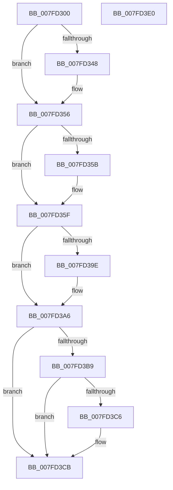

# MiFreePartitionId

- RVA: `0x007FD300`–`0x007FD3E1` (길이 `225` bytes)
- VA: `0x00000001407FD300`
- 실행 섹션: `PAGE`
- PDB 이름 있음: `예`; PDB Function 태그: `아니요`
- unwind 정보 RVA: `0x0005C954`
- 디코드: `59`개 명령, `225/225` bytes 표시
- 미해석 바이트: `0` (있으면 어셈블리에 `.byte`로 보존)

> 이 문서는 커널 이미지의 기계어와 PDB 기호를 분석해 생성했습니다. 4번과 5번은 함수 원형과 자료형을 바이너리 사용 방식에서 추정한 C 해석이며 원본 소스 복구 결과는 아닙니다.

## 1. Dependencies

- 직접 호출 지점: **5**; 고유 호출 대상: **5**
- 직접 호출자로 확인된 함수: **1**
- RIP 상대 이미지 참조: **4**

### Outgoing calls
- `0x007FD337` → [KeAbPreAcquire](../../text/21/KeAbPreAcquire_function_00210230.md) (function, `0x00210230`)
- `0x007FD351` → [ExfAcquirePushLockExclusiveEx](../../text/20/ExfAcquirePushLockExclusiveEx_function_0020FC90.md) (function, `0x0020FC90`)
- `0x007FD3A1` → [ExfTryToWakePushLock](../../text/26/ExfTryToWakePushLock_function_00265DD0.md) (function, `0x00265DD0`)
- `0x007FD3A9` → [KeAbPostRelease](../../text/2E/KeAbPostRelease_function_002E1600.md) (function, `0x002E1600`)
- `0x007FD3C6` → [KiCheckForKernelApcDelivery](../../text/2E/KiCheckForKernelApcDelivery_function_002E2C80.md) (function, `0x002E2C80`)

### Direct callers
- [MiDeletePartition](MiDeletePartition_function_007FD2BC.md) at `0x007FD2DC`

### Static image references
- `0x007FD31D` → RVA `0x00E30048` (`.data`; read)
- `0x007FD35F` → RVA `0x00E30068` (`.data`; read)
- `0x007FD37F` → RVA `0x00E30088` (`.data`; read)
- `0x007FD38F` → RVA `0x00E30048` (`.data`; read/write)

## 2. Other-region calls and transfers

- 다른 실행 섹션으로 향하는 call: **5**
  - `0x007FD337` → [KeAbPreAcquire](../../text/21/KeAbPreAcquire_function_00210230.md) (`PAGE` → `.text`)
  - `0x007FD351` → [ExfAcquirePushLockExclusiveEx](../../text/20/ExfAcquirePushLockExclusiveEx_function_0020FC90.md) (`PAGE` → `.text`)
  - `0x007FD3A1` → [ExfTryToWakePushLock](../../text/26/ExfTryToWakePushLock_function_00265DD0.md) (`PAGE` → `.text`)
  - `0x007FD3A9` → [KeAbPostRelease](../../text/2E/KeAbPostRelease_function_002E1600.md) (`PAGE` → `.text`)
  - `0x007FD3C6` → [KiCheckForKernelApcDelivery](../../text/2E/KiCheckForKernelApcDelivery_function_002E2C80.md) (`PAGE` → `.text`)
- 별도 외부 분기/꼬리 이동을 확인하지 못했습니다.

## 3. Assembly (complete function range)

```asm
007FD300  48 89 5C 24 08                  mov qword ptr [rsp + 8], rbx
007FD305  48 89 6C 24 10                  mov qword ptr [rsp + 0x10], rbp
007FD30A  48 89 74 24 18                  mov qword ptr [rsp + 0x18], rsi
007FD30F  57                              push rdi
007FD310  48 83 EC 20                     sub rsp, 0x20
007FD314  65 48 8B 1C 25 88 01 00 00      mov rbx, qword ptr gs:[0x188]
007FD31D  48 8D 2D 24 2D 63 00            lea rbp, [rip + 0x632d24]
007FD324  0F B7 F1                        movzx esi, cx
007FD327  45 33 C0                        xor r8d, r8d
007FD32A  33 D2                           xor edx, edx
007FD32C  48 8B CD                        mov rcx, rbp
007FD32F  66 FF 8B E6 01 00 00            dec word ptr [rbx + 0x1e6]
007FD336  90                              nop
007FD337  E8 F4 2E A1 FF                  call 0x140210230
007FD33C  F0 48 0F BA 6D 00 00            lock bts qword ptr [rbp], 0
007FD343  48 8B F8                        mov rdi, rax
007FD346  73 0E                           jae 0x1407fd356
007FD348  4C 8B C5                        mov r8, rbp
007FD34B  48 8B D0                        mov rdx, rax
007FD34E  48 8B CD                        mov rcx, rbp
007FD351  E8 3A 29 A1 FF                  call 0x14020fc90
007FD356  48 85 FF                        test rdi, rdi
007FD359  74 04                           je 0x1407fd35f
007FD35B  C6 47 0A 01                     mov byte ptr [rdi + 0xa], 1
007FD35F  48 8B 05 02 2D 63 00            mov rax, qword ptr [rip + 0x632d02]
007FD366  48 8B D6                        mov rdx, rsi
007FD369  48 C1 EA 03                     shr rdx, 3
007FD36D  48 8B CE                        mov rcx, rsi
007FD370  83 E1 07                        and ecx, 7
007FD373  48 03 50 08                     add rdx, qword ptr [rax + 8]
007FD377  0F BE 02                        movsx eax, byte ptr [rdx]
007FD37A  0F B3 C8                        btr eax, ecx
007FD37D  88 02                           mov byte ptr [rdx], al
007FD37F  48 8B 05 02 2D 63 00            mov rax, qword ptr [rip + 0x632d02]
007FD386  48 83 24 F0 00                  and qword ptr [rax + rsi*8], 0
007FD38B  48 83 C8 FF                     or rax, 0xffffffffffffffff
007FD38F  F0 48 0F C1 05 B0 2C 63 00      lock xadd qword ptr [rip + 0x632cb0], rax
007FD398  24 06                           and al, 6
007FD39A  3C 02                           cmp al, 2
007FD39C  75 08                           jne 0x1407fd3a6
007FD39E  48 8B CD                        mov rcx, rbp
007FD3A1  E8 2A 8A A6 FF                  call 0x140265dd0
007FD3A6  48 8B CD                        mov rcx, rbp
007FD3A9  E8 52 42 AE FF                  call 0x1402e1600
007FD3AE  90                              nop
007FD3AF  66 83 83 E6 01 00 00 01         add word ptr [rbx + 0x1e6], 1
007FD3B7  75 12                           jne 0x1407fd3cb
007FD3B9  48 8D 83 98 00 00 00            lea rax, [rbx + 0x98]
007FD3C0  90                              nop
007FD3C1  48 39 00                        cmp qword ptr [rax], rax
007FD3C4  74 05                           je 0x1407fd3cb
007FD3C6  E8 B5 58 AE FF                  call 0x1402e2c80
007FD3CB  48 8B 5C 24 30                  mov rbx, qword ptr [rsp + 0x30]
007FD3D0  48 8B 6C 24 38                  mov rbp, qword ptr [rsp + 0x38]
007FD3D5  48 8B 74 24 40                  mov rsi, qword ptr [rsp + 0x40]
007FD3DA  48 83 C4 20                     add rsp, 0x20
007FD3DE  5F                              pop rdi
007FD3DF  C3                              ret
007FD3E0  CC                              int3
```

## 4. C-style interpretation (structured pseudocode)

```c
__int64 __fastcall MiFreePartitionId(unsigned __int16 a1, int a2, int a3)
{
    __int64 result;
    __int64 v_rsp;
    unsigned __int64 v_stack_p10;
    unsigned __int64 v_stack_p18;
    unsigned __int64 v_stack_p8;

    v_stack_p8 = v_rbx;
    v_stack_p10 = v_rbp;
    v_stack_p18 = v_rsi;
    v_rsp = (v_rsp) - (32);
    a3 = 0;
    a2 = 0;
    result = KeAbPreAcquire(v_rip + 6499620, a2, a3, a4);
    if (!(condition_is_above_or_equal)) {
        a3 = v_rip + 6499620;
        a2 = result;
        a1 = v_rip + 6499620;
        result = ExfAcquirePushLockExclusiveEx(a1, a2, a3, a4);
    }
    if (result != 0) {
        *(unsigned __int8 *)(result + 10) = 1;
    }
    a2 = (a1) >> (3);
    a1 = (unsigned int)((a1) & (7));
    a2 = (a2) + (*(unsigned __int64 *)(*(unsigned __int64 *)(v_rip + 6499586) + 8));
    *(unsigned __int8 *)(a2) = (unsigned __int8)((__int8)(*(unsigned __int8 *)(a2)));
    result = (*(unsigned __int64 *)(v_rip + 6499586)) | (-1);
    result = (unsigned __int8)((result) & (6));
    if (((unsigned __int8)(result)) == 2) {
        a1 = v_rip + 6499620;
        result = ExfTryToWakePushLock(a1, a2, a3, a4);
    }
    result = KeAbPostRelease(v_rip + 6499620, a2, a3, a4);
    if (((unsigned __int8)(result)) != 2) goto loc_007FD3CB;
    result = *(unsigned __int64 *)(gs_base + (0 + 392)) + 152;
    if ((*(unsigned __int64 *)(*(unsigned __int64 *)(gs_base + (0 + 392)) + 152)) != (*(unsigned __int64 *)(gs_base + (0 + 392)) + 152)) {
        result = KiCheckForKernelApcDelivery(v_rip + 6499620, a2, a3, a4);
    }
    v_rsp = (v_rsp) + (32);
    return result;
}
```

## 5. (Beta) C Style

```c
int64_t MiFreePartitionId(uint16_t Arg1, int32_t Arg2, int32_t Arg3)
{
    int64_t result;
    int64_t local_rsp;
    uint64_t v_stack_p10;
    uint64_t v_stack_p18;
    uint64_t v_stack_p8;

    v_stack_p8 = local_rbx;
    v_stack_p10 = local_rbp;
    v_stack_p18 = local_rsi;
    local_rsp = (local_rsp) - (32);
    Arg3 = 0;
    Arg2 = 0;
    result = KeAbPreAcquire(v_rip + 6499620, Arg2, Arg3, a4);
    if (!(condition_is_above_or_equal)) {
        Arg3 = v_rip + 6499620;
        Arg2 = result;
        Arg1 = v_rip + 6499620;
        result = ExfAcquirePushLockExclusiveEx(Arg1, Arg2, Arg3, a4);
    }
    if (result != 0) {
        *(uint8_t *)(result + 0xA) = 1;
    }
    Arg2 = (Arg1) >> (3);
    Arg1 = (uint32_t)((Arg1) & (7));
    Arg2 = (Arg2) + (*(uint64_t *)(*(uint64_t *)(v_rip + 0x632D02) + 0x8));
    *(uint8_t *)(Arg2) = (uint8_t)((int8_t)(*(uint8_t *)(Arg2)));
    result = (*(uint64_t *)(v_rip + 0x632D02)) | (-1);
    result = (uint8_t)((result) & (6));
    if (((uint8_t)(result)) == 2) {
        Arg1 = v_rip + 6499620;
        result = ExfTryToWakePushLock(Arg1, Arg2, Arg3, a4);
    }
    result = KeAbPostRelease(v_rip + 6499620, Arg2, Arg3, a4);
    if (((uint8_t)(result)) != 2) goto loc_007FD3CB;
    result = *(uint64_t *)(gs_base + (0 + 0x188)) + 152;
    if ((*(uint64_t *)(*(uint64_t *)(gs_base + (0 + 0x188)) + 0x98)) != (*(uint64_t *)(gs_base + (0 + 0x188)) + 152)) {
        result = KiCheckForKernelApcDelivery(v_rip + 6499620, Arg2, Arg3, a4);
    }
    local_rsp = (local_rsp) + (32);
    return result;
}
```

## 6. Execution-region graph

[열기: 2D/3D 그래프와 함수 탐색 컨트롤 패널](../../../control-panel.html?section=page&rva=0x007FD300&view=graph)

- 2D 그래프는 위에서 아래로 흐르고, 3D 그래프는 빈 공간을 드래그해 회전합니다. Shift+드래그는 이동, 휠은 확대·축소, 함수 노드 선택은 대상 보고서 이동입니다.

### Static fallback


