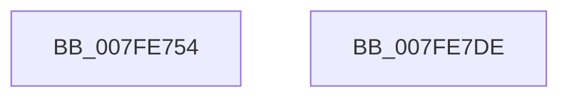

# MiGenerateSecureCookie

- RVA: `0x007FE754`–`0x007FE7DF` (길이 `139` bytes)
- VA: `0x00000001407FE754`
- 실행 섹션: `PAGE`
- PDB 이름 있음: `예`; PDB Function 태그: `아니요`
- unwind 정보 RVA: `0x00060BC4`
- 디코드: `38`개 명령, `139/139` bytes 표시
- 미해석 바이트: `0` (있으면 어셈블리에 `.byte`로 보존)

> 이 문서는 커널 이미지의 기계어와 PDB 기호를 분석해 생성했습니다. 4번과 5번은 함수 원형과 자료형을 바이너리 사용 방식에서 추정한 C 해석이며 원본 소스 복구 결과는 아닙니다.

## 1. Dependencies

- 직접 호출 지점: **3**; 고유 호출 대상: **2**
- 직접 호출자로 확인된 함수: **1**
- RIP 상대 이미지 참조: **0**

### Outgoing calls
- `0x007FE774` → [KiQueryUnbiasedInterruptTime](../../text/42/KiQueryUnbiasedInterruptTime_function_0042D180.md) (function, `0x0042D180`)
- `0x007FE7B0` → [ExGenRandom](../../text/41/ExGenRandom_function_0041B010.md) (function, `0x0041B010`)
- `0x007FE7BD` → [ExGenRandom](../../text/41/ExGenRandom_function_0041B010.md) (function, `0x0041B010`)

### Direct callers
- [MiInitSystem](../../init/C5/MiInitSystem_function_00C5E6C0.md) at `0x00C5E7C3`

### Static image references
- 디코드된 RIP-relative 메모리 참조가 없습니다.

## 2. Other-region calls and transfers

- 다른 실행 섹션으로 향하는 call: **3**
  - `0x007FE774` → [KiQueryUnbiasedInterruptTime](../../text/42/KiQueryUnbiasedInterruptTime_function_0042D180.md) (`PAGE` → `.text`)
  - `0x007FE7B0` → [ExGenRandom](../../text/41/ExGenRandom_function_0041B010.md) (`PAGE` → `.text`)
  - `0x007FE7BD` → [ExGenRandom](../../text/41/ExGenRandom_function_0041B010.md) (`PAGE` → `.text`)
- 별도 외부 분기/꼬리 이동을 확인하지 못했습니다.

## 3. Assembly (complete function range)

```asm
007FE754  48 89 5C 24 08                  mov qword ptr [rsp + 8], rbx
007FE759  48 89 74 24 10                  mov qword ptr [rsp + 0x10], rsi
007FE75E  57                              push rdi
007FE75F  48 83 EC 20                     sub rsp, 0x20
007FE763  65 4C 8B 1C 25 20 00 00 00      mov r11, qword ptr gs:[0x20]
007FE76C  BE 01 00 00 00                  mov esi, 1
007FE771  40 8A CE                        mov cl, sil
007FE774  E8 07 EA C2 FF                  call 0x14042d180
007FE779  48 8B F8                        mov rdi, rax
007FE77C  48 8B C8                        mov rcx, rax
007FE77F  48 C1 E7 20                     shl rdi, 0x20
007FE783  0F 31                           rdtsc
007FE785  48 C1 E9 1C                     shr rcx, 0x1c
007FE789  48 C1 E2 20                     shl rdx, 0x20
007FE78D  48 0B C2                        or rax, rdx
007FE790  48 33 C1                        xor rax, rcx
007FE793  41 8B 8B 38 2D 00 00            mov ecx, dword ptr [r11 + 0x2d38]
007FE79A  48 C1 E8 04                     shr rax, 4
007FE79E  48 33 C1                        xor rax, rcx
007FE7A1  41 8B 8B 50 86 00 00            mov ecx, dword ptr [r11 + 0x8650]
007FE7A8  48 33 C1                        xor rax, rcx
007FE7AB  33 C9                           xor ecx, ecx
007FE7AD  48 33 F8                        xor rdi, rax
007FE7B0  E8 5B C8 C1 FF                  call 0x14041b010
007FE7B5  8B D8                           mov ebx, eax
007FE7B7  33 C9                           xor ecx, ecx
007FE7B9  48 C1 E3 20                     shl rbx, 0x20
007FE7BD  E8 4E C8 C1 FF                  call 0x14041b010
007FE7C2  8B C0                           mov eax, eax
007FE7C4  48 0B C3                        or rax, rbx
007FE7C7  48 8B 5C 24 30                  mov rbx, qword ptr [rsp + 0x30]
007FE7CC  48 33 C7                        xor rax, rdi
007FE7CF  48 0F 44 C6                     cmove rax, rsi
007FE7D3  48 8B 74 24 38                  mov rsi, qword ptr [rsp + 0x38]
007FE7D8  48 83 C4 20                     add rsp, 0x20
007FE7DC  5F                              pop rdi
007FE7DD  C3                              ret
007FE7DE  CC                              int3
```

## 4. C-style interpretation (structured pseudocode)

```c
__int64 __fastcall MiGenerateSecureCookie(__int64 a1, __int64 a2)
{
    __int64 result;
    __int64 v_rbx;
    __int64 v_rdi;
    __int64 v_rsp;
    unsigned __int64 v_stack_p10;
    unsigned __int64 v_stack_p8;

    v_stack_p8 = v_rbx;
    v_stack_p10 = v_rsi;
    v_rsp = (v_rsp) - (32);
    result = KiQueryUnbiasedInterruptTime(1, a2, a3, a4);
    v_rdi = (result) << (32);
    a1 = (result) >> (28);
    a2 = (a2) << (32);
    result = (result) | (a2);
    result = (result) ^ (a1);
    result = (result) >> (4);
    result = (result) ^ ((unsigned int)(*(unsigned int *)(*(unsigned __int64 *)(gs_base + (0 + 32)) + 11576)));
    result = (result) ^ ((unsigned int)(*(unsigned int *)(*(unsigned __int64 *)(gs_base + (0 + 32)) + 34384)));
    a1 = 0;
    v_rdi = (v_rdi) ^ (result);
    result = ExGenRandom(a1, a2, a3, a4);
    a1 = 0;
    v_rbx = ((unsigned int)((unsigned int)(result))) << (32);
    result = ExGenRandom(a1, a2, a3, a4);
    result = ((unsigned int)((unsigned int)(result))) | (v_rbx);
    result = (result) ^ (v_rdi);
    if (condition_is_equal) { result = 1; }
    v_rsp = (v_rsp) + (32);
    return result;
}
```

## 5. (Beta) C Style

```c
int64_t MiGenerateSecureCookie(int64_t Arg1, int64_t Arg2)
{
    int64_t result;
    int64_t local_rbx;
    int64_t local_rdi;
    int64_t local_rsp;
    uint64_t v_stack_p10;
    uint64_t v_stack_p8;

    v_stack_p8 = local_rbx;
    v_stack_p10 = local_rsi;
    local_rsp = (local_rsp) - (32);
    result = KiQueryUnbiasedInterruptTime(1, Arg2, a3, a4);
    local_rdi = (result) << (32);
    Arg1 = (result) >> (28);
    Arg2 = (Arg2) << (32);
    result = (result) | (Arg2);
    result = (result) ^ (Arg1);
    result = (result) >> (4);
    result = (result) ^ ((uint32_t)(*(uint32_t *)(*(uint64_t *)(gs_base + (0 + 0x20)) + 0x2D38)));
    result = (result) ^ ((uint32_t)(*(uint32_t *)(*(uint64_t *)(gs_base + (0 + 0x20)) + 0x8650)));
    Arg1 = 0;
    local_rdi = (local_rdi) ^ (result);
    result = ExGenRandom(Arg1, Arg2, a3, a4);
    Arg1 = 0;
    local_rbx = ((uint32_t)((uint32_t)(result))) << (32);
    result = ExGenRandom(Arg1, Arg2, a3, a4);
    result = ((uint32_t)((uint32_t)(result))) | (local_rbx);
    result = (result) ^ (local_rdi);
    if (condition_is_equal) { result = 1; }
    local_rsp = (local_rsp) + (32);
    return result;
}
```

## 6. Execution-region graph

[열기: 2D/3D 그래프와 함수 탐색 컨트롤 패널](../../../control-panel.html?section=page&rva=0x007FE754&view=graph)

- 2D 그래프는 위에서 아래로 흐르고, 3D 그래프는 빈 공간을 드래그해 회전합니다. Shift+드래그는 이동, 휠은 확대·축소, 함수 노드 선택은 대상 보고서 이동입니다.

### Static fallback


