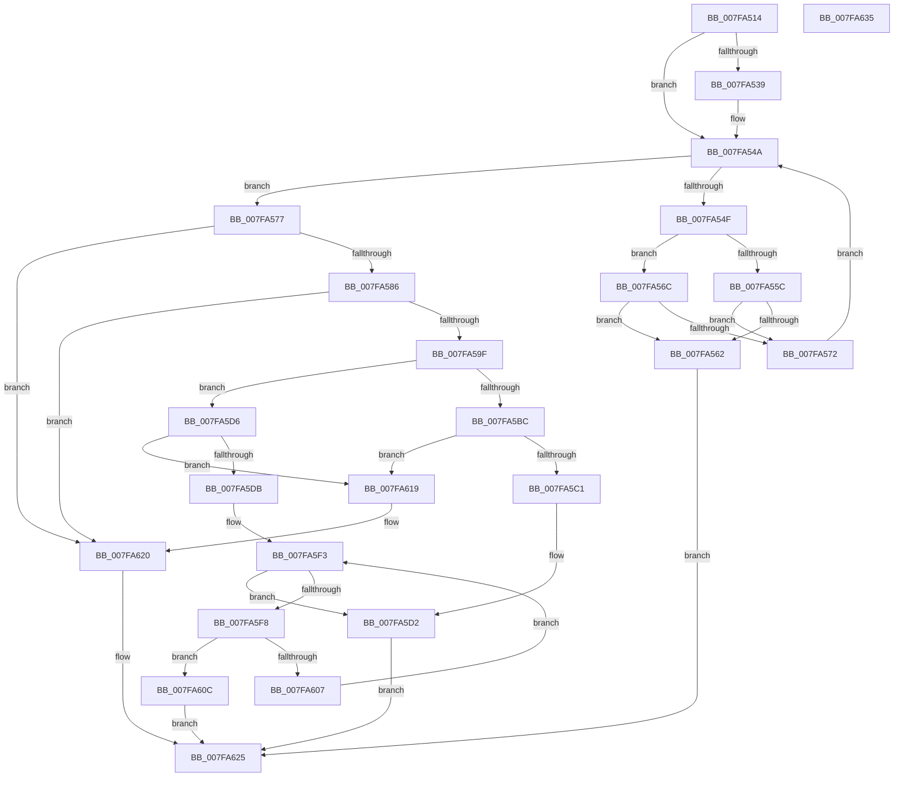

# MiHonorExistingHotMemoryFlights

- RVA: `0x007FA514`–`0x007FA636` (길이 `290` bytes)
- VA: `0x00000001407FA514`
- 실행 섹션: `PAGE`
- PDB 이름 있음: `예`; PDB Function 태그: `아니요`
- unwind 정보 RVA: `0x00060BC4`
- 디코드: `76`개 명령, `290/290` bytes 표시
- 미해석 바이트: `0` (있으면 어셈블리에 `.byte`로 보존)

> 이 문서는 커널 이미지의 기계어와 PDB 기호를 분석해 생성했습니다. 4번과 5번은 함수 원형과 자료형을 바이너리 사용 방식에서 추정한 C 해석이며 원본 소스 복구 결과는 아닙니다.

## 1. Dependencies

- 직접 호출 지점: **2**; 고유 호출 대상: **2**
- 직접 호출자로 확인된 함수: **1**
- RIP 상대 이미지 참조: **8**

### Outgoing calls
- `0x007FA5FB` → [MiExtendMemoryBlocks](MiExtendMemoryBlocks_function_007FA454.md) (function, `0x007FA454`)
- `0x007FA60F` → [MiUnlinkHotAddFlight](MiUnlinkHotAddFlight_function_007FB05C.md) (function, `0x007FB05C`)

### Direct callers
- [MiAllocateInitialMemoryBlocks](MiAllocateInitialMemoryBlocks_function_007F9E34.md) at `0x007F9EF5`

### Static image references
- `0x007FA523` → RVA `0x00E2ED00` (`.data`; read)
- `0x007FA53C` → RVA `0x00E2ED08` (`.data`; write)
- `0x007FA543` → RVA `0x00E2ED00` (`.data`; write)
- `0x007FA577` → RVA `0x00E2ED10` (`.data`; read)
- `0x007FA58C` → RVA `0x00E2ED14` (`.data`; read)
- `0x007FA5A6` → RVA `0x00E2ED08` (`.data`; read)
- `0x007FA5AD` → RVA `0x00E2ED10` (`.data`; write)
- `0x007FA5B3` → RVA `0x00E2ED14` (`.data`; write)

## 2. Other-region calls and transfers

- 다른 실행 섹션으로 향하는 call: **0**
- 별도 외부 분기/꼬리 이동을 확인하지 못했습니다.

## 3. Assembly (complete function range)

```asm
007FA514  48 89 5C 24 08                  mov qword ptr [rsp + 8], rbx
007FA519  48 89 74 24 10                  mov qword ptr [rsp + 0x10], rsi
007FA51E  57                              push rdi
007FA51F  48 83 EC 20                     sub rsp, 0x20
007FA523  48 8B 05 D6 47 63 00            mov rax, qword ptr [rip + 0x6347d6]
007FA52A  48 8D 35 CF 47 63 00            lea rsi, [rip + 0x6347cf]
007FA531  48 8B D9                        mov rbx, rcx
007FA534  48 85 C0                        test rax, rax
007FA537  75 11                           jne 0x1407fa54a
007FA539  48 8B C6                        mov rax, rsi
007FA53C  48 89 35 C5 47 63 00            mov qword ptr [rip + 0x6347c5], rsi
007FA543  48 89 05 B6 47 63 00            mov qword ptr [rip + 0x6347b6], rax
007FA54A  48 3B C6                        cmp rax, rsi
007FA54D  74 28                           je 0x1407fa577
007FA54F  48 8B 4B 10                     mov rcx, qword ptr [rbx + 0x10]
007FA553  48 8B 50 10                     mov rdx, qword ptr [rax + 0x10]
007FA557  48 3B CA                        cmp rcx, rdx
007FA55A  73 10                           jae 0x1407fa56c
007FA55C  48 39 53 18                     cmp qword ptr [rbx + 0x18], rdx
007FA560  76 10                           jbe 0x1407fa572
007FA562  B8 18 00 00 C0                  mov eax, 0xc0000018
007FA567  E9 B9 00 00 00                  jmp 0x1407fa625
007FA56C  48 3B 48 18                     cmp rcx, qword ptr [rax + 0x18]
007FA570  72 F0                           jb 0x1407fa562
007FA572  48 8B 00                        mov rax, qword ptr [rax]
007FA575  EB D3                           jmp 0x1407fa54a
007FA577  8B 15 93 47 63 00               mov edx, dword ptr [rip + 0x634793]
007FA57D  83 C2 01                        add edx, 1
007FA580  0F 84 9A 00 00 00               je 0x1407fa620
007FA586  8B 8B 98 00 00 00               mov ecx, dword ptr [rbx + 0x98]
007FA58C  44 8B 05 81 47 63 00            mov r8d, dword ptr [rip + 0x634781]
007FA593  44 03 C1                        add r8d, ecx
007FA596  44 3B C1                        cmp r8d, ecx
007FA599  0F 82 81 00 00 00               jb 0x1407fa620
007FA59F  48 39 35 5A 47 63 00            cmp qword ptr [rip + 0x63475a], rsi
007FA5A6  48 8B 05 5B 47 63 00            mov rax, qword ptr [rip + 0x63475b]
007FA5AD  89 15 5D 47 63 00               mov dword ptr [rip + 0x63475d], edx
007FA5B3  44 89 05 5A 47 63 00            mov dword ptr [rip + 0x63475a], r8d
007FA5BA  75 1A                           jne 0x1407fa5d6
007FA5BC  48 39 30                        cmp qword ptr [rax], rsi
007FA5BF  75 58                           jne 0x1407fa619
007FA5C1  48 89 33                        mov qword ptr [rbx], rsi
007FA5C4  48 89 43 08                     mov qword ptr [rbx + 8], rax
007FA5C8  48 89 18                        mov qword ptr [rax], rbx
007FA5CB  48 89 1D 36 47 63 00            mov qword ptr [rip + 0x634736], rbx
007FA5D2  33 C0                           xor eax, eax
007FA5D4  EB 4F                           jmp 0x1407fa625
007FA5D6  48 39 30                        cmp qword ptr [rax], rsi
007FA5D9  75 3E                           jne 0x1407fa619
007FA5DB  48 89 33                        mov qword ptr [rbx], rsi
007FA5DE  48 89 43 08                     mov qword ptr [rbx + 8], rax
007FA5E2  48 89 18                        mov qword ptr [rax], rbx
007FA5E5  48 8B 3D 14 47 63 00            mov rdi, qword ptr [rip + 0x634714]
007FA5EC  48 89 1D 15 47 63 00            mov qword ptr [rip + 0x634715], rbx
007FA5F3  48 3B FE                        cmp rdi, rsi
007FA5F6  74 DA                           je 0x1407fa5d2
007FA5F8  48 8B CF                        mov rcx, rdi
007FA5FB  E8 54 FE FF FF                  call 0x1407fa454
007FA600  44 8B C0                        mov r8d, eax
007FA603  85 C0                           test eax, eax
007FA605  78 05                           js 0x1407fa60c
007FA607  48 8B 3F                        mov rdi, qword ptr [rdi]
007FA60A  EB E7                           jmp 0x1407fa5f3
007FA60C  48 8B CB                        mov rcx, rbx
007FA60F  E8 48 0A 00 00                  call 0x1407fb05c
007FA614  41 8B C0                        mov eax, r8d
007FA617  EB 0C                           jmp 0x1407fa625
007FA619  B9 03 00 00 00                  mov ecx, 3
007FA61E  CD 29                           int 0x29
007FA620  B8 9A 00 00 C0                  mov eax, 0xc000009a
007FA625  48 8B 5C 24 30                  mov rbx, qword ptr [rsp + 0x30]
007FA62A  48 8B 74 24 38                  mov rsi, qword ptr [rsp + 0x38]
007FA62F  48 83 C4 20                     add rsp, 0x20
007FA633  5F                              pop rdi
007FA634  C3                              ret
007FA635  CC                              int3
```

## 4. C-style interpretation (structured pseudocode)

```c
__int64 __fastcall MiHonorExistingHotMemoryFlights(__int64 a1)
{
    __int64 result;
    __int64 v_rsp;
    unsigned __int64 v_stack_p10;
    unsigned __int64 v_stack_p8;

    v_stack_p8 = v_rbx;
    v_stack_p10 = v_rsi;
    v_rsp = (v_rsp) - (32);
    result = *(unsigned __int64 *)(v_rip + 6506454);
    if (*(unsigned __int64 *)(v_rip + 6506454) == 0) {
        result = v_rip + 6506447;
        *(unsigned __int64 *)(v_rip + 6506437) = v_rip + 6506447;
        *(unsigned __int64 *)(v_rip + 6506422) = result;
    }
    if (result == (v_rip + 6506447)) goto loc_007FA577;
    if ((*(unsigned __int64 *)(a1 + 16)) >= (*(unsigned __int64 *)(result + 16))) goto loc_007FA56C;
    if ((*(unsigned __int64 *)(a1 + 24)) <= (*(unsigned __int64 *)(result + 16))) goto loc_007FA572;
loc_007FA562:
    goto loc_007FA625;
loc_007FA56C:
    if ((*(unsigned __int64 *)(a1 + 16)) < (*(unsigned __int64 *)((unsigned int)(0xC0000018ULL) + 24))) goto loc_007FA562;
loc_007FA572:
    goto loc_007FA54A;
loc_007FA577:
    a2 = (unsigned int)(((unsigned int)(*(unsigned int *)(v_rip + 6506387))) + (1));
    if (condition_is_equal) goto loc_007FA620;
    a3 = (unsigned int)(((unsigned int)(*(unsigned int *)(v_rip + 6506369))) + ((unsigned int)((unsigned int)(*(unsigned int *)(a1 + 152)))));
    if (((unsigned int)(a3)) < ((unsigned int)((unsigned int)(*(unsigned int *)(a1 + 152))))) goto loc_007FA620;
    *(unsigned int *)(v_rip + 6506333) = (unsigned int)(a2);
    *(unsigned int *)(v_rip + 6506330) = (unsigned int)(a3);
    if ((*(unsigned __int64 *)(v_rip + 6506330)) != (v_rip + 6506447)) goto loc_007FA5D6;
    if ((*(unsigned __int64 *)(*(unsigned __int64 *)(v_rip + 6506331))) != (v_rip + 6506447)) goto loc_007FA619;
    *(unsigned __int64 *)(a1) = v_rip + 6506447;
    *(unsigned __int64 *)(a1 + 8) = *(unsigned __int64 *)(v_rip + 6506331);
    *(unsigned __int64 *)(*(unsigned __int64 *)(v_rip + 6506331)) = a1;
    *(unsigned __int64 *)(v_rip + 6506294) = a1;
loc_007FA5D2:
    result = 0;
    goto loc_007FA625;
loc_007FA5D6:
    if ((*(unsigned __int64 *)(result)) != (v_rip + 6506447)) goto loc_007FA619;
    *(unsigned __int64 *)(a1) = v_rip + 6506447;
    *(unsigned __int64 *)(a1 + 8) = 0;
    *(unsigned __int64 *)(result) = a1;
    *(unsigned __int64 *)(v_rip + 6506261) = a1;
loc_007FA5F3:
    if ((*(unsigned __int64 *)(v_rip + 6506260)) == (v_rip + 6506447)) goto loc_007FA5D2;
    result = MiExtendMemoryBlocks(*(unsigned __int64 *)(v_rip + 6506260), a2, a3, a4);
    if (sign_flag) goto loc_007FA60C;
    goto loc_007FA5F3;
loc_007FA60C:
    result = MiUnlinkHotAddFlight(a1, a2, (unsigned int)((unsigned int)(result)), a4);
    goto loc_007FA625;
loc_007FA619:
loc_007FA620:
loc_007FA625:
    v_rsp = (v_rsp) + (32);
    return (unsigned int)(0xC000009AULL);
}
```

## 5. (Beta) C Style

```c
int64_t MiHonorExistingHotMemoryFlights(void *Arg1)
{
    uint8_t *arg1 = (uint8_t *)Arg1;

    int64_t result;
    int64_t local_rsp;
    uint64_t v_stack_p10;
    uint64_t v_stack_p8;

    v_stack_p8 = local_rbx;
    v_stack_p10 = local_rsi;
    local_rsp = (local_rsp) - (32);
    result = *(uint64_t *)(v_rip + 0x6347D6);
    if (*(uint64_t *)(v_rip + 0x6347D6) == 0) {
        result = v_rip + 6506447;
        *(uint64_t *)(v_rip + 0x6347C5) = v_rip + 6506447;
        *(uint64_t *)(v_rip + 0x6347B6) = result;
    }
    if (result == (v_rip + 6506447)) goto loc_007FA577;
    if ((*(uint64_t *)(arg1 + 0x10)) >= (*(uint64_t *)(result + 0x10))) goto loc_007FA56C;
    if ((*(uint64_t *)(arg1 + 0x18)) <= (*(uint64_t *)(result + 0x10))) goto loc_007FA572;
loc_007FA562:
    goto loc_007FA625;
loc_007FA56C:
    if ((*(uint64_t *)(arg1 + 0x10)) < (*(uint64_t *)((uint32_t)(0xC0000018ULL) + 0x18))) goto loc_007FA562;
loc_007FA572:
    goto loc_007FA54A;
loc_007FA577:
    a2 = (uint32_t)(((uint32_t)(*(uint32_t *)(v_rip + 0x634793))) + (1));
    if (condition_is_equal) goto loc_007FA620;
    a3 = (uint32_t)(((uint32_t)(*(uint32_t *)(v_rip + 0x634781))) + ((uint32_t)((uint32_t)(*(uint32_t *)(arg1 + 0x98)))));
    if (((uint32_t)(a3)) < ((uint32_t)((uint32_t)(*(uint32_t *)(arg1 + 0x98))))) goto loc_007FA620;
    *(uint32_t *)(v_rip + 0x63475D) = (uint32_t)(a2);
    *(uint32_t *)(v_rip + 0x63475A) = (uint32_t)(a3);
    if ((*(uint64_t *)(v_rip + 0x63475A)) != (v_rip + 6506447)) goto loc_007FA5D6;
    if ((*(uint64_t *)(*(uint64_t *)(v_rip + 0x63475B))) != (v_rip + 6506447)) goto loc_007FA619;
    *(uint64_t *)(arg1) = v_rip + 6506447;
    *(uint64_t *)(arg1 + 0x8) = *(uint64_t *)(v_rip + 0x63475B);
    *(void **)(*(uint64_t *)(v_rip + 0x63475B)) = Arg1;
    *(void **)(v_rip + 0x634736) = Arg1;
loc_007FA5D2:
    result = 0;
    goto loc_007FA625;
loc_007FA5D6:
    if ((*(uint64_t *)(result)) != (v_rip + 6506447)) goto loc_007FA619;
    *(uint64_t *)(arg1) = v_rip + 6506447;
    *(uint64_t *)(arg1 + 0x8) = 0;
    *(void **)(result) = Arg1;
    *(void **)(v_rip + 0x634715) = Arg1;
loc_007FA5F3:
    if ((*(uint64_t *)(v_rip + 0x634714)) == (v_rip + 6506447)) goto loc_007FA5D2;
    result = MiExtendMemoryBlocks(*(uint64_t *)(v_rip + 0x634714), a2, a3, a4);
    if (sign_flag) goto loc_007FA60C;
    goto loc_007FA5F3;
loc_007FA60C:
    result = MiUnlinkHotAddFlight(Arg1, a2, (uint32_t)((uint32_t)(result)), a4);
    goto loc_007FA625;
loc_007FA619:
loc_007FA620:
loc_007FA625:
    local_rsp = (local_rsp) + (32);
    return (uint32_t)(0xC000009AULL);
}
```

### 관측된 메모리 오프셋

구조체 형식이 확인되지 않은 접근은 인자 기준의 오프셋으로만 기록했습니다.

| 기준 인자 | 오프셋 표현 | 폭 (bit) | 접근 |
|---|---:|---:|---|
| `Arg1` | `+ 0x0` | `64` | `W` |
| `Arg1` | `+ 0x8` | `64` | `W` |
| `Arg1` | `+ 0x10` | `64` | `R` |
| `Arg1` | `+ 0x18` | `64` | `R` |
| `Arg1` | `+ 0x98` | `32` | `R` |

## 6. Execution-region graph

[열기: 2D/3D 그래프와 함수 탐색 컨트롤 패널](../../../control-panel.html?section=page&rva=0x007FA514&view=graph)

- 2D 그래프는 위에서 아래로 흐르고, 3D 그래프는 빈 공간을 드래그해 회전합니다. Shift+드래그는 이동, 휠은 확대·축소, 함수 노드 선택은 대상 보고서 이동입니다.

### Static fallback


