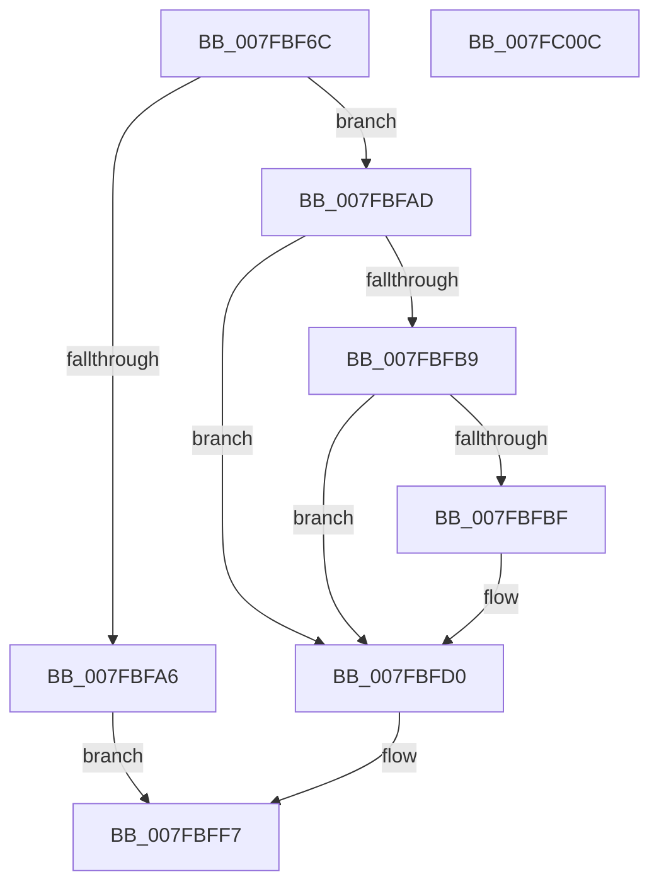

# MiHotAddHugeRange

- RVA: `0x007FBF6C`–`0x007FC00D` (길이 `161` bytes)
- VA: `0x00000001407FBF6C`
- 실행 섹션: `PAGE`
- PDB 이름 있음: `예`; PDB Function 태그: `아니요`
- unwind 정보 RVA: `0x0006F874`
- 디코드: `42`개 명령, `161/161` bytes 표시
- 미해석 바이트: `0` (있으면 어셈블리에 `.byte`로 보존)

> 이 문서는 커널 이미지의 기계어와 PDB 기호를 분석해 생성했습니다. 4번과 5번은 함수 원형과 자료형을 바이너리 사용 방식에서 추정한 C 해석이며 원본 소스 복구 결과는 아닙니다.

## 1. Dependencies

- 직접 호출 지점: **3**; 고유 호출 대상: **3**
- 직접 호출자로 확인된 함수: **2**
- RIP 상대 이미지 참조: **0**

### Outgoing calls
- `0x007FBF9D` → [MiInitializeHugePfnDatabase](../../text/67/MiInitializeHugePfnDatabase_function_00676410.md) (function, `0x00676410`)
- `0x007FBFC5` → [MiHugePageOperation](../../text/68/MiHugePageOperation_function_0068C490.md) (function, `0x0068C490`)
- `0x007FBFF2` → [MiAddPartitionHugeRange](../../text/67/MiAddPartitionHugeRange_function_006750D8.md) (function, `0x006750D8`)

### Direct callers
- [MiActOnPartitionNodePages](../../text/68/MiActOnPartitionNodePages_function_0068F7F4.md) at `0x0068FF55`
- [MiRemovePhysicalMemory](MiRemovePhysicalMemory_function_007FAD3C.md) at `0x007FAFED`

### Static image references
- 디코드된 RIP-relative 메모리 참조가 없습니다.

## 2. Other-region calls and transfers

- 다른 실행 섹션으로 향하는 call: **3**
  - `0x007FBF9D` → [MiInitializeHugePfnDatabase](../../text/67/MiInitializeHugePfnDatabase_function_00676410.md) (`PAGE` → `.text`)
  - `0x007FBFC5` → [MiHugePageOperation](../../text/68/MiHugePageOperation_function_0068C490.md) (`PAGE` → `.text`)
  - `0x007FBFF2` → [MiAddPartitionHugeRange](../../text/67/MiAddPartitionHugeRange_function_006750D8.md) (`PAGE` → `.text`)
- 별도 외부 분기/꼬리 이동을 확인하지 못했습니다.

## 3. Assembly (complete function range)

```asm
007FBF6C  48 8B C4                        mov rax, rsp
007FBF6F  48 89 58 08                     mov qword ptr [rax + 8], rbx
007FBF73  48 89 68 10                     mov qword ptr [rax + 0x10], rbp
007FBF77  48 89 70 18                     mov qword ptr [rax + 0x18], rsi
007FBF7B  57                              push rdi
007FBF7C  48 83 EC 50                     sub rsp, 0x50
007FBF80  48 83 60 C8 00                  and qword ptr [rax - 0x38], 0
007FBF85  0F 57 C0                        xorps xmm0, xmm0
007FBF88  83 60 E4 00                     and dword ptr [rax - 0x1c], 0
007FBF8C  41 8B F1                        mov esi, r9d
007FBF8F  F3 0F 7F 40 D0                  movdqu xmmword ptr [rax - 0x30], xmm0
007FBF94  49 8B E8                        mov rbp, r8
007FBF97  48 8B DA                        mov rbx, rdx
007FBF9A  48 8B F9                        mov rdi, rcx
007FBF9D  E8 6E A4 E7 FF                  call 0x140676410
007FBFA2  85 C0                           test eax, eax
007FBFA4  75 07                           jne 0x1407fbfad
007FBFA6  B8 9A 00 00 C0                  mov eax, 0xc000009a
007FBFAB  EB 4A                           jmp 0x1407fbff7
007FBFAD  44 8B 84 24 80 00 00 00         mov r8d, dword ptr [rsp + 0x80]
007FBFB5  85 F6                           test esi, esi
007FBFB7  74 17                           je 0x1407fbfd0
007FBFB9  41 83 F8 01                     cmp r8d, 1
007FBFBD  74 11                           je 0x1407fbfd0
007FBFBF  48 8B D3                        mov rdx, rbx
007FBFC2  48 8B CF                        mov rcx, rdi
007FBFC5  E8 C6 04 E9 FF                  call 0x14068c490
007FBFCA  41 B8 01 00 00 00               mov r8d, 1
007FBFD0  44 8B 8C 24 88 00 00 00         mov r9d, dword ptr [rsp + 0x88]
007FBFD8  48 8D 54 24 20                  lea rdx, [rsp + 0x20]
007FBFDD  48 8B CF                        mov rcx, rdi
007FBFE0  48 89 5C 24 40                  mov qword ptr [rsp + 0x40], rbx
007FBFE5  48 89 6C 24 48                  mov qword ptr [rsp + 0x48], rbp
007FBFEA  C7 44 24 38 26 00 00 00         mov dword ptr [rsp + 0x38], 0x26
007FBFF2  E8 E1 90 E7 FF                  call 0x1406750d8
007FBFF7  48 8B 5C 24 60                  mov rbx, qword ptr [rsp + 0x60]
007FBFFC  48 8B 6C 24 68                  mov rbp, qword ptr [rsp + 0x68]
007FC001  48 8B 74 24 70                  mov rsi, qword ptr [rsp + 0x70]
007FC006  48 83 C4 50                     add rsp, 0x50
007FC00A  5F                              pop rdi
007FC00B  C3                              ret
007FC00C  CC                              int3
```

## 4. C-style interpretation (structured pseudocode)

```c
__int64 __fastcall MiHotAddHugeRange(__int64 a1, __int64 a2, __int64 a3, int a4, unsigned int a5, unsigned int a6)
{
    __int64 result;
    __int64 v_rsp;
    unsigned __int64 v_stack_m10;
    unsigned __int64 v_stack_m18;
    unsigned int v_stack_m20;
    unsigned __int64 v_stack_m38;
    unsigned __int64 v_stack_p10;
    unsigned __int64 v_stack_p18;
    unsigned __int64 v_stack_p8;

    *(unsigned __int64 *)(v_rsp + 8) = v_rbx;
    *(unsigned __int64 *)(v_rsp + 16) = v_rbp;
    *(unsigned __int64 *)(v_rsp + 24) = v_rsi;
    v_rsp = (v_rsp) - (80);
    *(unsigned __int64 *)(v_rsp - 48) = v_xmm0;
    result = MiInitializeHugePfnDatabase(a1, a2, a3, a4);
    if ((unsigned int)(result) != 0) goto loc_007FBFAD;
    goto loc_007FBFF7;
loc_007FBFAD:
    if ((unsigned int)((unsigned int)(a4)) == 0) goto loc_007FBFD0;
    result = (unsigned int)(0xC000009AULL);
    if (((unsigned int)((unsigned int)(a5))) != 1) {
        a2 = a2;
        a1 = a1;
        result = MiHugePageOperation(a1, a2, (unsigned int)(a5), a4);
        a3 = 1;
    }
    v_stack_m18 = a2;
    v_stack_m10 = a3;
    v_stack_m20 = 38;
    result = MiAddPartitionHugeRange(a1, v_stack_m38, a3, (unsigned int)(a6));
loc_007FBFF7:
    v_rsp = (v_rsp) + (80);
    return result;
}
```

## 5. (Beta) C Style

```c
int64_t MiHotAddHugeRange(int64_t Arg1, int64_t Arg2, int64_t Arg3, int32_t Arg4, uint32_t Arg5, uint32_t Arg6)
{
    int64_t result;
    int64_t local_rsp;
    uint64_t v_stack_m10;
    uint64_t v_stack_m18;
    uint32_t v_stack_m20;
    uint64_t v_stack_m38;
    uint64_t v_stack_p10;
    uint64_t v_stack_p18;
    uint64_t v_stack_p8;

    *(uint64_t *)(local_rsp + 0x8) = local_rbx;
    *(uint64_t *)(local_rsp + 0x10) = local_rbp;
    *(uint64_t *)(local_rsp + 0x18) = local_rsi;
    local_rsp = (local_rsp) - (80);
    *(uint64_t *)(local_rsp - 0x30) = v_xmm0;
    result = MiInitializeHugePfnDatabase(Arg1, Arg2, Arg3, Arg4);
    if ((uint32_t)(result) != 0) goto loc_007FBFAD;
    goto loc_007FBFF7;
loc_007FBFAD:
    if ((uint32_t)((uint32_t)(Arg4)) == 0) goto loc_007FBFD0;
    result = (uint32_t)(0xC000009AULL);
    if (((uint32_t)((uint32_t)(Arg5))) != 1) {
        Arg2 = Arg2;
        Arg1 = Arg1;
        result = MiHugePageOperation(Arg1, Arg2, (uint32_t)(Arg5), Arg4);
        Arg3 = 1;
    }
    v_stack_m18 = Arg2;
    v_stack_m10 = Arg3;
    v_stack_m20 = 38;
    result = MiAddPartitionHugeRange(Arg1, v_stack_m38, Arg3, (uint32_t)(Arg6));
loc_007FBFF7:
    local_rsp = (local_rsp) + (80);
    return result;
}
```

## 6. Execution-region graph

[열기: 2D/3D 그래프와 함수 탐색 컨트롤 패널](../../../control-panel.html?section=page&rva=0x007FBF6C&view=graph)

- 2D 그래프는 위에서 아래로 흐르고, 3D 그래프는 빈 공간을 드래그해 회전합니다. Shift+드래그는 이동, 휠은 확대·축소, 함수 노드 선택은 대상 보고서 이동입니다.

### Static fallback


