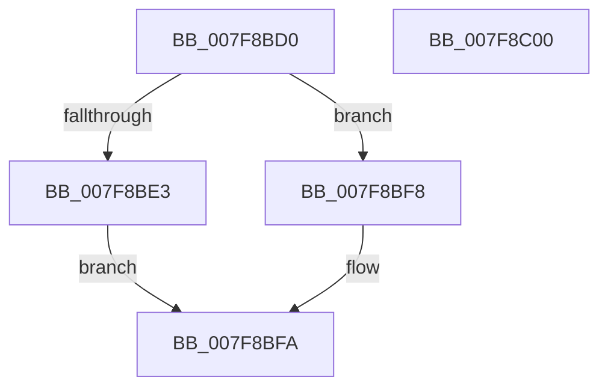

# MiImagePagable

- RVA: `0x007F8BD0`–`0x007F8C01` (길이 `49` bytes)
- VA: `0x00000001407F8BD0`
- 실행 섹션: `PAGE`
- PDB 이름 있음: `예`; PDB Function 태그: `아니요`
- unwind 정보 RVA: `0x0005CF00`
- 디코드: `18`개 명령, `49/49` bytes 표시
- 미해석 바이트: `0` (있으면 어셈블리에 `.byte`로 보존)

> 이 문서는 커널 이미지의 기계어와 PDB 기호를 분석해 생성했습니다. 4번과 5번은 함수 원형과 자료형을 바이너리 사용 방식에서 추정한 C 해석이며 원본 소스 복구 결과는 아닙니다.

## 1. Dependencies

- 직접 호출 지점: **1**; 고유 호출 대상: **1**
- 직접 호출자로 확인된 함수: **2**
- RIP 상대 이미지 참조: **1**

### Outgoing calls
- `0x007F8BE6` → [MI_IS_PHYSICAL_ADDRESS](../../text/23/MI_IS_PHYSICAL_ADDRESS_function_0023B3A0.md) (function, `0x0023B3A0`)

### Direct callers
- [MiEnablePagingOfDriver](../../init/C5/MiEnablePagingOfDriver_function_00C5F550.md) at `0x00C5F572`
- [MiLockPagableSections](../../init/C6/MiLockPagableSections_function_00C6C35C.md) at `0x00C6C37C`

### Static image references
- `0x007F8BD6` → RVA `0x00FC51F4` (`ALMOSTRO`; read)

## 2. Other-region calls and transfers

- 다른 실행 섹션으로 향하는 call: **1**
  - `0x007F8BE6` → [MI_IS_PHYSICAL_ADDRESS](../../text/23/MI_IS_PHYSICAL_ADDRESS_function_0023B3A0.md) (`PAGE` → `.text`)
- 별도 외부 분기/꼬리 이동을 확인하지 못했습니다.

## 3. Assembly (complete function range)

```asm
007F8BD0  40 53                           push rbx
007F8BD2  48 83 EC 20                     sub rsp, 0x20
007F8BD6  8B 05 18 C6 7C 00               mov eax, dword ptr [rip + 0x7cc618]
007F8BDC  48 8B D9                        mov rbx, rcx
007F8BDF  A8 01                           test al, 1
007F8BE1  75 15                           jne 0x1407f8bf8
007F8BE3  48 8B CA                        mov rcx, rdx
007F8BE6  E8 B5 27 A4 FF                  call 0x14023b3a0
007F8BEB  33 C9                           xor ecx, ecx
007F8BED  85 C0                           test eax, eax
007F8BEF  48 0F 45 D9                     cmovne rbx, rcx
007F8BF3  48 8B C3                        mov rax, rbx
007F8BF6  EB 02                           jmp 0x1407f8bfa
007F8BF8  33 C0                           xor eax, eax
007F8BFA  48 83 C4 20                     add rsp, 0x20
007F8BFE  5B                              pop rbx
007F8BFF  C3                              ret
007F8C00  CC                              int3
```

## 4. C-style interpretation (structured pseudocode)

```c
__int64 __fastcall MiImagePagable(__int64 a1, __int64 a2)
{
    __int64 result;
    __int64 v_rsp;

    v_rsp = (v_rsp) - (32);
    if ((((unsigned __int8)((unsigned int)(*(unsigned int *)(v_rip + 8177176)))) & (1)) != 0) goto loc_007F8BF8;
    result = MI_IS_PHYSICAL_ADDRESS(a2, a2, a3, a4);
    a1 = 0;
    if ((unsigned int)(result) != 0) { a1 = 0; }
    goto loc_007F8BFA;
loc_007F8BF8:
    result = 0;
loc_007F8BFA:
    v_rsp = (v_rsp) + (32);
    return result;
}
```

## 5. (Beta) C Style

```c
int64_t MiImagePagable(int64_t Arg1, int64_t Arg2)
{
    int64_t result;
    int64_t local_rsp;

    local_rsp = (local_rsp) - (32);
    if ((((uint8_t)((uint32_t)(*(uint32_t *)(v_rip + 0x7CC618)))) & (1)) != 0) goto loc_007F8BF8;
    result = MI_IS_PHYSICAL_ADDRESS(Arg2, Arg2, a3, a4);
    Arg1 = 0;
    if ((uint32_t)(result) != 0) { Arg1 = 0; }
    goto loc_007F8BFA;
loc_007F8BF8:
    result = 0;
loc_007F8BFA:
    local_rsp = (local_rsp) + (32);
    return result;
}
```

## 6. Execution-region graph

[열기: 2D/3D 그래프와 함수 탐색 컨트롤 패널](../../../control-panel.html?section=page&rva=0x007F8BD0&view=graph)

- 2D 그래프는 위에서 아래로 흐르고, 3D 그래프는 빈 공간을 드래그해 회전합니다. Shift+드래그는 이동, 휠은 확대·축소, 함수 노드 선택은 대상 보고서 이동입니다.

### Static fallback


