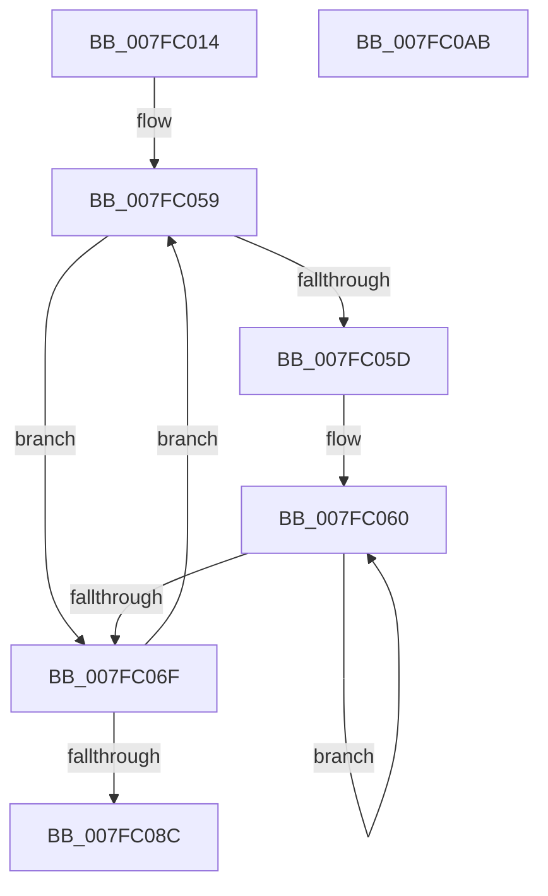

# MiInitializeHugeIoRanges

- RVA: `0x007FC014`–`0x007FC0AC` (길이 `152` bytes)
- VA: `0x00000001407FC014`
- 실행 섹션: `PAGE`
- PDB 이름 있음: `예`; PDB Function 태그: `아니요`
- unwind 정보 RVA: `0x0005CAAC`
- 디코드: `38`개 명령, `152/152` bytes 표시
- 미해석 바이트: `0` (있으면 어셈블리에 `.byte`로 보존)

> 이 문서는 커널 이미지의 기계어와 PDB 기호를 분석해 생성했습니다. 4번과 5번은 함수 원형과 자료형을 바이너리 사용 방식에서 추정한 C 해석이며 원본 소스 복구 결과는 아닙니다.

## 1. Dependencies

- 직접 호출 지점: **2**; 고유 호출 대상: **1**
- 직접 호출자로 확인된 함수: **1**
- RIP 상대 이미지 참조: **1**

### Outgoing calls
- `0x007FC060` → [CsanWrite64NoCheck](../../text/4F/CsanWrite64NoCheck_function_004FD380.md) (function, `0x004FD380`)
- `0x007FC09B` → [CsanWrite64NoCheck](../../text/4F/CsanWrite64NoCheck_function_004FD380.md) (function, `0x004FD380`)

### Direct callers
- [MiInitializeNuma](../../text/66/MiInitializeNuma_function_0066E0E0.md) at `0x0066E158`

### Static image references
- `0x007FC028` → RVA `0x00E2DCC0` (`.data`; read)

## 2. Other-region calls and transfers

- 다른 실행 섹션으로 향하는 call: **2**
  - `0x007FC060` → [CsanWrite64NoCheck](../../text/4F/CsanWrite64NoCheck_function_004FD380.md) (`PAGE` → `.text`)
  - `0x007FC09B` → [CsanWrite64NoCheck](../../text/4F/CsanWrite64NoCheck_function_004FD380.md) (`PAGE` → `.text`)
- 별도 외부 분기/꼬리 이동을 확인하지 못했습니다.

## 3. Assembly (complete function range)

```asm
007FC014  48 89 5C 24 08                  mov qword ptr [rsp + 8], rbx
007FC019  57                              push rdi
007FC01A  48 83 EC 20                     sub rsp, 0x20
007FC01E  48 8B 81 88 3A 00 00            mov rax, qword ptr [rcx + 0x3a88]
007FC025  4C 8B C9                        mov r9, rcx
007FC028  8B 1D 92 1C 63 00               mov ebx, dword ptr [rip + 0x631c92]
007FC02E  BF 02 00 00 00                  mov edi, 2
007FC033  0F B7 10                        movzx edx, word ptr [rax]
007FC036  4D 8D 91 E0 3A 00 00            lea r10, [r9 + 0x3ae0]
007FC03D  48 8B 88 10 41 00 00            mov rcx, qword ptr [rax + 0x4110]
007FC044  81 E2 FF 07 00 00               and edx, 0x7ff
007FC04A  48 C1 E2 04                     shl rdx, 4
007FC04E  49 8D 81 C0 3A 00 00            lea rax, [r9 + 0x3ac0]
007FC055  48 83 CA 01                     or rdx, 1
007FC059  85 DB                           test ebx, ebx
007FC05B  74 12                           je 0x1407fc06f
007FC05D  4C 8B C3                        mov r8, rbx
007FC060  E8 1B 13 D0 FF                  call 0x1404fd380
007FC065  48 83 C1 08                     add rcx, 8
007FC069  49 83 E8 01                     sub r8, 1
007FC06D  75 F1                           jne 0x1407fc060
007FC06F  48 83 E2 FA                     and rdx, 0xfffffffffffffffa
007FC073  4C 89 50 08                     mov qword ptr [rax + 8], r10
007FC077  48 89 18                        mov qword ptr [rax], rbx
007FC07A  48 83 CA 02                     or rdx, 2
007FC07E  49 83 C2 20                     add r10, 0x20
007FC082  48 83 C0 10                     add rax, 0x10
007FC086  48 83 EF 01                     sub rdi, 1
007FC08A  75 CD                           jne 0x1407fc059
007FC08C  48 83 E2 FC                     and rdx, 0xfffffffffffffffc
007FC090  49 8D 89 20 3B 00 00            lea rcx, [r9 + 0x3b20]
007FC097  48 83 CA 04                     or rdx, 4
007FC09B  E8 E0 12 D0 FF                  call 0x1404fd380
007FC0A0  48 8B 5C 24 30                  mov rbx, qword ptr [rsp + 0x30]
007FC0A5  48 83 C4 20                     add rsp, 0x20
007FC0A9  5F                              pop rdi
007FC0AA  C3                              ret
007FC0AB  CC                              int3
```

## 4. C-style interpretation (structured pseudocode)

```c
__int64 __fastcall MiInitializeHugeIoRanges(__int64 a1)
{
    __int64 result;
    __int64 v_r10;
    __int64 v_rdi;
    __int64 v_rsp;
    unsigned __int64 v_stack_p8;

    v_stack_p8 = v_rbx;
    v_rsp = (v_rsp) - (32);
    a2 = (unsigned int)((*(unsigned __int16 *)(*(unsigned __int64 *)(a1 + 14984))) & (0x7FFULL));
    a2 = (a2) << (4);
    a2 = (a2) | (1);
loc_007FC059:
    if ((unsigned int)((unsigned int)(*(unsigned int *)(v_rip + 6495378))) == 0) goto loc_007FC06F;
loc_007FC060:
    result = CsanWrite64NoCheck(*(unsigned __int64 *)(*(unsigned __int64 *)(a1 + 14984) + 16656), a2, (unsigned int)(*(unsigned int *)(v_rip + 6495378)), a1);
    a1 = (*(unsigned __int64 *)(*(unsigned __int64 *)(a1 + 14984) + 16656)) + (8);
    a3 = ((unsigned int)(*(unsigned int *)(v_rip + 6495378))) - (1);
    if (condition_is_not_equal) goto loc_007FC060;
loc_007FC06F:
    a2 = (a2) & (-6);
    *(unsigned __int64 *)(result + 8) = a1 + 15072;
    *(unsigned __int64 *)(result) = (unsigned int)(*(unsigned int *)(v_rip + 6495378));
    a2 = (a2) | (2);
    v_r10 = (a1 + 15072) + (32);
    result = (result) + (16);
    v_rdi = (2) - (1);
    if (condition_is_not_equal) goto loc_007FC059;
    a2 = (a2) & (-4);
    a2 = (a2) | (4);
    result = CsanWrite64NoCheck(a1 + 15136, a2, a3, a1);
    v_rsp = (v_rsp) + (32);
    return result;
}
```

## 5. (Beta) C Style

```c
int64_t MiInitializeHugeIoRanges(void *Arg1)
{
    uint8_t *arg1 = (uint8_t *)Arg1;

    int64_t result;
    int64_t local_r10;
    int64_t local_rdi;
    int64_t local_rsp;
    uint64_t v_stack_p8;

    v_stack_p8 = local_rbx;
    local_rsp = (local_rsp) - (32);
    a2 = (uint32_t)((*(uint16_t *)(*(uint64_t *)(arg1 + 0x3A88))) & (0x7FFULL));
    a2 = (a2) << (4);
    a2 = (a2) | (1);
loc_007FC059:
    if ((uint32_t)((uint32_t)(*(uint32_t *)(v_rip + 0x631C92))) == 0) goto loc_007FC06F;
loc_007FC060:
    result = CsanWrite64NoCheck(*(uint64_t *)(*(uint64_t *)(arg1 + 0x3A88) + 0x4110), a2, (uint32_t)(*(uint32_t *)(v_rip + 0x631C92)), Arg1);
    Arg1 = (*(uint64_t *)(*(uint64_t *)(arg1 + 0x3A88) + 0x4110)) + (8);
    a3 = ((uint32_t)(*(uint32_t *)(v_rip + 0x631C92))) - (1);
    if (condition_is_not_equal) goto loc_007FC060;
loc_007FC06F:
    a2 = (a2) & (-6);
    *(void **)(result + 0x8) = Arg1 + 15072;
    *(uint64_t *)(result) = (uint32_t)(*(uint32_t *)(v_rip + 0x631C92));
    a2 = (a2) | (2);
    local_r10 = (Arg1 + 15072) + (32);
    result = (result) + (16);
    local_rdi = (2) - (1);
    if (condition_is_not_equal) goto loc_007FC059;
    a2 = (a2) & (-4);
    a2 = (a2) | (4);
    result = CsanWrite64NoCheck(Arg1 + 15136, a2, a3, Arg1);
    local_rsp = (local_rsp) + (32);
    return result;
}
```

### 관측된 메모리 오프셋

구조체 형식이 확인되지 않은 접근은 인자 기준의 오프셋으로만 기록했습니다.

| 기준 인자 | 오프셋 표현 | 폭 (bit) | 접근 |
|---|---:|---:|---|
| `Arg1` | `+ 0x3A88` | `64` | `R` |
| `Arg1` | `+ 0x3AC0` | `64` | `R` |
| `Arg1` | `+ 0x3AE0` | `64` | `R` |

## 6. Execution-region graph

[열기: 2D/3D 그래프와 함수 탐색 컨트롤 패널](../../../control-panel.html?section=page&rva=0x007FC014&view=graph)

- 2D 그래프는 위에서 아래로 흐르고, 3D 그래프는 빈 공간을 드래그해 회전합니다. Shift+드래그는 이동, 휠은 확대·축소, 함수 노드 선택은 대상 보고서 이동입니다.

### Static fallback


