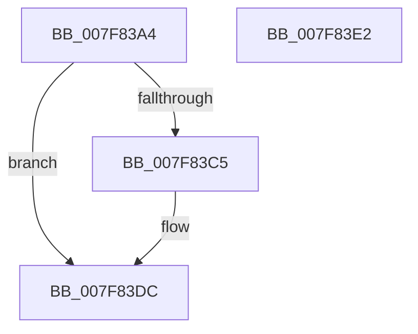

# MiInitializeLockedPagesTracking

- RVA: `0x007F83A4`–`0x007F83E3` (길이 `63` bytes)
- VA: `0x00000001407F83A4`
- 실행 섹션: `PAGE`
- PDB 이름 있음: `예`; PDB Function 태그: `아니요`
- unwind 정보 RVA: `0x0005CF00`
- 디코드: `17`개 명령, `63/63` bytes 표시
- 미해석 바이트: `0` (있으면 어셈블리에 `.byte`로 보존)

> 이 문서는 커널 이미지의 기계어와 PDB 기호를 분석해 생성했습니다. 4번과 5번은 함수 원형과 자료형을 바이너리 사용 방식에서 추정한 C 해석이며 원본 소스 복구 결과는 아닙니다.

## 1. Dependencies

- 직접 호출 지점: **1**; 고유 호출 대상: **1**
- 직접 호출자로 확인된 함수: **2**
- RIP 상대 이미지 참조: **0**

### Outgoing calls
- `0x007F83BB` → [MiAllocatePool](../../text/35/MiAllocatePool_function_0035B540.md) (function, `0x0035B540`)

### Direct callers
- [MmInitializeProcessAddressSpace](../8C/MmInitializeProcessAddressSpace_function_008CF6B0.md) at `0x008CFB09`
- [MmInitializeHandBuiltProcess2](../AC/MmInitializeHandBuiltProcess2_function_00AC1138.md) at `0x00AC11DF`

### Static image references
- 디코드된 RIP-relative 메모리 참조가 없습니다.

## 2. Other-region calls and transfers

- 다른 실행 섹션으로 향하는 call: **1**
  - `0x007F83BB` → [MiAllocatePool](../../text/35/MiAllocatePool_function_0035B540.md) (`PAGE` → `.text`)
- 별도 외부 분기/꼬리 이동을 확인하지 못했습니다.

## 3. Assembly (complete function range)

```asm
007F83A4  40 53                           push rbx
007F83A6  48 83 EC 20                     sub rsp, 0x20
007F83AA  BA 20 00 00 00                  mov edx, 0x20
007F83AF  48 8B D9                        mov rbx, rcx
007F83B2  41 B8 4D 6D 54 78               mov r8d, 0x78546d4d
007F83B8  8D 4A 20                        lea ecx, [rdx + 0x20]
007F83BB  E8 80 31 B6 FF                  call 0x14035b540
007F83C0  48 85 C0                        test rax, rax
007F83C3  74 17                           je 0x1407f83dc
007F83C5  48 83 20 00                     and qword ptr [rax], 0
007F83C9  48 83 60 08 00                  and qword ptr [rax + 8], 0
007F83CE  C7 40 1C 01 00 00 00            mov dword ptr [rax + 0x1c], 1
007F83D5  48 89 83 98 03 00 00            mov qword ptr [rbx + 0x398], rax
007F83DC  48 83 C4 20                     add rsp, 0x20
007F83E0  5B                              pop rbx
007F83E1  C3                              ret
007F83E2  CC                              int3
```

## 4. C-style interpretation (structured pseudocode)

```c
__int64 __fastcall MiInitializeLockedPagesTracking(__int64 a1)
{
    __int64 result;
    __int64 v_rsp;

    v_rsp = (v_rsp) - (32);
    result = MiAllocatePool(32 + 32, 32, (unsigned int)(0x78546D4DULL), a4);
    if (result != 0) {
        *(unsigned int *)(result + 28) = 1;
        *(unsigned __int64 *)(a1 + 920) = result;
    }
    v_rsp = (v_rsp) + (32);
    return result;
}
```

## 5. (Beta) C Style

```c
int64_t MiInitializeLockedPagesTracking(void *Arg1)
{
    uint8_t *arg1 = (uint8_t *)Arg1;

    int64_t result;
    int64_t local_rsp;

    local_rsp = (local_rsp) - (32);
    result = MiAllocatePool(32 + 32, 32, (uint32_t)(0x78546D4DULL), a4);
    if (result != 0) {
        *(uint32_t *)(result + 0x1C) = 1;
        *(uint64_t *)(arg1 + 0x398) = result;
    }
    local_rsp = (local_rsp) + (32);
    return result;
}
```

### 관측된 메모리 오프셋

구조체 형식이 확인되지 않은 접근은 인자 기준의 오프셋으로만 기록했습니다.

| 기준 인자 | 오프셋 표현 | 폭 (bit) | 접근 |
|---|---:|---:|---|
| `Arg1` | `+ 0x398` | `64` | `W` |

## 6. Execution-region graph

[열기: 2D/3D 그래프와 함수 탐색 컨트롤 패널](../../../control-panel.html?section=page&rva=0x007F83A4&view=graph)

- 2D 그래프는 위에서 아래로 흐르고, 3D 그래프는 빈 공간을 드래그해 회전합니다. Shift+드래그는 이동, 휠은 확대·축소, 함수 노드 선택은 대상 보고서 이동입니다.

### Static fallback


