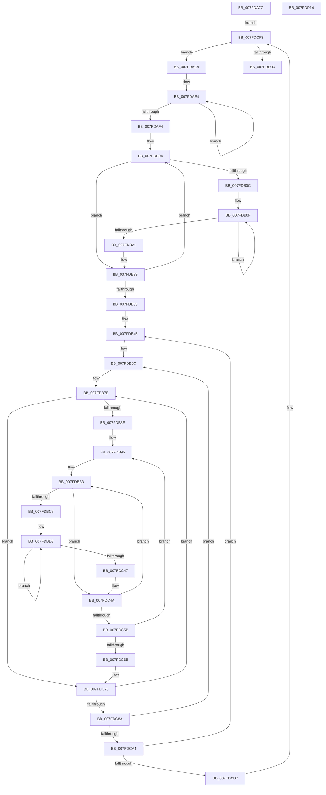

# MiInitializePartitionFreeZeroLists

- RVA: `0x007FDA7C`–`0x007FDD15` (길이 `665` bytes)
- VA: `0x00000001407FDA7C`
- 실행 섹션: `PAGE`
- PDB 이름 있음: `예`; PDB Function 태그: `아니요`
- unwind 정보 RVA: `0x000BA5A4`
- 디코드: `160`개 명령, `665/665` bytes 표시
- 미해석 바이트: `0` (있으면 어셈블리에 `.byte`로 보존)

> 이 문서는 커널 이미지의 기계어와 PDB 기호를 분석해 생성했습니다. 4번과 5번은 함수 원형과 자료형을 바이너리 사용 방식에서 추정한 C 해석이며 원본 소스 복구 결과는 아닙니다.

## 1. Dependencies

- 직접 호출 지점: **5**; 고유 호출 대상: **5**
- 직접 호출자로 확인된 함수: **1**
- RIP 상대 이미지 참조: **4**

### Outgoing calls
- `0x007FDB12` → [InitializeSListHead](../../text/46/InitializeSListHead_function_00468A90.md) (function, `0x00468A90`)
- `0x007FDBE3` → [MiMakeColor](../../text/43/MiMakeColor_function_0043E240.md) (function, `0x0043E240`)
- `0x007FDBF9` → [MiColorSetHighLow](../../text/45/MiColorSetHighLow_function_0045B6A8.md) (function, `0x0045B6A8`)
- `0x007FDC1E` → [MiInitializeFreeZeroPfnListHead](../../text/67/MiInitializeFreeZeroPfnListHead_function_006791B4.md) (function, `0x006791B4`)
- `0x007FDCA9` → [ExGenRandom](../../text/41/ExGenRandom_function_0041B010.md) (function, `0x0041B010`)

### Direct callers
- [MiInitializePartition](MiInitializePartition_function_007FD3E8.md) at `0x007FD4AA`

### Static image references
- `0x007FDAA7` → RVA `0x00FC5000` (`ALMOSTRO`; read)
- `0x007FDAC9` → RVA `0x00E2DCCC` (`.data`; read)
- `0x007FDB33` → RVA `0x00E2DCC0` (`.data`; read)
- `0x007FDB7E` → RVA `0x00FC5002` (`ALMOSTRO`; read)

## 2. Other-region calls and transfers

- 다른 실행 섹션으로 향하는 call: **5**
  - `0x007FDB12` → [InitializeSListHead](../../text/46/InitializeSListHead_function_00468A90.md) (`PAGE` → `.text`)
  - `0x007FDBE3` → [MiMakeColor](../../text/43/MiMakeColor_function_0043E240.md) (`PAGE` → `.text`)
  - `0x007FDBF9` → [MiColorSetHighLow](../../text/45/MiColorSetHighLow_function_0045B6A8.md) (`PAGE` → `.text`)
  - `0x007FDC1E` → [MiInitializeFreeZeroPfnListHead](../../text/67/MiInitializeFreeZeroPfnListHead_function_006791B4.md) (`PAGE` → `.text`)
  - `0x007FDCA9` → [ExGenRandom](../../text/41/ExGenRandom_function_0041B010.md) (`PAGE` → `.text`)
- 별도 외부 분기/꼬리 이동을 확인하지 못했습니다.

## 3. Assembly (complete function range)

```asm
007FDA7C  48 8B C4                        mov rax, rsp
007FDA7F  53                              push rbx
007FDA80  55                              push rbp
007FDA81  56                              push rsi
007FDA82  57                              push rdi
007FDA83  41 54                           push r12
007FDA85  41 55                           push r13
007FDA87  41 56                           push r14
007FDA89  41 57                           push r15
007FDA8B  48 83 EC 78                     sub rsp, 0x78
007FDA8F  4C 8B A9 F0 3F 00 00            mov r13, qword ptr [rcx + 0x3ff0]
007FDA96  45 33 C9                        xor r9d, r9d
007FDA99  4C 8B 81 D8 1B 00 00            mov r8, qword ptr [rcx + 0x1bd8]
007FDAA0  41 8B D9                        mov ebx, r9d
007FDAA3  48 8B 71 10                     mov rsi, qword ptr [rcx + 0x10]
007FDAA7  66 44 3B 0D 51 75 7C 00         cmp r9w, word ptr [rip + 0x7c7551]
007FDAAF  44 89 48 08                     mov dword ptr [rax + 8], r9d
007FDAB3  48 8B 81 E8 3F 00 00            mov rax, qword ptr [rcx + 0x3fe8]
007FDABA  48 89 44 24 30                  mov qword ptr [rsp + 0x30], rax
007FDABF  4C 89 6C 24 58                  mov qword ptr [rsp + 0x58], r13
007FDAC4  E9 2F 02 00 00                  jmp 0x1407fdcf8
007FDAC9  44 8B 3D FC 01 63 00            mov r15d, dword ptr [rip + 0x6301fc]
007FDAD0  48 8D 86 00 14 00 00            lea rax, [rsi + 0x1400]
007FDAD7  B9 04 00 00 00                  mov ecx, 4
007FDADC  4A 8D 14 FD 00 00 00 00         lea rdx, [r15*8]
007FDAE4  4C 89 00                        mov qword ptr [rax], r8
007FDAE7  4C 03 C2                        add r8, rdx
007FDAEA  48 8D 40 08                     lea rax, [rax + 8]
007FDAEE  48 83 E9 01                     sub rcx, 1
007FDAF2  75 F0                           jne 0x1407fdae4
007FDAF4  4C 89 44 24 68                  mov qword ptr [rsp + 0x68], r8
007FDAF9  48 8D BE 60 3A 00 00            lea rdi, [rsi + 0x3a60]
007FDB00  44 8D 71 02                     lea r14d, [rcx + 2]
007FDB04  4C 89 2F                        mov qword ptr [rdi], r13
007FDB07  45 85 FF                        test r15d, r15d
007FDB0A  74 1D                           je 0x1407fdb29
007FDB0C  49 8B EF                        mov rbp, r15
007FDB0F  49 8B CD                        mov rcx, r13
007FDB12  E8 79 AF C6 FF                  call 0x140468a90
007FDB17  49 83 C5 10                     add r13, 0x10
007FDB1B  48 83 ED 01                     sub rbp, 1
007FDB1F  75 EE                           jne 0x1407fdb0f
007FDB21  4C 89 6C 24 58                  mov qword ptr [rsp + 0x58], r13
007FDB26  45 33 C9                        xor r9d, r9d
007FDB29  48 83 C7 08                     add rdi, 8
007FDB2D  49 83 EE 01                     sub r14, 1
007FDB31  75 D1                           jne 0x1407fdb04
007FDB33  48 8D 05 86 01 63 00            lea rax, [rip + 0x630186]
007FDB3A  41 8B F9                        mov edi, r9d
007FDB3D  48 89 44 24 48                  mov qword ptr [rsp + 0x48], rax
007FDB42  4C 8B FE                        mov r15, rsi
007FDB45  8B 10                           mov edx, dword ptr [rax]
007FDB47  83 FF 03                        cmp edi, 3
007FDB4A  49 8B C1                        mov rax, r9
007FDB4D  89 94 24 D8 00 00 00            mov dword ptr [rsp + 0xd8], edx
007FDB54  0F 95 C0                        setne al
007FDB57  44 89 8C 24 C8 00 00 00         mov dword ptr [rsp + 0xc8], r9d
007FDB5F  48 89 44 24 60                  mov qword ptr [rsp + 0x60], rax
007FDB64  4D 8B E1                        mov r12, r9
007FDB67  4C 89 4C 24 40                  mov qword ptr [rsp + 0x40], r9
007FDB6C  8B B4 24 C8 00 00 00            mov esi, dword ptr [rsp + 0xc8]
007FDB73  49 8B C9                        mov rcx, r9
007FDB76  48 89 4C 24 38                  mov qword ptr [rsp + 0x38], rcx
007FDB7B  45 8B F1                        mov r14d, r9d
007FDB7E  80 3D 7D 74 7C 00 00            cmp byte ptr [rip + 0x7c747d], 0
007FDB85  41 8A E9                        mov bpl, r9b
007FDB88  0F 84 E7 00 00 00               je 0x1407fdc75
007FDB8E  4A 8D 04 61                     lea rax, [rcx + r12*2]
007FDB92  4C 8B E0                        mov r12, rax
007FDB95  48 8B 4C 24 30                  mov rcx, qword ptr [rsp + 0x30]
007FDB9A  4E 8D 14 65 1F 00 00 00         lea r10, [r12*2 + 0x1f]
007FDBA2  40 0F B6 C5                     movzx eax, bpl
007FDBA6  45 8B E9                        mov r13d, r9d
007FDBA9  4C 03 D0                        add r10, rax
007FDBAC  49 C1 E2 05                     shl r10, 5
007FDBB0  4D 03 D7                        add r10, r15
007FDBB3  49 89 0A                        mov qword ptr [r10], rcx
007FDBB6  41 8B C1                        mov eax, r9d
007FDBB9  89 84 24 D0 00 00 00            mov dword ptr [rsp + 0xd0], eax
007FDBC0  85 D2                           test edx, edx
007FDBC2  0F 84 82 00 00 00               je 0x1407fdc4a
007FDBC8  45 8B DE                        mov r11d, r14d
007FDBCB  41 83 E3 01                     and r11d, 1
007FDBCF  41 C1 E3 14                     shl r11d, 0x14
007FDBD3  44 8B CF                        mov r9d, edi
007FDBD6  44 89 6C 24 20                  mov dword ptr [rsp + 0x20], r13d
007FDBDB  44 8B C0                        mov r8d, eax
007FDBDE  40 8A D5                        mov dl, bpl
007FDBE1  8B CB                           mov ecx, ebx
007FDBE3  E8 58 06 C4 FF                  call 0x14043e240
007FDBE8  8B D6                           mov edx, esi
007FDBEA  89 84 24 C0 00 00 00            mov dword ptr [rsp + 0xc0], eax
007FDBF1  48 8D 8C 24 C0 00 00 00         lea rcx, [rsp + 0xc0]
007FDBF9  E8 AA DA C5 FF                  call 0x14045b6a8
007FDBFE  44 8B 84 24 C0 00 00 00         mov r8d, dword ptr [rsp + 0xc0]
007FDC06  41 8B D6                        mov edx, r14d
007FDC09  48 8B 4C 24 30                  mov rcx, qword ptr [rsp + 0x30]
007FDC0E  41 0F BA F0 14                  btr r8d, 0x14
007FDC13  45 0B C3                        or r8d, r11d
007FDC16  44 89 84 24 C0 00 00 00         mov dword ptr [rsp + 0xc0], r8d
007FDC1E  E8 91 B5 E7 FF                  call 0x1406791b4
007FDC23  8B 84 24 D0 00 00 00            mov eax, dword ptr [rsp + 0xd0]
007FDC2A  48 83 C1 58                     add rcx, 0x58
007FDC2E  8B 94 24 D8 00 00 00            mov edx, dword ptr [rsp + 0xd8]
007FDC35  FF C0                           inc eax
007FDC37  48 89 4C 24 30                  mov qword ptr [rsp + 0x30], rcx
007FDC3C  89 84 24 D0 00 00 00            mov dword ptr [rsp + 0xd0], eax
007FDC43  3B C2                           cmp eax, edx
007FDC45  72 8C                           jb 0x1407fdbd3
007FDC47  45 33 C9                        xor r9d, r9d
007FDC4A  41 FF C5                        inc r13d
007FDC4D  49 83 C2 08                     add r10, 8
007FDC51  41 83 FD 03                     cmp r13d, 3
007FDC55  0F 8E 58 FF FF FF               jle 0x1407fdbb3
007FDC5B  40 FE C5                        inc bpl
007FDC5E  40 3A 2D 9D 73 7C 00            cmp bpl, byte ptr [rip + 0x7c739d]
007FDC65  0F 82 2A FF FF FF               jb 0x1407fdb95
007FDC6B  4C 8B 64 24 40                  mov r12, qword ptr [rsp + 0x40]
007FDC70  48 8B 4C 24 38                  mov rcx, qword ptr [rsp + 0x38]
007FDC75  48 FF C1                        inc rcx
007FDC78  41 FF C6                        inc r14d
007FDC7B  48 89 4C 24 38                  mov qword ptr [rsp + 0x38], rcx
007FDC80  41 83 FE 01                     cmp r14d, 1
007FDC84  0F 8E F4 FE FF FF               jle 0x1407fdb7e
007FDC8A  FF 84 24 C8 00 00 00            inc dword ptr [rsp + 0xc8]
007FDC91  49 FF C4                        inc r12
007FDC94  4C 89 64 24 40                  mov qword ptr [rsp + 0x40], r12
007FDC99  4C 3B 64 24 60                  cmp r12, qword ptr [rsp + 0x60]
007FDC9E  0F 8E C8 FE FF FF               jle 0x1407fdb6c
007FDCA4  B9 01 00 00 00                  mov ecx, 1
007FDCA9  E8 62 D3 C1 FF                  call 0x14041b010
007FDCAE  41 89 07                        mov dword ptr [r15], eax
007FDCB1  FF C7                           inc edi
007FDCB3  48 8B 44 24 48                  mov rax, qword ptr [rsp + 0x48]
007FDCB8  49 81 C7 00 05 00 00            add r15, 0x500
007FDCBF  48 83 C0 04                     add rax, 4
007FDCC3  41 B9 00 00 00 00               mov r9d, 0
007FDCC9  48 89 44 24 48                  mov qword ptr [rsp + 0x48], rax
007FDCCE  83 FF 03                        cmp edi, 3
007FDCD1  0F 86 6E FE FF FF               jbe 0x1407fdb45
007FDCD7  48 8B 74 24 50                  mov rsi, qword ptr [rsp + 0x50]
007FDCDC  FF C3                           inc ebx
007FDCDE  0F B7 05 1B 73 7C 00            movzx eax, word ptr [rip + 0x7c731b]
007FDCE5  48 81 C6 80 DF 00 00            add rsi, 0xdf80
007FDCEC  4C 8B 6C 24 58                  mov r13, qword ptr [rsp + 0x58]
007FDCF1  3B D8                           cmp ebx, eax
007FDCF3  4C 8B 44 24 68                  mov r8, qword ptr [rsp + 0x68]
007FDCF8  48 89 74 24 50                  mov qword ptr [rsp + 0x50], rsi
007FDCFD  0F 82 C6 FD FF FF               jb 0x1407fdac9
007FDD03  48 83 C4 78                     add rsp, 0x78
007FDD07  41 5F                           pop r15
007FDD09  41 5E                           pop r14
007FDD0B  41 5D                           pop r13
007FDD0D  41 5C                           pop r12
007FDD0F  5F                              pop rdi
007FDD10  5E                              pop rsi
007FDD11  5D                              pop rbp
007FDD12  5B                              pop rbx
007FDD13  C3                              ret
007FDD14  CC                              int3
```

## 4. C-style interpretation (structured pseudocode)

```c
__int64 __fastcall MiInitializePartitionFreeZeroLists(__int64 a1, __int64 a2, __int64 a3, int a4)
{
    __int64 result;
    __int64 v_r10;
    __int64 v_r11;
    __int64 v_r12;
    __int64 v_r13;
    __int64 v_r14;
    __int64 v_r15;
    __int64 v_rbp;
    __int64 v_rbx;
    __int64 v_rdi;
    __int64 v_rsi;
    __int64 v_rsp;
    unsigned __int64 v_stack_m50;
    unsigned __int64 v_stack_m58;
    unsigned __int64 v_stack_m60;
    unsigned __int64 v_stack_m68;
    unsigned __int64 v_stack_m70;
    unsigned __int64 v_stack_m78;
    unsigned __int64 v_stack_m80;
    unsigned __int64 v_stack_m88;
    unsigned int v_stack_m98;
    unsigned int v_stack_p10;
    unsigned int v_stack_p18;
    unsigned int v_stack_p20;
    unsigned int v_stack_p8;

    v_rsp = (v_rsp) - (120);
    a4 = 0;
    *(unsigned int *)(v_rsp + 8) = 0;
    v_stack_m88 = *(unsigned __int64 *)(a1 + 16360);
    v_stack_m60 = *(unsigned __int64 *)(a1 + 16368);
    goto loc_007FDCF8;
loc_007FDAC9:
loc_007FDAE4:
    *(unsigned __int64 *)(*(unsigned __int64 *)(a1 + 16) + 5120) = *(unsigned __int64 *)(a1 + 7128);
    a3 = (*(unsigned __int64 *)(a1 + 7128)) + ((unsigned int)(*(unsigned int *)(v_rip + 6488572)) * 8);
    a1 = (4) - (1);
    if (condition_is_not_equal) goto loc_007FDAE4;
    v_stack_m50 = a3;
loc_007FDB04:
    *(unsigned __int64 *)(*(unsigned __int64 *)(a1 + 16) + 14944) = *(unsigned __int64 *)(a1 + 16368);
    if ((unsigned int)((unsigned int)(*(unsigned int *)(v_rip + 6488572))) == 0) goto loc_007FDB29;
loc_007FDB0F:
    result = InitializeSListHead(*(unsigned __int64 *)(a1 + 16368), (unsigned int)(*(unsigned int *)(v_rip + 6488572)) * 8, a3, a4);
    v_r13 = (*(unsigned __int64 *)(a1 + 16368)) + (16);
    v_rbp = ((unsigned int)(*(unsigned int *)(v_rip + 6488572))) - (1);
    if (condition_is_not_equal) goto loc_007FDB0F;
    v_stack_m60 = v_r13;
    a4 = 0;
loc_007FDB29:
    v_rdi = (*(unsigned __int64 *)(a1 + 16) + 14944) + (8);
    v_r14 = (a1 + 2) - (1);
    if (condition_is_not_equal) goto loc_007FDB04;
    v_stack_m70 = v_rip + 6488454;
loc_007FDB45:
    v_stack_p20 = (unsigned int)((unsigned int)(*(unsigned int *)(v_rip + 6488454)));
    result = (0 != 3) ? 1 : 0;
    v_stack_p10 = 0;
    v_stack_m58 = result;
    v_stack_m78 = 0;
loc_007FDB6C:
    v_stack_m80 = 0;
loc_007FDB7E:
    if ((*(unsigned __int8 *)(v_rip + 8156285)) == 0) goto loc_007FDC75;
loc_007FDB95:
    v_r10 = (0 + 0 * 2 * 2 + 31) + (0);
    v_r10 = (v_r10) << (5);
    v_r10 = (v_r10) + (*(unsigned __int64 *)(a1 + 16));
loc_007FDBB3:
    *(unsigned __int64 *)(v_r10) = v_stack_m88;
    v_stack_p18 = 0;
    if ((unsigned int)((unsigned int)(*(unsigned int *)(v_rip + 6488454))) == 0) goto loc_007FDC4A;
    v_r11 = (unsigned int)((0) & (1));
    v_r11 = (unsigned int)((v_r11) << (20));
loc_007FDBD3:
    v_stack_m98 = 0;
    result = MiMakeColor(0, 0, 0, 0);
    v_stack_p8 = (unsigned int)(result);
    result = MiColorSetHighLow(v_stack_p8, (unsigned int)((unsigned int)((unsigned int)(v_stack_p10))), 0, 0);
    a3 = (unsigned int)(((unsigned int)(v_stack_p8)) | ((unsigned int)(v_r11)));
    v_stack_p8 = (unsigned int)(a3);
    result = MiInitializeFreeZeroPfnListHead(v_stack_m88, 0, a3, 0);
    a1 = (v_stack_m88) + (88);
    result = (unsigned int)(((unsigned int)(v_stack_p18)) + 1);
    v_stack_m88 = a1;
    v_stack_p18 = (unsigned int)(result);
    if (((unsigned int)(result)) < ((unsigned int)((unsigned int)(v_stack_p20)))) goto loc_007FDBD3;
    a4 = 0;
loc_007FDC4A:
    v_r13 = (unsigned int)((0) + 1);
    v_r10 = (v_r10) + (8);
    if (((unsigned int)(v_r13)) <= 3) goto loc_007FDBB3;
    v_rbp = (unsigned __int8)((0) + 1);
    if (((unsigned __int8)(v_rbp)) < (*(unsigned __int8 *)(v_rip + 8156061))) goto loc_007FDB95;
loc_007FDC75:
    a1 = (v_stack_m80) + 1;
    v_r14 = (unsigned int)((0) + 1);
    v_stack_m80 = a1;
    if (((unsigned int)(v_r14)) <= 1) goto loc_007FDB7E;
    v_r12 = (v_stack_m78) + 1;
    v_stack_m78 = v_r12;
    if (v_r12 <= v_stack_m58) goto loc_007FDB6C;
    result = ExGenRandom(1, (unsigned int)(v_stack_p20), a3, a4);
    *(unsigned int *)(*(unsigned __int64 *)(a1 + 16)) = (unsigned int)(result);
    v_rdi = (unsigned int)((0) + 1);
    v_r15 = (*(unsigned __int64 *)(a1 + 16)) + (0x500ULL);
    result = (v_stack_m70) + (4);
    v_stack_m70 = result;
    if (((unsigned int)(v_rdi)) <= 3) goto loc_007FDB45;
    v_rbx = (unsigned int)((0) + 1);
    v_rsi = (v_stack_m68) + (0xDF80ULL);
loc_007FDCF8:
    v_stack_m68 = v_rsi;
    if (((unsigned int)(v_rbx)) < ((unsigned int)(*(unsigned __int16 *)(v_rip + 8155931)))) goto loc_007FDAC9;
    v_rsp = (v_rsp) + (120);
    return *(unsigned __int16 *)(v_rip + 8155931);
}
```

## 5. (Beta) C Style

```c
int64_t MiInitializePartitionFreeZeroLists(void *Arg1, int64_t Arg2, int64_t Arg3, int32_t Arg4)
{
    uint8_t *arg1 = (uint8_t *)Arg1;

    int64_t result;
    int64_t local_r10;
    int64_t local_r11;
    int64_t local_r12;
    int64_t local_r13;
    int64_t local_r14;
    int64_t local_r15;
    int64_t local_rbp;
    int64_t local_rbx;
    int64_t local_rdi;
    int64_t local_rsi;
    int64_t local_rsp;
    uint64_t v_stack_m50;
    uint64_t v_stack_m58;
    uint64_t v_stack_m60;
    uint64_t v_stack_m68;
    uint64_t v_stack_m70;
    uint64_t v_stack_m78;
    uint64_t v_stack_m80;
    uint64_t v_stack_m88;
    uint32_t v_stack_m98;
    uint32_t v_stack_p10;
    uint32_t v_stack_p18;
    uint32_t v_stack_p20;
    uint32_t v_stack_p8;

    local_rsp = (local_rsp) - (120);
    Arg4 = 0;
    *(uint32_t *)(local_rsp + 0x8) = 0;
    v_stack_m88 = *(uint64_t *)(arg1 + 0x3FE8);
    v_stack_m60 = *(uint64_t *)(arg1 + 0x3FF0);
    goto loc_007FDCF8;
loc_007FDAC9:
loc_007FDAE4:
    *(uint64_t *)(*(uint64_t *)(arg1 + 0x10) + 0x1400) = *(uint64_t *)(arg1 + 0x1BD8);
    Arg3 = (*(uint64_t *)(arg1 + 0x1BD8)) + ((uint32_t)(*(uint32_t *)(v_rip + 0x6301FC)) * 8);
    Arg1 = (4) - (1);
    if (condition_is_not_equal) goto loc_007FDAE4;
    v_stack_m50 = Arg3;
loc_007FDB04:
    *(uint64_t *)(*(uint64_t *)(arg1 + 0x10) + 0x3A60) = *(uint64_t *)(arg1 + 0x3FF0);
    if ((uint32_t)((uint32_t)(*(uint32_t *)(v_rip + 0x6301FC))) == 0) goto loc_007FDB29;
loc_007FDB0F:
    result = InitializeSListHead(*(uint64_t *)(arg1 + 0x3FF0), (uint32_t)(*(uint32_t *)(v_rip + 0x6301FC)) * 8, Arg3, Arg4);
    local_r13 = (*(uint64_t *)(arg1 + 0x3FF0)) + (16);
    local_rbp = ((uint32_t)(*(uint32_t *)(v_rip + 0x6301FC))) - (1);
    if (condition_is_not_equal) goto loc_007FDB0F;
    v_stack_m60 = local_r13;
    Arg4 = 0;
loc_007FDB29:
    local_rdi = (*(uint64_t *)(arg1 + 0x10) + 14944) + (8);
    local_r14 = (Arg1 + 2) - (1);
    if (condition_is_not_equal) goto loc_007FDB04;
    v_stack_m70 = v_rip + 6488454;
loc_007FDB45:
    v_stack_p20 = (uint32_t)((uint32_t)(*(uint32_t *)(v_rip + 0x630186)));
    result = (0 != 3) ? 1 : 0;
    v_stack_p10 = 0;
    v_stack_m58 = result;
    v_stack_m78 = 0;
loc_007FDB6C:
    v_stack_m80 = 0;
loc_007FDB7E:
    if ((*(uint8_t *)(v_rip + 0x7C747D)) == 0) goto loc_007FDC75;
loc_007FDB95:
    local_r10 = (0 + 0 * 2 * 2 + 31) + (0);
    local_r10 = (local_r10) << (5);
    local_r10 = (local_r10) + (*(uint64_t *)(arg1 + 0x10));
loc_007FDBB3:
    *(uint64_t *)(local_r10) = v_stack_m88;
    v_stack_p18 = 0;
    if ((uint32_t)((uint32_t)(*(uint32_t *)(v_rip + 0x630186))) == 0) goto loc_007FDC4A;
    local_r11 = (uint32_t)((0) & (1));
    local_r11 = (uint32_t)((local_r11) << (20));
loc_007FDBD3:
    v_stack_m98 = 0;
    result = MiMakeColor(0, 0, 0, 0);
    v_stack_p8 = (uint32_t)(result);
    result = MiColorSetHighLow(v_stack_p8, (uint32_t)((uint32_t)((uint32_t)(v_stack_p10))), 0, 0);
    Arg3 = (uint32_t)(((uint32_t)(v_stack_p8)) | ((uint32_t)(local_r11)));
    v_stack_p8 = (uint32_t)(Arg3);
    result = MiInitializeFreeZeroPfnListHead(v_stack_m88, 0, Arg3, 0);
    Arg1 = (v_stack_m88) + (88);
    result = (uint32_t)(((uint32_t)(v_stack_p18)) + 1);
    v_stack_m88 = Arg1;
    v_stack_p18 = (uint32_t)(result);
    if (((uint32_t)(result)) < ((uint32_t)((uint32_t)(v_stack_p20)))) goto loc_007FDBD3;
    Arg4 = 0;
loc_007FDC4A:
    local_r13 = (uint32_t)((0) + 1);
    local_r10 = (local_r10) + (8);
    if (((uint32_t)(local_r13)) <= 3) goto loc_007FDBB3;
    local_rbp = (uint8_t)((0) + 1);
    if (((uint8_t)(local_rbp)) < (*(uint8_t *)(v_rip + 0x7C739D))) goto loc_007FDB95;
loc_007FDC75:
    Arg1 = (v_stack_m80) + 1;
    local_r14 = (uint32_t)((0) + 1);
    v_stack_m80 = Arg1;
    if (((uint32_t)(local_r14)) <= 1) goto loc_007FDB7E;
    local_r12 = (v_stack_m78) + 1;
    v_stack_m78 = local_r12;
    if (local_r12 <= v_stack_m58) goto loc_007FDB6C;
    result = ExGenRandom(1, (uint32_t)(v_stack_p20), Arg3, Arg4);
    *(uint32_t *)(*(uint64_t *)(arg1 + 0x10)) = (uint32_t)(result);
    local_rdi = (uint32_t)((0) + 1);
    local_r15 = (*(uint64_t *)(arg1 + 0x10)) + (0x500ULL);
    result = (v_stack_m70) + (4);
    v_stack_m70 = result;
    if (((uint32_t)(local_rdi)) <= 3) goto loc_007FDB45;
    local_rbx = (uint32_t)((0) + 1);
    local_rsi = (v_stack_m68) + (0xDF80ULL);
loc_007FDCF8:
    v_stack_m68 = local_rsi;
    if (((uint32_t)(local_rbx)) < ((uint32_t)(*(uint16_t *)(v_rip + 0x7C731B)))) goto loc_007FDAC9;
    local_rsp = (local_rsp) + (120);
    return *(uint16_t *)(v_rip + 0x7C731B);
}
```

### 관측된 메모리 오프셋

구조체 형식이 확인되지 않은 접근은 인자 기준의 오프셋으로만 기록했습니다.

| 기준 인자 | 오프셋 표현 | 폭 (bit) | 접근 |
|---|---:|---:|---|
| `Arg1` | `+ 0x10` | `64` | `R` |
| `Arg1` | `+ 0x1BD8` | `64` | `R` |
| `Arg1` | `+ 0x3FE8` | `64` | `R` |
| `Arg1` | `+ 0x3FF0` | `64` | `R` |

## 6. Execution-region graph

[열기: 2D/3D 그래프와 함수 탐색 컨트롤 패널](../../../control-panel.html?section=page&rva=0x007FDA7C&view=graph)

- 2D 그래프는 위에서 아래로 흐르고, 3D 그래프는 빈 공간을 드래그해 회전합니다. Shift+드래그는 이동, 휠은 확대·축소, 함수 노드 선택은 대상 보고서 이동입니다.

### Static fallback


