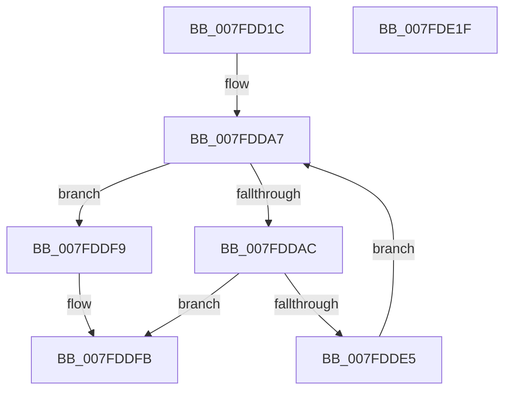

# MiInitializePartitionThreads

- RVA: `0x007FDD1C`–`0x007FDE20` (길이 `260` bytes)
- VA: `0x00000001407FDD1C`
- 실행 섹션: `PAGE`
- PDB 이름 있음: `예`; PDB Function 태그: `아니요`
- unwind 정보 RVA: `0x000D7D84`
- 디코드: `61`개 명령, `260/260` bytes 표시
- 미해석 바이트: `0` (있으면 어셈블리에 `.byte`로 보존)

> 이 문서는 커널 이미지의 기계어와 PDB 기호를 분석해 생성했습니다. 4번과 5번은 함수 원형과 자료형을 바이너리 사용 방식에서 추정한 C 해석이며 원본 소스 복구 결과는 아닙니다.

## 1. Dependencies

- 직접 호출 지점: **2**; 고유 호출 대상: **2**
- 직접 호출자로 확인된 함수: **1**
- RIP 상대 이미지 참조: **7**

### Outgoing calls
- `0x007FDDDC` → [PsCreateSystemThreadEx](../9E/PsCreateSystemThreadEx_function_009ED120.md) (function, `0x009ED120`)
- `0x007FDE02` → [_security_check_cookie](../../text/6A/_security_check_cookie_function_006AC640.md) (function, `0x006AC640`)

### Direct callers
- [MmCreatePartition](../80/MmCreatePartition_function_0080DC3C.md) at `0x0080DD8F`

### Static image references
- `0x007FDD36` → RVA `0x00E0A740` (`.data`; read)
- `0x007FDD49` → RVA `0x00696D80` (`MiZeroPageThread`; read)
- `0x007FDD50` → RVA `0x00012290` (`.rdata`; read)
- `0x007FDD61` → RVA `0x00379AC0` (`MiRebuildLargePagesThread`; read)
- `0x007FDD73` → RVA `0x006791E0` (`MiPartitionWorkingSetManager`; read)
- `0x007FDD7E` → RVA `0x00464890` (`MiDereferenceSegmentThread`; read)
- `0x007FDD89` → RVA `0x00404AC0` (`MiMappedPageWriter`; read)

## 2. Other-region calls and transfers

- 다른 실행 섹션으로 향하는 call: **1**
  - `0x007FDE02` → [_security_check_cookie](../../text/6A/_security_check_cookie_function_006AC640.md) (`PAGE` → `.text`)
- 별도 외부 분기/꼬리 이동을 확인하지 못했습니다.

## 3. Assembly (complete function range)

```asm
007FDD1C  48 89 5C 24 10                  mov qword ptr [rsp + 0x10], rbx
007FDD21  48 89 74 24 18                  mov qword ptr [rsp + 0x18], rsi
007FDD26  55                              push rbp
007FDD27  57                              push rdi
007FDD28  41 56                           push r14
007FDD2A  48 8D 6C 24 B9                  lea rbp, [rsp - 0x47]
007FDD2F  48 81 EC A0 00 00 00            sub rsp, 0xa0
007FDD36  48 8B 05 03 CA 60 00            mov rax, qword ptr [rip + 0x60ca03]
007FDD3D  48 33 C4                        xor rax, rsp
007FDD40  48 89 45 3F                     mov qword ptr [rbp + 0x3f], rax
007FDD44  48 83 65 F7 00                  and qword ptr [rbp - 9], 0
007FDD49  48 8D 05 30 90 E9 FF            lea rax, [rip - 0x166fd0]
007FDD50  66 0F 6F 05 38 45 81 FF         movdqa xmm0, xmmword ptr [rip - 0x7ebac8]
007FDD58  48 8B F9                        mov rdi, rcx
007FDD5B  48 89 45 17                     mov qword ptr [rbp + 0x17], rax
007FDD5F  33 DB                           xor ebx, ebx
007FDD61  48 8D 05 58 BD B7 FF            lea rax, [rip - 0x4842a8]
007FDD68  C7 45 0F 04 00 00 00            mov dword ptr [rbp + 0xf], 4
007FDD6F  48 89 45 1F                     mov qword ptr [rbp + 0x1f], rax
007FDD73  48 8D 05 66 B4 E7 FF            lea rax, [rip - 0x184b9a]
007FDD7A  48 89 45 27                     mov qword ptr [rbp + 0x27], rax
007FDD7E  48 8D 05 0B 6B C6 FF            lea rax, [rip - 0x3994f5]
007FDD85  48 89 45 2F                     mov qword ptr [rbp + 0x2f], rax
007FDD89  48 8D 05 30 6D C0 FF            lea rax, [rip - 0x3f92d0]
007FDD90  48 89 45 37                     mov qword ptr [rbp + 0x37], rax
007FDD94  48 8B 81 B8 00 00 00            mov rax, qword ptr [rcx + 0xb8]
007FDD9B  F3 0F 7F 45 FF                  movdqu xmmword ptr [rbp - 1], xmm0
007FDDA0  4C 8B B0 80 00 00 00            mov r14, qword ptr [rax + 0x80]
007FDDA7  83 FB 05                        cmp ebx, 5
007FDDAA  73 4D                           jae 0x1407fddf9
007FDDAC  48 83 64 24 40 00               and qword ptr [rsp + 0x40], 0
007FDDB2  48 8D 4D F7                     lea rcx, [rbp - 9]
007FDDB6  48 83 64 24 38 00               and qword ptr [rsp + 0x38], 0
007FDDBC  4D 8B CE                        mov r9, r14
007FDDBF  48 8B 44 DD 17                  mov rax, qword ptr [rbp + rbx*8 + 0x17]
007FDDC4  45 33 C0                        xor r8d, r8d
007FDDC7  48 89 7C 24 30                  mov qword ptr [rsp + 0x30], rdi
007FDDCC  BA FF FF 1F 00                  mov edx, 0x1fffff
007FDDD1  48 89 44 24 28                  mov qword ptr [rsp + 0x28], rax
007FDDD6  48 83 64 24 20 00               and qword ptr [rsp + 0x20], 0
007FDDDC  E8 3F F3 1E 00                  call 0x1409ed120
007FDDE1  85 C0                           test eax, eax
007FDDE3  78 16                           js 0x1407fddfb
007FDDE5  8B 4C 9D FF                     mov ecx, dword ptr [rbp + rbx*4 - 1]
007FDDE9  FF C3                           inc ebx
007FDDEB  48 8B 45 F7                     mov rax, qword ptr [rbp - 9]
007FDDEF  48 89 84 CF 88 00 00 00         mov qword ptr [rdi + rcx*8 + 0x88], rax
007FDDF7  EB AE                           jmp 0x1407fdda7
007FDDF9  33 C0                           xor eax, eax
007FDDFB  48 8B 4D 3F                     mov rcx, qword ptr [rbp + 0x3f]
007FDDFF  48 33 CC                        xor rcx, rsp
007FDE02  E8 39 E8 EA FF                  call 0x1406ac640
007FDE07  4C 8D 9C 24 A0 00 00 00         lea r11, [rsp + 0xa0]
007FDE0F  49 8B 5B 28                     mov rbx, qword ptr [r11 + 0x28]
007FDE13  49 8B 73 30                     mov rsi, qword ptr [r11 + 0x30]
007FDE17  49 8B E3                        mov rsp, r11
007FDE1A  41 5E                           pop r14
007FDE1C  5F                              pop rdi
007FDE1D  5D                              pop rbp
007FDE1E  C3                              ret
007FDE1F  CC                              int3
```

## 4. C-style interpretation (structured pseudocode)

```c
__int64 __fastcall MiInitializePartitionThreads(__int64 a1, __int64 a2, int a3)
{
    __int64 result;
    __int64 v_rbx;
    __int64 v_rsp;
    unsigned __int64 v_stack_m18;
    unsigned __int64 v_stack_m20;
    unsigned __int64 v_stack_m28;
    unsigned __int64 v_stack_m30;
    unsigned __int64 v_stack_m38;
    unsigned __int64 v_stack_m40;
    unsigned __int64 v_stack_m48;
    unsigned int v_stack_m50;
    unsigned __int64 v_stack_m5F;
    unsigned __int64 v_stack_m60;
    unsigned __int64 v_stack_m68;
    unsigned __int64 v_stack_m78;
    unsigned __int64 v_stack_m80;
    unsigned __int64 v_stack_m88;
    unsigned __int64 v_stack_m90;
    unsigned __int64 v_stack_m98;
    unsigned __int64 v_stack_p10;
    unsigned __int64 v_stack_p18;

    v_stack_p10 = v_rbx;
    v_stack_p18 = v_rsi;
    v_rsp = (v_rsp) - (160);
    result = (*(unsigned __int64 *)(v_rip + 6343171)) ^ (v_rsp);
    v_stack_m20 = result;
    v_stack_m48 = v_rip - 1470416;
    v_rbx = 0;
    v_stack_m50 = 4;
    v_stack_m40 = v_rip - 4735656;
    v_stack_m38 = v_rip - 1592218;
    v_stack_m30 = v_rip - 3773685;
    v_stack_m28 = v_rip - 4166352;
    v_stack_m60 = v_xmm0;
loc_007FDDA7:
    if (0 >= 5) goto loc_007FDDF9;
    a3 = 0;
    v_stack_m88 = a1;
    v_stack_m90 = *(unsigned __int64 *)(v_stack_m5F + v_rbx * 8 + 23);
    result = PsCreateSystemThreadEx(v_stack_m68, (unsigned int)(0x1FFFFFULL), a3, *(unsigned __int64 *)(*(unsigned __int64 *)(a1 + 184) + 128));
    if (sign_flag) goto loc_007FDDFB;
    v_rbx = (unsigned int)((v_rbx) + 1);
    *(unsigned __int64 *)(a1 + (unsigned int)(*(unsigned int *)(v_stack_m5F + v_rbx * 4 - 1)) * 8 + 136) = v_stack_m68;
    goto loc_007FDDA7;
loc_007FDDF9:
    result = 0;
loc_007FDDFB:
    a1 = (v_stack_m20) ^ (v_rsp);
    result = _security_check_cookie(a1, (unsigned int)(0x1FFFFFULL), a3, *(unsigned __int64 *)(*(unsigned __int64 *)(a1 + 184) + 128));
    return result;
}
```

## 5. (Beta) C Style

```c
int64_t MiInitializePartitionThreads(void *Arg1, int64_t Arg2, int32_t Arg3)
{
    uint8_t *arg1 = (uint8_t *)Arg1;

    int64_t result;
    int64_t local_rbx;
    int64_t local_rsp;
    uint64_t v_stack_m18;
    uint64_t v_stack_m20;
    uint64_t v_stack_m28;
    uint64_t v_stack_m30;
    uint64_t v_stack_m38;
    uint64_t v_stack_m40;
    uint64_t v_stack_m48;
    uint32_t v_stack_m50;
    uint64_t v_stack_m5F;
    uint64_t v_stack_m60;
    uint64_t v_stack_m68;
    uint64_t v_stack_m78;
    uint64_t v_stack_m80;
    uint64_t v_stack_m88;
    uint64_t v_stack_m90;
    uint64_t v_stack_m98;
    uint64_t v_stack_p10;
    uint64_t v_stack_p18;

    v_stack_p10 = local_rbx;
    v_stack_p18 = local_rsi;
    local_rsp = (local_rsp) - (160);
    result = (*(uint64_t *)(v_rip + 0x60CA03)) ^ (local_rsp);
    v_stack_m20 = result;
    v_stack_m48 = v_rip - 1470416;
    local_rbx = 0;
    v_stack_m50 = 4;
    v_stack_m40 = v_rip - 4735656;
    v_stack_m38 = v_rip - 1592218;
    v_stack_m30 = v_rip - 3773685;
    v_stack_m28 = v_rip - 4166352;
    v_stack_m60 = v_xmm0;
loc_007FDDA7:
    if (0 >= 5) goto loc_007FDDF9;
    Arg3 = 0;
    v_stack_m88 = Arg1;
    v_stack_m90 = *(uint64_t *)(v_stack_m5F + local_rbx * 8 + 0x17);
    result = PsCreateSystemThreadEx(v_stack_m68, (uint32_t)(0x1FFFFFULL), Arg3, *(uint64_t *)(*(uint64_t *)(arg1 + 0xB8) + 0x80));
    if (sign_flag) goto loc_007FDDFB;
    local_rbx = (uint32_t)((local_rbx) + 1);
    *(uint64_t *)(arg1 + (uint32_t)(*(uint32_t *)(v_stack_m5F + local_rbx * 4 - 0x1)) * 8 + 0x88) = v_stack_m68;
    goto loc_007FDDA7;
loc_007FDDF9:
    result = 0;
loc_007FDDFB:
    Arg1 = (v_stack_m20) ^ (local_rsp);
    result = _security_check_cookie(Arg1, (uint32_t)(0x1FFFFFULL), Arg3, *(uint64_t *)(*(uint64_t *)(arg1 + 0xB8) + 0x80));
    return result;
}
```

### 관측된 메모리 오프셋

구조체 형식이 확인되지 않은 접근은 인자 기준의 오프셋으로만 기록했습니다.

| 기준 인자 | 오프셋 표현 | 폭 (bit) | 접근 |
|---|---:|---:|---|
| `Arg1` | `+ 0x88 + rcx*8` | `64` | `W` |
| `Arg1` | `+ 0xB8` | `64` | `R` |

## 6. Execution-region graph

[열기: 2D/3D 그래프와 함수 탐색 컨트롤 패널](../../../control-panel.html?section=page&rva=0x007FDD1C&view=graph)

- 2D 그래프는 위에서 아래로 흐르고, 3D 그래프는 빈 공간을 드래그해 회전합니다. Shift+드래그는 이동, 휠은 확대·축소, 함수 노드 선택은 대상 보고서 이동입니다.

### Static fallback


