# MiInitializePartition

- RVA: `0x007FD3E8`–`0x007FDA73` (길이 `1,675` bytes)
- VA: `0x00000001407FD3E8`
- 실행 섹션: `PAGE`
- PDB 이름 있음: `예`; PDB Function 태그: `아니요`
- unwind 정보 RVA: `0x00075C18`
- 디코드: `376`개 명령, `1,675/1,675` bytes 표시
- 미해석 바이트: `0` (있으면 어셈블리에 `.byte`로 보존)

> 이 문서는 커널 이미지의 기계어와 PDB 기호를 분석해 생성했습니다. 4번과 5번은 함수 원형과 자료형을 바이너리 사용 방식에서 추정한 C 해석이며 원본 소스 복구 결과는 아닙니다.

## 1. Dependencies

- 직접 호출 지점: **48**; 고유 호출 대상: **19**
- 직접 호출자로 확인된 함수: **2**
- RIP 상대 이미지 참조: **18**

### Outgoing calls
- `0x007FD459` → [KeInitializeEvent](../../text/40/KeInitializeEvent_function_0040DD10.md) (function, `0x0040DD10`)
- `0x007FD46C` → [KeInitializeEvent](../../text/40/KeInitializeEvent_function_0040DD10.md) (function, `0x0040DD10`)
- `0x007FD492` → [KeInitializeEvent](../../text/40/KeInitializeEvent_function_0040DD10.md) (function, `0x0040DD10`)
- `0x007FD4AA` → [MiInitializePartitionFreeZeroLists](MiInitializePartitionFreeZeroLists_function_007FDA7C.md) (function, `0x007FDA7C`)
- `0x007FD4BB` → [MiInitializePfnListHead](../../text/44/MiInitializePfnListHead_function_004489F8.md) (function, `0x004489F8`)
- `0x007FD4CD` → [MiInitializePfnListHead](../../text/44/MiInitializePfnListHead_function_004489F8.md) (function, `0x004489F8`)
- `0x007FD4E1` → [MiInitializePfnListHead](../../text/44/MiInitializePfnListHead_function_004489F8.md) (function, `0x004489F8`)
- `0x007FD4FE` → [MiInitializePfnListHead](../../text/44/MiInitializePfnListHead_function_004489F8.md) (function, `0x004489F8`)
- `0x007FD568` → [RtlRandomEx](../../text/41/RtlRandomEx_function_0041AFE0.md) (function, `0x0041AFE0`)
- `0x007FD5E6` → [MiInitializePfnListHead](../../text/44/MiInitializePfnListHead_function_004489F8.md) (function, `0x004489F8`)
- `0x007FD5F7` → [KeInitializeEvent](../../text/40/KeInitializeEvent_function_0040DD10.md) (function, `0x0040DD10`)
- `0x007FD608` → [MiInitializePfnListHead](../../text/44/MiInitializePfnListHead_function_004489F8.md) (function, `0x004489F8`)
- `0x007FD619` → [MiInitializePfnListHead](../../text/44/MiInitializePfnListHead_function_004489F8.md) (function, `0x004489F8`)
- `0x007FD627` → [MiInitializePfnListHead](../../text/44/MiInitializePfnListHead_function_004489F8.md) (function, `0x004489F8`)
- `0x007FD633` → [MiInitializePfnListHead](../../text/44/MiInitializePfnListHead_function_004489F8.md) (function, `0x004489F8`)
- `0x007FD644` → [MiInitializePfnListHead](../../text/44/MiInitializePfnListHead_function_004489F8.md) (function, `0x004489F8`)
- `0x007FD666` → [MiInitializePfnListHead](../../text/44/MiInitializePfnListHead_function_004489F8.md) (function, `0x004489F8`)
- `0x007FD675` → [KeInitializeEvent](../../text/40/KeInitializeEvent_function_0040DD10.md) (function, `0x0040DD10`)
- `0x007FD692` → [MiInitializePfnListHead](../../text/44/MiInitializePfnListHead_function_004489F8.md) (function, `0x004489F8`)
- `0x007FD6B6` → [MiProtectPageListLocks](../../text/67/MiProtectPageListLocks_function_006792B0.md) (function, `0x006792B0`)
- `0x007FD6E7` → [KeInitializeEvent](../../text/40/KeInitializeEvent_function_0040DD10.md) (function, `0x0040DD10`)
- `0x007FD6F8` → [MiPopulateFreeKernelShadowStackCacheEntries](../../text/68/MiPopulateFreeKernelShadowStackCacheEntries_function_006865BC.md) (function, `0x006865BC`)
- `0x007FD72C` → [KeInitializeEvent](../../text/40/KeInitializeEvent_function_0040DD10.md) (function, `0x0040DD10`)
- `0x007FD75D` → [KeInitializeEvent](../../text/40/KeInitializeEvent_function_0040DD10.md) (function, `0x0040DD10`)
- `0x007FD76E` → [KeInitializeEvent](../../text/40/KeInitializeEvent_function_0040DD10.md) (function, `0x0040DD10`)
- `0x007FD77F` → [KeInitializeEvent](../../text/40/KeInitializeEvent_function_0040DD10.md) (function, `0x0040DD10`)
- `0x007FD79C` → [ExWaitForRundownProtectionRelease](../../text/2A/ExWaitForRundownProtectionRelease_function_002A4CB0.md) (function, `0x002A4CB0`)
- `0x007FD7B3` → [KeInitializeEvent](../../text/40/KeInitializeEvent_function_0040DD10.md) (function, `0x0040DD10`)
- `0x007FD7C4` → [KeInitializeEvent](../../text/40/KeInitializeEvent_function_0040DD10.md) (function, `0x0040DD10`)
- `0x007FD7D5` → [KeInitializeEvent](../../text/40/KeInitializeEvent_function_0040DD10.md) (function, `0x0040DD10`)
- `0x007FD7E6` → [KeInitializeEvent](../../text/40/KeInitializeEvent_function_0040DD10.md) (function, `0x0040DD10`)
- `0x007FD805` → [KeInitializeEvent](../../text/40/KeInitializeEvent_function_0040DD10.md) (function, `0x0040DD10`)
- `0x007FD827` → [MiInitializeCommitment](../../text/68/MiInitializeCommitment_function_0068CC08.md) (function, `0x0068CC08`)
- `0x007FD882` → [MiInitializeNuma](../../text/66/MiInitializeNuma_function_0066E0E0.md) (function, `0x0066E0E0`)
- `0x007FD8BD` → [KeInitializeEvent](../../text/40/KeInitializeEvent_function_0040DD10.md) (function, `0x0040DD10`)
- `0x007FD8CE` → [KeInitializeEvent](../../text/40/KeInitializeEvent_function_0040DD10.md) (function, `0x0040DD10`)
- `0x007FD8DF` → [KeInitializeEvent](../../text/40/KeInitializeEvent_function_0040DD10.md) (function, `0x0040DD10`)
- `0x007FD8EB` → [InitializeSListHead](../../text/46/InitializeSListHead_function_00468A90.md) (function, `0x00468A90`)
- `0x007FD8F7` → [KeInitializeTimer](../../text/45/KeInitializeTimer_function_0045B590.md) (function, `0x0045B590`)
- `0x007FD8FF` → [MiInitializeSections](MiInitializeSections_function_007FC738.md) (function, `0x007FC738`)
- `0x007FD90E` → [MiInitializeCombining](../../text/68/MiInitializeCombining_function_0068BED4.md) (function, `0x0068BED4`)
- `0x007FD963` → [KeInitializeEvent](../../text/40/KeInitializeEvent_function_0040DD10.md) (function, `0x0040DD10`)
- `0x007FD9B0` → [KeInitializeDpc](../../text/45/KeInitializeDpc_function_0045BBD0.md) (function, `0x0045BBD0`)
- `0x007FD9EA` → [KeAbPreAcquire](../../text/21/KeAbPreAcquire_function_00210230.md) (function, `0x00210230`)
- `0x007FDA04` → [ExfAcquirePushLockExclusiveEx](../../text/20/ExfAcquirePushLockExclusiveEx_function_0020FC90.md) (function, `0x0020FC90`)
- `0x007FDA2C` → [ExfTryToWakePushLock](../../text/26/ExfTryToWakePushLock_function_00265DD0.md) (function, `0x00265DD0`)
- `0x007FDA34` → [KeAbPostRelease](../../text/2E/KeAbPostRelease_function_002E1600.md) (function, `0x002E1600`)
- `0x007FDA50` → [KiCheckForKernelApcDelivery](../../text/2E/KiCheckForKernelApcDelivery_function_002E2C80.md) (function, `0x002E2C80`)

### Direct callers
- [MmCreatePartition](../80/MmCreatePartition_function_0080DC3C.md) at `0x0080DCE4`
- [MiCreatePfnDatabase](../../init/C5/MiCreatePfnDatabase_function_00C5F930.md) at `0x00C5FA82`

### Static image references
- `0x007FD411` → RVA `0x00E38D00` (`.data`; read)
- `0x007FD428` → RVA `0x00E2FFC0` (`.data`; write)
- `0x007FD42F` → RVA `0x00E30020` (`.data`; write)
- `0x007FD436` → RVA `0x00E2FFE0` (`.data`; read)
- `0x007FD43D` → RVA `0x00E2FFE8` (`.data`; write)
- `0x007FD444` → RVA `0x00E2FFE0` (`.data`; write)
- `0x007FD522` → RVA `0x00FC5000` (`ALMOSTRO`; read)
- `0x007FD561` → RVA `0x00E2DB48` (`.data`; read)
- `0x007FD59C` → RVA `0x00E2DCCC` (`.data`; read)
- `0x007FD5DF` → RVA `0x00E2D650` (`.data`; read)
- `0x007FD6BB` → RVA `0x00042F60` (`.rdata`; read)
- `0x007FD82E` → RVA `0x00FC5240` (`ALMOSTRO`; read)
- `0x007FD84E` → RVA `0x00FC5248` (`ALMOSTRO`; read)
- `0x007FD88E` → RVA `0x0068B860` (`MiContractWsSwapPageFileWorker`; read)
- `0x007FD978` → RVA `0x00689FF0` (`MiEmptyAccessLogs`; read)
- `0x007FD99B` → RVA `0x00488BD0` (`MiAllocatePfnRepurposeLogDispatch`; read)
- `0x007FD9BC` → RVA `0x00E30048` (`.data`; read)
- `0x007FDA18` → RVA `0x00E30048` (`.data`; read/write)

## 2. Other-region calls and transfers

- 다른 실행 섹션으로 향하는 call: **46**
  - `0x007FD459` → [KeInitializeEvent](../../text/40/KeInitializeEvent_function_0040DD10.md) (`PAGE` → `.text`)
  - `0x007FD46C` → [KeInitializeEvent](../../text/40/KeInitializeEvent_function_0040DD10.md) (`PAGE` → `.text`)
  - `0x007FD492` → [KeInitializeEvent](../../text/40/KeInitializeEvent_function_0040DD10.md) (`PAGE` → `.text`)
  - `0x007FD4BB` → [MiInitializePfnListHead](../../text/44/MiInitializePfnListHead_function_004489F8.md) (`PAGE` → `.text`)
  - `0x007FD4CD` → [MiInitializePfnListHead](../../text/44/MiInitializePfnListHead_function_004489F8.md) (`PAGE` → `.text`)
  - `0x007FD4E1` → [MiInitializePfnListHead](../../text/44/MiInitializePfnListHead_function_004489F8.md) (`PAGE` → `.text`)
  - `0x007FD4FE` → [MiInitializePfnListHead](../../text/44/MiInitializePfnListHead_function_004489F8.md) (`PAGE` → `.text`)
  - `0x007FD568` → [RtlRandomEx](../../text/41/RtlRandomEx_function_0041AFE0.md) (`PAGE` → `.text`)
  - `0x007FD5E6` → [MiInitializePfnListHead](../../text/44/MiInitializePfnListHead_function_004489F8.md) (`PAGE` → `.text`)
  - `0x007FD5F7` → [KeInitializeEvent](../../text/40/KeInitializeEvent_function_0040DD10.md) (`PAGE` → `.text`)
  - `0x007FD608` → [MiInitializePfnListHead](../../text/44/MiInitializePfnListHead_function_004489F8.md) (`PAGE` → `.text`)
  - `0x007FD619` → [MiInitializePfnListHead](../../text/44/MiInitializePfnListHead_function_004489F8.md) (`PAGE` → `.text`)
  - `0x007FD627` → [MiInitializePfnListHead](../../text/44/MiInitializePfnListHead_function_004489F8.md) (`PAGE` → `.text`)
  - `0x007FD633` → [MiInitializePfnListHead](../../text/44/MiInitializePfnListHead_function_004489F8.md) (`PAGE` → `.text`)
  - `0x007FD644` → [MiInitializePfnListHead](../../text/44/MiInitializePfnListHead_function_004489F8.md) (`PAGE` → `.text`)
  - `0x007FD666` → [MiInitializePfnListHead](../../text/44/MiInitializePfnListHead_function_004489F8.md) (`PAGE` → `.text`)
  - `0x007FD675` → [KeInitializeEvent](../../text/40/KeInitializeEvent_function_0040DD10.md) (`PAGE` → `.text`)
  - `0x007FD692` → [MiInitializePfnListHead](../../text/44/MiInitializePfnListHead_function_004489F8.md) (`PAGE` → `.text`)
  - `0x007FD6B6` → [MiProtectPageListLocks](../../text/67/MiProtectPageListLocks_function_006792B0.md) (`PAGE` → `.text`)
  - `0x007FD6E7` → [KeInitializeEvent](../../text/40/KeInitializeEvent_function_0040DD10.md) (`PAGE` → `.text`)
  - `0x007FD6F8` → [MiPopulateFreeKernelShadowStackCacheEntries](../../text/68/MiPopulateFreeKernelShadowStackCacheEntries_function_006865BC.md) (`PAGE` → `.text`)
  - `0x007FD72C` → [KeInitializeEvent](../../text/40/KeInitializeEvent_function_0040DD10.md) (`PAGE` → `.text`)
  - `0x007FD75D` → [KeInitializeEvent](../../text/40/KeInitializeEvent_function_0040DD10.md) (`PAGE` → `.text`)
  - `0x007FD76E` → [KeInitializeEvent](../../text/40/KeInitializeEvent_function_0040DD10.md) (`PAGE` → `.text`)
  - `0x007FD77F` → [KeInitializeEvent](../../text/40/KeInitializeEvent_function_0040DD10.md) (`PAGE` → `.text`)
  - `0x007FD79C` → [ExWaitForRundownProtectionRelease](../../text/2A/ExWaitForRundownProtectionRelease_function_002A4CB0.md) (`PAGE` → `.text`)
  - `0x007FD7B3` → [KeInitializeEvent](../../text/40/KeInitializeEvent_function_0040DD10.md) (`PAGE` → `.text`)
  - `0x007FD7C4` → [KeInitializeEvent](../../text/40/KeInitializeEvent_function_0040DD10.md) (`PAGE` → `.text`)
  - `0x007FD7D5` → [KeInitializeEvent](../../text/40/KeInitializeEvent_function_0040DD10.md) (`PAGE` → `.text`)
  - `0x007FD7E6` → [KeInitializeEvent](../../text/40/KeInitializeEvent_function_0040DD10.md) (`PAGE` → `.text`)
  - `0x007FD805` → [KeInitializeEvent](../../text/40/KeInitializeEvent_function_0040DD10.md) (`PAGE` → `.text`)
  - `0x007FD827` → [MiInitializeCommitment](../../text/68/MiInitializeCommitment_function_0068CC08.md) (`PAGE` → `.text`)
  - `0x007FD882` → [MiInitializeNuma](../../text/66/MiInitializeNuma_function_0066E0E0.md) (`PAGE` → `.text`)
  - `0x007FD8BD` → [KeInitializeEvent](../../text/40/KeInitializeEvent_function_0040DD10.md) (`PAGE` → `.text`)
  - `0x007FD8CE` → [KeInitializeEvent](../../text/40/KeInitializeEvent_function_0040DD10.md) (`PAGE` → `.text`)
  - `0x007FD8DF` → [KeInitializeEvent](../../text/40/KeInitializeEvent_function_0040DD10.md) (`PAGE` → `.text`)
  - `0x007FD8EB` → [InitializeSListHead](../../text/46/InitializeSListHead_function_00468A90.md) (`PAGE` → `.text`)
  - `0x007FD8F7` → [KeInitializeTimer](../../text/45/KeInitializeTimer_function_0045B590.md) (`PAGE` → `.text`)
  - `0x007FD90E` → [MiInitializeCombining](../../text/68/MiInitializeCombining_function_0068BED4.md) (`PAGE` → `.text`)
  - `0x007FD963` → [KeInitializeEvent](../../text/40/KeInitializeEvent_function_0040DD10.md) (`PAGE` → `.text`)
  - `0x007FD9B0` → [KeInitializeDpc](../../text/45/KeInitializeDpc_function_0045BBD0.md) (`PAGE` → `.text`)
  - `0x007FD9EA` → [KeAbPreAcquire](../../text/21/KeAbPreAcquire_function_00210230.md) (`PAGE` → `.text`)
  - `0x007FDA04` → [ExfAcquirePushLockExclusiveEx](../../text/20/ExfAcquirePushLockExclusiveEx_function_0020FC90.md) (`PAGE` → `.text`)
  - `0x007FDA2C` → [ExfTryToWakePushLock](../../text/26/ExfTryToWakePushLock_function_00265DD0.md) (`PAGE` → `.text`)
  - `0x007FDA34` → [KeAbPostRelease](../../text/2E/KeAbPostRelease_function_002E1600.md) (`PAGE` → `.text`)
  - `0x007FDA50` → [KiCheckForKernelApcDelivery](../../text/2E/KiCheckForKernelApcDelivery_function_002E2C80.md) (`PAGE` → `.text`)
- 별도 외부 분기/꼬리 이동을 확인하지 못했습니다.

## 3. Assembly (complete function range)

```asm
007FD3E8  48 89 5C 24 08                  mov qword ptr [rsp + 8], rbx
007FD3ED  48 89 6C 24 10                  mov qword ptr [rsp + 0x10], rbp
007FD3F2  48 89 74 24 18                  mov qword ptr [rsp + 0x18], rsi
007FD3F7  57                              push rdi
007FD3F8  41 54                           push r12
007FD3FA  41 55                           push r13
007FD3FC  41 56                           push r14
007FD3FE  41 57                           push r15
007FD400  48 83 EC 20                     sub rsp, 0x20
007FD404  4C 8B F1                        mov r14, rcx
007FD407  66 89 11                        mov word ptr [rcx], dx
007FD40A  C7 41 08 40 19 36 12            mov dword ptr [rcx + 8], 0x12361940
007FD411  48 8D 15 E8 B8 63 00            lea rdx, [rip + 0x63b8e8]
007FD418  33 C9                           xor ecx, ecx
007FD41A  8B C1                           mov eax, ecx
007FD41C  8D 69 10                        lea ebp, [rcx + 0x10]
007FD41F  4C 3B F2                        cmp r14, rdx
007FD422  74 04                           je 0x1407fd428
007FD424  8B C5                           mov eax, ebp
007FD426  EB 23                           jmp 0x1407fd44b
007FD428  48 89 0D 91 2B 63 00            mov qword ptr [rip + 0x632b91], rcx
007FD42F  48 89 0D EA 2B 63 00            mov qword ptr [rip + 0x632bea], rcx
007FD436  48 8D 0D A3 2B 63 00            lea rcx, [rip + 0x632ba3]
007FD43D  48 89 0D A4 2B 63 00            mov qword ptr [rip + 0x632ba4], rcx
007FD444  48 89 0D 95 2B 63 00            mov qword ptr [rip + 0x632b95], rcx
007FD44B  F0 41 09 46 04                  lock or dword ptr [r14 + 4], eax
007FD450  49 8D 4E 58                     lea rcx, [r14 + 0x58]
007FD454  45 33 C0                        xor r8d, r8d
007FD457  33 D2                           xor edx, edx
007FD459  E8 B2 08 C1 FF                  call 0x14040dd10
007FD45E  45 33 C0                        xor r8d, r8d
007FD461  49 8D 4E 70                     lea rcx, [r14 + 0x70]
007FD465  45 8D 68 01                     lea r13d, [r8 + 1]
007FD469  41 8B D5                        mov edx, r13d
007FD46C  E8 9F 08 C1 FF                  call 0x14040dd10
007FD471  41 8D 75 02                     lea esi, [r13 + 2]
007FD475  48 83 CB FF                     or rbx, 0xffffffffffffffff
007FD479  44 8B E6                        mov r12d, esi
007FD47C  49 8D BE 78 40 00 00            lea rdi, [r14 + 0x4078]
007FD483  4D 8D BE 60 40 00 00            lea r15, [r14 + 0x4060]
007FD48A  45 33 C0                        xor r8d, r8d
007FD48D  33 D2                           xor edx, edx
007FD48F  49 8B CF                        mov rcx, r15
007FD492  E8 79 08 C1 FF                  call 0x14040dd10
007FD497  49 83 C7 30                     add r15, 0x30
007FD49B  48 89 1F                        mov qword ptr [rdi], rbx
007FD49E  48 8D 7F 30                     lea rdi, [rdi + 0x30]
007FD4A2  4D 2B E5                        sub r12, r13
007FD4A5  75 E3                           jne 0x1407fd48a
007FD4A7  49 8B CE                        mov rcx, r14
007FD4AA  E8 CD 05 00 00                  call 0x1407fda7c
007FD4AF  4D 8D 8E 40 0B 00 00            lea r9, [r14 + 0xb40]
007FD4B6  33 D2                           xor edx, edx
007FD4B8  49 8B C9                        mov rcx, r9
007FD4BB  E8 38 B5 C4 FF                  call 0x1404489f8
007FD4C0  4D 8D 96 C0 0B 00 00            lea r10, [r14 + 0xbc0]
007FD4C7  41 8B D5                        mov edx, r13d
007FD4CA  49 8B CA                        mov rcx, r10
007FD4CD  E8 26 B5 C4 FF                  call 0x1404489f8
007FD4D2  4D 8D 9E 40 0C 00 00            lea r11, [r14 + 0xc40]
007FD4D9  49 8B CB                        mov rcx, r11
007FD4DC  41 8D 54 24 02                  lea edx, [r12 + 2]
007FD4E1  E8 12 B5 C4 FF                  call 0x1404489f8
007FD4E6  49 8D BE 40 2E 00 00            lea rdi, [r14 + 0x2e40]
007FD4ED  49 8D 8E C0 0C 00 00            lea rcx, [r14 + 0xcc0]
007FD4F4  45 8D 44 24 08                  lea r8d, [r12 + 8]
007FD4F9  BA 02 00 00 00                  mov edx, 2
007FD4FE  E8 F5 B4 C4 FF                  call 0x1404489f8
007FD503  8D 42 3E                        lea eax, [rdx + 0x3e]
007FD506  48 89 9F 00 F0 FF FF            mov qword ptr [rdi - 0x1000], rbx
007FD50D  48 89 1F                        mov qword ptr [rdi], rbx
007FD510  48 83 C7 08                     add rdi, 8
007FD514  49 2B C5                        sub rax, r13
007FD517  75 ED                           jne 0x1407fd506
007FD519  48 83 C1 58                     add rcx, 0x58
007FD51D  4D 2B C5                        sub r8, r13
007FD520  75 D7                           jne 0x1407fd4f9
007FD522  0F B7 0D D7 7A 7C 00            movzx ecx, word ptr [rip + 0x7c7ad7]
007FD529  49 8D 86 48 40 00 00            lea rax, [r14 + 0x4048]
007FD530  4D 89 8E E0 1B 00 00            mov qword ptr [r14 + 0x1be0], r9
007FD537  4D 89 96 E8 1B 00 00            mov qword ptr [r14 + 0x1be8], r10
007FD53E  4D 89 9E F0 1B 00 00            mov qword ptr [r14 + 0x1bf0], r11
007FD545  48 89 40 08                     mov qword ptr [rax + 8], rax
007FD549  48 89 00                        mov qword ptr [rax], rax
007FD54C  33 C0                           xor eax, eax
007FD54E  49 8B 7E 10                     mov rdi, qword ptr [r14 + 0x10]
007FD552  44 8B F8                        mov r15d, eax
007FD555  66 3B C1                        cmp ax, cx
007FD558  73 2B                           jae 0x1407fd585
007FD55A  48 81 C7 70 3B 00 00            add rdi, 0x3b70
007FD561  48 8D 0D E0 05 63 00            lea rcx, [rip + 0x6305e0]
007FD568  E8 73 DA C1 FF                  call 0x14041afe0
007FD56D  0F B7 0D 8C 7A 7C 00            movzx ecx, word ptr [rip + 0x7c7a8c]
007FD574  45 03 FD                        add r15d, r13d
007FD577  89 07                           mov dword ptr [rdi], eax
007FD579  48 8D BF 80 DF 00 00            lea rdi, [rdi + 0xdf80]
007FD580  44 3B F9                        cmp r15d, ecx
007FD583  72 DC                           jb 0x1407fd561
007FD585  49 8B BE 50 48 00 00            mov rdi, qword ptr [r14 + 0x4850]
007FD58C  48 B8 15 AE 47 E1 7A 14 AE 47   movabs rax, 0x47ae147ae147ae15
007FD596  48 F7 E7                        mul rdi
007FD599  0F B7 C9                        movzx ecx, cx
007FD59C  0F AF 0D 29 07 63 00            imul ecx, dword ptr [rip + 0x630729]
007FD5A3  48 2B FA                        sub rdi, rdx
007FD5A6  48 D1 EF                        shr rdi, 1
007FD5A9  48 8D 04 3A                     lea rax, [rdx + rdi]
007FD5AD  33 D2                           xor edx, edx
007FD5AF  48 C1 E8 06                     shr rax, 6
007FD5B3  BF 04 00 00 00                  mov edi, 4
007FD5B8  F7 F1                           div ecx
007FD5BA  3B C7                           cmp eax, edi
007FD5BC  7D 04                           jge 0x1407fd5c2
007FD5BE  8B C7                           mov eax, edi
007FD5C0  EB 05                           jmp 0x1407fd5c7
007FD5C2  3B C5                           cmp eax, ebp
007FD5C4  0F 47 C5                        cmova eax, ebp
007FD5C7  41 89 86 50 42 00 00            mov dword ptr [r14 + 0x4250], eax
007FD5CE  48 8D 05 2B B7 63 00            lea rax, [rip + 0x63b72b]
007FD5D5  4C 3B F0                        cmp r14, rax
007FD5D8  75 11                           jne 0x1407fd5eb
007FD5DA  BA 05 00 00 00                  mov edx, 5
007FD5DF  48 8D 0D 6A 00 63 00            lea rcx, [rip + 0x63006a]
007FD5E6  E8 0D B4 C4 FF                  call 0x1404489f8
007FD5EB  49 8D 8E 38 42 00 00            lea rcx, [r14 + 0x4238]
007FD5F2  45 33 C0                        xor r8d, r8d
007FD5F5  33 D2                           xor edx, edx
007FD5F7  E8 14 07 C1 FF                  call 0x14040dd10
007FD5FC  4D 8D A6 C0 4B 00 00            lea r12, [r14 + 0x4bc0]
007FD603  8B D6                           mov edx, esi
007FD605  49 8B CC                        mov rcx, r12
007FD608  E8 EB B3 C4 FF                  call 0x1404489f8
007FD60D  4D 8D AE 40 4C 00 00            lea r13, [r14 + 0x4c40]
007FD614  8B D7                           mov edx, edi
007FD616  49 8B CD                        mov rcx, r13
007FD619  E8 DA B3 C4 FF                  call 0x1404489f8
007FD61E  49 8D 8E 80 0F 00 00            lea rcx, [r14 + 0xf80]
007FD625  8B D6                           mov edx, esi
007FD627  E8 CC B3 C4 FF                  call 0x1404489f8
007FD62C  49 8D 8E 00 10 00 00            lea rcx, [r14 + 0x1000]
007FD633  E8 C0 B3 C4 FF                  call 0x1404489f8
007FD638  49 8D 8E 80 10 00 00            lea rcx, [r14 + 0x1080]
007FD63F  48 8B FD                        mov rdi, rbp
007FD642  8B D6                           mov edx, esi
007FD644  E8 AF B3 C4 FF                  call 0x1404489f8
007FD649  48 83 C1 58                     add rcx, 0x58
007FD64D  48 83 EF 01                     sub rdi, 1
007FD651  75 EF                           jne 0x1407fd642
007FD653  49 8D BE 90 1C 00 00            lea rdi, [r14 + 0x1c90]
007FD65A  4D 8D BE 00 16 00 00            lea r15, [r14 + 0x1600]
007FD661  8B D6                           mov edx, esi
007FD663  49 8B CF                        mov rcx, r15
007FD666  E8 8D B3 C4 FF                  call 0x1404489f8
007FD66B  45 33 C0                        xor r8d, r8d
007FD66E  48 8B CF                        mov rcx, rdi
007FD671  41 8D 50 01                     lea edx, [r8 + 1]
007FD675  E8 96 06 C1 FF                  call 0x14040dd10
007FD67A  49 83 C7 58                     add r15, 0x58
007FD67E  48 83 C7 18                     add rdi, 0x18
007FD682  48 83 ED 01                     sub rbp, 1
007FD686  75 D9                           jne 0x1407fd661
007FD688  49 8D 8E 80 1B 00 00            lea rcx, [r14 + 0x1b80]
007FD68F  8D 55 05                        lea edx, [rbp + 5]
007FD692  E8 61 B3 C4 FF                  call 0x1404489f8
007FD697  49 89 8E 08 1C 00 00            mov qword ptr [r14 + 0x1c08], rcx
007FD69E  49 8B CE                        mov rcx, r14
007FD6A1  4D 89 A6 F8 1B 00 00            mov qword ptr [r14 + 0x1bf8], r12
007FD6A8  4D 89 AE 00 1C 00 00            mov qword ptr [r14 + 0x1c00], r13
007FD6AF  49 89 9E 28 41 00 00            mov qword ptr [r14 + 0x4128], rbx
007FD6B6  E8 F5 BB E7 FF                  call 0x1406792b0
007FD6BB  66 0F 6F 05 9D 58 84 FF         movdqa xmm0, xmmword ptr [rip - 0x7ba763]
007FD6C3  49 8D BE 48 3F 00 00            lea rdi, [r14 + 0x3f48]
007FD6CA  41 0F 11 86 C0 3E 00 00         movups xmmword ptr [r14 + 0x3ec0], xmm0
007FD6D2  BD 01 00 00 00                  mov ebp, 1
007FD6D7  41 0F 11 86 D0 3E 00 00         movups xmmword ptr [r14 + 0x3ed0], xmm0
007FD6DF  44 8A C5                        mov r8b, bpl
007FD6E2  33 D2                           xor edx, edx
007FD6E4  48 8B CF                        mov rcx, rdi
007FD6E7  E8 24 06 C1 FF                  call 0x14040dd10
007FD6EC  48 83 C7 20                     add rdi, 0x20
007FD6F0  48 2B F5                        sub rsi, rbp
007FD6F3  75 EA                           jne 0x1407fd6df
007FD6F5  49 8B CE                        mov rcx, r14
007FD6F8  E8 BF 8E E8 FF                  call 0x1406865bc
007FD6FD  45 33 FF                        xor r15d, r15d
007FD700  49 8D 86 D0 09 00 00            lea rax, [r14 + 0x9d0]
007FD707  4D 89 BE C0 00 00 00            mov qword ptr [r14 + 0xc0], r15
007FD70E  8D 4E 09                        lea ecx, [rsi + 9]
007FD711  48 89 18                        mov qword ptr [rax], rbx
007FD714  48 8D 40 20                     lea rax, [rax + 0x20]
007FD718  48 2B CD                        sub rcx, rbp
007FD71B  75 F4                           jne 0x1407fd711
007FD71D  49 8D B6 D0 00 00 00            lea rsi, [r14 + 0xd0]
007FD724  45 33 C0                        xor r8d, r8d
007FD727  48 8B CE                        mov rcx, rsi
007FD72A  33 D2                           xor edx, edx
007FD72C  E8 DF 05 C1 FF                  call 0x14040dd10
007FD731  48 8B C6                        mov rax, rsi
007FD734  49 8D BE F8 00 00 00            lea rdi, [r14 + 0xf8]
007FD73B  B9 0B 00 00 00                  mov ecx, 0xb
007FD740  45 33 C0                        xor r8d, r8d
007FD743  F3 48 AB                        rep stosq qword ptr [rdi], rax
007FD746  49 8D 86 C8 44 00 00            lea rax, [r14 + 0x44c8]
007FD74D  8B D5                           mov edx, ebp
007FD74F  49 8D 8E 48 03 00 00            lea rcx, [r14 + 0x348]
007FD756  48 89 40 08                     mov qword ptr [rax + 8], rax
007FD75A  48 89 00                        mov qword ptr [rax], rax
007FD75D  E8 AE 05 C1 FF                  call 0x14040dd10
007FD762  49 8D 8E 10 03 00 00            lea rcx, [r14 + 0x310]
007FD769  45 33 C0                        xor r8d, r8d
007FD76C  8B D5                           mov edx, ebp
007FD76E  E8 9D 05 C1 FF                  call 0x14040dd10
007FD773  49 8D 8E 28 03 00 00            lea rcx, [r14 + 0x328]
007FD77A  45 33 C0                        xor r8d, r8d
007FD77D  33 D2                           xor edx, edx
007FD77F  E8 8C 05 C1 FF                  call 0x14040dd10
007FD784  49 8D BE E8 03 00 00            lea rdi, [r14 + 0x3e8]
007FD78B  41 C7 86 00 03 00 00 12 00 00 00  mov dword ptr [r14 + 0x300], 0x12
007FD796  48 8B CF                        mov rcx, rdi
007FD799  4C 89 3F                        mov qword ptr [rdi], r15
007FD79C  E8 0F 75 AA FF                  call 0x1402a4cb0
007FD7A1  48 8B C5                        mov rax, rbp
007FD7A4  49 8D 8E E8 02 00 00            lea rcx, [r14 + 0x2e8]
007FD7AB  48 87 07                        xchg qword ptr [rdi], rax
007FD7AE  45 33 C0                        xor r8d, r8d
007FD7B1  33 D2                           xor edx, edx
007FD7B3  E8 58 05 C1 FF                  call 0x14040dd10
007FD7B8  49 8D 8E A0 03 00 00            lea rcx, [r14 + 0x3a0]
007FD7BF  45 33 C0                        xor r8d, r8d
007FD7C2  33 D2                           xor edx, edx
007FD7C4  E8 47 05 C1 FF                  call 0x14040dd10
007FD7C9  49 8D 8E 20 04 00 00            lea rcx, [r14 + 0x420]
007FD7D0  45 33 C0                        xor r8d, r8d
007FD7D3  33 D2                           xor edx, edx
007FD7D5  E8 36 05 C1 FF                  call 0x14040dd10
007FD7DA  49 8D 8E B8 02 00 00            lea rcx, [r14 + 0x2b8]
007FD7E1  45 33 C0                        xor r8d, r8d
007FD7E4  8B D5                           mov edx, ebp
007FD7E6  E8 25 05 C1 FF                  call 0x14040dd10
007FD7EB  49 8D 86 A8 02 00 00            lea rax, [r14 + 0x2a8]
007FD7F2  45 33 C0                        xor r8d, r8d
007FD7F5  49 8D 8E C8 03 00 00            lea rcx, [r14 + 0x3c8]
007FD7FC  48 89 40 08                     mov qword ptr [rax + 8], rax
007FD800  8B D5                           mov edx, ebp
007FD802  48 89 00                        mov qword ptr [rax], rax
007FD805  E8 06 05 C1 FF                  call 0x14040dd10
007FD80A  49 8D 86 B8 03 00 00            lea rax, [r14 + 0x3b8]
007FD811  48 89 40 08                     mov qword ptr [rax + 8], rax
007FD815  48 89 00                        mov qword ptr [rax], rax
007FD818  48 8D 05 E1 B4 63 00            lea rax, [rip + 0x63b4e1]
007FD81F  4C 3B F0                        cmp r14, rax
007FD822  74 0A                           je 0x1407fd82e
007FD824  49 8B CE                        mov rcx, r14
007FD827  E8 DC F3 E8 FF                  call 0x14068cc08
007FD82C  EB 51                           jmp 0x1407fd87f
007FD82E  48 8B 05 0B 7A 7C 00            mov rax, qword ptr [rip + 0x7c7a0b]
007FD835  49 89 86 F0 40 00 00            mov qword ptr [r14 + 0x40f0], rax
007FD83C  48 8B 0D FD 79 7C 00            mov rcx, qword ptr [rip + 0x7c79fd]
007FD843  48 C1 E1 08                     shl rcx, 8
007FD847  49 89 8E F0 40 00 00            mov qword ptr [r14 + 0x40f0], rcx
007FD84E  48 8B 05 F3 79 7C 00            mov rax, qword ptr [rip + 0x7c79f3]
007FD855  49 89 86 F8 40 00 00            mov qword ptr [r14 + 0x40f8], rax
007FD85C  48 8B 05 E5 79 7C 00            mov rax, qword ptr [rip + 0x7c79e5]
007FD863  48 C1 E0 08                     shl rax, 8
007FD867  49 89 86 F8 40 00 00            mov qword ptr [r14 + 0x40f8], rax
007FD86E  48 3B C1                        cmp rax, rcx
007FD871  73 0C                           jae 0x1407fd87f
007FD873  48 85 C0                        test rax, rax
007FD876  74 07                           je 0x1407fd87f
007FD878  49 89 8E F8 40 00 00            mov qword ptr [r14 + 0x40f8], rcx
007FD87F  49 8B CE                        mov rcx, r14
007FD882  E8 59 08 E7 FF                  call 0x14066e0e0
007FD887  4D 89 BE 98 04 00 00            mov qword ptr [r14 + 0x498], r15
007FD88E  48 8D 05 CB DF E8 FF            lea rax, [rip - 0x172035]
007FD895  49 89 86 80 04 00 00            mov qword ptr [r14 + 0x480], rax
007FD89C  49 8D 8E 30 05 00 00            lea rcx, [r14 + 0x530]
007FD8A3  4D 89 B6 88 04 00 00            mov qword ptr [r14 + 0x488], r14
007FD8AA  45 33 C0                        xor r8d, r8d
007FD8AD  4D 89 BE 70 04 00 00            mov qword ptr [r14 + 0x470], r15
007FD8B4  33 D2                           xor edx, edx
007FD8B6  41 89 9E B4 04 00 00            mov dword ptr [r14 + 0x4b4], ebx
007FD8BD  E8 4E 04 C1 FF                  call 0x14040dd10
007FD8C2  49 8D 8E 70 05 00 00            lea rcx, [r14 + 0x570]
007FD8C9  45 33 C0                        xor r8d, r8d
007FD8CC  33 D2                           xor edx, edx
007FD8CE  E8 3D 04 C1 FF                  call 0x14040dd10
007FD8D3  49 8D 8E 48 05 00 00            lea rcx, [r14 + 0x548]
007FD8DA  45 33 C0                        xor r8d, r8d
007FD8DD  33 D2                           xor edx, edx
007FD8DF  E8 2C 04 C1 FF                  call 0x14040dd10
007FD8E4  49 8D 8E 60 05 00 00            lea rcx, [r14 + 0x560]
007FD8EB  E8 A0 B1 C6 FF                  call 0x140468a90
007FD8F0  49 8D 8E D8 04 00 00            lea rcx, [r14 + 0x4d8]
007FD8F7  E8 94 DC C5 FF                  call 0x14045b590
007FD8FC  49 8B CE                        mov rcx, r14
007FD8FF  E8 34 EE FF FF                  call 0x1407fc738
007FD904  49 8D 96 58 42 00 00            lea rdx, [r14 + 0x4258]
007FD90B  49 8B CE                        mov rcx, r14
007FD90E  E8 C1 E5 E8 FF                  call 0x14068bed4
007FD913  49 8D 86 E8 44 00 00            lea rax, [r14 + 0x44e8]
007FD91A  BE 02 00 00 00                  mov esi, 2
007FD91F  49 8D 96 D8 44 00 00            lea rdx, [r14 + 0x44d8]
007FD926  48 89 52 08                     mov qword ptr [rdx + 8], rdx
007FD92A  49 8D BE 88 47 00 00            lea rdi, [r14 + 0x4788]
007FD931  48 89 12                        mov qword ptr [rdx], rdx
007FD934  48 89 40 08                     mov qword ptr [rax + 8], rax
007FD938  48 89 00                        mov qword ptr [rax], rax
007FD93B  49 8D 86 68 47 00 00            lea rax, [r14 + 0x4768]
007FD942  4D 89 BE 78 47 00 00            mov qword ptr [r14 + 0x4778], r15
007FD949  49 89 86 60 47 00 00            mov qword ptr [r14 + 0x4760], rax
007FD950  41 C7 86 58 47 00 00 40 00 00 00  mov dword ptr [r14 + 0x4758], 0x40
007FD95B  45 33 C0                        xor r8d, r8d
007FD95E  33 D2                           xor edx, edx
007FD960  48 8B CF                        mov rcx, rdi
007FD963  E8 A8 03 C1 FF                  call 0x14040dd10
007FD968  48 83 C7 20                     add rdi, 0x20
007FD96C  48 2B F5                        sub rsi, rbp
007FD96F  75 EA                           jne 0x1407fd95b
007FD971  4D 89 BE C8 47 00 00            mov qword ptr [r14 + 0x47c8], r15
007FD978  48 8D 05 71 C6 E8 FF            lea rax, [rip - 0x17398f]
007FD97F  41 C7 86 30 44 00 00 05 00 00 00  mov dword ptr [r14 + 0x4430], 5
007FD98A  49 8D 8E 40 44 00 00            lea rcx, [r14 + 0x4440]
007FD991  4D 8B C6                        mov r8, r14
007FD994  49 89 86 18 44 00 00            mov qword ptr [r14 + 0x4418], rax
007FD99B  48 8D 15 2E B2 C8 FF            lea rdx, [rip - 0x374dd2]
007FD9A2  4D 89 B6 20 44 00 00            mov qword ptr [r14 + 0x4420], r14
007FD9A9  4D 89 BE 08 44 00 00            mov qword ptr [r14 + 0x4408], r15
007FD9B0  E8 1B E2 C5 FF                  call 0x14045bbd0
007FD9B5  49 89 AE C8 06 00 00            mov qword ptr [r14 + 0x6c8], rbp
007FD9BC  4C 8D 25 85 26 63 00            lea r12, [rip + 0x632685]
007FD9C3  49 89 AE D0 06 00 00            mov qword ptr [r14 + 0x6d0], rbp
007FD9CA  45 33 C0                        xor r8d, r8d
007FD9CD  49 89 AE D8 06 00 00            mov qword ptr [r14 + 0x6d8], rbp
007FD9D4  33 D2                           xor edx, edx
007FD9D6  65 48 8B 3C 25 88 01 00 00      mov rdi, qword ptr gs:[0x188]
007FD9DF  49 8B CC                        mov rcx, r12
007FD9E2  66 29 AF E6 01 00 00            sub word ptr [rdi + 0x1e6], bp
007FD9E9  90                              nop
007FD9EA  E8 41 28 A1 FF                  call 0x140210230
007FD9EF  F0 49 0F BA 2C 24 00            lock bts qword ptr [r12], 0
007FD9F6  48 8B F0                        mov rsi, rax
007FD9F9  73 0E                           jae 0x1407fda09
007FD9FB  4D 8B C4                        mov r8, r12
007FD9FE  48 8B D0                        mov rdx, rax
007FDA01  49 8B CC                        mov rcx, r12
007FDA04  E8 87 22 A1 FF                  call 0x14020fc90
007FDA09  48 85 F6                        test rsi, rsi
007FDA0C  74 04                           je 0x1407fda12
007FDA0E  40 88 6E 0A                     mov byte ptr [rsi + 0xa], bpl
007FDA12  F0 41 83 4E 04 02               lock or dword ptr [r14 + 4], 2
007FDA18  F0 48 0F C1 1D 27 26 63 00      lock xadd qword ptr [rip + 0x632627], rbx
007FDA21  80 E3 06                        and bl, 6
007FDA24  80 FB 02                        cmp bl, 2
007FDA27  75 08                           jne 0x1407fda31
007FDA29  49 8B CC                        mov rcx, r12
007FDA2C  E8 9F 83 A6 FF                  call 0x140265dd0
007FDA31  49 8B CC                        mov rcx, r12
007FDA34  E8 C7 3B AE FF                  call 0x1402e1600
007FDA39  90                              nop
007FDA3A  66 01 AF E6 01 00 00            add word ptr [rdi + 0x1e6], bp
007FDA41  75 12                           jne 0x1407fda55
007FDA43  48 8D 87 98 00 00 00            lea rax, [rdi + 0x98]
007FDA4A  90                              nop
007FDA4B  48 39 00                        cmp qword ptr [rax], rax
007FDA4E  74 05                           je 0x1407fda55
007FDA50  E8 2B 52 AE FF                  call 0x1402e2c80
007FDA55  48 8B 5C 24 50                  mov rbx, qword ptr [rsp + 0x50]
007FDA5A  48 8B 6C 24 58                  mov rbp, qword ptr [rsp + 0x58]
007FDA5F  48 8B 74 24 60                  mov rsi, qword ptr [rsp + 0x60]
007FDA64  48 83 C4 20                     add rsp, 0x20
007FDA68  41 5F                           pop r15
007FDA6A  41 5E                           pop r14
007FDA6C  41 5D                           pop r13
007FDA6E  41 5C                           pop r12
007FDA70  5F                              pop rdi
007FDA71  C3                              ret
007FDA72  CC                              int3
```

## 4. C-style interpretation (structured pseudocode)

```c
__int64 __fastcall MiInitializePartition(__int64 a1, unsigned __int16 a2, int a3)
{
    __int64 result;
    __int64 v_r12;
    __int64 v_r15;
    __int64 v_rbp;
    __int64 v_rbx;
    __int64 v_rdi;
    __int64 v_rsi;
    __int64 v_rsp;
    unsigned __int64 v_stack_p10;
    unsigned __int64 v_stack_p18;
    unsigned __int64 v_stack_p8;

    v_stack_p8 = v_rbx;
    v_stack_p10 = v_rbp;
    v_stack_p18 = v_rsi;
    v_rsp = (v_rsp) - (32);
    *(unsigned __int16 *)(a1) = a2;
    *(unsigned int *)(a1 + 8) = 0x12361940ULL;
    a1 = 0;
    if (0 == (v_rip + 6535400)) goto loc_007FD428;
    goto loc_007FD44B;
loc_007FD428:
    *(unsigned __int64 *)(v_rip + 6499217) = 0;
    *(unsigned __int64 *)(v_rip + 6499306) = 0;
    *(unsigned __int64 *)(v_rip + 6499236) = v_rip + 6499235;
    *(unsigned __int64 *)(v_rip + 6499221) = v_rip + 6499235;
loc_007FD44B:
    a3 = 0;
    a2 = 0;
    result = KeInitializeEvent(a1 + 88, a2, a3, a4);
    a3 = 0;
    result = KeInitializeEvent(a1 + 112, (unsigned int)((unsigned int)(a3 + 1)), a3, a4);
    v_rbx = (v_rbx) | (-1);
loc_007FD48A:
    a3 = 0;
    a2 = 0;
    result = KeInitializeEvent(a1 + 16480, a2, a3, a4);
    v_r15 = (a1 + 16480) + (48);
    *(unsigned __int64 *)(a1 + 16504) = v_rbx;
    v_r12 = ((unsigned int)((unsigned int)(a3 + 1 + 2))) - (a3 + 1);
    if (condition_is_not_equal) goto loc_007FD48A;
    result = MiInitializePartitionFreeZeroLists(0, a2, a3, a4);
    a2 = 0;
    result = MiInitializePfnListHead(a1 + 2880, a2, a3, a1 + 2880);
    result = MiInitializePfnListHead(a1 + 3008, (unsigned int)((unsigned int)(a3 + 1)), a3, a1 + 2880);
    result = MiInitializePfnListHead(a1 + 3136, v_r12 + 2, a3, a1 + 2880);
loc_007FD4F9:
    result = MiInitializePfnListHead(a1 + 3264, 2, v_r12 + 8, a1 + 2880);
loc_007FD506:
    *(unsigned __int64 *)(a1 + 11840 - 4096) = v_rbx;
    *(unsigned __int64 *)(a1 + 11840) = v_rbx;
    v_rdi = (a1 + 11840) + (8);
    result = (2 + 62) - (a3 + 1);
    if (condition_is_not_equal) goto loc_007FD506;
    a1 = (a1 + 3264) + (88);
    a3 = (v_r12 + 8) - (a3 + 1);
    if (condition_is_not_equal) goto loc_007FD4F9;
    *(unsigned __int64 *)(a1 + 7136) = a1 + 2880;
    *(unsigned __int64 *)(a1 + 7144) = a1 + 3008;
    *(unsigned __int64 *)(a1 + 7152) = a1 + 3136;
    *(unsigned __int64 *)(a1 + 16456 + 8) = a1 + 16456;
    *(unsigned __int64 *)(a1 + 16456) = a1 + 16456;
    result = 0;
    if (0 >= ((unsigned __int16)(*(unsigned __int16 *)(v_rip + 8157911)))) goto loc_007FD585;
    v_rdi = (*(unsigned __int64 *)(a1 + 16)) + (0x3B70ULL);
loc_007FD561:
    result = RtlRandomEx(v_rip + 6489568, 2, a3, a1 + 2880);
    v_r15 = (unsigned int)((0) + ((unsigned int)(a3 + 1)));
    *(unsigned int *)(v_rdi) = (unsigned int)(result);
    if (((unsigned int)(v_r15)) < ((unsigned int)(*(unsigned __int16 *)(v_rip + 8157836)))) goto loc_007FD561;
loc_007FD585:
    a1 = (unsigned int)(((unsigned __int16)(*(unsigned __int16 *)(v_rip + 8157836))) * (*(unsigned int *)(v_rip + 6489897)));
    v_rdi = (*(unsigned __int64 *)(a1 + 18512)) - (2);
    v_rdi = (v_rdi) >> (1);
    a2 = 0;
    result = (2 + v_rdi * 1) >> (6);
    if (((unsigned int)(result)) >= 4) goto loc_007FD5C2;
    goto loc_007FD5C7;
loc_007FD5C2:
    result = 4;
    if (4 > ((unsigned int)(a1 + 16))) { result = (unsigned int)(a1 + 16); }
loc_007FD5C7:
    *(unsigned int *)(a1 + 16976) = (unsigned int)(result);
    result = v_rip + 6534955;
    if (a1 == (v_rip + 6534955)) {
        a2 = 5;
        a1 = v_rip + 6488170;
        result = MiInitializePfnListHead(a1, a2, a3, a1 + 2880);
    }
    a3 = 0;
    a2 = 0;
    result = KeInitializeEvent(a1 + 16952, a2, a3, a1 + 2880);
    result = MiInitializePfnListHead(a1 + 19392, (unsigned int)((unsigned int)(a3 + 1 + 2)), a3, a1 + 2880);
    result = MiInitializePfnListHead(a1 + 19520, 4, a3, a1 + 2880);
    result = MiInitializePfnListHead(a1 + 3968, (unsigned int)((unsigned int)(a3 + 1 + 2)), a3, a1 + 2880);
    result = MiInitializePfnListHead(a1 + 4096, (unsigned int)((unsigned int)(a3 + 1 + 2)), a3, a1 + 2880);
loc_007FD642:
    result = MiInitializePfnListHead(a1 + 4224, (unsigned int)((unsigned int)(a3 + 1 + 2)), a3, a1 + 2880);
    a1 = (a1 + 4224) + (88);
    v_rdi = (a1 + 16) - (1);
    if (condition_is_not_equal) goto loc_007FD642;
loc_007FD661:
    result = MiInitializePfnListHead(a1 + 5632, (unsigned int)((unsigned int)(a3 + 1 + 2)), a3, a1 + 2880);
    a3 = 0;
    result = KeInitializeEvent(a1 + 7312, a3 + 1, a3, a1 + 2880);
    v_r15 = (a1 + 5632) + (88);
    v_rdi = (a1 + 7312) + (24);
    v_rbp = (a1 + 16) - (1);
    if (condition_is_not_equal) goto loc_007FD661;
    result = MiInitializePfnListHead(a1 + 7040, v_rbp + 5, a3, a1 + 2880);
    *(unsigned __int64 *)(a1 + 7176) = a1 + 7040;
    *(unsigned __int64 *)(a1 + 7160) = a1 + 19392;
    *(unsigned __int64 *)(a1 + 7168) = a1 + 19520;
    *(unsigned __int64 *)(a1 + 16680) = v_rbx;
    result = MiProtectPageListLocks(a1, v_rbp + 5, a3, a1 + 2880);
    *(unsigned __int64 *)(a1 + 16064) = v_xmm0;
    *(unsigned __int64 *)(a1 + 16080) = v_xmm0;
loc_007FD6DF:
    a2 = 0;
    result = KeInitializeEvent(a1 + 16200, a2, 1, a1 + 2880);
    v_rdi = (a1 + 16200) + (32);
    v_rsi = (a3 + 1 + 2) - (1);
    if (condition_is_not_equal) goto loc_007FD6DF;
    result = MiPopulateFreeKernelShadowStackCacheEntries(a1, a2, 1, a1 + 2880);
    v_r15 = 0;
    *(unsigned __int64 *)(a1 + 192) = 0;
loc_007FD711:
    *(unsigned __int64 *)(a1 + 2512) = v_rbx;
    a1 = (v_rsi + 9) - (1);
    if (condition_is_not_equal) goto loc_007FD711;
    a3 = 0;
    a2 = 0;
    result = KeInitializeEvent(a1 + 208, a2, a3, a1 + 2880);
    a3 = 0;
    *(unsigned __int64 *)(a1 + 17608 + 8) = a1 + 17608;
    *(unsigned __int64 *)(a1 + 17608) = a1 + 17608;
    result = KeInitializeEvent(a1 + 840, 1, a3, a1 + 2880);
    a3 = 0;
    result = KeInitializeEvent(a1 + 784, 1, a3, a1 + 2880);
    a3 = 0;
    a2 = 0;
    result = KeInitializeEvent(a1 + 808, a2, a3, a1 + 2880);
    *(unsigned int *)(a1 + 768) = 18;
    *(unsigned __int64 *)(a1 + 1000) = 0;
    result = ExWaitForRundownProtectionRelease(a1 + 1000, a2, a3, a1 + 2880);
    a3 = 0;
    a2 = 0;
    result = KeInitializeEvent(a1 + 744, a2, a3, a1 + 2880);
    a3 = 0;
    a2 = 0;
    result = KeInitializeEvent(a1 + 928, a2, a3, a1 + 2880);
    a3 = 0;
    a2 = 0;
    result = KeInitializeEvent(a1 + 1056, a2, a3, a1 + 2880);
    a3 = 0;
    result = KeInitializeEvent(a1 + 696, 1, a3, a1 + 2880);
    a3 = 0;
    *(unsigned __int64 *)(a1 + 680 + 8) = a1 + 680;
    *(unsigned __int64 *)(a1 + 680) = a1 + 680;
    result = KeInitializeEvent(a1 + 968, 1, a3, a1 + 2880);
    *(unsigned __int64 *)(a1 + 952 + 8) = a1 + 952;
    *(unsigned __int64 *)(a1 + 952) = a1 + 952;
    if (a1 == (v_rip + 6534369)) goto loc_007FD82E;
    result = MiInitializeCommitment(a1, 1, a3, a1 + 2880);
    goto loc_007FD87F;
loc_007FD82E:
    *(unsigned __int64 *)(a1 + 16624) = *(unsigned __int64 *)(v_rip + 8157707);
    a1 = (*(unsigned __int64 *)(v_rip + 8157693)) << (8);
    *(unsigned __int64 *)(a1 + 16624) = a1;
    *(unsigned __int64 *)(a1 + 16632) = *(unsigned __int64 *)(v_rip + 8157683);
    result = (*(unsigned __int64 *)(v_rip + 8157669)) << (8);
    *(unsigned __int64 *)(a1 + 16632) = result;
    if (result >= a1) goto loc_007FD87F;
    if (result != 0) {
        *(unsigned __int64 *)(a1 + 16632) = a1;
    }
    result = MiInitializeNuma(a1, 1, a3, a1 + 2880);
    *(unsigned __int64 *)(a1 + 1176) = 0;
    *(unsigned __int64 *)(a1 + 1152) = v_rip - 1515573;
    *(unsigned __int64 *)(a1 + 1160) = a1;
    a3 = 0;
    *(unsigned __int64 *)(a1 + 1136) = 0;
    a2 = 0;
    *(unsigned int *)(a1 + 1204) = (unsigned int)(v_rbx);
    result = KeInitializeEvent(a1 + 1328, a2, a3, a1 + 2880);
    a3 = 0;
    a2 = 0;
    result = KeInitializeEvent(a1 + 1392, a2, a3, a1 + 2880);
    a3 = 0;
    a2 = 0;
    result = KeInitializeEvent(a1 + 1352, a2, a3, a1 + 2880);
    result = InitializeSListHead(a1 + 1376, a2, a3, a1 + 2880);
    result = KeInitializeTimer(a1 + 1240, a2, a3, a1 + 2880);
    result = MiInitializeSections(a1, a2, a3, a1 + 2880);
    result = MiInitializeCombining(a1, a1 + 16984, a3, a1 + 2880);
    *(unsigned __int64 *)(a1 + 17624 + 8) = a1 + 17624;
    *(unsigned __int64 *)(a1 + 17624) = a1 + 17624;
    *(unsigned __int64 *)(a1 + 17640 + 8) = a1 + 17640;
    *(unsigned __int64 *)(a1 + 17640) = a1 + 17640;
    *(unsigned __int64 *)(a1 + 18296) = 0;
    *(unsigned __int64 *)(a1 + 18272) = a1 + 18280;
    *(unsigned int *)(a1 + 18264) = 64;
loc_007FD95B:
    a3 = 0;
    a2 = 0;
    result = KeInitializeEvent(a1 + 18312, a2, a3, a1 + 2880);
    v_rdi = (a1 + 18312) + (32);
    v_rsi = (2) - (1);
    if (condition_is_not_equal) goto loc_007FD95B;
    *(unsigned __int64 *)(a1 + 18376) = 0;
    *(unsigned int *)(a1 + 17456) = 5;
    *(unsigned __int64 *)(a1 + 17432) = v_rip - 1522063;
    *(unsigned __int64 *)(a1 + 17440) = a1;
    *(unsigned __int64 *)(a1 + 17416) = 0;
    result = KeInitializeDpc(a1 + 17472, v_rip - 3624402, a1, a1 + 2880);
    *(unsigned __int64 *)(a1 + 1736) = 1;
    *(unsigned __int64 *)(a1 + 1744) = 1;
    a3 = 0;
    *(unsigned __int64 *)(a1 + 1752) = 1;
    a2 = 0;
    result = KeAbPreAcquire(v_rip + 6497925, a2, a3, a1 + 2880);
    if (!(condition_is_above_or_equal)) {
        a3 = v_rip + 6497925;
        a2 = result;
        a1 = v_rip + 6497925;
        result = ExfAcquirePushLockExclusiveEx(a1, a2, a3, a1 + 2880);
    }
    if (result != 0) {
        *(unsigned __int8 *)(result + 10) = 1;
    }
    v_rbx = (unsigned __int8)((v_rbx) & (6));
    if (((unsigned __int8)(v_rbx)) == 2) {
        a1 = v_rip + 6497925;
        result = ExfTryToWakePushLock(a1, a2, a3, a1 + 2880);
    }
    result = KeAbPostRelease(v_rip + 6497925, a2, a3, a1 + 2880);
    if (((unsigned __int8)(v_rbx)) != 2) goto loc_007FDA55;
    result = *(unsigned __int64 *)(gs_base + (0 + 392)) + 152;
    if ((*(unsigned __int64 *)(*(unsigned __int64 *)(gs_base + (0 + 392)) + 152)) != (*(unsigned __int64 *)(gs_base + (0 + 392)) + 152)) {
        result = KiCheckForKernelApcDelivery(v_rip + 6497925, a2, a3, a1 + 2880);
    }
    v_rsp = (v_rsp) + (32);
    return result;
}
```

## 5. (Beta) C Style

```c
int64_t MiInitializePartition(void *Arg1, uint16_t Arg2, int32_t Arg3)
{
    uint8_t *arg1 = (uint8_t *)Arg1;

    int64_t result;
    int64_t local_r12;
    int64_t local_r15;
    int64_t local_rbp;
    int64_t local_rbx;
    int64_t local_rdi;
    int64_t local_rsi;
    int64_t local_rsp;
    uint64_t v_stack_p10;
    uint64_t v_stack_p18;
    uint64_t v_stack_p8;

    v_stack_p8 = local_rbx;
    v_stack_p10 = local_rbp;
    v_stack_p18 = local_rsi;
    local_rsp = (local_rsp) - (32);
    *(uint16_t *)(arg1) = Arg2;
    *(uint32_t *)(arg1 + 0x8) = 0x12361940ULL;
    Arg1 = 0;
    if (0 == (v_rip + 6535400)) goto loc_007FD428;
    goto loc_007FD44B;
loc_007FD428:
    *(uint64_t *)(v_rip + 0x632B91) = 0;
    *(uint64_t *)(v_rip + 0x632BEA) = 0;
    *(uint64_t *)(v_rip + 0x632BA4) = v_rip + 6499235;
    *(uint64_t *)(v_rip + 0x632B95) = v_rip + 6499235;
loc_007FD44B:
    Arg3 = 0;
    Arg2 = 0;
    result = KeInitializeEvent(Arg1 + 88, Arg2, Arg3, a4);
    Arg3 = 0;
    result = KeInitializeEvent(Arg1 + 112, (uint32_t)((uint32_t)(Arg3 + 1)), Arg3, a4);
    local_rbx = (local_rbx) | (-1);
loc_007FD48A:
    Arg3 = 0;
    Arg2 = 0;
    result = KeInitializeEvent(Arg1 + 16480, Arg2, Arg3, a4);
    local_r15 = (Arg1 + 16480) + (48);
    *(uint64_t *)(arg1 + 0x4078) = local_rbx;
    local_r12 = ((uint32_t)((uint32_t)(Arg3 + 1 + 2))) - (Arg3 + 1);
    if (condition_is_not_equal) goto loc_007FD48A;
    result = MiInitializePartitionFreeZeroLists(0, Arg2, Arg3, a4);
    Arg2 = 0;
    result = MiInitializePfnListHead(Arg1 + 2880, Arg2, Arg3, Arg1 + 2880);
    result = MiInitializePfnListHead(Arg1 + 3008, (uint32_t)((uint32_t)(Arg3 + 1)), Arg3, Arg1 + 2880);
    result = MiInitializePfnListHead(Arg1 + 3136, local_r12 + 2, Arg3, Arg1 + 2880);
loc_007FD4F9:
    result = MiInitializePfnListHead(Arg1 + 3264, 2, local_r12 + 8, Arg1 + 2880);
loc_007FD506:
    *(uint64_t *)(arg1 + 0x2E40 - 0x1000) = local_rbx;
    *(uint64_t *)(arg1 + 0x2E40) = local_rbx;
    local_rdi = (Arg1 + 11840) + (8);
    result = (2 + 62) - (Arg3 + 1);
    if (condition_is_not_equal) goto loc_007FD506;
    Arg1 = (Arg1 + 3264) + (88);
    Arg3 = (local_r12 + 8) - (Arg3 + 1);
    if (condition_is_not_equal) goto loc_007FD4F9;
    *(void **)(arg1 + 0x1BE0) = Arg1 + 2880;
    *(void **)(arg1 + 0x1BE8) = Arg1 + 3008;
    *(void **)(arg1 + 0x1BF0) = Arg1 + 3136;
    *(void **)(arg1 + 0x4048 + 0x8) = Arg1 + 16456;
    *(void **)(arg1 + 0x4048) = Arg1 + 16456;
    result = 0;
    if (0 >= ((uint16_t)(*(uint16_t *)(v_rip + 0x7C7AD7)))) goto loc_007FD585;
    local_rdi = (*(uint64_t *)(arg1 + 0x10)) + (0x3B70ULL);
loc_007FD561:
    result = RtlRandomEx(v_rip + 6489568, 2, Arg3, Arg1 + 2880);
    local_r15 = (uint32_t)((0) + ((uint32_t)(Arg3 + 1)));
    *(uint32_t *)(local_rdi) = (uint32_t)(result);
    if (((uint32_t)(local_r15)) < ((uint32_t)(*(uint16_t *)(v_rip + 0x7C7A8C)))) goto loc_007FD561;
loc_007FD585:
    Arg1 = (uint32_t)(((uint16_t)(*(uint16_t *)(v_rip + 0x7C7A8C))) * (*(uint32_t *)(v_rip + 0x630729)));
    local_rdi = (*(uint64_t *)(arg1 + 0x4850)) - (2);
    local_rdi = (local_rdi) >> (1);
    Arg2 = 0;
    result = (2 + local_rdi * 1) >> (6);
    if (((uint32_t)(result)) >= 4) goto loc_007FD5C2;
    goto loc_007FD5C7;
loc_007FD5C2:
    result = 4;
    if (4 > ((uint32_t)(Arg1 + 16))) { result = (uint32_t)(Arg1 + 16); }
loc_007FD5C7:
    *(uint32_t *)(arg1 + 0x4250) = (uint32_t)(result);
    result = v_rip + 6534955;
    if (Arg1 == (v_rip + 6534955)) {
        Arg2 = 5;
        Arg1 = v_rip + 6488170;
        result = MiInitializePfnListHead(Arg1, Arg2, Arg3, Arg1 + 2880);
    }
    Arg3 = 0;
    Arg2 = 0;
    result = KeInitializeEvent(Arg1 + 16952, Arg2, Arg3, Arg1 + 2880);
    result = MiInitializePfnListHead(Arg1 + 19392, (uint32_t)((uint32_t)(Arg3 + 1 + 2)), Arg3, Arg1 + 2880);
    result = MiInitializePfnListHead(Arg1 + 19520, 4, Arg3, Arg1 + 2880);
    result = MiInitializePfnListHead(Arg1 + 3968, (uint32_t)((uint32_t)(Arg3 + 1 + 2)), Arg3, Arg1 + 2880);
    result = MiInitializePfnListHead(Arg1 + 4096, (uint32_t)((uint32_t)(Arg3 + 1 + 2)), Arg3, Arg1 + 2880);
loc_007FD642:
    result = MiInitializePfnListHead(Arg1 + 4224, (uint32_t)((uint32_t)(Arg3 + 1 + 2)), Arg3, Arg1 + 2880);
    Arg1 = (Arg1 + 4224) + (88);
    local_rdi = (Arg1 + 16) - (1);
    if (condition_is_not_equal) goto loc_007FD642;
loc_007FD661:
    result = MiInitializePfnListHead(Arg1 + 5632, (uint32_t)((uint32_t)(Arg3 + 1 + 2)), Arg3, Arg1 + 2880);
    Arg3 = 0;
    result = KeInitializeEvent(Arg1 + 7312, Arg3 + 1, Arg3, Arg1 + 2880);
    local_r15 = (Arg1 + 5632) + (88);
    local_rdi = (Arg1 + 7312) + (24);
    local_rbp = (Arg1 + 16) - (1);
    if (condition_is_not_equal) goto loc_007FD661;
    result = MiInitializePfnListHead(Arg1 + 7040, local_rbp + 5, Arg3, Arg1 + 2880);
    *(void **)(arg1 + 0x1C08) = Arg1 + 7040;
    *(void **)(arg1 + 0x1BF8) = Arg1 + 19392;
    *(void **)(arg1 + 0x1C00) = Arg1 + 19520;
    *(uint64_t *)(arg1 + 0x4128) = local_rbx;
    result = MiProtectPageListLocks(Arg1, local_rbp + 5, Arg3, Arg1 + 2880);
    *(uint64_t *)(arg1 + 0x3EC0) = v_xmm0;
    *(uint64_t *)(arg1 + 0x3ED0) = v_xmm0;
loc_007FD6DF:
    Arg2 = 0;
    result = KeInitializeEvent(Arg1 + 16200, Arg2, 1, Arg1 + 2880);
    local_rdi = (Arg1 + 16200) + (32);
    local_rsi = (Arg3 + 1 + 2) - (1);
    if (condition_is_not_equal) goto loc_007FD6DF;
    result = MiPopulateFreeKernelShadowStackCacheEntries(Arg1, Arg2, 1, Arg1 + 2880);
    local_r15 = 0;
    *(uint64_t *)(arg1 + 0xC0) = 0;
loc_007FD711:
    *(uint64_t *)(arg1 + 0x9D0) = local_rbx;
    Arg1 = (local_rsi + 9) - (1);
    if (condition_is_not_equal) goto loc_007FD711;
    Arg3 = 0;
    Arg2 = 0;
    result = KeInitializeEvent(Arg1 + 208, Arg2, Arg3, Arg1 + 2880);
    Arg3 = 0;
    *(void **)(arg1 + 0x44C8 + 0x8) = Arg1 + 17608;
    *(void **)(arg1 + 0x44C8) = Arg1 + 17608;
    result = KeInitializeEvent(Arg1 + 840, 1, Arg3, Arg1 + 2880);
    Arg3 = 0;
    result = KeInitializeEvent(Arg1 + 784, 1, Arg3, Arg1 + 2880);
    Arg3 = 0;
    Arg2 = 0;
    result = KeInitializeEvent(Arg1 + 808, Arg2, Arg3, Arg1 + 2880);
    *(uint32_t *)(arg1 + 0x300) = 18;
    *(uint64_t *)(arg1 + 0x3E8) = 0;
    result = ExWaitForRundownProtectionRelease(Arg1 + 1000, Arg2, Arg3, Arg1 + 2880);
    Arg3 = 0;
    Arg2 = 0;
    result = KeInitializeEvent(Arg1 + 744, Arg2, Arg3, Arg1 + 2880);
    Arg3 = 0;
    Arg2 = 0;
    result = KeInitializeEvent(Arg1 + 928, Arg2, Arg3, Arg1 + 2880);
    Arg3 = 0;
    Arg2 = 0;
    result = KeInitializeEvent(Arg1 + 1056, Arg2, Arg3, Arg1 + 2880);
    Arg3 = 0;
    result = KeInitializeEvent(Arg1 + 696, 1, Arg3, Arg1 + 2880);
    Arg3 = 0;
    *(void **)(arg1 + 0x2A8 + 0x8) = Arg1 + 680;
    *(void **)(arg1 + 0x2A8) = Arg1 + 680;
    result = KeInitializeEvent(Arg1 + 968, 1, Arg3, Arg1 + 2880);
    *(void **)(arg1 + 0x3B8 + 0x8) = Arg1 + 952;
    *(void **)(arg1 + 0x3B8) = Arg1 + 952;
    if (Arg1 == (v_rip + 6534369)) goto loc_007FD82E;
    result = MiInitializeCommitment(Arg1, 1, Arg3, Arg1 + 2880);
    goto loc_007FD87F;
loc_007FD82E:
    *(uint64_t *)(arg1 + 0x40F0) = *(uint64_t *)(v_rip + 0x7C7A0B);
    Arg1 = (*(uint64_t *)(v_rip + 0x7C79FD)) << (8);
    *(void **)(arg1 + 0x40F0) = Arg1;
    *(uint64_t *)(arg1 + 0x40F8) = *(uint64_t *)(v_rip + 0x7C79F3);
    result = (*(uint64_t *)(v_rip + 0x7C79E5)) << (8);
    *(uint64_t *)(arg1 + 0x40F8) = result;
    if (result >= Arg1) goto loc_007FD87F;
    if (result != 0) {
        *(void **)(arg1 + 0x40F8) = Arg1;
    }
    result = MiInitializeNuma(Arg1, 1, Arg3, Arg1 + 2880);
    *(uint64_t *)(arg1 + 0x498) = 0;
    *(uint64_t *)(arg1 + 0x480) = v_rip - 1515573;
    *(void **)(arg1 + 0x488) = Arg1;
    Arg3 = 0;
    *(uint64_t *)(arg1 + 0x470) = 0;
    Arg2 = 0;
    *(uint32_t *)(arg1 + 0x4B4) = (uint32_t)(local_rbx);
    result = KeInitializeEvent(Arg1 + 1328, Arg2, Arg3, Arg1 + 2880);
    Arg3 = 0;
    Arg2 = 0;
    result = KeInitializeEvent(Arg1 + 1392, Arg2, Arg3, Arg1 + 2880);
    Arg3 = 0;
    Arg2 = 0;
    result = KeInitializeEvent(Arg1 + 1352, Arg2, Arg3, Arg1 + 2880);
    result = InitializeSListHead(Arg1 + 1376, Arg2, Arg3, Arg1 + 2880);
    result = KeInitializeTimer(Arg1 + 1240, Arg2, Arg3, Arg1 + 2880);
    result = MiInitializeSections(Arg1, Arg2, Arg3, Arg1 + 2880);
    result = MiInitializeCombining(Arg1, Arg1 + 16984, Arg3, Arg1 + 2880);
    *(void **)(arg1 + 0x44D8 + 0x8) = Arg1 + 17624;
    *(void **)(arg1 + 0x44D8) = Arg1 + 17624;
    *(void **)(arg1 + 0x44E8 + 0x8) = Arg1 + 17640;
    *(void **)(arg1 + 0x44E8) = Arg1 + 17640;
    *(uint64_t *)(arg1 + 0x4778) = 0;
    *(void **)(arg1 + 0x4760) = Arg1 + 18280;
    *(uint32_t *)(arg1 + 0x4758) = 64;
loc_007FD95B:
    Arg3 = 0;
    Arg2 = 0;
    result = KeInitializeEvent(Arg1 + 18312, Arg2, Arg3, Arg1 + 2880);
    local_rdi = (Arg1 + 18312) + (32);
    local_rsi = (2) - (1);
    if (condition_is_not_equal) goto loc_007FD95B;
    *(uint64_t *)(arg1 + 0x47C8) = 0;
    *(uint32_t *)(arg1 + 0x4430) = 5;
    *(uint64_t *)(arg1 + 0x4418) = v_rip - 1522063;
    *(void **)(arg1 + 0x4420) = Arg1;
    *(uint64_t *)(arg1 + 0x4408) = 0;
    result = KeInitializeDpc(Arg1 + 17472, v_rip - 3624402, Arg1, Arg1 + 2880);
    *(uint64_t *)(arg1 + 0x6C8) = 1;
    *(uint64_t *)(arg1 + 0x6D0) = 1;
    Arg3 = 0;
    *(uint64_t *)(arg1 + 0x6D8) = 1;
    Arg2 = 0;
    result = KeAbPreAcquire(v_rip + 6497925, Arg2, Arg3, Arg1 + 2880);
    if (!(condition_is_above_or_equal)) {
        Arg3 = v_rip + 6497925;
        Arg2 = result;
        Arg1 = v_rip + 6497925;
        result = ExfAcquirePushLockExclusiveEx(Arg1, Arg2, Arg3, Arg1 + 2880);
    }
    if (result != 0) {
        *(uint8_t *)(result + 0xA) = 1;
    }
    local_rbx = (uint8_t)((local_rbx) & (6));
    if (((uint8_t)(local_rbx)) == 2) {
        Arg1 = v_rip + 6497925;
        result = ExfTryToWakePushLock(Arg1, Arg2, Arg3, Arg1 + 2880);
    }
    result = KeAbPostRelease(v_rip + 6497925, Arg2, Arg3, Arg1 + 2880);
    if (((uint8_t)(local_rbx)) != 2) goto loc_007FDA55;
    result = *(uint64_t *)(gs_base + (0 + 0x188)) + 152;
    if ((*(uint64_t *)(*(uint64_t *)(gs_base + (0 + 0x188)) + 0x98)) != (*(uint64_t *)(gs_base + (0 + 0x188)) + 152)) {
        result = KiCheckForKernelApcDelivery(v_rip + 6497925, Arg2, Arg3, Arg1 + 2880);
    }
    local_rsp = (local_rsp) + (32);
    return result;
}
```

### 관측된 메모리 오프셋

구조체 형식이 확인되지 않은 접근은 인자 기준의 오프셋으로만 기록했습니다.

| 기준 인자 | 오프셋 표현 | 폭 (bit) | 접근 |
|---|---:|---:|---|
| `Arg1` | `+ 0x0` | `16` | `W` |
| `Arg1` | `+ 0x8` | `32` | `W` |

## 6. Execution-region graph

[열기: 2D/3D 그래프와 함수 탐색 컨트롤 패널](../../../control-panel.html?section=page&rva=0x007FD3E8&view=graph)

- 2D 그래프는 위에서 아래로 흐르고, 3D 그래프는 빈 공간을 드래그해 회전합니다. Shift+드래그는 이동, 휠은 확대·축소, 함수 노드 선택은 대상 보고서 이동입니다.

### Static fallback

```mermaid
flowchart TD
  bb_007FD3E8[BB_007FD3E8]
  bb_007FD424[BB_007FD424]
  bb_007FD428[BB_007FD428]
  bb_007FD44B[BB_007FD44B]
  bb_007FD48A[BB_007FD48A]
  bb_007FD4A7[BB_007FD4A7]
  bb_007FD4F9[BB_007FD4F9]
  bb_007FD506[BB_007FD506]
  bb_007FD519[BB_007FD519]
  bb_007FD522[BB_007FD522]
  bb_007FD55A[BB_007FD55A]
  bb_007FD561[BB_007FD561]
  bb_007FD585[BB_007FD585]
  bb_007FD5BE[BB_007FD5BE]
  bb_007FD5C2[BB_007FD5C2]
  bb_007FD5C7[BB_007FD5C7]
  bb_007FD5DA[BB_007FD5DA]
  bb_007FD5EB[BB_007FD5EB]
  bb_007FD642[BB_007FD642]
  bb_007FD653[BB_007FD653]
  bb_007FD661[BB_007FD661]
  bb_007FD688[BB_007FD688]
  bb_007FD6DF[BB_007FD6DF]
  bb_007FD6F5[BB_007FD6F5]
  bb_007FD711[BB_007FD711]
  bb_007FD71D[BB_007FD71D]
  bb_007FD824[BB_007FD824]
  bb_007FD82E[BB_007FD82E]
  bb_007FD873[BB_007FD873]
  bb_007FD878[BB_007FD878]
  bb_007FD87F[BB_007FD87F]
  bb_007FD95B[BB_007FD95B]
  bb_007FD971[BB_007FD971]
  bb_007FD9FB[BB_007FD9FB]
  bb_007FDA09[BB_007FDA09]
  bb_007FDA0E[BB_007FDA0E]
  bb_007FDA12[BB_007FDA12]
  bb_007FDA29[BB_007FDA29]
  bb_007FDA31[BB_007FDA31]
  bb_007FDA43[BB_007FDA43]
  bb_007FDA50[BB_007FDA50]
  bb_007FDA55[BB_007FDA55]
  bb_007FDA72[BB_007FDA72]
  bb_007FD3E8 -->|branch| bb_007FD428
  bb_007FD3E8 -->|fallthrough| bb_007FD424
  bb_007FD424 -->|branch| bb_007FD44B
  bb_007FD428 -->|flow| bb_007FD44B
  bb_007FD44B -->|flow| bb_007FD48A
  bb_007FD48A -->|branch| bb_007FD48A
  bb_007FD48A -->|fallthrough| bb_007FD4A7
  bb_007FD4A7 -->|flow| bb_007FD4F9
  bb_007FD4F9 -->|flow| bb_007FD506
  bb_007FD506 -->|branch| bb_007FD506
  bb_007FD506 -->|fallthrough| bb_007FD519
  bb_007FD519 -->|branch| bb_007FD4F9
  bb_007FD519 -->|fallthrough| bb_007FD522
  bb_007FD522 -->|branch| bb_007FD585
  bb_007FD522 -->|fallthrough| bb_007FD55A
  bb_007FD55A -->|flow| bb_007FD561
  bb_007FD561 -->|branch| bb_007FD561
  bb_007FD561 -->|fallthrough| bb_007FD585
  bb_007FD585 -->|branch| bb_007FD5C2
  bb_007FD585 -->|fallthrough| bb_007FD5BE
  bb_007FD5BE -->|branch| bb_007FD5C7
  bb_007FD5C2 -->|flow| bb_007FD5C7
  bb_007FD5C7 -->|branch| bb_007FD5EB
  bb_007FD5C7 -->|fallthrough| bb_007FD5DA
  bb_007FD5DA -->|flow| bb_007FD5EB
  bb_007FD5EB -->|flow| bb_007FD642
  bb_007FD642 -->|branch| bb_007FD642
  bb_007FD642 -->|fallthrough| bb_007FD653
  bb_007FD653 -->|flow| bb_007FD661
  bb_007FD661 -->|branch| bb_007FD661
  bb_007FD661 -->|fallthrough| bb_007FD688
  bb_007FD688 -->|flow| bb_007FD6DF
  bb_007FD6DF -->|branch| bb_007FD6DF
  bb_007FD6DF -->|fallthrough| bb_007FD6F5
  bb_007FD6F5 -->|flow| bb_007FD711
  bb_007FD711 -->|branch| bb_007FD711
  bb_007FD711 -->|fallthrough| bb_007FD71D
  bb_007FD71D -->|branch| bb_007FD82E
  bb_007FD71D -->|fallthrough| bb_007FD824
  bb_007FD824 -->|branch| bb_007FD87F
  bb_007FD82E -->|branch| bb_007FD87F
  bb_007FD82E -->|fallthrough| bb_007FD873
  bb_007FD873 -->|branch| bb_007FD87F
  bb_007FD873 -->|fallthrough| bb_007FD878
  bb_007FD878 -->|flow| bb_007FD87F
  bb_007FD87F -->|flow| bb_007FD95B
  bb_007FD95B -->|branch| bb_007FD95B
  bb_007FD95B -->|fallthrough| bb_007FD971
  bb_007FD971 -->|branch| bb_007FDA09
  bb_007FD971 -->|fallthrough| bb_007FD9FB
  bb_007FD9FB -->|flow| bb_007FDA09
  bb_007FDA09 -->|branch| bb_007FDA12
  bb_007FDA09 -->|fallthrough| bb_007FDA0E
  bb_007FDA0E -->|flow| bb_007FDA12
  bb_007FDA12 -->|branch| bb_007FDA31
  bb_007FDA12 -->|fallthrough| bb_007FDA29
  bb_007FDA29 -->|flow| bb_007FDA31
  bb_007FDA31 -->|branch| bb_007FDA55
  bb_007FDA31 -->|fallthrough| bb_007FDA43
  bb_007FDA43 -->|branch| bb_007FDA55
  bb_007FDA43 -->|fallthrough| bb_007FDA50
  bb_007FDA50 -->|flow| bb_007FDA55
```


