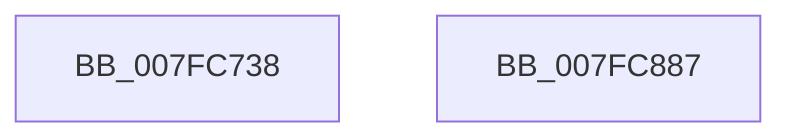

# MiInitializeSections

- RVA: `0x007FC738`–`0x007FC888` (길이 `336` bytes)
- VA: `0x00000001407FC738`
- 실행 섹션: `PAGE`
- PDB 이름 있음: `예`; PDB Function 태그: `아니요`
- unwind 정보 RVA: `0x0005CAAC`
- 디코드: `78`개 명령, `336/336` bytes 표시
- 미해석 바이트: `0` (있으면 어셈블리에 `.byte`로 보존)

> 이 문서는 커널 이미지의 기계어와 PDB 기호를 분석해 생성했습니다. 4번과 5번은 함수 원형과 자료형을 바이너리 사용 방식에서 추정한 C 해석이며 원본 소스 복구 결과는 아닙니다.

## 1. Dependencies

- 직접 호출 지점: **9**; 고유 호출 대상: **3**
- 직접 호출자로 확인된 함수: **2**
- RIP 상대 이미지 참조: **0**

### Outgoing calls
- `0x007FC776` → [KeInitializeEvent](../../text/40/KeInitializeEvent_function_0040DD10.md) (function, `0x0040DD10`)
- `0x007FC7BF` → [KeInitializeEvent](../../text/40/KeInitializeEvent_function_0040DD10.md) (function, `0x0040DD10`)
- `0x007FC7DE` → [KeInitializeEvent](../../text/40/KeInitializeEvent_function_0040DD10.md) (function, `0x0040DD10`)
- `0x007FC7EF` → [KeInitializeEvent](../../text/40/KeInitializeEvent_function_0040DD10.md) (function, `0x0040DD10`)
- `0x007FC7FD` → [KeInitializeTimerEx](../../text/45/KeInitializeTimerEx_function_004563F0.md) (function, `0x004563F0`)
- `0x007FC80E` → [KeInitializeEvent](../../text/40/KeInitializeEvent_function_0040DD10.md) (function, `0x0040DD10`)
- `0x007FC81A` → [InitializeSListHead](../../text/46/InitializeSListHead_function_00468A90.md) (function, `0x00468A90`)
- `0x007FC82B` → [KeInitializeEvent](../../text/40/KeInitializeEvent_function_0040DD10.md) (function, `0x0040DD10`)
- `0x007FC877` → [KeInitializeEvent](../../text/40/KeInitializeEvent_function_0040DD10.md) (function, `0x0040DD10`)

### Direct callers
- [MiInitializePartition](MiInitializePartition_function_007FD3E8.md) at `0x007FD8FF`
- [MiInitNucleus](../../init/C5/MiInitNucleus_function_00C5FD38.md) at `0x00C6015D`

### Static image references
- 디코드된 RIP-relative 메모리 참조가 없습니다.

## 2. Other-region calls and transfers

- 다른 실행 섹션으로 향하는 call: **9**
  - `0x007FC776` → [KeInitializeEvent](../../text/40/KeInitializeEvent_function_0040DD10.md) (`PAGE` → `.text`)
  - `0x007FC7BF` → [KeInitializeEvent](../../text/40/KeInitializeEvent_function_0040DD10.md) (`PAGE` → `.text`)
  - `0x007FC7DE` → [KeInitializeEvent](../../text/40/KeInitializeEvent_function_0040DD10.md) (`PAGE` → `.text`)
  - `0x007FC7EF` → [KeInitializeEvent](../../text/40/KeInitializeEvent_function_0040DD10.md) (`PAGE` → `.text`)
  - `0x007FC7FD` → [KeInitializeTimerEx](../../text/45/KeInitializeTimerEx_function_004563F0.md) (`PAGE` → `.text`)
  - `0x007FC80E` → [KeInitializeEvent](../../text/40/KeInitializeEvent_function_0040DD10.md) (`PAGE` → `.text`)
  - `0x007FC81A` → [InitializeSListHead](../../text/46/InitializeSListHead_function_00468A90.md) (`PAGE` → `.text`)
  - `0x007FC82B` → [KeInitializeEvent](../../text/40/KeInitializeEvent_function_0040DD10.md) (`PAGE` → `.text`)
  - `0x007FC877` → [KeInitializeEvent](../../text/40/KeInitializeEvent_function_0040DD10.md) (`PAGE` → `.text`)
- 별도 외부 분기/꼬리 이동을 확인하지 못했습니다.

## 3. Assembly (complete function range)

```asm
007FC738  48 89 5C 24 08                  mov qword ptr [rsp + 8], rbx
007FC73D  57                              push rdi
007FC73E  48 83 EC 20                     sub rsp, 0x20
007FC742  48 8B D9                        mov rbx, rcx
007FC745  45 33 C0                        xor r8d, r8d
007FC748  48 81 C1 70 07 00 00            add rcx, 0x770
007FC74F  41 8D 78 01                     lea edi, [r8 + 1]
007FC753  48 8D 41 18                     lea rax, [rcx + 0x18]
007FC757  8B D7                           mov edx, edi
007FC759  48 89 40 08                     mov qword ptr [rax + 8], rax
007FC75D  48 89 00                        mov qword ptr [rax], rax
007FC760  48 8D 41 28                     lea rax, [rcx + 0x28]
007FC764  48 89 40 08                     mov qword ptr [rax + 8], rax
007FC768  48 89 00                        mov qword ptr [rax], rax
007FC76B  48 8D 41 38                     lea rax, [rcx + 0x38]
007FC76F  48 89 40 08                     mov qword ptr [rax + 8], rax
007FC773  48 89 00                        mov qword ptr [rax], rax
007FC776  E8 95 15 C1 FF                  call 0x14040dd10
007FC77B  48 8D 83 C8 07 00 00            lea rax, [rbx + 0x7c8]
007FC782  45 33 C0                        xor r8d, r8d
007FC785  48 89 40 08                     mov qword ptr [rax + 8], rax
007FC789  48 8D 8B F8 06 00 00            lea rcx, [rbx + 0x6f8]
007FC790  48 89 00                        mov qword ptr [rax], rax
007FC793  33 D2                           xor edx, edx
007FC795  48 8D 83 D8 07 00 00            lea rax, [rbx + 0x7d8]
007FC79C  48 89 40 08                     mov qword ptr [rax + 8], rax
007FC7A0  48 89 00                        mov qword ptr [rax], rax
007FC7A3  48 8D 83 40 08 00 00            lea rax, [rbx + 0x840]
007FC7AA  48 89 40 08                     mov qword ptr [rax + 8], rax
007FC7AE  48 89 00                        mov qword ptr [rax], rax
007FC7B1  48 8D 83 B8 07 00 00            lea rax, [rbx + 0x7b8]
007FC7B8  48 89 40 08                     mov qword ptr [rax + 8], rax
007FC7BC  48 89 00                        mov qword ptr [rax], rax
007FC7BF  E8 4C 15 C1 FF                  call 0x14040dd10
007FC7C4  48 8D 83 50 08 00 00            lea rax, [rbx + 0x850]
007FC7CB  45 33 C0                        xor r8d, r8d
007FC7CE  48 8D 8B E0 06 00 00            lea rcx, [rbx + 0x6e0]
007FC7D5  48 89 40 08                     mov qword ptr [rax + 8], rax
007FC7D9  33 D2                           xor edx, edx
007FC7DB  48 89 00                        mov qword ptr [rax], rax
007FC7DE  E8 2D 15 C1 FF                  call 0x14040dd10
007FC7E3  48 8D 8B 60 08 00 00            lea rcx, [rbx + 0x860]
007FC7EA  45 33 C0                        xor r8d, r8d
007FC7ED  8B D7                           mov edx, edi
007FC7EF  E8 1C 15 C1 FF                  call 0x14040dd10
007FC7F4  48 8D 8B E8 07 00 00            lea rcx, [rbx + 0x7e8]
007FC7FB  8B D7                           mov edx, edi
007FC7FD  E8 EE 9B C5 FF                  call 0x1404563f0
007FC802  48 8D 8B 40 09 00 00            lea rcx, [rbx + 0x940]
007FC809  45 33 C0                        xor r8d, r8d
007FC80C  8B D7                           mov edx, edi
007FC80E  E8 FD 14 C1 FF                  call 0x14040dd10
007FC813  48 8D 8B 60 09 00 00            lea rcx, [rbx + 0x960]
007FC81A  E8 71 C2 C6 FF                  call 0x140468a90
007FC81F  48 8D 8B 80 09 00 00            lea rcx, [rbx + 0x980]
007FC826  45 33 C0                        xor r8d, r8d
007FC829  33 D2                           xor edx, edx
007FC82B  E8 E0 14 C1 FF                  call 0x14040dd10
007FC830  33 C0                           xor eax, eax
007FC832  48 89 BB 38 07 00 00            mov qword ptr [rbx + 0x738], rdi
007FC839  48 89 83 18 07 00 00            mov qword ptr [rbx + 0x718], rax
007FC840  48 8D 8B 48 07 00 00            lea rcx, [rbx + 0x748]
007FC847  48 89 83 40 07 00 00            mov qword ptr [rbx + 0x740], rax
007FC84E  45 33 C0                        xor r8d, r8d
007FC851  89 83 60 07 00 00               mov dword ptr [rbx + 0x760], eax
007FC857  33 D2                           xor edx, edx
007FC859  8A 83 67 07 00 00               mov al, byte ptr [rbx + 0x767]
007FC85F  24 FD                           and al, 0xfd
007FC861  48 89 9B 30 07 00 00            mov qword ptr [rbx + 0x730], rbx
007FC868  0C 04                           or al, 4
007FC86A  C6 83 64 07 00 00 FF            mov byte ptr [rbx + 0x764], 0xff
007FC871  88 83 67 07 00 00               mov byte ptr [rbx + 0x767], al
007FC877  E8 94 14 C1 FF                  call 0x14040dd10
007FC87C  48 8B 5C 24 30                  mov rbx, qword ptr [rsp + 0x30]
007FC881  48 83 C4 20                     add rsp, 0x20
007FC885  5F                              pop rdi
007FC886  C3                              ret
007FC887  CC                              int3
```

## 4. C-style interpretation (structured pseudocode)

```c
__int64 __fastcall MiInitializeSections(__int64 a1, __int64 a2, int a3)
{
    __int64 result;
    __int64 v_rsp;
    unsigned __int64 v_stack_p8;

    v_stack_p8 = v_rbx;
    v_rsp = (v_rsp) - (32);
    a3 = 0;
    a1 = (a1) + (0x770ULL);
    *(unsigned __int64 *)(a1 + 24 + 8) = a1 + 24;
    *(unsigned __int64 *)(a1 + 24) = a1 + 24;
    *(unsigned __int64 *)(a1 + 40 + 8) = a1 + 40;
    *(unsigned __int64 *)(a1 + 40) = a1 + 40;
    *(unsigned __int64 *)(a1 + 56 + 8) = a1 + 56;
    *(unsigned __int64 *)(a1 + 56) = a1 + 56;
    result = KeInitializeEvent(a1, (unsigned int)((unsigned int)(a3 + 1)), a3, a4);
    a3 = 0;
    *(unsigned __int64 *)(a1 + 1992 + 8) = a1 + 1992;
    *(unsigned __int64 *)(a1 + 1992) = a1 + 1992;
    a2 = 0;
    *(unsigned __int64 *)(a1 + 2008 + 8) = a1 + 2008;
    *(unsigned __int64 *)(a1 + 2008) = a1 + 2008;
    *(unsigned __int64 *)(a1 + 2112 + 8) = a1 + 2112;
    *(unsigned __int64 *)(a1 + 2112) = a1 + 2112;
    *(unsigned __int64 *)(a1 + 1976 + 8) = a1 + 1976;
    *(unsigned __int64 *)(a1 + 1976) = a1 + 1976;
    result = KeInitializeEvent(a1 + 1784, a2, a3, a4);
    a3 = 0;
    *(unsigned __int64 *)(a1 + 2128 + 8) = a1 + 2128;
    a2 = 0;
    *(unsigned __int64 *)(a1 + 2128) = a1 + 2128;
    result = KeInitializeEvent(a1 + 1760, a2, a3, a4);
    a3 = 0;
    result = KeInitializeEvent(a1 + 2144, (unsigned int)((unsigned int)(a3 + 1)), a3, a4);
    result = KeInitializeTimerEx(a1 + 2024, (unsigned int)((unsigned int)(a3 + 1)), a3, a4);
    a3 = 0;
    result = KeInitializeEvent(a1 + 2368, (unsigned int)((unsigned int)(a3 + 1)), a3, a4);
    result = InitializeSListHead(a1 + 2400, (unsigned int)((unsigned int)(a3 + 1)), a3, a4);
    a3 = 0;
    a2 = 0;
    result = KeInitializeEvent(a1 + 2432, a2, a3, a4);
    result = 0;
    *(unsigned __int64 *)(a1 + 1848) = a3 + 1;
    *(unsigned __int64 *)(a1 + 1816) = 0;
    *(unsigned __int64 *)(a1 + 1856) = 0;
    a3 = 0;
    *(unsigned int *)(a1 + 1888) = 0;
    a2 = 0;
    result = (unsigned __int8)((*(unsigned __int8 *)(a1 + 1895)) & (253));
    *(unsigned __int64 *)(a1 + 1840) = a1;
    result = (unsigned __int8)((result) | (4));
    *(unsigned __int8 *)(a1 + 1892) = 255;
    *(unsigned __int8 *)(a1 + 1895) = (unsigned __int8)(result);
    result = KeInitializeEvent(a1 + 1864, a2, a3, a4);
    v_rsp = (v_rsp) + (32);
    return result;
}
```

## 5. (Beta) C Style

```c
int64_t MiInitializeSections(void *Arg1, int64_t Arg2, int32_t Arg3)
{
    uint8_t *arg1 = (uint8_t *)Arg1;

    int64_t result;
    int64_t local_rsp;
    uint64_t v_stack_p8;

    v_stack_p8 = local_rbx;
    local_rsp = (local_rsp) - (32);
    Arg3 = 0;
    Arg1 = (Arg1) + (0x770ULL);
    *(void **)(arg1 + 0x18 + 0x8) = Arg1 + 24;
    *(void **)(arg1 + 0x18) = Arg1 + 24;
    *(void **)(arg1 + 0x28 + 0x8) = Arg1 + 40;
    *(void **)(arg1 + 0x28) = Arg1 + 40;
    *(void **)(arg1 + 0x38 + 0x8) = Arg1 + 56;
    *(void **)(arg1 + 0x38) = Arg1 + 56;
    result = KeInitializeEvent(Arg1, (uint32_t)((uint32_t)(Arg3 + 1)), Arg3, a4);
    Arg3 = 0;
    *(void **)(arg1 + 0x7C8 + 0x8) = Arg1 + 1992;
    *(void **)(arg1 + 0x7C8) = Arg1 + 1992;
    Arg2 = 0;
    *(void **)(arg1 + 0x7D8 + 0x8) = Arg1 + 2008;
    *(void **)(arg1 + 0x7D8) = Arg1 + 2008;
    *(void **)(arg1 + 0x840 + 0x8) = Arg1 + 2112;
    *(void **)(arg1 + 0x840) = Arg1 + 2112;
    *(void **)(arg1 + 0x7B8 + 0x8) = Arg1 + 1976;
    *(void **)(arg1 + 0x7B8) = Arg1 + 1976;
    result = KeInitializeEvent(Arg1 + 1784, Arg2, Arg3, a4);
    Arg3 = 0;
    *(void **)(arg1 + 0x850 + 0x8) = Arg1 + 2128;
    Arg2 = 0;
    *(void **)(arg1 + 0x850) = Arg1 + 2128;
    result = KeInitializeEvent(Arg1 + 1760, Arg2, Arg3, a4);
    Arg3 = 0;
    result = KeInitializeEvent(Arg1 + 2144, (uint32_t)((uint32_t)(Arg3 + 1)), Arg3, a4);
    result = KeInitializeTimerEx(Arg1 + 2024, (uint32_t)((uint32_t)(Arg3 + 1)), Arg3, a4);
    Arg3 = 0;
    result = KeInitializeEvent(Arg1 + 2368, (uint32_t)((uint32_t)(Arg3 + 1)), Arg3, a4);
    result = InitializeSListHead(Arg1 + 2400, (uint32_t)((uint32_t)(Arg3 + 1)), Arg3, a4);
    Arg3 = 0;
    Arg2 = 0;
    result = KeInitializeEvent(Arg1 + 2432, Arg2, Arg3, a4);
    result = 0;
    *(uint64_t *)(arg1 + 0x738) = Arg3 + 1;
    *(uint64_t *)(arg1 + 0x718) = 0;
    *(uint64_t *)(arg1 + 0x740) = 0;
    Arg3 = 0;
    *(uint32_t *)(arg1 + 0x760) = 0;
    Arg2 = 0;
    result = (uint8_t)((*(uint8_t *)(arg1 + 0x767)) & (253));
    *(void **)(arg1 + 0x730) = Arg1;
    result = (uint8_t)((result) | (4));
    *(uint8_t *)(arg1 + 0x764) = 255;
    *(uint8_t *)(arg1 + 0x767) = (uint8_t)(result);
    result = KeInitializeEvent(Arg1 + 1864, Arg2, Arg3, a4);
    local_rsp = (local_rsp) + (32);
    return result;
}
```

### 관측된 메모리 오프셋

구조체 형식이 확인되지 않은 접근은 인자 기준의 오프셋으로만 기록했습니다.

| 기준 인자 | 오프셋 표현 | 폭 (bit) | 접근 |
|---|---:|---:|---|
| `Arg1` | `+ 0x0` | `64` | `W` |
| `Arg1` | `+ 0x8` | `64` | `W` |
| `Arg1` | `+ 0x18` | `64` | `R` |
| `Arg1` | `+ 0x28` | `64` | `R` |
| `Arg1` | `+ 0x38` | `64` | `R` |
| `Arg1` | `+ 0x6E0` | `64` | `R` |
| `Arg1` | `+ 0x6F8` | `64` | `R` |
| `Arg1` | `+ 0x718` | `64` | `W` |
| `Arg1` | `+ 0x730` | `64` | `W` |
| `Arg1` | `+ 0x738` | `64` | `W` |
| `Arg1` | `+ 0x740` | `64` | `W` |
| `Arg1` | `+ 0x748` | `64` | `R` |
| `Arg1` | `+ 0x760` | `32` | `W` |
| `Arg1` | `+ 0x764` | `8` | `W` |
| `Arg1` | `+ 0x767` | `8` | `R` |
| `Arg1` | `+ 0x767` | `8` | `W` |
| `Arg1` | `+ 0x7B8` | `64` | `R` |
| `Arg1` | `+ 0x7C8` | `64` | `R` |
| `Arg1` | `+ 0x7D8` | `64` | `R` |
| `Arg1` | `+ 0x7E8` | `64` | `R` |
| `Arg1` | `+ 0x840` | `64` | `R` |
| `Arg1` | `+ 0x850` | `64` | `R` |
| `Arg1` | `+ 0x860` | `64` | `R` |
| `Arg1` | `+ 0x940` | `64` | `R` |
| `Arg1` | `+ 0x960` | `64` | `R` |
| `Arg1` | `+ 0x980` | `64` | `R` |

## 6. Execution-region graph

[열기: 2D/3D 그래프와 함수 탐색 컨트롤 패널](../../../control-panel.html?section=page&rva=0x007FC738&view=graph)

- 2D 그래프는 위에서 아래로 흐르고, 3D 그래프는 빈 공간을 드래그해 회전합니다. Shift+드래그는 이동, 휠은 확대·축소, 함수 노드 선택은 대상 보고서 이동입니다.

### Static fallback


