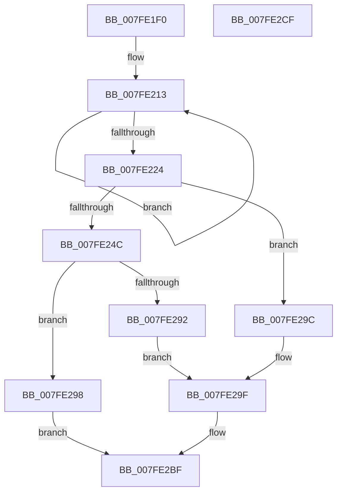

# MiInitializeSystemCache

- RVA: `0x007FE1F0`–`0x007FE2D0` (길이 `224` bytes)
- VA: `0x00000001407FE1F0`
- 실행 섹션: `PAGE`
- PDB 이름 있음: `예`; PDB Function 태그: `아니요`
- unwind 정보 RVA: `0x000D1934`
- 디코드: `59`개 명령, `224/224` bytes 표시
- 미해석 바이트: `0` (있으면 어셈블리에 `.byte`로 보존)

> 이 문서는 커널 이미지의 기계어와 PDB 기호를 분석해 생성했습니다. 4번과 5번은 함수 원형과 자료형을 바이너리 사용 방식에서 추정한 C 해석이며 원본 소스 복구 결과는 아닙니다.

## 1. Dependencies

- 직접 호출 지점: **3**; 고유 호출 대상: **3**
- 직접 호출자로 확인된 함수: **1**
- RIP 상대 이미지 참조: **3**

### Outgoing calls
- `0x007FE274` → [MiQuerySystemBase](../../text/46/MiQuerySystemBase_function_00468F1C.md) (function, `0x00468F1C`)
- `0x007FE289` → [MiInitializeDynamicRegion](../../init/C6/MiInitializeDynamicRegion_function_00C65C2C.md) (function, `0x00C65C2C`)
- `0x007FE2B2` → [MiInitializeSystemWorkingSetList](MiInitializeSystemWorkingSetList_function_007FB7D4.md) (function, `0x007FB7D4`)

### Direct callers
- [MiLateInitializeSystemCache](../../text/4C/MiLateInitializeSystemCache_function_004C8104.md) at `0x004C8172`

### Static image references
- `0x007FE240` → RVA `0x00E38D00` (`.data`; read)
- `0x007FE24C` → RVA `0x00E37DB8` (`.data`; read)
- `0x007FE26D` → RVA `0x00E37DB8` (`.data`; write)

## 2. Other-region calls and transfers

- 다른 실행 섹션으로 향하는 call: **2**
  - `0x007FE274` → [MiQuerySystemBase](../../text/46/MiQuerySystemBase_function_00468F1C.md) (`PAGE` → `.text`)
  - `0x007FE289` → [MiInitializeDynamicRegion](../../init/C6/MiInitializeDynamicRegion_function_00C65C2C.md) (`PAGE` → `INIT`)
- 별도 외부 분기/꼬리 이동을 확인하지 못했습니다.

## 3. Assembly (complete function range)

```asm
007FE1F0  48 89 5C 24 18                  mov qword ptr [rsp + 0x18], rbx
007FE1F5  48 89 74 24 20                  mov qword ptr [rsp + 0x20], rsi
007FE1FA  57                              push rdi
007FE1FB  48 83 EC 20                     sub rsp, 0x20
007FE1FF  33 FF                           xor edi, edi
007FE201  48 8D 81 80 08 00 00            lea rax, [rcx + 0x880]
007FE208  48 8B D9                        mov rbx, rcx
007FE20B  48 89 7C 24 38                  mov qword ptr [rsp + 0x38], rdi
007FE210  8D 4F 04                        lea ecx, [rdi + 4]
007FE213  48 89 40 08                     mov qword ptr [rax + 8], rax
007FE217  48 89 00                        mov qword ptr [rax], rax
007FE21A  48 83 C0 20                     add rax, 0x20
007FE21E  48 83 E9 01                     sub rcx, 1
007FE222  75 EF                           jne 0x1407fe213
007FE224  48 8D 83 00 09 00 00            lea rax, [rbx + 0x900]
007FE22B  48 89 40 08                     mov qword ptr [rax + 8], rax
007FE22F  48 89 00                        mov qword ptr [rax], rax
007FE232  48 8D 83 20 09 00 00            lea rax, [rbx + 0x920]
007FE239  48 89 40 08                     mov qword ptr [rax + 8], rax
007FE23D  48 89 00                        mov qword ptr [rax], rax
007FE240  48 8D 05 B9 AA 63 00            lea rax, [rip + 0x63aab9]
007FE247  48 3B D8                        cmp rbx, rax
007FE24A  75 50                           jne 0x1407fe29c
007FE24C  8B 05 66 9B 63 00               mov eax, dword ptr [rip + 0x639b66]
007FE252  48 8D 54 24 38                  lea rdx, [rsp + 0x38]
007FE257  89 44 24 30                     mov dword ptr [rsp + 0x30], eax
007FE25B  B9 03 00 00 00                  mov ecx, 3
007FE260  24 F1                           and al, 0xf1
007FE262  0C 01                           or al, 1
007FE264  88 44 24 30                     mov byte ptr [rsp + 0x30], al
007FE268  0F B7 44 24 30                  movzx eax, word ptr [rsp + 0x30]
007FE26D  66 89 05 44 9B 63 00            mov word ptr [rip + 0x639b44], ax
007FE274  E8 A3 AC C6 FF                  call 0x140468f1c
007FE279  48 8B 74 24 38                  mov rsi, qword ptr [rsp + 0x38]
007FE27E  48 8B D0                        mov rdx, rax
007FE281  4C 8B C6                        mov r8, rsi
007FE284  B9 07 00 00 00                  mov ecx, 7
007FE289  E8 9E 79 46 00                  call 0x140c65c2c
007FE28E  85 C0                           test eax, eax
007FE290  74 06                           je 0x1407fe298
007FE292  48 C1 EE 0C                     shr rsi, 0xc
007FE296  EB 07                           jmp 0x1407fe29f
007FE298  33 C0                           xor eax, eax
007FE29A  EB 23                           jmp 0x1407fe2bf
007FE29C  48 8B F7                        mov rsi, rdi
007FE29F  48 8D 93 80 49 00 00            lea rdx, [rbx + 0x4980]
007FE2A6  4C 8B CE                        mov r9, rsi
007FE2A9  41 B8 01 00 00 00               mov r8d, 1
007FE2AF  48 8B CB                        mov rcx, rbx
007FE2B2  E8 1D D5 FF FF                  call 0x1407fb7d4
007FE2B7  85 C0                           test eax, eax
007FE2B9  40 0F 99 C7                     setns dil
007FE2BD  8B C7                           mov eax, edi
007FE2BF  48 8B 5C 24 40                  mov rbx, qword ptr [rsp + 0x40]
007FE2C4  48 8B 74 24 48                  mov rsi, qword ptr [rsp + 0x48]
007FE2C9  48 83 C4 20                     add rsp, 0x20
007FE2CD  5F                              pop rdi
007FE2CE  C3                              ret
007FE2CF  CC                              int3
```

## 4. C-style interpretation (structured pseudocode)

```c
__int64 __fastcall MiInitializeSystemCache(__int64 a1)
{
    __int64 result;
    __int64 v_rdi;
    __int64 v_rsi;
    __int64 v_rsp;
    unsigned __int64 v_stack_p10;
    unsigned __int64 v_stack_p18;
    unsigned __int64 v_stack_p20;
    unsigned int v_stack_p8;

    v_stack_p18 = v_rbx;
    v_stack_p20 = v_rsi;
    v_rsp = (v_rsp) - (32);
    v_rdi = 0;
    v_stack_p10 = 0;
loc_007FE213:
    *(unsigned __int64 *)(a1 + 2176 + 8) = a1 + 2176;
    *(unsigned __int64 *)(a1 + 2176) = a1 + 2176;
    result = (a1 + 2176) + (32);
    a1 = (v_rdi + 4) - (1);
    if (condition_is_not_equal) goto loc_007FE213;
    *(unsigned __int64 *)(a1 + 2304 + 8) = a1 + 2304;
    *(unsigned __int64 *)(a1 + 2304) = a1 + 2304;
    *(unsigned __int64 *)(a1 + 2336 + 8) = a1 + 2336;
    *(unsigned __int64 *)(a1 + 2336) = a1 + 2336;
    if (a1 != (v_rip + 6531769)) goto loc_007FE29C;
    v_stack_p8 = (unsigned int)((unsigned int)(*(unsigned int *)(v_rip + 6527846)));
    result = (unsigned __int8)(((unsigned int)(*(unsigned int *)(v_rip + 6527846))) & (241));
    result = (unsigned __int8)((result) | (1));
    v_stack_p8 = (unsigned __int8)(result);
    *(unsigned __int16 *)(v_rip + 6527812) = (unsigned __int16)(v_stack_p8);
    result = MiQuerySystemBase(3, v_stack_p10, a3, a4);
    result = MiInitializeDynamicRegion(7, result, v_stack_p10, a4);
    if ((unsigned int)(result) == 0) goto loc_007FE298;
    v_rsi = (v_stack_p10) >> (12);
    goto loc_007FE29F;
loc_007FE298:
    result = 0;
    goto loc_007FE2BF;
loc_007FE29C:
loc_007FE29F:
    result = MiInitializeSystemWorkingSetList(a1, a1 + 18816, 1, 0);
    v_rdi = (!sign_flag) ? 1 : 0;
loc_007FE2BF:
    v_rsp = (v_rsp) + (32);
    return (unsigned int)((unsigned int)(v_rdi));
}
```

## 5. (Beta) C Style

```c
int64_t MiInitializeSystemCache(void *Arg1)
{
    uint8_t *arg1 = (uint8_t *)Arg1;

    int64_t result;
    int64_t local_rdi;
    int64_t local_rsi;
    int64_t local_rsp;
    uint64_t v_stack_p10;
    uint64_t v_stack_p18;
    uint64_t v_stack_p20;
    uint32_t v_stack_p8;

    v_stack_p18 = local_rbx;
    v_stack_p20 = local_rsi;
    local_rsp = (local_rsp) - (32);
    local_rdi = 0;
    v_stack_p10 = 0;
loc_007FE213:
    *(void **)(arg1 + 0x880 + 0x8) = Arg1 + 2176;
    *(void **)(arg1 + 0x880) = Arg1 + 2176;
    result = (Arg1 + 2176) + (32);
    Arg1 = (local_rdi + 4) - (1);
    if (condition_is_not_equal) goto loc_007FE213;
    *(void **)(arg1 + 0x900 + 0x8) = Arg1 + 2304;
    *(void **)(arg1 + 0x900) = Arg1 + 2304;
    *(void **)(arg1 + 0x920 + 0x8) = Arg1 + 2336;
    *(void **)(arg1 + 0x920) = Arg1 + 2336;
    if (Arg1 != (v_rip + 6531769)) goto loc_007FE29C;
    v_stack_p8 = (uint32_t)((uint32_t)(*(uint32_t *)(v_rip + 0x639B66)));
    result = (uint8_t)(((uint32_t)(*(uint32_t *)(v_rip + 0x639B66))) & (241));
    result = (uint8_t)((result) | (1));
    v_stack_p8 = (uint8_t)(result);
    *(uint16_t *)(v_rip + 0x639B44) = (uint16_t)(v_stack_p8);
    result = MiQuerySystemBase(3, v_stack_p10, a3, a4);
    result = MiInitializeDynamicRegion(7, result, v_stack_p10, a4);
    if ((uint32_t)(result) == 0) goto loc_007FE298;
    local_rsi = (v_stack_p10) >> (12);
    goto loc_007FE29F;
loc_007FE298:
    result = 0;
    goto loc_007FE2BF;
loc_007FE29C:
loc_007FE29F:
    result = MiInitializeSystemWorkingSetList(Arg1, Arg1 + 18816, 1, 0);
    local_rdi = (!sign_flag) ? 1 : 0;
loc_007FE2BF:
    local_rsp = (local_rsp) + (32);
    return (uint32_t)((uint32_t)(local_rdi));
}
```

### 관측된 메모리 오프셋

구조체 형식이 확인되지 않은 접근은 인자 기준의 오프셋으로만 기록했습니다.

| 기준 인자 | 오프셋 표현 | 폭 (bit) | 접근 |
|---|---:|---:|---|
| `Arg1` | `+ 0x0` | `64` | `W` |
| `Arg1` | `+ 0x8` | `64` | `W` |
| `Arg1` | `+ 0x880` | `64` | `R` |
| `Arg1` | `+ 0x900` | `64` | `R` |
| `Arg1` | `+ 0x920` | `64` | `R` |

## 6. Execution-region graph

[열기: 2D/3D 그래프와 함수 탐색 컨트롤 패널](../../../control-panel.html?section=page&rva=0x007FE1F0&view=graph)

- 2D 그래프는 위에서 아래로 흐르고, 3D 그래프는 빈 공간을 드래그해 회전합니다. Shift+드래그는 이동, 휠은 확대·축소, 함수 노드 선택은 대상 보고서 이동입니다.

### Static fallback


