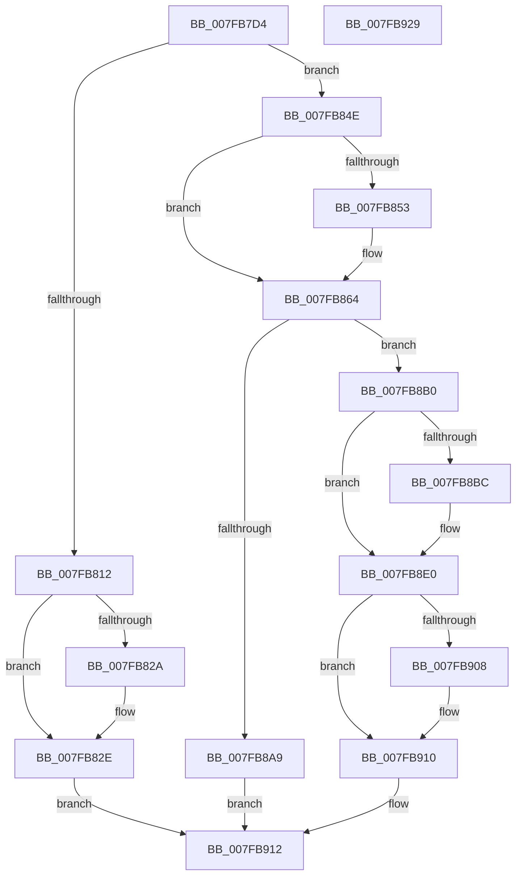

# MiInitializeSystemWorkingSetList

- RVA: `0x007FB7D4`–`0x007FB92A` (길이 `342` bytes)
- VA: `0x00000001407FB7D4`
- 실행 섹션: `PAGE`
- PDB 이름 있음: `예`; PDB Function 태그: `아니요`
- unwind 정보 RVA: `0x0009C52C`
- 디코드: `91`개 명령, `342/342` bytes 표시
- 미해석 바이트: `0` (있으면 어셈블리에 `.byte`로 보존)

> 이 문서는 커널 이미지의 기계어와 PDB 기호를 분석해 생성했습니다. 4번과 5번은 함수 원형과 자료형을 바이너리 사용 방식에서 추정한 C 해석이며 원본 소스 복구 결과는 아닙니다.

## 1. Dependencies

- 직접 호출 지점: **4**; 고유 호출 대상: **4**
- 직접 호출자로 확인된 함수: **6**
- RIP 상대 이미지 참조: **3**

### Outgoing calls
- `0x007FB7F9` → [MiTranslateWsType](../../text/47/MiTranslateWsType_function_0047DF68.md) (function, `0x0047DF68`)
- `0x007FB8A0` → [MiChargeResident](../../text/28/MiChargeResident_function_0028A0F0.md) (function, `0x0028A0F0`)
- `0x007FB8FD` → [MiInitializeWorkingSetList](../../text/4A/MiInitializeWorkingSetList_function_004AE640.md) (function, `0x004AE640`)
- `0x007FB90B` → [MiAllowWorkingSetExpansion](../../text/35/MiAllowWorkingSetExpansion_function_00350490.md) (function, `0x00350490`)

### Direct callers
- [MiInitializeSystemCache](MiInitializeSystemCache_function_007FE1F0.md) at `0x007FE2B2`
- [MiInitNucleus](../../init/C5/MiInitNucleus_function_00C5FD38.md) at `0x00C60332`
- [MiInitNucleus](../../init/C5/MiInitNucleus_function_00C5FD38.md) at `0x00C60357`
- [MiBuildPagedPool](../../init/C6/MiBuildPagedPool_function_00C64918.md) at `0x00C64996`
- [MiInitializeNonPagedPool](../../init/C6/MiInitializeNonPagedPool_function_00C64A24.md) at `0x00C64A58`
- [MiBuildSystemDataViews](../../init/C6/MiBuildSystemDataViews_function_00C64DCC.md) at `0x00C64E3C`
- [MiInitializeSystemPtes](../../init/C6/MiInitializeSystemPtes_function_00C6A998.md) at `0x00C6A9FD`
- [MiInitializeSystemPtes](../../init/C6/MiInitializeSystemPtes_function_00C6A998.md) at `0x00C6AA25`

### Static image references
- `0x007FB867` → RVA `0x00E2F3C0` (`.data`; read)
- `0x007FB8B0` → RVA `0x00E38D00` (`.data`; read)
- `0x007FB8CB` → RVA `0x00E37D78` (`.data`; read)

## 2. Other-region calls and transfers

- 다른 실행 섹션으로 향하는 call: **4**
  - `0x007FB7F9` → [MiTranslateWsType](../../text/47/MiTranslateWsType_function_0047DF68.md) (`PAGE` → `.text`)
  - `0x007FB8A0` → [MiChargeResident](../../text/28/MiChargeResident_function_0028A0F0.md) (`PAGE` → `.text`)
  - `0x007FB8FD` → [MiInitializeWorkingSetList](../../text/4A/MiInitializeWorkingSetList_function_004AE640.md) (`PAGE` → `.text`)
  - `0x007FB90B` → [MiAllowWorkingSetExpansion](../../text/35/MiAllowWorkingSetExpansion_function_00350490.md) (`PAGE` → `.text`)
- 별도 외부 분기/꼬리 이동을 확인하지 못했습니다.

## 3. Assembly (complete function range)

```asm
007FB7D4  48 89 5C 24 08                  mov qword ptr [rsp + 8], rbx
007FB7D9  48 89 6C 24 18                  mov qword ptr [rsp + 0x18], rbp
007FB7DE  56                              push rsi
007FB7DF  57                              push rdi
007FB7E0  41 54                           push r12
007FB7E2  41 56                           push r14
007FB7E4  41 57                           push r15
007FB7E6  48 83 EC 20                     sub rsp, 0x20
007FB7EA  48 8B F9                        mov rdi, rcx
007FB7ED  4D 8B E1                        mov r12, r9
007FB7F0  41 8B C8                        mov ecx, r8d
007FB7F3  41 8B F0                        mov esi, r8d
007FB7F6  48 8B DA                        mov rbx, rdx
007FB7F9  E8 6A 27 C8 FF                  call 0x14047df68
007FB7FE  44 8B 93 B8 00 00 00            mov r10d, dword ptr [rbx + 0xb8]
007FB805  48 63 D0                        movsxd rdx, eax
007FB808  44 89 54 24 58                  mov dword ptr [rsp + 0x58], r10d
007FB80D  83 FA 03                        cmp edx, 3
007FB810  7E 3C                           jle 0x1407fb84e
007FB812  40 80 E6 0F                     and sil, 0xf
007FB816  45 8A CA                        mov r9b, r10b
007FB819  41 80 E1 F0                     and r9b, 0xf0
007FB81D  44 0A CE                        or r9b, sil
007FB820  44 88 4C 24 58                  mov byte ptr [rsp + 0x58], r9b
007FB825  83 FA 08                        cmp edx, 8
007FB828  75 04                           jne 0x1407fb82e
007FB82A  08 54 24 59                     or byte ptr [rsp + 0x59], dl
007FB82E  0F B7 44 24 58                  movzx eax, word ptr [rsp + 0x58]
007FB833  66 89 83 B8 00 00 00            mov word ptr [rbx + 0xb8], ax
007FB83A  83 23 00                        and dword ptr [rbx], 0
007FB83D  0F B7 07                        movzx eax, word ptr [rdi]
007FB840  66 89 83 AE 00 00 00            mov word ptr [rbx + 0xae], ax
007FB847  33 C0                           xor eax, eax
007FB849  E9 C4 00 00 00                  jmp 0x1407fb912
007FB84E  83 FA 01                        cmp edx, 1
007FB851  75 11                           jne 0x1407fb864
007FB853  80 4C 24 59 08                  or byte ptr [rsp + 0x59], 8
007FB858  0F B7 44 24 58                  movzx eax, word ptr [rsp + 0x58]
007FB85D  66 89 83 B8 00 00 00            mov word ptr [rbx + 0xb8], ax
007FB864  48 8B EA                        mov rbp, rdx
007FB867  48 8D 05 52 3B 63 00            lea rax, [rip + 0x633b52]
007FB86E  48 C1 E5 08                     shl rbp, 8
007FB872  4C 8B F2                        mov r14, rdx
007FB875  48 03 E8                        add rbp, rax
007FB878  41 B8 14 00 00 00               mov r8d, 0x14
007FB87E  48 81 BF 50 48 00 00 00 40 00 00  cmp qword ptr [rdi + 0x4850], 0x4000
007FB889  48 8B CF                        mov rcx, rdi
007FB88C  4D 1B FF                        sbb r15, r15
007FB88F  49 81 E7 20 FF FF FF            and r15, 0xffffffffffffff20
007FB896  49 81 C7 00 01 00 00            add r15, 0x100
007FB89D  49 8B D7                        mov rdx, r15
007FB8A0  E8 4B E8 A8 FF                  call 0x14028a0f0
007FB8A5  85 C0                           test eax, eax
007FB8A7  75 07                           jne 0x1407fb8b0
007FB8A9  B8 9A 00 00 C0                  mov eax, 0xc000009a
007FB8AE  EB 62                           jmp 0x1407fb912
007FB8B0  48 8D 05 49 D4 63 00            lea rax, [rip + 0x63d449]
007FB8B7  48 3B F8                        cmp rdi, rax
007FB8BA  74 24                           je 0x1407fb8e0
007FB8BC  49 69 EE C0 01 00 00            imul rbp, r14, 0x1c0
007FB8C3  4B 8D 04 B6                     lea rax, [r14 + r14*4]
007FB8C7  48 C1 E0 06                     shl rax, 6
007FB8CB  4C 8D 25 A6 C4 63 00            lea r12, [rip + 0x63c4a6]
007FB8D2  48 81 C5 40 4A 00 00            add rbp, 0x4a40
007FB8D9  48 03 EF                        add rbp, rdi
007FB8DC  4E 8B 24 20                     mov r12, qword ptr [rax + r12]
007FB8E0  83 23 00                        and dword ptr [rbx], 0
007FB8E3  4D 8B CC                        mov r9, r12
007FB8E6  4C 89 7B 70                     mov qword ptr [rbx + 0x70], r15
007FB8EA  44 8B C6                        mov r8d, esi
007FB8ED  0F B7 07                        movzx eax, word ptr [rdi]
007FB8F0  48 8B D5                        mov rdx, rbp
007FB8F3  48 8B CB                        mov rcx, rbx
007FB8F6  66 89 83 AE 00 00 00            mov word ptr [rbx + 0xae], ax
007FB8FD  E8 3E 2D CB FF                  call 0x1404ae640
007FB902  8B F8                           mov edi, eax
007FB904  85 C0                           test eax, eax
007FB906  78 08                           js 0x1407fb910
007FB908  48 8B CB                        mov rcx, rbx
007FB90B  E8 80 4B B5 FF                  call 0x140350490
007FB910  8B C7                           mov eax, edi
007FB912  48 8B 5C 24 50                  mov rbx, qword ptr [rsp + 0x50]
007FB917  48 8B 6C 24 60                  mov rbp, qword ptr [rsp + 0x60]
007FB91C  48 83 C4 20                     add rsp, 0x20
007FB920  41 5F                           pop r15
007FB922  41 5E                           pop r14
007FB924  41 5C                           pop r12
007FB926  5F                              pop rdi
007FB927  5E                              pop rsi
007FB928  C3                              ret
007FB929  CC                              int3
```

## 4. C-style interpretation (structured pseudocode)

```c
__int64 __fastcall MiInitializeSystemWorkingSetList(__int64 a1, __int64 a2, int a3, __int64 a4)
{
    __int64 result;
    __int64 v_r12;
    __int64 v_r15;
    __int64 v_rbp;
    __int64 v_rsi;
    __int64 v_rsp;
    unsigned int v_stack_p10;
    unsigned __int8 v_stack_p11;
    unsigned __int64 v_stack_p18;
    unsigned __int64 v_stack_p8;

    v_stack_p8 = v_rbx;
    v_stack_p18 = v_rbp;
    v_rsp = (v_rsp) - (32);
    result = MiTranslateWsType((unsigned int)(a3), a2, a3, a4);
    v_stack_p10 = (unsigned int)((unsigned int)(*(unsigned int *)(a2 + 184)));
    if (((unsigned int)((int)((unsigned int)(result)))) <= 3) goto loc_007FB84E;
    v_rsi = (unsigned __int8)(((unsigned int)(a3)) & (15));
    a4 = (unsigned __int8)(((unsigned __int8)((unsigned int)(*(unsigned int *)(a2 + 184)))) & (240));
    a4 = (unsigned __int8)((a4) | ((unsigned __int8)(v_rsi)));
    v_stack_p10 = (unsigned __int8)(a4);
    if (((unsigned int)((int)((unsigned int)(result)))) == 8) {
    }
    *(unsigned __int16 *)(a2 + 184) = (unsigned __int16)(v_stack_p10);
    *(unsigned __int16 *)(a2 + 174) = (unsigned __int16)(*(unsigned __int16 *)(a1));
    result = 0;
    goto loc_007FB912;
loc_007FB84E:
    if (((unsigned int)((int)((unsigned int)(result)))) == 1) {
        result = v_stack_p10;
        *(unsigned __int16 *)(a2 + 184) = (unsigned __int16)(result);
    }
    v_rbp = ((int)((unsigned int)(result))) << (8);
    v_rbp = (v_rbp) + (v_rip + 6503250);
    v_r15 = (v_r15) & (-224);
    v_r15 = (v_r15) + (256);
    result = MiChargeResident(a1, v_r15, 20, a4);
    if ((unsigned int)(result) != 0) goto loc_007FB8B0;
    goto loc_007FB912;
loc_007FB8B0:
    result = v_rip + 6542409;
    v_r12 = a4;
    if (a1 != (v_rip + 6542409)) {
        v_rbp = (v_rbp) * ((int)((unsigned int)(result)));
        result = (int)((unsigned int)(result)) + (int)((unsigned int)(result)) * 4;
        result = (result) << (6);
        v_r12 = v_rip + 6538406;
        v_rbp = (v_rbp) + (0x4A40ULL);
        v_rbp = (v_rbp) + (a1);
        v_r12 = *(unsigned __int64 *)(result + v_r12 * 1);
    }
    *(unsigned __int64 *)(a2 + 112) = v_r15;
    *(unsigned __int16 *)(a2 + 174) = (unsigned __int16)(*(unsigned __int16 *)(a1));
    result = MiInitializeWorkingSetList(a2, v_rbp, (unsigned int)((unsigned int)(v_rsi)), v_r12);
    if (!(sign_flag)) {
        a1 = a2;
        result = MiAllowWorkingSetExpansion(a1, v_rbp, (unsigned int)((unsigned int)(v_rsi)), v_r12);
    }
loc_007FB912:
    v_rsp = (v_rsp) + (32);
    return (unsigned int)((unsigned int)((unsigned int)((unsigned int)(result))));
}
```

## 5. (Beta) C Style

```c
int64_t MiInitializeSystemWorkingSetList(void *Arg1, void *Arg2, int32_t Arg3, int64_t Arg4)
{
    uint8_t *arg1 = (uint8_t *)Arg1;
    uint8_t *arg2 = (uint8_t *)Arg2;

    int64_t result;
    int64_t local_r12;
    int64_t local_r15;
    int64_t local_rbp;
    int64_t local_rsi;
    int64_t local_rsp;
    uint32_t v_stack_p10;
    uint8_t v_stack_p11;
    uint64_t v_stack_p18;
    uint64_t v_stack_p8;

    v_stack_p8 = local_rbx;
    v_stack_p18 = local_rbp;
    local_rsp = (local_rsp) - (32);
    result = MiTranslateWsType((uint32_t)(Arg3), Arg2, Arg3, Arg4);
    v_stack_p10 = (uint32_t)((uint32_t)(*(uint32_t *)(arg2 + 0xB8)));
    if (((uint32_t)((int32_t)((uint32_t)(result)))) <= 3) goto loc_007FB84E;
    local_rsi = (uint8_t)(((uint32_t)(Arg3)) & (15));
    Arg4 = (uint8_t)(((uint8_t)((uint32_t)(*(uint32_t *)(arg2 + 0xB8)))) & (240));
    Arg4 = (uint8_t)((Arg4) | ((uint8_t)(local_rsi)));
    v_stack_p10 = (uint8_t)(Arg4);
    if (((uint32_t)((int32_t)((uint32_t)(result)))) == 8) {
    }
    *(uint16_t *)(arg2 + 0xB8) = (uint16_t)(v_stack_p10);
    *(uint16_t *)(arg2 + 0xAE) = (uint16_t)(*(uint16_t *)(arg1));
    result = 0;
    goto loc_007FB912;
loc_007FB84E:
    if (((uint32_t)((int32_t)((uint32_t)(result)))) == 1) {
        result = v_stack_p10;
        *(uint16_t *)(arg2 + 0xB8) = (uint16_t)(result);
    }
    local_rbp = ((int32_t)((uint32_t)(result))) << (8);
    local_rbp = (local_rbp) + (v_rip + 6503250);
    local_r15 = (local_r15) & (-224);
    local_r15 = (local_r15) + (256);
    result = MiChargeResident(Arg1, local_r15, 20, Arg4);
    if ((uint32_t)(result) != 0) goto loc_007FB8B0;
    goto loc_007FB912;
loc_007FB8B0:
    result = v_rip + 6542409;
    local_r12 = Arg4;
    if (Arg1 != (v_rip + 6542409)) {
        local_rbp = (local_rbp) * ((int32_t)((uint32_t)(result)));
        result = (int32_t)((uint32_t)(result)) + (int32_t)((uint32_t)(result)) * 4;
        result = (result) << (6);
        local_r12 = v_rip + 6538406;
        local_rbp = (local_rbp) + (0x4A40ULL);
        local_rbp = (local_rbp) + (Arg1);
        local_r12 = *(uint64_t *)(result + local_r12 * 1);
    }
    *(uint64_t *)(arg2 + 0x70) = local_r15;
    *(uint16_t *)(arg2 + 0xAE) = (uint16_t)(*(uint16_t *)(arg1));
    result = MiInitializeWorkingSetList(Arg2, local_rbp, (uint32_t)((uint32_t)(local_rsi)), local_r12);
    if (!(sign_flag)) {
        Arg1 = Arg2;
        result = MiAllowWorkingSetExpansion(Arg1, local_rbp, (uint32_t)((uint32_t)(local_rsi)), local_r12);
    }
loc_007FB912:
    local_rsp = (local_rsp) + (32);
    return (uint32_t)((uint32_t)((uint32_t)((uint32_t)(result))));
}
```

### 관측된 메모리 오프셋

구조체 형식이 확인되지 않은 접근은 인자 기준의 오프셋으로만 기록했습니다.

| 기준 인자 | 오프셋 표현 | 폭 (bit) | 접근 |
|---|---:|---:|---|
| `Arg1` | `+ 0x0` | `16` | `R` |
| `Arg1` | `+ 0x4850` | `64` | `R` |
| `Arg2` | `+ 0x0` | `32` | `R/W` |
| `Arg2` | `+ 0x70` | `64` | `W` |
| `Arg2` | `+ 0xAE` | `16` | `W` |
| `Arg2` | `+ 0xB8` | `16` | `W` |
| `Arg2` | `+ 0xB8` | `32` | `R` |

## 6. Execution-region graph

[열기: 2D/3D 그래프와 함수 탐색 컨트롤 패널](../../../control-panel.html?section=page&rva=0x007FB7D4&view=graph)

- 2D 그래프는 위에서 아래로 흐르고, 3D 그래프는 빈 공간을 드래그해 회전합니다. Shift+드래그는 이동, 휠은 확대·축소, 함수 노드 선택은 대상 보고서 이동입니다.

### Static fallback


