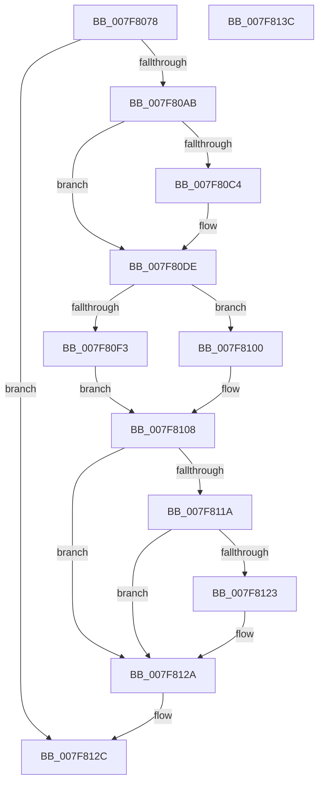

# MiIssueDllInitializeCall

- RVA: `0x007F8078`–`0x007F813D` (길이 `197` bytes)
- VA: `0x00000001407F8078`
- 실행 섹션: `PAGE`
- PDB 이름 있음: `예`; PDB Function 태그: `아니요`
- unwind 정보 RVA: `0x000718AC`
- 디코드: `57`개 명령, `197/197` bytes 표시
- 미해석 바이트: `0` (있으면 어셈블리에 `.byte`로 보존)

> 이 문서는 커널 이미지의 기계어와 PDB 기호를 분석해 생성했습니다. 4번과 5번은 함수 원형과 자료형을 바이너리 사용 방식에서 추정한 C 해석이며 원본 소스 복구 결과는 아닙니다.

## 1. Dependencies

- 직접 호출 지점: **9**; 고유 호출 대상: **9**
- 직접 호출자로 확인된 함수: **1**
- RIP 상대 이미지 참조: **1**

### Outgoing calls
- `0x007F809E` → [MiFormDllRegistryPath](MiFormDllRegistryPath_function_007F7E3C.md) (function, `0x007F7E3C`)
- `0x007F80B4` → [RtlPcToFileHeader](../../text/2F/RtlPcToFileHeader_function_002F1C50.md) (function, `0x002F1C50`)
- `0x007F80D8` → [KeBugCheckEx](../../text/4F/KeBugCheckEx_function_004FD660.md) (function, `0x004FD660`)
- `0x007F80DE` → [VfDriverInitStarting](../../pagevrfy/B9/VfDriverInitStarting_function_00B92248.md) (function, `0x00B92248`)
- `0x007F80E5` → [VfIsVerifierEnabled](../../text/4C/VfIsVerifierEnabled_function_004C72F0.md) (function, `0x004C72F0`)
- `0x007F80F9` → [DifDllInitializeWrapper](../../text/6A/DifDllInitializeWrapper_function_006AAEBC.md) (function, `0x006AAEBC`)
- `0x007F8103` → `indirect target` (indirect, 간접 대상)
- `0x007F8111` → [ExFreePoolWithTag](../../poolcode/B8/ExFreePoolWithTag_function_00B82870.md) (function, `0x00B82870`)
- `0x007F8125` → [VfDriverInitSuccess](../../pagevrfy/B9/VfDriverInitSuccess_function_00B9A484.md) (function, `0x00B9A484`)

### Direct callers
- [MmCallDllInitialize](MmCallDllInitialize_function_007F836C.md) at `0x007F8390`

### Static image references
- `0x007F811A` → RVA `0x00E2D92C` (`.data`; read)

## 2. Other-region calls and transfers

- 다른 실행 섹션으로 향하는 call: **7**
  - `0x007F80B4` → [RtlPcToFileHeader](../../text/2F/RtlPcToFileHeader_function_002F1C50.md) (`PAGE` → `.text`)
  - `0x007F80D8` → [KeBugCheckEx](../../text/4F/KeBugCheckEx_function_004FD660.md) (`PAGE` → `.text`)
  - `0x007F80DE` → [VfDriverInitStarting](../../pagevrfy/B9/VfDriverInitStarting_function_00B92248.md) (`PAGE` → `PAGEVRFY`)
  - `0x007F80E5` → [VfIsVerifierEnabled](../../text/4C/VfIsVerifierEnabled_function_004C72F0.md) (`PAGE` → `.text`)
  - `0x007F80F9` → [DifDllInitializeWrapper](../../text/6A/DifDllInitializeWrapper_function_006AAEBC.md) (`PAGE` → `.text`)
  - `0x007F8111` → [ExFreePoolWithTag](../../poolcode/B8/ExFreePoolWithTag_function_00B82870.md) (`PAGE` → `POOLCODE`)
  - `0x007F8125` → [VfDriverInitSuccess](../../pagevrfy/B9/VfDriverInitSuccess_function_00B9A484.md) (`PAGE` → `PAGEVRFY`)
- 별도 외부 분기/꼬리 이동을 확인하지 못했습니다.

## 3. Assembly (complete function range)

```asm
007F8078  48 8B C4                        mov rax, rsp
007F807B  48 89 58 08                     mov qword ptr [rax + 8], rbx
007F807F  48 89 70 10                     mov qword ptr [rax + 0x10], rsi
007F8083  57                              push rdi
007F8084  48 83 EC 40                     sub rsp, 0x40
007F8088  48 83 60 18 00                  and qword ptr [rax + 0x18], 0
007F808D  48 8B DA                        mov rbx, rdx
007F8090  0F 57 C0                        xorps xmm0, xmm0
007F8093  48 8D 50 E8                     lea rdx, [rax - 0x18]
007F8097  0F 11 40 E8                     movups xmmword ptr [rax - 0x18], xmm0
007F809B  48 8B F9                        mov rdi, rcx
007F809E  E8 99 FD FF FF                  call 0x1407f7e3c
007F80A3  85 C0                           test eax, eax
007F80A5  0F 88 81 00 00 00               js 0x1407f812c
007F80AB  48 8B 4F 30                     mov rcx, qword ptr [rdi + 0x30]
007F80AF  48 8D 54 24 60                  lea rdx, [rsp + 0x60]
007F80B4  E8 97 9B AF FF                  call 0x1402f1c50
007F80B9  48 8B 7F 30                     mov rdi, qword ptr [rdi + 0x30]
007F80BD  48 39 7C 24 60                  cmp qword ptr [rsp + 0x60], rdi
007F80C2  74 1A                           je 0x1407f80de
007F80C4  45 33 C9                        xor r9d, r9d
007F80C7  48 89 5C 24 20                  mov qword ptr [rsp + 0x20], rbx
007F80CC  45 33 C0                        xor r8d, r8d
007F80CF  B9 39 01 00 00                  mov ecx, 0x139
007F80D4  41 8D 51 0A                     lea edx, [r9 + 0xa]
007F80D8  E8 83 55 D0 FF                  call 0x1404fd660
007F80DD  CC                              int3
007F80DE  E8 65 A1 39 00                  call 0x140b92248
007F80E3  8B F0                           mov esi, eax
007F80E5  E8 06 F2 CC FF                  call 0x1404c72f0
007F80EA  48 8D 4C 24 30                  lea rcx, [rsp + 0x30]
007F80EF  85 C0                           test eax, eax
007F80F1  74 0D                           je 0x1407f8100
007F80F3  4C 8B C3                        mov r8, rbx
007F80F6  48 8B D7                        mov rdx, rdi
007F80F9  E8 BE 2D EB FF                  call 0x1406aaebc
007F80FE  EB 08                           jmp 0x1407f8108
007F8100  48 8B C3                        mov rax, rbx
007F8103  FF D0                           call rax
007F8105  0F 1F 00                        nop dword ptr [rax]
007F8108  48 8B 4C 24 38                  mov rcx, qword ptr [rsp + 0x38]
007F810D  33 D2                           xor edx, edx
007F810F  8B D8                           mov ebx, eax
007F8111  E8 5A A7 38 00                  call 0x140b82870
007F8116  85 DB                           test ebx, ebx
007F8118  78 10                           js 0x1407f812a
007F811A  80 3D 0B 58 63 00 00            cmp byte ptr [rip + 0x63580b], 0
007F8121  75 07                           jne 0x1407f812a
007F8123  8B CE                           mov ecx, esi
007F8125  E8 5A 23 3A 00                  call 0x140b9a484
007F812A  8B C3                           mov eax, ebx
007F812C  48 8B 5C 24 50                  mov rbx, qword ptr [rsp + 0x50]
007F8131  48 8B 74 24 58                  mov rsi, qword ptr [rsp + 0x58]
007F8136  48 83 C4 40                     add rsp, 0x40
007F813A  5F                              pop rdi
007F813B  C3                              ret
007F813C  CC                              int3
```

## 4. C-style interpretation (structured pseudocode)

```c
__int64 __fastcall MiIssueDllInitializeCall(__int64 a1, __int64 a2, int a3, int a4)
{
    __int64 result;
    __int64 v_rsp;
    unsigned __int64 v_stack_m10;
    unsigned __int64 v_stack_m18;
    unsigned __int64 v_stack_m28;
    unsigned __int64 v_stack_p10;
    unsigned __int64 v_stack_p18;
    unsigned __int64 v_stack_p8;

    *(unsigned __int64 *)(v_rsp + 8) = v_rbx;
    *(unsigned __int64 *)(v_rsp + 16) = v_rsi;
    v_rsp = (v_rsp) - (64);
    *(unsigned __int64 *)(v_rsp - 24) = v_xmm0;
    result = MiFormDllRegistryPath(a1, v_rsp - 24, a3, a4);
    if (sign_flag) goto loc_007F812C;
    result = RtlPcToFileHeader(*(unsigned __int64 *)(a1 + 48), v_stack_p18, a3, a4);
    if (v_stack_p18 != (*(unsigned __int64 *)(a1 + 48))) {
        a4 = 0;
        v_stack_m28 = a2;
        a3 = 0;
        a1 = 313;
        a2 = a4 + 10;
        result = KeBugCheckEx(a1, a2, a3, a4);
    }
    result = VfDriverInitStarting(a1, a2, a3, a4);
    result = VfIsVerifierEnabled(a1, a2, a3, a4);
    if ((unsigned int)(result) == 0) goto loc_007F8100;
    result = DifDllInitializeWrapper(v_stack_m18, *(unsigned __int64 *)(a1 + 48), a2, a4);
    goto loc_007F8108;
loc_007F8100:
    result = kernel_indirect_call(v_stack_m18, *(unsigned __int64 *)(a1 + 48), a2, a4);
loc_007F8108:
    a2 = 0;
    result = ExFreePoolWithTag(v_stack_m10, a2, a2, a4);
    if (sign_flag) goto loc_007F812A;
    if ((*(unsigned __int8 *)(v_rip + 6510603)) == 0) {
        a1 = (unsigned int)((unsigned int)((unsigned int)(result)));
        result = VfDriverInitSuccess(a1, a2, a2, a4);
    }
loc_007F812C:
    v_rsp = (v_rsp) + (64);
    return (unsigned int)((unsigned int)((unsigned int)((unsigned int)(result))));
}
```

## 5. (Beta) C Style

```c
int64_t MiIssueDllInitializeCall(void *Arg1, int64_t Arg2, int32_t Arg3, int32_t Arg4)
{
    uint8_t *arg1 = (uint8_t *)Arg1;

    int64_t result;
    int64_t local_rsp;
    uint64_t v_stack_m10;
    uint64_t v_stack_m18;
    uint64_t v_stack_m28;
    uint64_t v_stack_p10;
    uint64_t v_stack_p18;
    uint64_t v_stack_p8;

    *(uint64_t *)(local_rsp + 0x8) = local_rbx;
    *(uint64_t *)(local_rsp + 0x10) = local_rsi;
    local_rsp = (local_rsp) - (64);
    *(uint64_t *)(local_rsp - 0x18) = v_xmm0;
    result = MiFormDllRegistryPath(Arg1, local_rsp - 24, Arg3, Arg4);
    if (sign_flag) goto loc_007F812C;
    result = RtlPcToFileHeader(*(uint64_t *)(arg1 + 0x30), v_stack_p18, Arg3, Arg4);
    if (v_stack_p18 != (*(uint64_t *)(arg1 + 0x30))) {
        Arg4 = 0;
        v_stack_m28 = Arg2;
        Arg3 = 0;
        Arg1 = 313;
        Arg2 = Arg4 + 10;
        result = KeBugCheckEx(Arg1, Arg2, Arg3, Arg4);
    }
    result = VfDriverInitStarting(Arg1, Arg2, Arg3, Arg4);
    result = VfIsVerifierEnabled(Arg1, Arg2, Arg3, Arg4);
    if ((uint32_t)(result) == 0) goto loc_007F8100;
    result = DifDllInitializeWrapper(v_stack_m18, *(uint64_t *)(arg1 + 0x30), Arg2, Arg4);
    goto loc_007F8108;
loc_007F8100:
    result = kernel_indirect_call(v_stack_m18, *(uint64_t *)(arg1 + 0x30), Arg2, Arg4);
loc_007F8108:
    Arg2 = 0;
    result = ExFreePoolWithTag(v_stack_m10, Arg2, Arg2, Arg4);
    if (sign_flag) goto loc_007F812A;
    if ((*(uint8_t *)(v_rip + 0x63580B)) == 0) {
        Arg1 = (uint32_t)((uint32_t)((uint32_t)(result)));
        result = VfDriverInitSuccess(Arg1, Arg2, Arg2, Arg4);
    }
loc_007F812C:
    local_rsp = (local_rsp) + (64);
    return (uint32_t)((uint32_t)((uint32_t)((uint32_t)(result))));
}
```

### 관측된 메모리 오프셋

구조체 형식이 확인되지 않은 접근은 인자 기준의 오프셋으로만 기록했습니다.

| 기준 인자 | 오프셋 표현 | 폭 (bit) | 접근 |
|---|---:|---:|---|
| `Arg1` | `+ 0x30` | `64` | `R` |

## 6. Execution-region graph

[열기: 2D/3D 그래프와 함수 탐색 컨트롤 패널](../../../control-panel.html?section=page&rva=0x007F8078&view=graph)

- 2D 그래프는 위에서 아래로 흐르고, 3D 그래프는 빈 공간을 드래그해 회전합니다. Shift+드래그는 이동, 휠은 확대·축소, 함수 노드 선택은 대상 보고서 이동입니다.

### Static fallback


