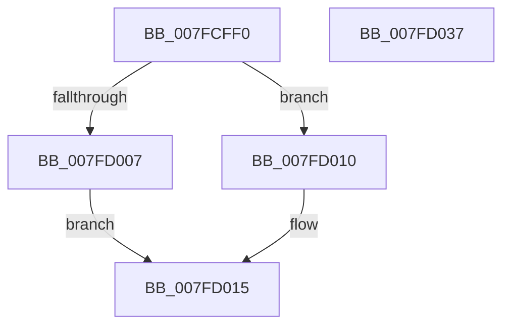

# MiLdwPopupWorker

- RVA: `0x007FCFF0`–`0x007FD038` (길이 `72` bytes)
- VA: `0x00000001407FCFF0`
- 실행 섹션: `PAGE`
- PDB 이름 있음: `예`; PDB Function 태그: `아니요`
- unwind 정보 RVA: `0x0005CAAC`
- 디코드: `22`개 명령, `72/72` bytes 표시
- 미해석 바이트: `0` (있으면 어셈블리에 `.byte`로 보존)

> 이 문서는 커널 이미지의 기계어와 PDB 기호를 분석해 생성했습니다. 4번과 5번은 함수 원형과 자료형을 바이너리 사용 방식에서 추정한 C 해석이며 원본 소스 복구 결과는 아닙니다.

## 1. Dependencies

- 직접 호출 지점: **3**; 고유 호출 대상: **3**
- 직접 호출자로 확인된 함수: **0**
- RIP 상대 이미지 참조: **0**

### Outgoing calls
- `0x007FD009` → [ExFreePoolWithTag](../../poolcode/B8/ExFreePoolWithTag_function_00B82870.md) (function, `0x00B82870`)
- `0x007FD01A` → [CcMmLogLostDelayedWriteError](../../text/4C/CcMmLogLostDelayedWriteError_function_004C6C60.md) (function, `0x004C6C60`)
- `0x007FD027` → [ObfDereferenceObjectWithTag](../../text/2F/ObfDereferenceObjectWithTag_function_002F78E0.md) (function, `0x002F78E0`)

### Direct callers
- 이 함수 시작 RVA로 연결되는 직접 call은 확인되지 않았습니다. 간접 호출은 완전히 역산할 수 없습니다.

### Static image references
- 디코드된 RIP-relative 메모리 참조가 없습니다.

## 2. Other-region calls and transfers

- 다른 실행 섹션으로 향하는 call: **3**
  - `0x007FD009` → [ExFreePoolWithTag](../../poolcode/B8/ExFreePoolWithTag_function_00B82870.md) (`PAGE` → `POOLCODE`)
  - `0x007FD01A` → [CcMmLogLostDelayedWriteError](../../text/4C/CcMmLogLostDelayedWriteError_function_004C6C60.md) (`PAGE` → `.text`)
  - `0x007FD027` → [ObfDereferenceObjectWithTag](../../text/2F/ObfDereferenceObjectWithTag_function_002F78E0.md) (`PAGE` → `.text`)
- 별도 외부 분기/꼬리 이동을 확인하지 못했습니다.

## 3. Assembly (complete function range)

```asm
007FCFF0  48 89 5C 24 08                  mov qword ptr [rsp + 8], rbx
007FCFF5  57                              push rdi
007FCFF6  48 83 EC 20                     sub rsp, 0x20
007FCFFA  80 79 30 00                     cmp byte ptr [rcx + 0x30], 0
007FCFFE  48 8B 59 20                     mov rbx, qword ptr [rcx + 0x20]
007FD002  8B 79 28                        mov edi, dword ptr [rcx + 0x28]
007FD005  74 09                           je 0x1407fd010
007FD007  33 D2                           xor edx, edx
007FD009  E8 62 58 38 00                  call 0x140b82870
007FD00E  EB 05                           jmp 0x1407fd015
007FD010  F0 83 61 2C 00                  lock and dword ptr [rcx + 0x2c], 0
007FD015  8B D7                           mov edx, edi
007FD017  48 8B CB                        mov rcx, rbx
007FD01A  E8 41 9C CC FF                  call 0x1404c6c60
007FD01F  BA 4D 6D 4C 64                  mov edx, 0x644c6d4d
007FD024  48 8B CB                        mov rcx, rbx
007FD027  E8 B4 A8 AF FF                  call 0x1402f78e0
007FD02C  48 8B 5C 24 30                  mov rbx, qword ptr [rsp + 0x30]
007FD031  48 83 C4 20                     add rsp, 0x20
007FD035  5F                              pop rdi
007FD036  C3                              ret
007FD037  CC                              int3
```

## 4. C-style interpretation (structured pseudocode)

```c
__int64 __fastcall MiLdwPopupWorker(__int64 a1, int a2)
{
    __int64 result;
    __int64 v_rsp;
    unsigned __int64 v_stack_p8;

    v_stack_p8 = v_rbx;
    v_rsp = (v_rsp) - (32);
    if ((*(unsigned __int8 *)(a1 + 48)) == 0) goto loc_007FD010;
    a2 = 0;
    result = ExFreePoolWithTag(a1, a2, a3, a4);
    goto loc_007FD015;
loc_007FD010:
loc_007FD015:
    result = CcMmLogLostDelayedWriteError(*(unsigned __int64 *)(a1 + 32), (unsigned int)((unsigned int)((unsigned int)(*(unsigned int *)(a1 + 40)))), a3, a4);
    result = ObfDereferenceObjectWithTag(*(unsigned __int64 *)(a1 + 32), (unsigned int)(0x644C6D4DULL), a3, a4);
    v_rsp = (v_rsp) + (32);
    return result;
}
```

## 5. (Beta) C Style

```c
int64_t MiLdwPopupWorker(void *Arg1, int32_t Arg2)
{
    uint8_t *arg1 = (uint8_t *)Arg1;

    int64_t result;
    int64_t local_rsp;
    uint64_t v_stack_p8;

    v_stack_p8 = local_rbx;
    local_rsp = (local_rsp) - (32);
    if ((*(uint8_t *)(arg1 + 0x30)) == 0) goto loc_007FD010;
    Arg2 = 0;
    result = ExFreePoolWithTag(Arg1, Arg2, a3, a4);
    goto loc_007FD015;
loc_007FD010:
loc_007FD015:
    result = CcMmLogLostDelayedWriteError(*(uint64_t *)(arg1 + 0x20), (uint32_t)((uint32_t)((uint32_t)(*(uint32_t *)(arg1 + 0x28)))), a3, a4);
    result = ObfDereferenceObjectWithTag(*(uint64_t *)(arg1 + 0x20), (uint32_t)(0x644C6D4DULL), a3, a4);
    local_rsp = (local_rsp) + (32);
    return result;
}
```

### 관측된 메모리 오프셋

구조체 형식이 확인되지 않은 접근은 인자 기준의 오프셋으로만 기록했습니다.

| 기준 인자 | 오프셋 표현 | 폭 (bit) | 접근 |
|---|---:|---:|---|
| `Arg1` | `+ 0x20` | `64` | `R` |
| `Arg1` | `+ 0x28` | `32` | `R` |
| `Arg1` | `+ 0x2C` | `32` | `R/W` |
| `Arg1` | `+ 0x30` | `8` | `R` |

## 6. Execution-region graph

[열기: 2D/3D 그래프와 함수 탐색 컨트롤 패널](../../../control-panel.html?section=page&rva=0x007FCFF0&view=graph)

- 2D 그래프는 위에서 아래로 흐르고, 3D 그래프는 빈 공간을 드래그해 회전합니다. Shift+드래그는 이동, 휠은 확대·축소, 함수 노드 선택은 대상 보고서 이동입니다.

### Static fallback


