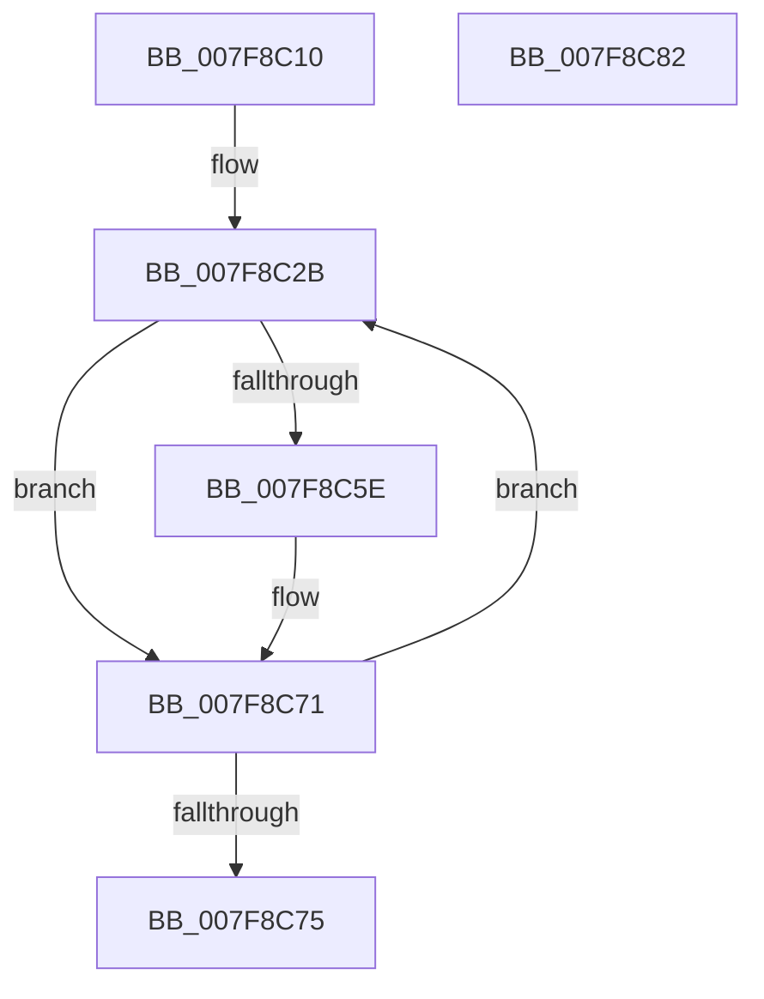

# MiLockRegistryRecoverySection

- RVA: `0x007F8C10`–`0x007F8C83` (길이 `115` bytes)
- VA: `0x00000001407F8C10`
- 실행 섹션: `PAGE`
- PDB 이름 있음: `예`; PDB Function 태그: `아니요`
- unwind 정보 RVA: `0x0006E5F8`
- 디코드: `32`개 명령, `115/115` bytes 표시
- 미해석 바이트: `0` (있으면 어셈블리에 `.byte`로 보존)

> 이 문서는 커널 이미지의 기계어와 PDB 기호를 분석해 생성했습니다. 4번과 5번은 함수 원형과 자료형을 바이너리 사용 방식에서 추정한 C 해석이며 원본 소스 복구 결과는 아닙니다.

## 1. Dependencies

- 직접 호출 지점: **2**; 고유 호출 대상: **2**
- 직접 호출자로 확인된 함수: **0**
- RIP 상대 이미지 참조: **0**

### Outgoing calls
- `0x007F8C4D` → [MiSnapDriverRange](../A4/MiSnapDriverRange_function_00A4B328.md) (function, `0x00A4B328`)
- `0x007F8C6C` → [MiLockCode](../../text/36/MiLockCode_function_0036F91C.md) (function, `0x0036F91C`)

### Direct callers
- 이 함수 시작 RVA로 연결되는 직접 call은 확인되지 않았습니다. 간접 호출은 완전히 역산할 수 없습니다.

### Static image references
- 디코드된 RIP-relative 메모리 참조가 없습니다.

## 2. Other-region calls and transfers

- 다른 실행 섹션으로 향하는 call: **1**
  - `0x007F8C6C` → [MiLockCode](../../text/36/MiLockCode_function_0036F91C.md) (`PAGE` → `.text`)
- 별도 외부 분기/꼬리 이동을 확인하지 못했습니다.

## 3. Assembly (complete function range)

```asm
007F8C10  48 89 5C 24 08                  mov qword ptr [rsp + 8], rbx
007F8C15  57                              push rdi
007F8C16  48 83 EC 30                     sub rsp, 0x30
007F8C1A  48 83 64 24 50 00               and qword ptr [rsp + 0x50], 0
007F8C20  48 8B F9                        mov rdi, rcx
007F8C23  48 83 64 24 58 00               and qword ptr [rsp + 0x58], 0
007F8C29  33 DB                           xor ebx, ebx
007F8C2B  48 8D 44 24 58                  lea rax, [rsp + 0x58]
007F8C30  45 33 C9                        xor r9d, r9d
007F8C33  48 89 44 24 28                  mov qword ptr [rsp + 0x28], rax
007F8C38  41 B8 80 00 00 00               mov r8d, 0x80
007F8C3E  48 8D 44 24 50                  lea rax, [rsp + 0x50]
007F8C43  8B D3                           mov edx, ebx
007F8C45  48 8B CF                        mov rcx, rdi
007F8C48  48 89 44 24 20                  mov qword ptr [rsp + 0x20], rax
007F8C4D  E8 D6 26 25 00                  call 0x140a4b328
007F8C52  48 8B 54 24 50                  mov rdx, qword ptr [rsp + 0x50]
007F8C57  8B D8                           mov ebx, eax
007F8C59  48 85 D2                        test rdx, rdx
007F8C5C  74 13                           je 0x1407f8c71
007F8C5E  4C 8B 44 24 58                  mov r8, qword ptr [rsp + 0x58]
007F8C63  41 B9 02 00 00 00               mov r9d, 2
007F8C69  48 8B CF                        mov rcx, rdi
007F8C6C  E8 AB 6C B7 FF                  call 0x14036f91c
007F8C71  85 DB                           test ebx, ebx
007F8C73  75 B6                           jne 0x1407f8c2b
007F8C75  48 8B 5C 24 40                  mov rbx, qword ptr [rsp + 0x40]
007F8C7A  33 C0                           xor eax, eax
007F8C7C  48 83 C4 30                     add rsp, 0x30
007F8C80  5F                              pop rdi
007F8C81  C3                              ret
007F8C82  CC                              int3
```

## 4. C-style interpretation (structured pseudocode)

```c
__int64 __fastcall MiLockRegistryRecoverySection(__int64 a1, __int64 a2, __int64 a3, int a4)
{
    __int64 result;
    __int64 v_rbx;
    __int64 v_rsp;
    unsigned __int64 v_stack_m10;
    unsigned __int64 v_stack_m18;
    unsigned __int64 v_stack_p18;
    unsigned __int64 v_stack_p20;
    unsigned __int64 v_stack_p8;

    v_stack_p8 = v_rbx;
    v_rsp = (v_rsp) - (48);
    v_rbx = 0;
loc_007F8C2B:
    a4 = 0;
    v_stack_m10 = v_stack_p20;
    v_stack_m18 = v_stack_p18;
    result = MiSnapDriverRange(a1, 0, 128, a4);
    if (v_stack_p18 != 0) {
        a3 = v_stack_p20;
        a4 = 2;
        a1 = a1;
        result = MiLockCode(a1, v_stack_p18, a3, a4);
    }
    if ((unsigned int)((unsigned int)((unsigned int)(result))) != 0) goto loc_007F8C2B;
    result = 0;
    v_rsp = (v_rsp) + (48);
    return result;
}
```

## 5. (Beta) C Style

```c
int64_t MiLockRegistryRecoverySection(int64_t Arg1, int64_t Arg2, int64_t Arg3, int32_t Arg4)
{
    int64_t result;
    int64_t local_rbx;
    int64_t local_rsp;
    uint64_t v_stack_m10;
    uint64_t v_stack_m18;
    uint64_t v_stack_p18;
    uint64_t v_stack_p20;
    uint64_t v_stack_p8;

    v_stack_p8 = local_rbx;
    local_rsp = (local_rsp) - (48);
    local_rbx = 0;
loc_007F8C2B:
    Arg4 = 0;
    v_stack_m10 = v_stack_p20;
    v_stack_m18 = v_stack_p18;
    result = MiSnapDriverRange(Arg1, 0, 128, Arg4);
    if (v_stack_p18 != 0) {
        Arg3 = v_stack_p20;
        Arg4 = 2;
        Arg1 = Arg1;
        result = MiLockCode(Arg1, v_stack_p18, Arg3, Arg4);
    }
    if ((uint32_t)((uint32_t)((uint32_t)(result))) != 0) goto loc_007F8C2B;
    result = 0;
    local_rsp = (local_rsp) + (48);
    return result;
}
```

## 6. Execution-region graph

[열기: 2D/3D 그래프와 함수 탐색 컨트롤 패널](../../../control-panel.html?section=page&rva=0x007F8C10&view=graph)

- 2D 그래프는 위에서 아래로 흐르고, 3D 그래프는 빈 공간을 드래그해 회전합니다. Shift+드래그는 이동, 휠은 확대·축소, 함수 노드 선택은 대상 보고서 이동입니다.

### Static fallback


