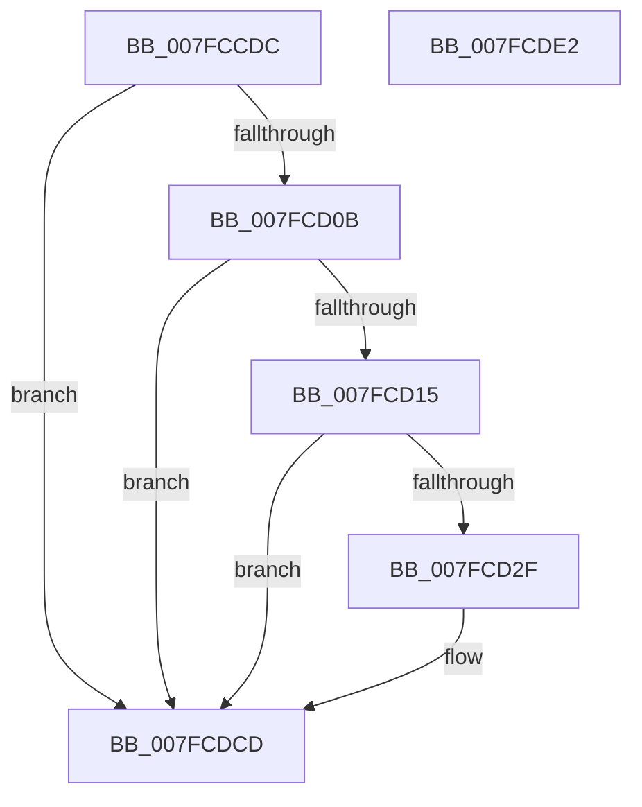

# MiLogCreateImageFileMapFailure

- RVA: `0x007FCCDC`–`0x007FCDE3` (길이 `263` bytes)
- VA: `0x00000001407FCCDC`
- 실행 섹션: `PAGE`
- PDB 이름 있음: `예`; PDB Function 태그: `아니요`
- unwind 정보 RVA: `0x000B43CC`
- 디코드: `60`개 명령, `263/263` bytes 표시
- 미해석 바이트: `0` (있으면 어셈블리에 `.byte`로 보존)

> 이 문서는 커널 이미지의 기계어와 PDB 기호를 분석해 생성했습니다. 4번과 5번은 함수 원형과 자료형을 바이너리 사용 방식에서 추정한 C 해석이며 원본 소스 복구 결과는 아닙니다.

## 1. Dependencies

- 직접 호출 지점: **4**; 고유 호출 대상: **4**
- 직접 호출자로 확인된 함수: **1**
- RIP 상대 이미지 참조: **4**

### Outgoing calls
- `0x007FCD22` → [tlgKeywordOn](../../text/42/tlgKeywordOn_function_0042EAA0.md) (function, `0x0042EAA0`)
- `0x007FCD3A` → [tlgCreate1Sz_char](../../text/42/tlgCreate1Sz_char_function_00427304.md) (function, `0x00427304`)
- `0x007FCDC8` → [tlgWriteEx_EtwWriteEx](../../text/4A/tlgWriteEx_EtwWriteEx_function_004AA348.md) (function, `0x004AA348`)
- `0x007FCDD4` → [_security_check_cookie](../../text/6A/_security_check_cookie_function_006AC640.md) (function, `0x006AC640`)

### Direct callers
- [MiCreateImageFileMap](../98/MiCreateImageFileMap_function_00986830.md) at `0x00986F8A`

### Static image references
- `0x007FCCEA` → RVA `0x00E0A740` (`.data`; read)
- `0x007FCCF8` → RVA `0x00E37618` (`.data`; read)
- `0x007FCD2F` → RVA `0x00B09F90` (` ?? ::NNGAKEGL::`string'`; read)
- `0x007FCD4B` → RVA `0x00057ECD` (`.rdata`; read)

## 2. Other-region calls and transfers

- 다른 실행 섹션으로 향하는 call: **4**
  - `0x007FCD22` → [tlgKeywordOn](../../text/42/tlgKeywordOn_function_0042EAA0.md) (`PAGE` → `.text`)
  - `0x007FCD3A` → [tlgCreate1Sz_char](../../text/42/tlgCreate1Sz_char_function_00427304.md) (`PAGE` → `.text`)
  - `0x007FCDC8` → [tlgWriteEx_EtwWriteEx](../../text/4A/tlgWriteEx_EtwWriteEx_function_004AA348.md) (`PAGE` → `.text`)
  - `0x007FCDD4` → [_security_check_cookie](../../text/6A/_security_check_cookie_function_006AC640.md) (`PAGE` → `.text`)
- 별도 외부 분기/꼬리 이동을 확인하지 못했습니다.

## 3. Assembly (complete function range)

```asm
007FCCDC  40 55                           push rbp
007FCCDE  48 8D 6C 24 A9                  lea rbp, [rsp - 0x57]
007FCCE3  48 81 EC E0 00 00 00            sub rsp, 0xe0
007FCCEA  48 8B 05 4F DA 60 00            mov rax, qword ptr [rip + 0x60da4f]
007FCCF1  48 33 C4                        xor rax, rsp
007FCCF4  48 89 45 47                     mov qword ptr [rbp + 0x47], rax
007FCCF8  4C 8B 15 19 A9 63 00            mov r10, qword ptr [rip + 0x63a919]
007FCCFF  4C 8B DA                        mov r11, rdx
007FCD02  4D 85 D2                        test r10, r10
007FCD05  0F 84 C2 00 00 00               je 0x1407fcdcd
007FCD0B  41 83 3A 02                     cmp dword ptr [r10], 2
007FCD0F  0F 86 B8 00 00 00               jbe 0x1407fcdcd
007FCD15  48 BA 00 40 00 00 00 40 00 00   movabs rdx, 0x400000004000
007FCD1F  49 8B CA                        mov rcx, r10
007FCD22  E8 79 1D C3 FF                  call 0x14042eaa0
007FCD27  84 C0                           test al, al
007FCD29  0F 84 9E 00 00 00               je 0x1407fcdcd
007FCD2F  48 8D 15 5A D2 30 00            lea rdx, [rip + 0x30d25a]
007FCD36  48 8D 4D E7                     lea rcx, [rbp - 0x19]
007FCD3A  E8 C5 A5 C2 FF                  call 0x140427304
007FCD3F  83 65 03 00                     and dword ptr [rbp + 3], 0
007FCD43  48 8D 45 0F                     lea rax, [rbp + 0xf]
007FCD47  83 65 13 00                     and dword ptr [rbp + 0x13], 0
007FCD4B  48 8D 15 7B B1 85 FF            lea rdx, [rip - 0x7a4e85]
007FCD52  83 65 23 00                     and dword ptr [rbp + 0x23], 0
007FCD56  B9 04 00 00 00                  mov ecx, 4
007FCD5B  83 65 33 00                     and dword ptr [rbp + 0x33], 0
007FCD5F  83 65 43 00                     and dword ptr [rbp + 0x43], 0
007FCD63  48 89 45 F7                     mov qword ptr [rbp - 9], rax
007FCD67  49 8B 43 60                     mov rax, qword ptr [r11 + 0x60]
007FCD6B  48 89 45 07                     mov qword ptr [rbp + 7], rax
007FCD6F  41 0F B7 43 58                  movzx eax, word ptr [r11 + 0x58]
007FCD74  89 45 0F                        mov dword ptr [rbp + 0xf], eax
007FCD77  48 8D 45 B7                     lea rax, [rbp - 0x49]
007FCD7B  48 89 45 17                     mov qword ptr [rbp + 0x17], rax
007FCD7F  48 8D 45 BB                     lea rax, [rbp - 0x45]
007FCD83  48 89 45 27                     mov qword ptr [rbp + 0x27], rax
007FCD87  48 8D 45 BF                     lea rax, [rbp - 0x41]
007FCD8B  89 4D 1F                        mov dword ptr [rbp + 0x1f], ecx
007FCD8E  89 4D 2F                        mov dword ptr [rbp + 0x2f], ecx
007FCD91  B9 08 00 00 00                  mov ecx, 8
007FCD96  48 89 45 37                     mov qword ptr [rbp + 0x37], rax
007FCD9A  48 8D 45 C7                     lea rax, [rbp - 0x39]
007FCD9E  48 89 44 24 38                  mov qword ptr [rsp + 0x38], rax
007FCDA3  44 89 4D BB                     mov dword ptr [rbp - 0x45], r9d
007FCDA7  89 4C 24 30                     mov dword ptr [rsp + 0x30], ecx
007FCDAB  44 8D 49 F9                     lea r9d, [rcx - 7]
007FCDAF  89 4D 3F                        mov dword ptr [rbp + 0x3f], ecx
007FCDB2  49 8B CA                        mov rcx, r10
007FCDB5  C7 45 FF 02 00 00 00            mov dword ptr [rbp - 1], 2
007FCDBC  44 89 45 B7                     mov dword ptr [rbp - 0x49], r8d
007FCDC0  48 C7 45 BF 00 00 00 01         mov qword ptr [rbp - 0x41], 0x1000000
007FCDC8  E8 7B D5 CA FF                  call 0x1404aa348
007FCDCD  48 8B 4D 47                     mov rcx, qword ptr [rbp + 0x47]
007FCDD1  48 33 CC                        xor rcx, rsp
007FCDD4  E8 67 F8 EA FF                  call 0x1406ac640
007FCDD9  48 81 C4 E0 00 00 00            add rsp, 0xe0
007FCDE0  5D                              pop rbp
007FCDE1  C3                              ret
007FCDE2  CC                              int3
```

## 4. C-style interpretation (structured pseudocode)

```c
__int64 __fastcall MiLogCreateImageFileMapFailure(__int64 a1, __int64 a2, int a3, int a4)
{
    __int64 result;
    __int64 v_rsp;
    unsigned __int64 v_stack_m18;
    unsigned int v_stack_m1C;
    unsigned int v_stack_m20;
    unsigned __int64 v_stack_m28;
    unsigned int v_stack_m2C;
    unsigned int v_stack_m30;
    unsigned __int64 v_stack_m38;
    unsigned int v_stack_m3C;
    unsigned int v_stack_m40;
    unsigned __int64 v_stack_m48;
    unsigned int v_stack_m4C;
    unsigned __int64 v_stack_m50;
    unsigned __int64 v_stack_m58;
    unsigned int v_stack_m5C;
    unsigned __int64 v_stack_m5F;
    unsigned int v_stack_m60;
    unsigned __int64 v_stack_m68;
    unsigned __int64 v_stack_m78;
    unsigned __int64 v_stack_m98;
    unsigned __int64 v_stack_mA0;
    unsigned __int64 v_stack_mA4;
    unsigned __int64 v_stack_mA8;
    unsigned __int64 v_stack_mB0;
    unsigned int v_stack_mB8;

    v_rsp = (v_rsp) - (224);
    result = (*(unsigned __int64 *)(v_rip + 6347343)) ^ (v_rsp);
    v_stack_m18 = result;
    if (*(unsigned __int64 *)(v_rip + 6531353) == 0) goto loc_007FCDCD;
    if ((*(unsigned int *)(*(unsigned __int64 *)(v_rip + 6531353))) <= 2) goto loc_007FCDCD;
    result = tlgKeywordOn(*(unsigned __int64 *)(v_rip + 6531353), a2, a3, a4);
    if ((unsigned __int8)(result) != 0) {
        a2 = v_rip + 3199578;
        a1 = v_stack_m78;
        result = tlgCreate1Sz_char(a1, a2, a3, a4);
        result = v_stack_m50;
        a2 = v_rip - 8015493;
        a1 = 4;
        v_stack_m68 = result;
        result = *(unsigned __int64 *)(a2 + 96);
        v_stack_m58 = result;
        result = *(unsigned __int16 *)(a2 + 88);
        v_stack_m50 = (unsigned int)(result);
        result = v_stack_mA8;
        v_stack_m48 = result;
        result = v_stack_mA4;
        v_stack_m38 = result;
        result = v_stack_mA0;
        v_stack_m40 = (unsigned int)(a1);
        v_stack_m30 = (unsigned int)(a1);
        a1 = 8;
        v_stack_m28 = result;
        result = v_stack_m98;
        v_stack_mB0 = result;
        v_stack_mA4 = a4;
        v_stack_mB8 = (unsigned int)(a1);
        a4 = a1 - 7;
        v_stack_m20 = (unsigned int)(a1);
        a1 = *(unsigned __int64 *)(v_rip + 6531353);
        v_stack_m60 = 2;
        v_stack_mA8 = a3;
        v_stack_mA0 = 0x1000000ULL;
        result = tlgWriteEx_EtwWriteEx(a1, a2, a3, a4);
    }
    a1 = (v_stack_m18) ^ (v_rsp);
    result = _security_check_cookie(a1, a2, a3, a4);
    v_rsp = (v_rsp) + (224);
    return result;
}
```

## 5. (Beta) C Style

```c
int64_t MiLogCreateImageFileMapFailure(int64_t Arg1, int64_t Arg2, int32_t Arg3, int32_t Arg4)
{
    int64_t result;
    int64_t local_rsp;
    uint64_t v_stack_m18;
    uint32_t v_stack_m1C;
    uint32_t v_stack_m20;
    uint64_t v_stack_m28;
    uint32_t v_stack_m2C;
    uint32_t v_stack_m30;
    uint64_t v_stack_m38;
    uint32_t v_stack_m3C;
    uint32_t v_stack_m40;
    uint64_t v_stack_m48;
    uint32_t v_stack_m4C;
    uint64_t v_stack_m50;
    uint64_t v_stack_m58;
    uint32_t v_stack_m5C;
    uint64_t v_stack_m5F;
    uint32_t v_stack_m60;
    uint64_t v_stack_m68;
    uint64_t v_stack_m78;
    uint64_t v_stack_m98;
    uint64_t v_stack_mA0;
    uint64_t v_stack_mA4;
    uint64_t v_stack_mA8;
    uint64_t v_stack_mB0;
    uint32_t v_stack_mB8;

    local_rsp = (local_rsp) - (224);
    result = (*(uint64_t *)(v_rip + 0x60DA4F)) ^ (local_rsp);
    v_stack_m18 = result;
    if (*(uint64_t *)(v_rip + 0x63A919) == 0) goto loc_007FCDCD;
    if ((*(uint32_t *)(*(uint64_t *)(v_rip + 0x63A919))) <= 2) goto loc_007FCDCD;
    result = tlgKeywordOn(*(uint64_t *)(v_rip + 0x63A919), Arg2, Arg3, Arg4);
    if ((uint8_t)(result) != 0) {
        Arg2 = v_rip + 3199578;
        Arg1 = v_stack_m78;
        result = tlgCreate1Sz_char(Arg1, Arg2, Arg3, Arg4);
        result = v_stack_m50;
        Arg2 = v_rip - 8015493;
        Arg1 = 4;
        v_stack_m68 = result;
        result = *(uint64_t *)(Arg2 + 0x60);
        v_stack_m58 = result;
        result = *(uint16_t *)(Arg2 + 0x58);
        v_stack_m50 = (uint32_t)(result);
        result = v_stack_mA8;
        v_stack_m48 = result;
        result = v_stack_mA4;
        v_stack_m38 = result;
        result = v_stack_mA0;
        v_stack_m40 = (uint32_t)(Arg1);
        v_stack_m30 = (uint32_t)(Arg1);
        Arg1 = 8;
        v_stack_m28 = result;
        result = v_stack_m98;
        v_stack_mB0 = result;
        v_stack_mA4 = Arg4;
        v_stack_mB8 = (uint32_t)(Arg1);
        Arg4 = Arg1 - 7;
        v_stack_m20 = (uint32_t)(Arg1);
        Arg1 = *(uint64_t *)(v_rip + 0x63A919);
        v_stack_m60 = 2;
        v_stack_mA8 = Arg3;
        v_stack_mA0 = 0x1000000ULL;
        result = tlgWriteEx_EtwWriteEx(Arg1, Arg2, Arg3, Arg4);
    }
    Arg1 = (v_stack_m18) ^ (local_rsp);
    result = _security_check_cookie(Arg1, Arg2, Arg3, Arg4);
    local_rsp = (local_rsp) + (224);
    return result;
}
```

## 6. Execution-region graph

[열기: 2D/3D 그래프와 함수 탐색 컨트롤 패널](../../../control-panel.html?section=page&rva=0x007FCCDC&view=graph)

- 2D 그래프는 위에서 아래로 흐르고, 3D 그래프는 빈 공간을 드래그해 회전합니다. Shift+드래그는 이동, 휠은 확대·축소, 함수 노드 선택은 대상 보고서 이동입니다.

### Static fallback


