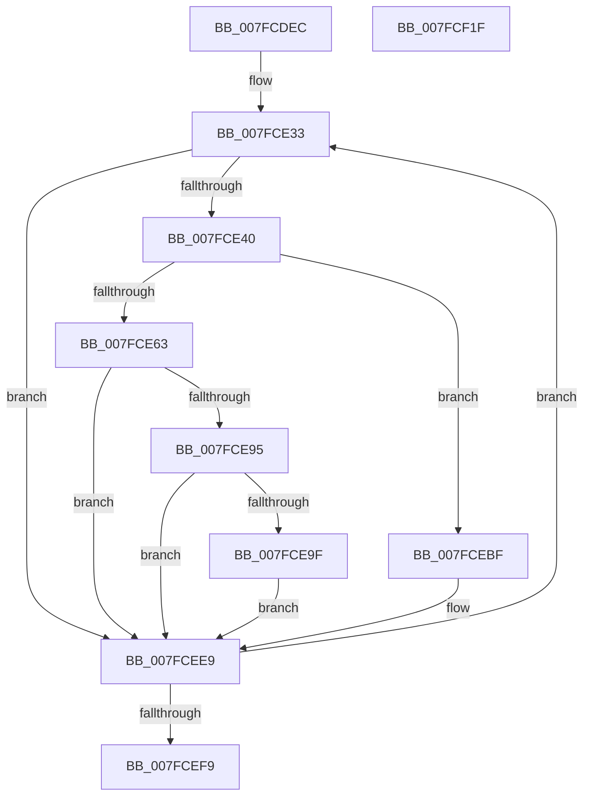

# MiLogSectionCreate

- RVA: `0x007FCDEC`–`0x007FCF20` (길이 `308` bytes)
- VA: `0x00000001407FCDEC`
- 실행 섹션: `PAGE`
- PDB 이름 있음: `예`; PDB Function 태그: `아니요`
- unwind 정보 RVA: `0x000D7D60`
- 디코드: `78`개 명령, `308/308` bytes 표시
- 미해석 바이트: `0` (있으면 어셈블리에 `.byte`로 보존)

> 이 문서는 커널 이미지의 기계어와 PDB 기호를 분석해 생성했습니다. 4번과 5번은 함수 원형과 자료형을 바이너리 사용 방식에서 추정한 C 해석이며 원본 소스 복구 결과는 아닙니다.

## 1. Dependencies

- 직접 호출 지점: **5**; 고유 호출 대상: **4**
- 직접 호출자로 확인된 함수: **2**
- RIP 상대 이미지 참조: **2**

### Outgoing calls
- `0x007FCE88` → [EtwTraceKernelEvent](../../text/23/EtwTraceKernelEvent_function_00235350.md) (function, `0x00235350`)
- `0x007FCEA7` → [MiInitPerfMemoryFlags](../../text/4F/MiInitPerfMemoryFlags_function_004FBDCC.md) (function, `0x004FBDCC`)
- `0x007FCEB8` → [MiLogPerfMemoryRangeEvent](../../text/4D/MiLogPerfMemoryRangeEvent_function_004D9D7C.md) (function, `0x004D9D7C`)
- `0x007FCEE4` → [EtwTraceKernelEvent](../../text/23/EtwTraceKernelEvent_function_00235350.md) (function, `0x00235350`)
- `0x007FCF00` → [_security_check_cookie](../../text/6A/_security_check_cookie_function_006AC640.md) (function, `0x006AC640`)

### Direct callers
- [MiCreatePagingFileMap](../98/MiCreatePagingFileMap_function_009852F8.md) at `0x00985B4E`
- [MiSegmentDelete](../A1/MiSegmentDelete_function_00A1FBB4.md) at `0x00A1FD23`

### Static image references
- `0x007FCE07` → RVA `0x00E0A740` (`.data`; read)
- `0x007FCE95` → RVA `0x00FC6B04` (`ALMOSTRO`; read)

## 2. Other-region calls and transfers

- 다른 실행 섹션으로 향하는 call: **5**
  - `0x007FCE88` → [EtwTraceKernelEvent](../../text/23/EtwTraceKernelEvent_function_00235350.md) (`PAGE` → `.text`)
  - `0x007FCEA7` → [MiInitPerfMemoryFlags](../../text/4F/MiInitPerfMemoryFlags_function_004FBDCC.md) (`PAGE` → `.text`)
  - `0x007FCEB8` → [MiLogPerfMemoryRangeEvent](../../text/4D/MiLogPerfMemoryRangeEvent_function_004D9D7C.md) (`PAGE` → `.text`)
  - `0x007FCEE4` → [EtwTraceKernelEvent](../../text/23/EtwTraceKernelEvent_function_00235350.md) (`PAGE` → `.text`)
  - `0x007FCF00` → [_security_check_cookie](../../text/6A/_security_check_cookie_function_006AC640.md) (`PAGE` → `.text`)
- 별도 외부 분기/꼬리 이동을 확인하지 못했습니다.

## 3. Assembly (complete function range)

```asm
007FCDEC  48 89 5C 24 10                  mov qword ptr [rsp + 0x10], rbx
007FCDF1  48 89 74 24 18                  mov qword ptr [rsp + 0x18], rsi
007FCDF6  48 89 7C 24 20                  mov qword ptr [rsp + 0x20], rdi
007FCDFB  55                              push rbp
007FCDFC  41 56                           push r14
007FCDFE  41 57                           push r15
007FCE00  48 8B EC                        mov rbp, rsp
007FCE03  48 83 EC 70                     sub rsp, 0x70
007FCE07  48 8B 05 32 D9 60 00            mov rax, qword ptr [rip + 0x60d932]
007FCE0E  48 33 C4                        xor rax, rsp
007FCE11  48 89 45 F8                     mov qword ptr [rbp - 8], rax
007FCE15  48 8B 31                        mov rsi, qword ptr [rcx]
007FCE18  48 8D 99 80 00 00 00            lea rbx, [rcx + 0x80]
007FCE1F  0F 57 C0                        xorps xmm0, xmm0
007FCE22  33 C0                           xor eax, eax
007FCE24  0F 11 45 C0                     movups xmmword ptr [rbp - 0x40], xmm0
007FCE28  48 89 45 D0                     mov qword ptr [rbp - 0x30], rax
007FCE2C  44 8B F2                        mov r14d, edx
007FCE2F  44 8B 7E 30                     mov r15d, dword ptr [rsi + 0x30]
007FCE33  48 8B 7B 08                     mov rdi, qword ptr [rbx + 8]
007FCE37  48 85 FF                        test rdi, rdi
007FCE3A  0F 84 A9 00 00 00               je 0x1407fcee9
007FCE40  8B 43 2C                        mov eax, dword ptr [rbx + 0x2c]
007FCE43  BA 01 00 00 00                  mov edx, 1
007FCE48  48 89 7D C0                     mov qword ptr [rbp - 0x40], rdi
007FCE4C  41 B8 01 00 40 20               mov r8d, 0x20400001
007FCE52  48 8D 0C C7                     lea rcx, [rdi + rax*8]
007FCE56  48 89 4D C8                     mov qword ptr [rbp - 0x38], rcx
007FCE5A  48 8D 45 C0                     lea rax, [rbp - 0x40]
007FCE5E  45 85 F6                        test r14d, r14d
007FCE61  74 5C                           je 0x1407fcebf
007FCE63  83 65 E4 00                     and dword ptr [rbp - 0x1c], 0
007FCE67  48 8D 4D D8                     lea rcx, [rbp - 0x28]
007FCE6B  41 B9 49 02 00 00               mov r9d, 0x249
007FCE71  44 89 7D D0                     mov dword ptr [rbp - 0x30], r15d
007FCE75  48 89 45 D8                     mov qword ptr [rbp - 0x28], rax
007FCE79  C7 45 E0 18 00 00 00            mov dword ptr [rbp - 0x20], 0x18
007FCE80  C7 44 24 20 02 19 50 00         mov dword ptr [rsp + 0x20], 0x501902
007FCE88  E8 C3 84 A3 FF                  call 0x140235350
007FCE8D  66 0F BA 66 0C 0A               bt word ptr [rsi + 0xc], 0xa
007FCE93  73 54                           jae 0x1407fcee9
007FCE95  8B 05 69 9C 7C 00               mov eax, dword ptr [rip + 0x7c9c69]
007FCE9B  A8 01                           test al, 1
007FCE9D  74 4A                           je 0x1407fcee9
007FCE9F  BA 02 00 00 00                  mov edx, 2
007FCEA4  8D 4A FF                        lea ecx, [rdx - 1]
007FCEA7  E8 20 EF CF FF                  call 0x1404fbdcc
007FCEAC  44 8B 4B 2C                     mov r9d, dword ptr [rbx + 0x2c]
007FCEB0  44 8B C0                        mov r8d, eax
007FCEB3  33 D2                           xor edx, edx
007FCEB5  48 8B CF                        mov rcx, rdi
007FCEB8  E8 BF CE CD FF                  call 0x1404d9d7c
007FCEBD  EB 2A                           jmp 0x1407fcee9
007FCEBF  83 4D D0 FF                     or dword ptr [rbp - 0x30], 0xffffffff
007FCEC3  48 8D 4D E8                     lea rcx, [rbp - 0x18]
007FCEC7  83 65 F4 00                     and dword ptr [rbp - 0xc], 0
007FCECB  41 B9 4F 02 00 00               mov r9d, 0x24f
007FCED1  48 89 45 E8                     mov qword ptr [rbp - 0x18], rax
007FCED5  C7 45 F0 18 00 00 00            mov dword ptr [rbp - 0x10], 0x18
007FCEDC  C7 44 24 20 02 19 50 01         mov dword ptr [rsp + 0x20], 0x1501902
007FCEE4  E8 67 84 A3 FF                  call 0x140235350
007FCEE9  48 8B 43 10                     mov rax, qword ptr [rbx + 0x10]
007FCEED  48 8B D8                        mov rbx, rax
007FCEF0  48 85 C0                        test rax, rax
007FCEF3  0F 85 3A FF FF FF               jne 0x1407fce33
007FCEF9  48 8B 4D F8                     mov rcx, qword ptr [rbp - 8]
007FCEFD  48 33 CC                        xor rcx, rsp
007FCF00  E8 3B F7 EA FF                  call 0x1406ac640
007FCF05  4C 8D 5C 24 70                  lea r11, [rsp + 0x70]
007FCF0A  49 8B 5B 28                     mov rbx, qword ptr [r11 + 0x28]
007FCF0E  49 8B 73 30                     mov rsi, qword ptr [r11 + 0x30]
007FCF12  49 8B 7B 38                     mov rdi, qword ptr [r11 + 0x38]
007FCF16  49 8B E3                        mov rsp, r11
007FCF19  41 5F                           pop r15
007FCF1B  41 5E                           pop r14
007FCF1D  5D                              pop rbp
007FCF1E  C3                              ret
007FCF1F  CC                              int3
```

## 4. C-style interpretation (structured pseudocode)

```c
__int64 __fastcall MiLogSectionCreate(__int64 a1, int a2)
{
    __int64 result;
    __int64 v_rsp;
    unsigned __int64 v_stack_m18;
    unsigned __int64 v_stack_m20;
    unsigned int v_stack_m24;
    unsigned int v_stack_m28;
    unsigned __int64 v_stack_m30;
    unsigned int v_stack_m34;
    unsigned int v_stack_m38;
    unsigned __int64 v_stack_m40;
    unsigned __int64 v_stack_m48;
    unsigned __int64 v_stack_m50;
    unsigned __int64 v_stack_m58;
    unsigned int v_stack_m68;
    unsigned __int64 v_stack_p10;
    unsigned __int64 v_stack_p18;
    unsigned __int64 v_stack_p20;

    v_stack_p10 = v_rbx;
    v_stack_p18 = v_rsi;
    v_stack_p20 = v_rdi;
    v_rsp = (v_rsp) - (112);
    result = (*(unsigned __int64 *)(v_rip + 6347058)) ^ (v_rsp);
    v_stack_m20 = result;
    result = 0;
    v_stack_m58 = v_xmm0;
    v_stack_m48 = 0;
loc_007FCE33:
    if (*(unsigned __int64 *)(a1 + 128 + 8) == 0) goto loc_007FCEE9;
    v_stack_m58 = *(unsigned __int64 *)(a1 + 128 + 8);
    v_stack_m50 = *(unsigned __int64 *)(a1 + 128 + 8) + (unsigned int)(*(unsigned int *)(a1 + 128 + 44)) * 8;
    if ((unsigned int)((unsigned int)(a2)) == 0) goto loc_007FCEBF;
    v_stack_m48 = (unsigned int)((unsigned int)(*(unsigned int *)(*(unsigned __int64 *)(a1) + 48)));
    v_stack_m40 = v_stack_m58;
    v_stack_m38 = 24;
    v_stack_m68 = 0x501902ULL;
    result = EtwTraceKernelEvent(v_stack_m40, 1, (unsigned int)(0x20400001ULL), 585);
    if (condition_is_above_or_equal) goto loc_007FCEE9;
    if ((((unsigned __int8)((unsigned int)(*(unsigned int *)(v_rip + 8166505)))) & (1)) == 0) goto loc_007FCEE9;
    result = MiInitPerfMemoryFlags(2 - 1, 2, (unsigned int)(0x20400001ULL), 585);
    a2 = 0;
    result = MiLogPerfMemoryRangeEvent(*(unsigned __int64 *)(a1 + 128 + 8), a2, (unsigned int)((unsigned int)(result)), (unsigned int)(*(unsigned int *)(a1 + 128 + 44)));
    goto loc_007FCEE9;
loc_007FCEBF:
    v_stack_m30 = result;
    v_stack_m28 = 24;
    v_stack_m68 = 0x1501902ULL;
    result = EtwTraceKernelEvent(v_stack_m30, a2, (unsigned int)((unsigned int)(result)), 591);
loc_007FCEE9:
    if (*(unsigned __int64 *)(a1 + 128 + 16) != 0) goto loc_007FCE33;
    a1 = (v_stack_m20) ^ (v_rsp);
    result = _security_check_cookie(a1, a2, (unsigned int)((unsigned int)(result)), 591);
    return result;
}
```

## 5. (Beta) C Style

```c
int64_t MiLogSectionCreate(void *Arg1, int32_t Arg2)
{
    uint8_t *arg1 = (uint8_t *)Arg1;

    int64_t result;
    int64_t local_rsp;
    uint64_t v_stack_m18;
    uint64_t v_stack_m20;
    uint32_t v_stack_m24;
    uint32_t v_stack_m28;
    uint64_t v_stack_m30;
    uint32_t v_stack_m34;
    uint32_t v_stack_m38;
    uint64_t v_stack_m40;
    uint64_t v_stack_m48;
    uint64_t v_stack_m50;
    uint64_t v_stack_m58;
    uint32_t v_stack_m68;
    uint64_t v_stack_p10;
    uint64_t v_stack_p18;
    uint64_t v_stack_p20;

    v_stack_p10 = local_rbx;
    v_stack_p18 = local_rsi;
    v_stack_p20 = local_rdi;
    local_rsp = (local_rsp) - (112);
    result = (*(uint64_t *)(v_rip + 0x60D932)) ^ (local_rsp);
    v_stack_m20 = result;
    result = 0;
    v_stack_m58 = v_xmm0;
    v_stack_m48 = 0;
loc_007FCE33:
    if (*(uint64_t *)(arg1 + 0x80 + 0x8) == 0) goto loc_007FCEE9;
    v_stack_m58 = *(uint64_t *)(arg1 + 0x80 + 0x8);
    v_stack_m50 = *(uint64_t *)(arg1 + 0x80 + 0x8) + (uint32_t)(*(uint32_t *)(arg1 + 0x80 + 0x2C)) * 8;
    if ((uint32_t)((uint32_t)(Arg2)) == 0) goto loc_007FCEBF;
    v_stack_m48 = (uint32_t)((uint32_t)(*(uint32_t *)(*(uint64_t *)(arg1) + 0x30)));
    v_stack_m40 = v_stack_m58;
    v_stack_m38 = 24;
    v_stack_m68 = 0x501902ULL;
    result = EtwTraceKernelEvent(v_stack_m40, 1, (uint32_t)(0x20400001ULL), 585);
    if (condition_is_above_or_equal) goto loc_007FCEE9;
    if ((((uint8_t)((uint32_t)(*(uint32_t *)(v_rip + 0x7C9C69)))) & (1)) == 0) goto loc_007FCEE9;
    result = MiInitPerfMemoryFlags(2 - 1, 2, (uint32_t)(0x20400001ULL), 585);
    Arg2 = 0;
    result = MiLogPerfMemoryRangeEvent(*(uint64_t *)(arg1 + 0x80 + 0x8), Arg2, (uint32_t)((uint32_t)(result)), (uint32_t)(*(uint32_t *)(arg1 + 0x80 + 0x2C)));
    goto loc_007FCEE9;
loc_007FCEBF:
    v_stack_m30 = result;
    v_stack_m28 = 24;
    v_stack_m68 = 0x1501902ULL;
    result = EtwTraceKernelEvent(v_stack_m30, Arg2, (uint32_t)((uint32_t)(result)), 591);
loc_007FCEE9:
    if (*(uint64_t *)(arg1 + 0x80 + 0x10) != 0) goto loc_007FCE33;
    Arg1 = (v_stack_m20) ^ (local_rsp);
    result = _security_check_cookie(Arg1, Arg2, (uint32_t)((uint32_t)(result)), 591);
    return result;
}
```

### 관측된 메모리 오프셋

구조체 형식이 확인되지 않은 접근은 인자 기준의 오프셋으로만 기록했습니다.

| 기준 인자 | 오프셋 표현 | 폭 (bit) | 접근 |
|---|---:|---:|---|
| `Arg1` | `+ 0x0` | `64` | `R` |
| `Arg1` | `+ 0x80` | `64` | `R` |

## 6. Execution-region graph

[열기: 2D/3D 그래프와 함수 탐색 컨트롤 패널](../../../control-panel.html?section=page&rva=0x007FCDEC&view=graph)

- 2D 그래프는 위에서 아래로 흐르고, 3D 그래프는 빈 공간을 드래그해 회전합니다. Shift+드래그는 이동, 휠은 확대·축소, 함수 노드 선택은 대상 보고서 이동입니다.

### Static fallback


