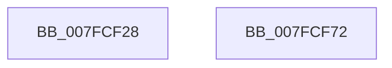

# MiLogSectionObjectEvent

- RVA: `0x007FCF28`–`0x007FCF73` (길이 `75` bytes)
- VA: `0x00000001407FCF28`
- 실행 섹션: `PAGE`
- PDB 이름 있음: `예`; PDB Function 태그: `아니요`
- unwind 정보 RVA: `0x00063458`
- 디코드: `18`개 명령, `75/75` bytes 표시
- 미해석 바이트: `0` (있으면 어셈블리에 `.byte`로 보존)

> 이 문서는 커널 이미지의 기계어와 PDB 기호를 분석해 생성했습니다. 4번과 5번은 함수 원형과 자료형을 바이너리 사용 방식에서 추정한 C 해석이며 원본 소스 복구 결과는 아닙니다.

## 1. Dependencies

- 직접 호출 지점: **2**; 고유 호출 대상: **2**
- 직접 호출자로 확인된 함수: **4**
- RIP 상대 이미지 참조: **0**

### Outgoing calls
- `0x007FCF2F` → [MiSectionControlArea](../../text/29/MiSectionControlArea_function_00294CB0.md) (function, `0x00294CB0`)
- `0x007FCF68` → [MiLogPerfMemoryEvent](../../text/23/MiLogPerfMemoryEvent_function_002369C8.md) (function, `0x002369C8`)

### Direct callers
- [MmCreateSectionEx](../98/MmCreateSectionEx_function_009839CC.md) at `0x00983C8D`
- [MmCreateCacheManagerSection](../98/MmCreateCacheManagerSection_function_00983CB8.md) at `0x00983E8D`
- [MiCreateSection](../98/MiCreateSection_function_00983EC0.md) at `0x0098410B`
- [MiSectionDelete](../A2/MiSectionDelete_function_00A2ECA0.md) at `0x00A2EDD5`

### Static image references
- 디코드된 RIP-relative 메모리 참조가 없습니다.

## 2. Other-region calls and transfers

- 다른 실행 섹션으로 향하는 call: **2**
  - `0x007FCF2F` → [MiSectionControlArea](../../text/29/MiSectionControlArea_function_00294CB0.md) (`PAGE` → `.text`)
  - `0x007FCF68` → [MiLogPerfMemoryEvent](../../text/23/MiLogPerfMemoryEvent_function_002369C8.md) (`PAGE` → `.text`)
- 별도 외부 분기/꼬리 이동을 확인하지 못했습니다.

## 3. Assembly (complete function range)

```asm
007FCF28  48 83 EC 48                     sub rsp, 0x48
007FCF2C  44 8B C2                        mov r8d, edx
007FCF2F  E8 7C 7D A9 FF                  call 0x140294cb0
007FCF34  48 89 4C 24 30                  mov qword ptr [rsp + 0x30], rcx
007FCF39  41 F7 D8                        neg r8d
007FCF3C  41 B9 10 00 00 00               mov r9d, 0x10
007FCF42  C7 44 24 20 02 19 50 00         mov dword ptr [rsp + 0x20], 0x501902
007FCF4A  4C 8D 44 24 30                  lea r8, [rsp + 0x30]
007FCF4F  BA 01 00 40 20                  mov edx, 0x20400001
007FCF54  48 8B 00                        mov rax, qword ptr [rax]
007FCF57  48 8B 48 40                     mov rcx, qword ptr [rax + 0x40]
007FCF5B  48 89 4C 24 38                  mov qword ptr [rsp + 0x38], rcx
007FCF60  66 1B C9                        sbb cx, cx
007FCF63  66 81 C1 88 02                  add cx, 0x288
007FCF68  E8 5B 9A A3 FF                  call 0x1402369c8
007FCF6D  48 83 C4 48                     add rsp, 0x48
007FCF71  C3                              ret
007FCF72  CC                              int3
```

## 4. C-style interpretation (structured pseudocode)

```c
__int64 __fastcall MiLogSectionObjectEvent(__int64 a1, int a2)
{
    __int64 result;
    __int64 v_rsp;
    unsigned __int64 v_stack_m10;
    unsigned __int64 v_stack_m18;
    unsigned int v_stack_m28;

    v_rsp = (v_rsp) - (72);
    result = MiSectionControlArea(a1, a2, (unsigned int)(a2), a4);
    v_stack_m18 = a1;
    a3 = (unsigned int)(-((unsigned int)(a2)));
    v_stack_m28 = 0x501902ULL;
    v_stack_m10 = *(unsigned __int64 *)(*(unsigned __int64 *)(result) + 64);
    a1 = (unsigned __int16)((*(unsigned __int64 *)(*(unsigned __int64 *)(result) + 64)) + (648));
    result = MiLogPerfMemoryEvent(a1, (unsigned int)(0x20400001ULL), v_stack_m18, 16);
    v_rsp = (v_rsp) + (72);
    return result;
}
```

## 5. (Beta) C Style

```c
int64_t MiLogSectionObjectEvent(int64_t Arg1, int32_t Arg2)
{
    int64_t result;
    int64_t local_rsp;
    uint64_t v_stack_m10;
    uint64_t v_stack_m18;
    uint32_t v_stack_m28;

    local_rsp = (local_rsp) - (72);
    result = MiSectionControlArea(Arg1, Arg2, (uint32_t)(Arg2), a4);
    v_stack_m18 = Arg1;
    a3 = (uint32_t)(-((uint32_t)(Arg2)));
    v_stack_m28 = 0x501902ULL;
    v_stack_m10 = *(uint64_t *)(*(uint64_t *)(result) + 0x40);
    Arg1 = (uint16_t)((*(uint64_t *)(*(uint64_t *)(result) + 0x40)) + (648));
    result = MiLogPerfMemoryEvent(Arg1, (uint32_t)(0x20400001ULL), v_stack_m18, 16);
    local_rsp = (local_rsp) + (72);
    return result;
}
```

## 6. Execution-region graph

[열기: 2D/3D 그래프와 함수 탐색 컨트롤 패널](../../../control-panel.html?section=page&rva=0x007FCF28&view=graph)

- 2D 그래프는 위에서 아래로 흐르고, 3D 그래프는 빈 공간을 드래그해 회전합니다. Shift+드래그는 이동, 휠은 확대·축소, 함수 노드 선택은 대상 보고서 이동입니다.

### Static fallback


