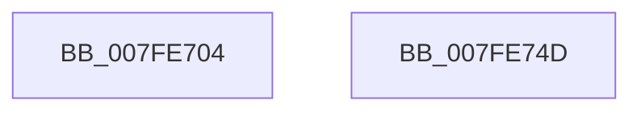

# MiLogVirtualRotateEvent

- RVA: `0x007FE704`–`0x007FE74E` (길이 `74` bytes)
- VA: `0x00000001407FE704`
- 실행 섹션: `PAGE`
- PDB 이름 있음: `예`; PDB Function 태그: `아니요`
- unwind 정보 RVA: `0x0006C2A4`
- 디코드: `18`개 명령, `74/74` bytes 표시
- 미해석 바이트: `0` (있으면 어셈블리에 `.byte`로 보존)

> 이 문서는 커널 이미지의 기계어와 PDB 기호를 분석해 생성했습니다. 4번과 5번은 함수 원형과 자료형을 바이너리 사용 방식에서 추정한 C 해석이며 원본 소스 복구 결과는 아닙니다.

## 1. Dependencies

- 직접 호출 지점: **1**; 고유 호출 대상: **1**
- 직접 호출자로 확인된 함수: **2**
- RIP 상대 이미지 참조: **0**

### Outgoing calls
- `0x007FE743` → [MiLogPerfMemoryEvent](../../text/23/MiLogPerfMemoryEvent_function_002369C8.md) (function, `0x002369C8`)

### Direct callers
- [MmRotatePhysicalView](../A3/MmRotatePhysicalView_function_00A37FE0.md) at `0x00A38166`
- [MmRotatePhysicalView](../A3/MmRotatePhysicalView_function_00A37FE0.md) at `0x00A381E7`
- [MiReplaceRotateWithDemandZero](../A7/MiReplaceRotateWithDemandZero_function_00A7C010.md) at `0x00A7C2A7`

### Static image references
- 디코드된 RIP-relative 메모리 참조가 없습니다.

## 2. Other-region calls and transfers

- 다른 실행 섹션으로 향하는 call: **1**
  - `0x007FE743` → [MiLogPerfMemoryEvent](../../text/23/MiLogPerfMemoryEvent_function_002369C8.md) (`PAGE` → `.text`)
- 별도 외부 분기/꼬리 이동을 확인하지 못했습니다.

## 3. Assembly (complete function range)

```asm
007FE704  48 83 EC 58                     sub rsp, 0x58
007FE708  33 C0                           xor eax, eax
007FE70A  48 89 4C 24 30                  mov qword ptr [rsp + 0x30], rcx
007FE70F  89 44 24 44                     mov dword ptr [rsp + 0x44], eax
007FE713  41 83 E0 0F                     and r8d, 0xf
007FE717  83 E0 F0                        and eax, 0xfffffff0
007FE71A  48 89 54 24 38                  mov qword ptr [rsp + 0x38], rdx
007FE71F  41 0B C0                        or eax, r8d
007FE722  C7 44 24 20 02 19 50 00         mov dword ptr [rsp + 0x20], 0x501902
007FE72A  4C 8D 44 24 30                  lea r8, [rsp + 0x30]
007FE72F  89 44 24 40                     mov dword ptr [rsp + 0x40], eax
007FE733  B9 7F 02 00 00                  mov ecx, 0x27f
007FE738  41 B9 14 00 00 00               mov r9d, 0x14
007FE73E  BA 00 80 00 20                  mov edx, 0x20008000
007FE743  E8 80 82 A3 FF                  call 0x1402369c8
007FE748  48 83 C4 58                     add rsp, 0x58
007FE74C  C3                              ret
007FE74D  CC                              int3
```

## 4. C-style interpretation (structured pseudocode)

```c
__int64 __fastcall MiLogVirtualRotateEvent(__int64 a1, __int64 a2, int a3)
{
    __int64 result;
    __int64 v_rsp;
    unsigned int v_stack_m14;
    unsigned int v_stack_m18;
    unsigned __int64 v_stack_m20;
    unsigned __int64 v_stack_m28;
    unsigned int v_stack_m38;

    v_rsp = (v_rsp) - (88);
    result = 0;
    v_stack_m28 = a1;
    v_stack_m14 = 0;
    a3 = (unsigned int)((a3) & (15));
    result = (unsigned int)((result) & (0xFFFFFFF0ULL));
    v_stack_m20 = a2;
    result = (unsigned int)((result) | (a3));
    v_stack_m38 = 0x501902ULL;
    v_stack_m18 = (unsigned int)(result);
    result = MiLogPerfMemoryEvent(639, (unsigned int)(0x20008000ULL), v_stack_m28, 20);
    v_rsp = (v_rsp) + (88);
    return result;
}
```

## 5. (Beta) C Style

```c
int64_t MiLogVirtualRotateEvent(int64_t Arg1, int64_t Arg2, int32_t Arg3)
{
    int64_t result;
    int64_t local_rsp;
    uint32_t v_stack_m14;
    uint32_t v_stack_m18;
    uint64_t v_stack_m20;
    uint64_t v_stack_m28;
    uint32_t v_stack_m38;

    local_rsp = (local_rsp) - (88);
    result = 0;
    v_stack_m28 = Arg1;
    v_stack_m14 = 0;
    Arg3 = (uint32_t)((Arg3) & (15));
    result = (uint32_t)((result) & (0xFFFFFFF0ULL));
    v_stack_m20 = Arg2;
    result = (uint32_t)((result) | (Arg3));
    v_stack_m38 = 0x501902ULL;
    v_stack_m18 = (uint32_t)(result);
    result = MiLogPerfMemoryEvent(639, (uint32_t)(0x20008000ULL), v_stack_m28, 20);
    local_rsp = (local_rsp) + (88);
    return result;
}
```

## 6. Execution-region graph

[열기: 2D/3D 그래프와 함수 탐색 컨트롤 패널](../../../control-panel.html?section=page&rva=0x007FE704&view=graph)

- 2D 그래프는 위에서 아래로 흐르고, 3D 그래프는 빈 공간을 드래그해 회전합니다. Shift+드래그는 이동, 휠은 확대·축소, 함수 노드 선택은 대상 보고서 이동입니다.

### Static fallback


