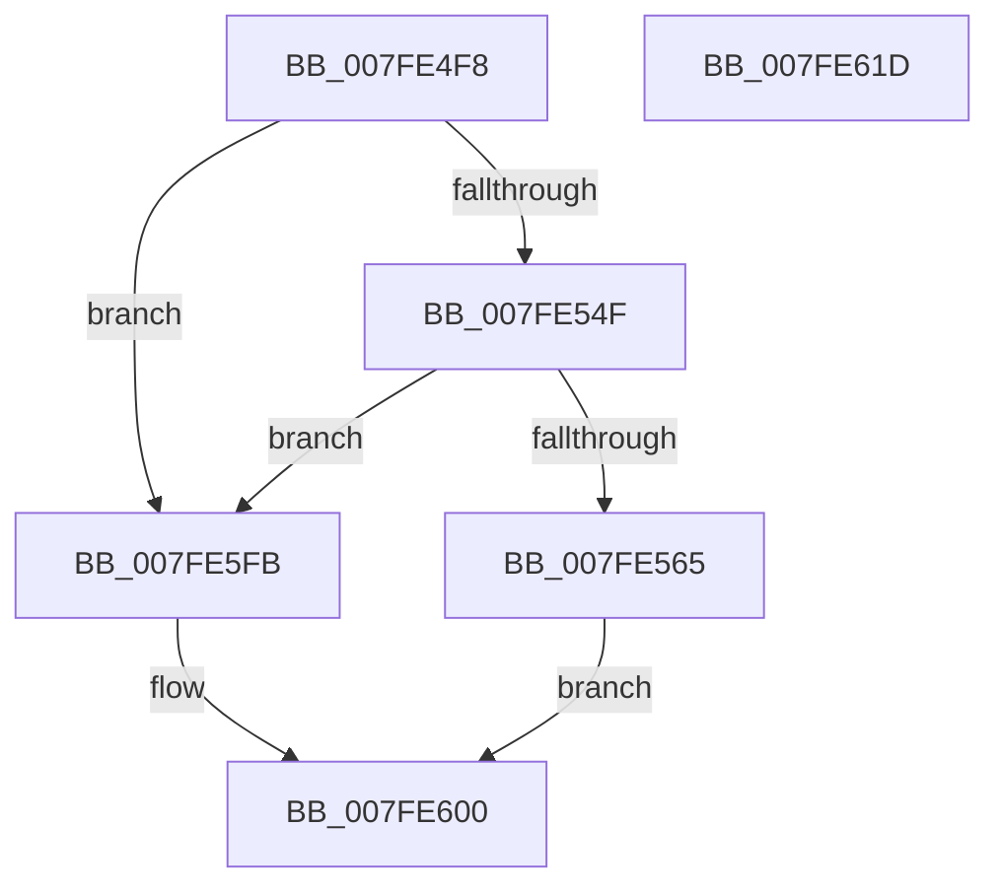

# MiMapImageInSystemProcess

- RVA: `0x007FE4F8`–`0x007FE61E` (길이 `294` bytes)
- VA: `0x00000001407FE4F8`
- 실행 섹션: `PAGE`
- PDB 이름 있음: `예`; PDB Function 태그: `아니요`
- unwind 정보 RVA: `0x000C8F94`
- 디코드: `68`개 명령, `294/294` bytes 표시
- 미해석 바이트: `0` (있으면 어셈블리에 `.byte`로 보존)

> 이 문서는 커널 이미지의 기계어와 PDB 기호를 분석해 생성했습니다. 4번과 5번은 함수 원형과 자료형을 바이너리 사용 방식에서 추정한 C 해석이며 원본 소스 복구 결과는 아닙니다.

## 1. Dependencies

- 직접 호출 지점: **3**; 고유 호출 대상: **3**
- 직접 호출자로 확인된 함수: **1**
- RIP 상대 이미지 참조: **0**

### Outgoing calls
- `0x007FE58A` → [memset](../../text/6C/memset_function_006C6C40.md) (function, `0x006C6C40`)
- `0x007FE594` → [MiGetUserReservationHighestAddress](../98/MiGetUserReservationHighestAddress_function_00982430.md) (function, `0x00982430`)
- `0x007FE5F4` → [MiMapViewOfImageSection](../97/MiMapViewOfImageSection_function_0097E92C.md) (function, `0x0097E92C`)

### Direct callers
- [MiMapImageInSystemSpace](../94/MiMapImageInSystemSpace_function_00941DD8.md) at `0x00942044`

### Static image references
- 디코드된 RIP-relative 메모리 참조가 없습니다.

## 2. Other-region calls and transfers

- 다른 실행 섹션으로 향하는 call: **1**
  - `0x007FE58A` → [memset](../../text/6C/memset_function_006C6C40.md) (`PAGE` → `.text`)
- 별도 외부 분기/꼬리 이동을 확인하지 못했습니다.

## 3. Assembly (complete function range)

```asm
007FE4F8  48 8B C4                        mov rax, rsp
007FE4FB  48 89 58 10                     mov qword ptr [rax + 0x10], rbx
007FE4FF  48 89 70 18                     mov qword ptr [rax + 0x18], rsi
007FE503  48 89 78 20                     mov qword ptr [rax + 0x20], rdi
007FE507  55                              push rbp
007FE508  41 56                           push r14
007FE50A  41 57                           push r15
007FE50C  48 8D 68 A1                     lea rbp, [rax - 0x5f]
007FE510  48 81 EC C0 00 00 00            sub rsp, 0xc0
007FE517  4C 8B 11                        mov r10, qword ptr [rcx]
007FE51A  4C 8B F1                        mov r14, rcx
007FE51D  48 83 C9 FF                     or rcx, 0xffffffffffffffff
007FE521  49 8B F0                        mov rsi, r8
007FE524  48 8B C1                        mov rax, rcx
007FE527  44 8B FA                        mov r15d, edx
007FE52A  F0 49 0F B1 4A 18               lock cmpxchg qword ptr [r10 + 0x18], rcx
007FE530  49 89 01                        mov qword ptr [r9], rax
007FE533  48 8B C1                        mov rax, rcx
007FE536  F0 49 0F B1 4A 18               lock cmpxchg qword ptr [r10 + 0x18], rcx
007FE53C  48 B9 00 00 00 00 01 00 00 00   movabs rcx, 0x100000000
007FE546  48 3B C1                        cmp rax, rcx
007FE549  0F 83 AC 00 00 00               jae 0x1407fe5fb
007FE54F  49 8B 39                        mov rdi, qword ptr [r9]
007FE552  48 B8 00 00 FF FF FF 7F 00 00   movabs rax, 0x7fffffff0000
007FE55C  48 3B F8                        cmp rdi, rax
007FE55F  0F 87 96 00 00 00               ja 0x1407fe5fb
007FE565  49 83 20 00                     and qword ptr [r8], 0
007FE569  48 8D 4D C7                     lea rcx, [rbp - 0x39]
007FE56D  48 83 65 67 00                  and qword ptr [rbp + 0x67], 0
007FE572  33 D2                           xor edx, edx
007FE574  65 48 8B 04 25 88 01 00 00      mov rax, qword ptr gs:[0x188]
007FE57D  41 B8 80 00 00 00               mov r8d, 0x80
007FE583  48 8B 98 B8 00 00 00            mov rbx, qword ptr [rax + 0xb8]
007FE58A  E8 B1 86 EC FF                  call 0x1406c6c40
007FE58F  33 D2                           xor edx, edx
007FE591  48 8B CB                        mov rcx, rbx
007FE594  E8 97 3E 18 00                  call 0x140982430
007FE599  48 89 45 CF                     mov qword ptr [rbp - 0x31], rax
007FE59D  4C 8D 4D 67                     lea r9, [rbp + 0x67]
007FE5A1  44 89 7C 24 38                  mov dword ptr [rsp + 0x38], r15d
007FE5A6  48 8D 87 FF 0F 00 00            lea rax, [rdi + 0xfff]
007FE5AD  C7 44 24 30 01 00 00 00         mov dword ptr [rsp + 0x30], 1
007FE5B5  48 25 00 F0 FF FF               and rax, 0xfffffffffffff000
007FE5BB  88 55 00                        mov byte ptr [rbp], dl
007FE5BE  4C 8B C6                        mov r8, rsi
007FE5C1  C7 44 24 28 02 00 00 00         mov dword ptr [rsp + 0x28], 2
007FE5C9  49 8B CE                        mov rcx, r14
007FE5CC  48 21 54 24 20                  and qword ptr [rsp + 0x20], rdx
007FE5D1  48 8D 55 C7                     lea rdx, [rbp - 0x39]
007FE5D5  48 89 45 DF                     mov qword ptr [rbp - 0x21], rax
007FE5D9  48 C7 45 D7 00 00 01 00         mov qword ptr [rbp - 0x29], 0x10000
007FE5E1  48 89 7D E7                     mov qword ptr [rbp - 0x19], rdi
007FE5E5  C7 45 EF 00 00 04 00            mov dword ptr [rbp - 0x11], 0x40000
007FE5EC  48 89 5D 27                     mov qword ptr [rbp + 0x27], rbx
007FE5F0  48 89 5D 1F                     mov qword ptr [rbp + 0x1f], rbx
007FE5F4  E8 33 03 18 00                  call 0x14097e92c
007FE5F9  EB 05                           jmp 0x1407fe600
007FE5FB  B8 1F 00 00 C0                  mov eax, 0xc000001f
007FE600  4C 8D 9C 24 C0 00 00 00         lea r11, [rsp + 0xc0]
007FE608  49 8B 5B 28                     mov rbx, qword ptr [r11 + 0x28]
007FE60C  49 8B 73 30                     mov rsi, qword ptr [r11 + 0x30]
007FE610  49 8B 7B 38                     mov rdi, qword ptr [r11 + 0x38]
007FE614  49 8B E3                        mov rsp, r11
007FE617  41 5F                           pop r15
007FE619  41 5E                           pop r14
007FE61B  5D                              pop rbp
007FE61C  C3                              ret
007FE61D  CC                              int3
```

## 4. C-style interpretation (structured pseudocode)

```c
__int64 __fastcall MiMapImageInSystemProcess(__int64 a1, int a2, __int64 a3, __int64 a4)
{
    __int64 result;
    __int64 v_rsp;
    unsigned __int64 v_stack_m18;
    unsigned int v_stack_mA0;
    unsigned int v_stack_mA8;
    unsigned int v_stack_mB0;
    unsigned __int64 v_stack_mB8;

    *(unsigned __int64 *)(v_rsp + 16) = v_rbx;
    *(unsigned __int64 *)(v_rsp + 24) = v_rsi;
    *(unsigned __int64 *)(v_rsp + 32) = v_rdi;
    v_rsp = (v_rsp) - (192);
    a1 = (a1) | (-1);
    *(unsigned __int64 *)(a4) = a1;
    if (a1 >= a1) goto loc_007FE5FB;
    if ((*(unsigned __int64 *)(a4)) > a1) goto loc_007FE5FB;
    a2 = 0;
    result = memset(v_rsp - 95 - 57, a2, 128, a4);
    a2 = 0;
    result = MiGetUserReservationHighestAddress(*(unsigned __int64 *)(*(unsigned __int64 *)(gs_base + (0 + 392)) + 184), a2, 128, a4);
    *(unsigned __int64 *)(v_rsp - 95 - 49) = result;
    v_stack_mA0 = (unsigned int)((unsigned int)(a2));
    v_stack_mA8 = 1;
    result = (*(unsigned __int64 *)(a4) + 4095) & (0xFFFFFFFFFFFFF000ULL);
    *(unsigned __int8 *)(v_rsp - 95) = 0;
    v_stack_mB0 = 2;
    *(unsigned __int64 *)(v_rsp - 95 - 33) = result;
    *(unsigned __int64 *)(v_rsp - 95 - 41) = 0x10000ULL;
    *(unsigned __int64 *)(v_rsp - 95 - 25) = *(unsigned __int64 *)(a4);
    *(unsigned int *)(v_rsp - 95 - 17) = 0x40000ULL;
    *(unsigned __int64 *)(v_rsp - 95 + 39) = *(unsigned __int64 *)(*(unsigned __int64 *)(gs_base + (0 + 392)) + 184);
    *(unsigned __int64 *)(v_rsp - 95 + 31) = *(unsigned __int64 *)(*(unsigned __int64 *)(gs_base + (0 + 392)) + 184);
    result = MiMapViewOfImageSection(a1, v_rsp - 95 - 57, a3, v_rsp - 95 + 103);
    goto loc_007FE600;
loc_007FE5FB:
loc_007FE600:
    return (unsigned int)(0xC000001FULL);
}
```

## 5. (Beta) C Style

```c
int64_t MiMapImageInSystemProcess(void *Arg1, int32_t Arg2, void *Arg3, void *Arg4)
{
    uint8_t *arg1 = (uint8_t *)Arg1;
    uint8_t *arg3 = (uint8_t *)Arg3;
    uint8_t *arg4 = (uint8_t *)Arg4;

    int64_t result;
    int64_t local_rsp;
    uint64_t v_stack_m18;
    uint32_t v_stack_mA0;
    uint32_t v_stack_mA8;
    uint32_t v_stack_mB0;
    uint64_t v_stack_mB8;

    *(uint64_t *)(local_rsp + 0x10) = local_rbx;
    *(uint64_t *)(local_rsp + 0x18) = local_rsi;
    *(uint64_t *)(local_rsp + 0x20) = local_rdi;
    local_rsp = (local_rsp) - (192);
    Arg1 = (Arg1) | (-1);
    *(void **)(arg4) = Arg1;
    if (Arg1 >= Arg1) goto loc_007FE5FB;
    if ((*(uint64_t *)(arg4)) > Arg1) goto loc_007FE5FB;
    Arg2 = 0;
    result = memset(local_rsp - 95 - 57, Arg2, 128, Arg4);
    Arg2 = 0;
    result = MiGetUserReservationHighestAddress(*(uint64_t *)(*(uint64_t *)(gs_base + (0 + 0x188)) + 0xB8), Arg2, 128, Arg4);
    *(uint64_t *)(local_rsp - 0x5F - 0x31) = result;
    v_stack_mA0 = (uint32_t)((uint32_t)(Arg2));
    v_stack_mA8 = 1;
    result = (*(uint64_t *)(arg4) + 4095) & (0xFFFFFFFFFFFFF000ULL);
    *(uint8_t *)(local_rsp - 0x5F) = 0;
    v_stack_mB0 = 2;
    *(uint64_t *)(local_rsp - 0x5F - 0x21) = result;
    *(uint64_t *)(local_rsp - 0x5F - 0x29) = 0x10000ULL;
    *(uint64_t *)(local_rsp - 0x5F - 0x19) = *(uint64_t *)(arg4);
    *(uint32_t *)(local_rsp - 0x5F - 0x11) = 0x40000ULL;
    *(uint64_t *)(local_rsp - 0x5F + 0x27) = *(uint64_t *)(*(uint64_t *)(gs_base + (0 + 0x188)) + 0xB8);
    *(uint64_t *)(local_rsp - 0x5F + 0x1F) = *(uint64_t *)(*(uint64_t *)(gs_base + (0 + 0x188)) + 0xB8);
    result = MiMapViewOfImageSection(Arg1, local_rsp - 95 - 57, Arg3, local_rsp - 95 + 103);
    goto loc_007FE600;
loc_007FE5FB:
loc_007FE600:
    return (uint32_t)(0xC000001FULL);
}
```

### 관측된 메모리 오프셋

구조체 형식이 확인되지 않은 접근은 인자 기준의 오프셋으로만 기록했습니다.

| 기준 인자 | 오프셋 표현 | 폭 (bit) | 접근 |
|---|---:|---:|---|
| `Arg1` | `+ 0x0` | `64` | `R` |
| `Arg3` | `+ 0x0` | `64` | `R/W` |
| `Arg4` | `+ 0x0` | `64` | `R` |
| `Arg4` | `+ 0x0` | `64` | `W` |

## 6. Execution-region graph

[열기: 2D/3D 그래프와 함수 탐색 컨트롤 패널](../../../control-panel.html?section=page&rva=0x007FE4F8&view=graph)

- 2D 그래프는 위에서 아래로 흐르고, 3D 그래프는 빈 공간을 드래그해 회전합니다. Shift+드래그는 이동, 휠은 확대·축소, 함수 노드 선택은 대상 보고서 이동입니다.

### Static fallback


