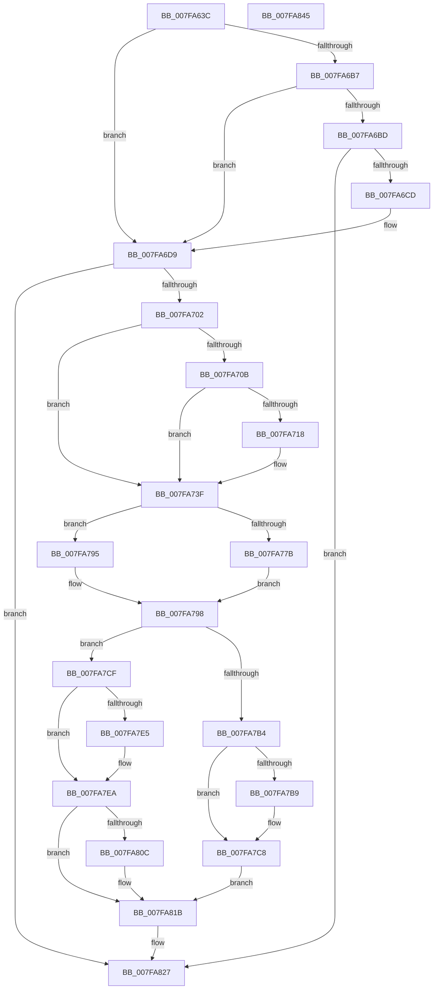

# MiMapNewPfns

- RVA: `0x007FA63C`–`0x007FA846` (길이 `522` bytes)
- VA: `0x00000001407FA63C`
- 실행 섹션: `PAGE`
- PDB 이름 있음: `예`; PDB Function 태그: `아니요`
- unwind 정보 RVA: `0x0008C11C`
- 디코드: `140`개 명령, `522/522` bytes 표시
- 미해석 바이트: `0` (있으면 어셈블리에 `.byte`로 보존)

> 이 문서는 커널 이미지의 기계어와 PDB 기호를 분석해 생성했습니다. 4번과 5번은 함수 원형과 자료형을 바이너리 사용 방식에서 추정한 C 해석이며 원본 소스 복구 결과는 아닙니다.

## 1. Dependencies

- 직접 호출 지점: **13**; 고유 호출 대상: **11**
- 직접 호출자로 확인된 함수: **1**
- RIP 상대 이미지 참조: **2**

### Outgoing calls
- `0x007FA685` → [MiGetPteAddress](../../text/43/MiGetPteAddress_function_0043E130.md) (function, `0x0043E130`)
- `0x007FA6A2` → [MiGetPteAddress](../../text/43/MiGetPteAddress_function_0043E130.md) (function, `0x0043E130`)
- `0x007FA6C0` → [MiZeroHotAddMemory](MiZeroHotAddMemory_function_007FB324.md) (function, `0x007FB324`)
- `0x007FA6F5` → [MiCreateIoPageExclusion](../../text/67/MiCreateIoPageExclusion_function_0067B638.md) (function, `0x0067B638`)
- `0x007FA743` → [MiPageToNode](../../text/33/MiPageToNode_function_00338CD0.md) (function, `0x00338CD0`)
- `0x007FA74B` → [MiGetClosestImplicitNode](../../text/3F/MiGetClosestImplicitNode_function_003F00AC.md) (function, `0x003F00AC`)
- `0x007FA78E` → [MiLockDynamicMemoryShared](../../text/3B/MiLockDynamicMemoryShared_function_003B8AA8.md) (function, `0x003B8AA8`)
- `0x007FA7AB` → [MiMakeZeroedPageTablesEx](../../text/3B/MiMakeZeroedPageTablesEx_function_003B59FC.md) (function, `0x003B59FC`)
- `0x007FA7C3` → [MiUnlockDynamicMemoryShared](../../text/3B/MiUnlockDynamicMemoryShared_function_003B8A48.md) (function, `0x003B8A48`)
- `0x007FA7DC` → [MiPhysicalMemoryEverRemoved](../../text/67/MiPhysicalMemoryEverRemoved_function_00673958.md) (function, `0x00673958`)
- `0x007FA802` → [MiInitializeDynamicPfns](../../text/67/MiInitializeDynamicPfns_function_00672BD0.md) (function, `0x00672BD0`)
- `0x007FA816` → [MiUnlockDynamicMemoryShared](../../text/3B/MiUnlockDynamicMemoryShared_function_003B8A48.md) (function, `0x003B8A48`)
- `0x007FA820` → [MiRemoveIoPageExclusion](../../text/67/MiRemoveIoPageExclusion_function_0067C91C.md) (function, `0x0067C91C`)

### Direct callers
- [MiAddPhysicalMemory](MiAddPhysicalMemory_function_007F95FC.md) at `0x007F9714`
- [MiAddPhysicalMemory](MiAddPhysicalMemory_function_007F95FC.md) at `0x007F9811`

### Static image references
- `0x007FA70B` → RVA `0x00E3D550` (`.data`; read)
- `0x007FA784` → RVA `0x00E38D00` (`.data`; read)

## 2. Other-region calls and transfers

- 다른 실행 섹션으로 향하는 call: **12**
  - `0x007FA685` → [MiGetPteAddress](../../text/43/MiGetPteAddress_function_0043E130.md) (`PAGE` → `.text`)
  - `0x007FA6A2` → [MiGetPteAddress](../../text/43/MiGetPteAddress_function_0043E130.md) (`PAGE` → `.text`)
  - `0x007FA6F5` → [MiCreateIoPageExclusion](../../text/67/MiCreateIoPageExclusion_function_0067B638.md) (`PAGE` → `.text`)
  - `0x007FA743` → [MiPageToNode](../../text/33/MiPageToNode_function_00338CD0.md) (`PAGE` → `.text`)
  - `0x007FA74B` → [MiGetClosestImplicitNode](../../text/3F/MiGetClosestImplicitNode_function_003F00AC.md) (`PAGE` → `.text`)
  - `0x007FA78E` → [MiLockDynamicMemoryShared](../../text/3B/MiLockDynamicMemoryShared_function_003B8AA8.md) (`PAGE` → `.text`)
  - `0x007FA7AB` → [MiMakeZeroedPageTablesEx](../../text/3B/MiMakeZeroedPageTablesEx_function_003B59FC.md) (`PAGE` → `.text`)
  - `0x007FA7C3` → [MiUnlockDynamicMemoryShared](../../text/3B/MiUnlockDynamicMemoryShared_function_003B8A48.md) (`PAGE` → `.text`)
  - `0x007FA7DC` → [MiPhysicalMemoryEverRemoved](../../text/67/MiPhysicalMemoryEverRemoved_function_00673958.md) (`PAGE` → `.text`)
  - `0x007FA802` → [MiInitializeDynamicPfns](../../text/67/MiInitializeDynamicPfns_function_00672BD0.md) (`PAGE` → `.text`)
  - `0x007FA816` → [MiUnlockDynamicMemoryShared](../../text/3B/MiUnlockDynamicMemoryShared_function_003B8A48.md) (`PAGE` → `.text`)
  - `0x007FA820` → [MiRemoveIoPageExclusion](../../text/67/MiRemoveIoPageExclusion_function_0067C91C.md) (`PAGE` → `.text`)
- 별도 외부 분기/꼬리 이동을 확인하지 못했습니다.

## 3. Assembly (complete function range)

```asm
007FA63C  48 8B C4                        mov rax, rsp
007FA63F  48 89 58 08                     mov qword ptr [rax + 8], rbx
007FA643  48 89 68 10                     mov qword ptr [rax + 0x10], rbp
007FA647  48 89 70 18                     mov qword ptr [rax + 0x18], rsi
007FA64B  57                              push rdi
007FA64C  41 54                           push r12
007FA64E  41 55                           push r13
007FA650  41 56                           push r14
007FA652  41 57                           push r15
007FA654  48 83 EC 60                     sub rsp, 0x60
007FA658  4C 8B 41 10                     mov r8, qword ptr [rcx + 0x10]
007FA65C  48 8B F9                        mov rdi, rcx
007FA65F  33 F6                           xor esi, esi
007FA661  48 BA 00 00 00 00 00 DE FF FF   movabs rdx, 0xffffde0000000000
007FA66B  0F 57 C0                        xorps xmm0, xmm0
007FA66E  48 89 70 A8                     mov qword ptr [rax - 0x58], rsi
007FA672  F3 0F 7F 40 B0                  movdqu xmmword ptr [rax - 0x50], xmm0
007FA677  4B 8D 0C 40                     lea rcx, [r8 + r8*2]
007FA67B  48 C1 E1 04                     shl rcx, 4
007FA67F  48 8B C2                        mov rax, rdx
007FA682  48 03 C8                        add rcx, rax
007FA685  E8 A6 3A C4 FF                  call 0x14043e130
007FA68A  4C 8B F0                        mov r14, rax
007FA68D  48 8B 47 18                     mov rax, qword ptr [rdi + 0x18]
007FA691  48 8D 0C 40                     lea rcx, [rax + rax*2]
007FA695  48 C1 E1 04                     shl rcx, 4
007FA699  48 8B C2                        mov rax, rdx
007FA69C  48 FF C8                        dec rax
007FA69F  48 03 C8                        add rcx, rax
007FA6A2  E8 89 3A C4 FF                  call 0x14043e130
007FA6A7  4C 8B 67 20                     mov r12, qword ptr [rdi + 0x20]
007FA6AB  4C 8B F8                        mov r15, rax
007FA6AE  8B 47 28                        mov eax, dword ptr [rdi + 0x28]
007FA6B1  8B D0                           mov edx, eax
007FA6B3  A8 02                           test al, 2
007FA6B5  75 22                           jne 0x1407fa6d9
007FA6B7  0F BA E0 0A                     bt eax, 0xa
007FA6BB  73 1C                           jae 0x1407fa6d9
007FA6BD  48 8B CF                        mov rcx, rdi
007FA6C0  E8 5F 0C 00 00                  call 0x1407fb324
007FA6C5  85 C0                           test eax, eax
007FA6C7  0F 88 5A 01 00 00               js 0x1407fa827
007FA6CD  0F BA 77 28 0A                  btr dword ptr [rdi + 0x28], 0xa
007FA6D2  8B 57 28                        mov edx, dword ptr [rdi + 0x28]
007FA6D5  4C 8B 47 10                     mov r8, qword ptr [rdi + 0x10]
007FA6D9  D1 EA                           shr edx, 1
007FA6DB  49 8D 44 24 FF                  lea rax, [r12 - 1]
007FA6E0  49 03 C0                        add rax, r8
007FA6E3  4C 89 44 24 48                  mov qword ptr [rsp + 0x48], r8
007FA6E8  83 E2 01                        and edx, 1
007FA6EB  48 89 44 24 50                  mov qword ptr [rsp + 0x50], rax
007FA6F0  48 8D 4C 24 30                  lea rcx, [rsp + 0x30]
007FA6F5  E8 3E 0F E8 FF                  call 0x14067b638
007FA6FA  85 C0                           test eax, eax
007FA6FC  0F 88 25 01 00 00               js 0x1407fa827
007FA702  49 81 FC 00 00 04 00            cmp r12, 0x40000
007FA709  72 34                           jb 0x1407fa73f
007FA70B  48 81 3D 3A 2E 64 00 00 00 20 00  cmp qword ptr [rip + 0x642e3a], 0x200000
007FA716  72 27                           jb 0x1407fa73f
007FA718  49 8B C6                        mov rax, r14
007FA71B  48 C7 C1 00 F0 FF FF            mov rcx, 0xfffffffffffff000
007FA722  48 23 C1                        and rax, rcx
007FA725  4C 3B F0                        cmp r14, rax
007FA728  4C 0F 45 F0                     cmovne r14, rax
007FA72C  49 8B C7                        mov rax, r15
007FA72F  48 23 C1                        and rax, rcx
007FA732  48 05 F8 0F 00 00               add rax, 0xff8
007FA738  4C 3B F8                        cmp r15, rax
007FA73B  4C 0F 45 F8                     cmovne r15, rax
007FA73F  48 8B 4F 10                     mov rcx, qword ptr [rdi + 0x10]
007FA743  E8 88 E5 B3 FF                  call 0x140338cd0
007FA748  8D 48 01                        lea ecx, [rax + 1]
007FA74B  E8 5C 59 BF FF                  call 0x1403f00ac
007FA750  8B 57 28                        mov edx, dword ptr [rdi + 0x28]
007FA753  8B D8                           mov ebx, eax
007FA755  8B CA                           mov ecx, edx
007FA757  81 E1 00 40 00 00               and ecx, 0x4000
007FA75D  81 C9 10 2A 00 00               or ecx, 0x2a10
007FA763  C1 E9 04                        shr ecx, 4
007FA766  44 8B E9                        mov r13d, ecx
007FA769  41 0F BA ED 08                  bts r13d, 8
007FA76E  0F BA E2 0F                     bt edx, 0xf
007FA772  44 0F 43 E9                     cmovae r13d, ecx
007FA776  F6 C2 02                        test dl, 2
007FA779  74 1A                           je 0x1407fa795
007FA77B  65 48 8B 2C 25 88 01 00 00      mov rbp, qword ptr gs:[0x188]
007FA784  48 8D 0D 75 E5 63 00            lea rcx, [rip + 0x63e575]
007FA78B  48 8B D5                        mov rdx, rbp
007FA78E  E8 15 E3 BB FF                  call 0x1403b8aa8
007FA793  EB 03                           jmp 0x1407fa798
007FA795  48 8B EE                        mov rbp, rsi
007FA798  41 B9 03 00 00 00               mov r9d, 3
007FA79E  89 5C 24 20                     mov dword ptr [rsp + 0x20], ebx
007FA7A2  45 8B C5                        mov r8d, r13d
007FA7A5  49 8B D7                        mov rdx, r15
007FA7A8  49 8B CE                        mov rcx, r14
007FA7AB  E8 4C B2 BB FF                  call 0x1403b59fc
007FA7B0  85 C0                           test eax, eax
007FA7B2  75 1B                           jne 0x1407fa7cf
007FA7B4  48 85 ED                        test rbp, rbp
007FA7B7  74 0F                           je 0x1407fa7c8
007FA7B9  48 8B D5                        mov rdx, rbp
007FA7BC  48 8D 0D 3D E5 63 00            lea rcx, [rip + 0x63e53d]
007FA7C3  E8 80 E2 BB FF                  call 0x1403b8a48
007FA7C8  BE 9A 00 00 C0                  mov esi, 0xc000009a
007FA7CD  EB 4C                           jmp 0x1407fa81b
007FA7CF  48 8B 4F 10                     mov rcx, qword ptr [rdi + 0x10]
007FA7D3  41 B8 01 00 00 00               mov r8d, 1
007FA7D9  49 8B D4                        mov rdx, r12
007FA7DC  E8 77 91 E7 FF                  call 0x140673958
007FA7E1  85 C0                           test eax, eax
007FA7E3  75 05                           jne 0x1407fa7ea
007FA7E5  0F BA 6F 28 12                  bts dword ptr [rdi + 0x28], 0x12
007FA7EA  48 8B 47 38                     mov rax, qword ptr [rdi + 0x38]
007FA7EE  49 8B D4                        mov rdx, r12
007FA7F1  44 8B 4F 28                     mov r9d, dword ptr [rdi + 0x28]
007FA7F5  4C 8B 47 30                     mov r8, qword ptr [rdi + 0x30]
007FA7F9  48 8B 4F 10                     mov rcx, qword ptr [rdi + 0x10]
007FA7FD  48 89 44 24 20                  mov qword ptr [rsp + 0x20], rax
007FA802  E8 C9 83 E7 FF                  call 0x140672bd0
007FA807  48 85 ED                        test rbp, rbp
007FA80A  74 0F                           je 0x1407fa81b
007FA80C  48 8B D5                        mov rdx, rbp
007FA80F  48 8D 0D EA E4 63 00            lea rcx, [rip + 0x63e4ea]
007FA816  E8 2D E2 BB FF                  call 0x1403b8a48
007FA81B  48 8D 4C 24 30                  lea rcx, [rsp + 0x30]
007FA820  E8 F7 20 E8 FF                  call 0x14067c91c
007FA825  8B C6                           mov eax, esi
007FA827  4C 8D 5C 24 60                  lea r11, [rsp + 0x60]
007FA82C  49 8B 5B 30                     mov rbx, qword ptr [r11 + 0x30]
007FA830  49 8B 6B 38                     mov rbp, qword ptr [r11 + 0x38]
007FA834  49 8B 73 40                     mov rsi, qword ptr [r11 + 0x40]
007FA838  49 8B E3                        mov rsp, r11
007FA83B  41 5F                           pop r15
007FA83D  41 5E                           pop r14
007FA83F  41 5D                           pop r13
007FA841  41 5C                           pop r12
007FA843  5F                              pop rdi
007FA844  C3                              ret
007FA845  CC                              int3
```

## 4. C-style interpretation (structured pseudocode)

```c
__int64 __fastcall MiMapNewPfns(__int64 a1)
{
    __int64 result;
    __int64 v_r13;
    __int64 v_r14;
    __int64 v_r15;
    __int64 v_rsi;
    __int64 v_rsp;
    unsigned __int64 v_stack_m28;
    unsigned __int64 v_stack_m38;
    unsigned __int64 v_stack_m40;
    unsigned __int64 v_stack_m58;
    unsigned int v_stack_m68;

    *(unsigned __int64 *)(v_rsp + 8) = v_rbx;
    *(unsigned __int64 *)(v_rsp + 16) = v_rbp;
    *(unsigned __int64 *)(v_rsp + 24) = v_rsi;
    v_rsp = (v_rsp) - (96);
    v_rsi = 0;
    *(unsigned __int64 *)(v_rsp - 88) = 0;
    *(unsigned __int64 *)(v_rsp - 80) = v_xmm0;
    a1 = (*(unsigned __int64 *)(a1 + 16) + *(unsigned __int64 *)(a1 + 16) * 2) << (4);
    a1 = (a1) + (a2);
    result = MiGetPteAddress(a1, a2, *(unsigned __int64 *)(a1 + 16), a4);
    a1 = (*(unsigned __int64 *)(a1 + 24) + *(unsigned __int64 *)(a1 + 24) * 2) << (4);
    result = (a2) - 1;
    a1 = (a1) + (result);
    result = MiGetPteAddress(a1, a2, *(unsigned __int64 *)(a1 + 16), a4);
    if ((((unsigned __int8)((unsigned int)(*(unsigned int *)(a1 + 40)))) & (2)) != 0) goto loc_007FA6D9;
    if (condition_is_above_or_equal) goto loc_007FA6D9;
    result = MiZeroHotAddMemory(a1, (unsigned int)((unsigned int)((unsigned int)(*(unsigned int *)(a1 + 40)))), *(unsigned __int64 *)(a1 + 16), a4);
    if (sign_flag) goto loc_007FA827;
loc_007FA6D9:
    a2 = (unsigned int)(((unsigned int)(*(unsigned int *)(a1 + 40))) >> (1));
    result = (*(unsigned __int64 *)(a1 + 32) - 1) + (*(unsigned __int64 *)(a1 + 16));
    v_stack_m40 = *(unsigned __int64 *)(a1 + 16);
    a2 = (unsigned int)((a2) & (1));
    v_stack_m38 = result;
    result = MiCreateIoPageExclusion(v_stack_m58, a2, *(unsigned __int64 *)(a1 + 16), a4);
    if (sign_flag) goto loc_007FA827;
    if ((*(unsigned __int64 *)(a1 + 32)) < 0x40000ULL) goto loc_007FA73F;
    v_r14 = result;
    v_r15 = result;
    if ((*(unsigned __int64 *)(v_rip + 6565434)) >= 0x200000ULL) {
        result = result;
        a1 = 0xFFFFFFFFFFFFF000ULL;
        result = (result) & (a1);
        v_r14 = result;
        if (result != result) { v_r14 = result; }
        result = result;
        result = (result) & (a1);
        result = (result) + (0xFF8ULL);
        v_r15 = result;
        if (result != result) { v_r15 = result; }
    }
    result = MiPageToNode(*(unsigned __int64 *)(a1 + 16), a2, *(unsigned __int64 *)(a1 + 16), a4);
    result = MiGetClosestImplicitNode(result + 1, a2, *(unsigned __int64 *)(a1 + 16), a4);
    a1 = (unsigned int)(((unsigned int)((unsigned int)((unsigned int)(*(unsigned int *)(a1 + 40))))) & (0x4000ULL));
    a1 = (unsigned int)((a1) | (0x2A10ULL));
    a1 = (unsigned int)((a1) >> (4));
    v_r13 = (unsigned int)((unsigned int)(a1));
    if (condition_is_above_or_equal) { v_r13 = (unsigned int)(a1); }
    if ((((unsigned __int8)((unsigned int)(*(unsigned int *)(a1 + 40)))) & (2)) == 0) goto loc_007FA795;
    result = MiLockDynamicMemoryShared(v_rip + 6546805, *(unsigned __int64 *)(gs_base + (0 + 392)), *(unsigned __int64 *)(a1 + 16), a4);
    goto loc_007FA798;
loc_007FA795:
loc_007FA798:
    v_stack_m68 = (unsigned int)((unsigned int)((unsigned int)(result)));
    result = MiMakeZeroedPageTablesEx(v_r14, v_r15, (unsigned int)((unsigned int)(v_r13)), 3);
    if ((unsigned int)(result) != 0) goto loc_007FA7CF;
    if (0 != 0) {
        a2 = 0;
        a1 = v_rip + 6546749;
        result = MiUnlockDynamicMemoryShared(a1, a2, (unsigned int)((unsigned int)(v_r13)), 3);
    }
    goto loc_007FA81B;
loc_007FA7CF:
    result = MiPhysicalMemoryEverRemoved(*(unsigned __int64 *)(a1 + 16), *(unsigned __int64 *)(a1 + 32), 1, 3);
    if ((unsigned int)(result) == 0) {
    }
    v_stack_m68 = *(unsigned __int64 *)(a1 + 56);
    result = MiInitializeDynamicPfns(*(unsigned __int64 *)(a1 + 16), *(unsigned __int64 *)(a1 + 32), *(unsigned __int64 *)(a1 + 48), (unsigned int)(*(unsigned int *)(a1 + 40)));
    if (0 != 0) {
        a2 = 0;
        a1 = v_rip + 6546666;
        result = MiUnlockDynamicMemoryShared(a1, a2, *(unsigned __int64 *)(a1 + 48), (unsigned int)(*(unsigned int *)(a1 + 40)));
    }
    result = MiRemoveIoPageExclusion(v_stack_m58, a2, *(unsigned __int64 *)(a1 + 48), (unsigned int)(*(unsigned int *)(a1 + 40)));
loc_007FA827:
    return (unsigned int)((unsigned int)((unsigned int)(0xC000009AULL)));
}
```

## 5. (Beta) C Style

```c
int64_t MiMapNewPfns(void *Arg1)
{
    uint8_t *arg1 = (uint8_t *)Arg1;

    int64_t result;
    int64_t local_r13;
    int64_t local_r14;
    int64_t local_r15;
    int64_t local_rsi;
    int64_t local_rsp;
    uint64_t v_stack_m28;
    uint64_t v_stack_m38;
    uint64_t v_stack_m40;
    uint64_t v_stack_m58;
    uint32_t v_stack_m68;

    *(uint64_t *)(local_rsp + 0x8) = local_rbx;
    *(uint64_t *)(local_rsp + 0x10) = local_rbp;
    *(uint64_t *)(local_rsp + 0x18) = local_rsi;
    local_rsp = (local_rsp) - (96);
    local_rsi = 0;
    *(uint64_t *)(local_rsp - 0x58) = 0;
    *(uint64_t *)(local_rsp - 0x50) = v_xmm0;
    Arg1 = (*(uint64_t *)(arg1 + 0x10) + *(uint64_t *)(arg1 + 0x10) * 2) << (4);
    Arg1 = (Arg1) + (a2);
    result = MiGetPteAddress(Arg1, a2, *(uint64_t *)(arg1 + 0x10), a4);
    Arg1 = (*(uint64_t *)(arg1 + 0x18) + *(uint64_t *)(arg1 + 0x18) * 2) << (4);
    result = (a2) - 1;
    Arg1 = (Arg1) + (result);
    result = MiGetPteAddress(Arg1, a2, *(uint64_t *)(arg1 + 0x10), a4);
    if ((((uint8_t)((uint32_t)(*(uint32_t *)(arg1 + 0x28)))) & (2)) != 0) goto loc_007FA6D9;
    if (condition_is_above_or_equal) goto loc_007FA6D9;
    result = MiZeroHotAddMemory(Arg1, (uint32_t)((uint32_t)((uint32_t)(*(uint32_t *)(arg1 + 0x28)))), *(uint64_t *)(arg1 + 0x10), a4);
    if (sign_flag) goto loc_007FA827;
loc_007FA6D9:
    a2 = (uint32_t)(((uint32_t)(*(uint32_t *)(arg1 + 0x28))) >> (1));
    result = (*(uint64_t *)(arg1 + 0x20) - 1) + (*(uint64_t *)(arg1 + 0x10));
    v_stack_m40 = *(uint64_t *)(arg1 + 0x10);
    a2 = (uint32_t)((a2) & (1));
    v_stack_m38 = result;
    result = MiCreateIoPageExclusion(v_stack_m58, a2, *(uint64_t *)(arg1 + 0x10), a4);
    if (sign_flag) goto loc_007FA827;
    if ((*(uint64_t *)(arg1 + 0x20)) < 0x40000ULL) goto loc_007FA73F;
    local_r14 = result;
    local_r15 = result;
    if ((*(uint64_t *)(v_rip + 0x642E3A)) >= 0x200000ULL) {
        result = result;
        Arg1 = 0xFFFFFFFFFFFFF000ULL;
        result = (result) & (Arg1);
        local_r14 = result;
        if (result != result) { local_r14 = result; }
        result = result;
        result = (result) & (Arg1);
        result = (result) + (0xFF8ULL);
        local_r15 = result;
        if (result != result) { local_r15 = result; }
    }
    result = MiPageToNode(*(uint64_t *)(arg1 + 0x10), a2, *(uint64_t *)(arg1 + 0x10), a4);
    result = MiGetClosestImplicitNode(result + 1, a2, *(uint64_t *)(arg1 + 0x10), a4);
    Arg1 = (uint32_t)(((uint32_t)((uint32_t)((uint32_t)(*(uint32_t *)(arg1 + 0x28))))) & (0x4000ULL));
    Arg1 = (uint32_t)((Arg1) | (0x2A10ULL));
    Arg1 = (uint32_t)((Arg1) >> (4));
    local_r13 = (uint32_t)((uint32_t)(Arg1));
    if (condition_is_above_or_equal) { local_r13 = (uint32_t)(Arg1); }
    if ((((uint8_t)((uint32_t)(*(uint32_t *)(arg1 + 0x28)))) & (2)) == 0) goto loc_007FA795;
    result = MiLockDynamicMemoryShared(v_rip + 6546805, *(uint64_t *)(gs_base + (0 + 0x188)), *(uint64_t *)(arg1 + 0x10), a4);
    goto loc_007FA798;
loc_007FA795:
loc_007FA798:
    v_stack_m68 = (uint32_t)((uint32_t)((uint32_t)(result)));
    result = MiMakeZeroedPageTablesEx(local_r14, local_r15, (uint32_t)((uint32_t)(local_r13)), 3);
    if ((uint32_t)(result) != 0) goto loc_007FA7CF;
    if (0 != 0) {
        a2 = 0;
        Arg1 = v_rip + 6546749;
        result = MiUnlockDynamicMemoryShared(Arg1, a2, (uint32_t)((uint32_t)(local_r13)), 3);
    }
    goto loc_007FA81B;
loc_007FA7CF:
    result = MiPhysicalMemoryEverRemoved(*(uint64_t *)(arg1 + 0x10), *(uint64_t *)(arg1 + 0x20), 1, 3);
    if ((uint32_t)(result) == 0) {
    }
    v_stack_m68 = *(uint64_t *)(arg1 + 0x38);
    result = MiInitializeDynamicPfns(*(uint64_t *)(arg1 + 0x10), *(uint64_t *)(arg1 + 0x20), *(uint64_t *)(arg1 + 0x30), (uint32_t)(*(uint32_t *)(arg1 + 0x28)));
    if (0 != 0) {
        a2 = 0;
        Arg1 = v_rip + 6546666;
        result = MiUnlockDynamicMemoryShared(Arg1, a2, *(uint64_t *)(arg1 + 0x30), (uint32_t)(*(uint32_t *)(arg1 + 0x28)));
    }
    result = MiRemoveIoPageExclusion(v_stack_m58, a2, *(uint64_t *)(arg1 + 0x30), (uint32_t)(*(uint32_t *)(arg1 + 0x28)));
loc_007FA827:
    return (uint32_t)((uint32_t)((uint32_t)(0xC000009AULL)));
}
```

### 관측된 메모리 오프셋

구조체 형식이 확인되지 않은 접근은 인자 기준의 오프셋으로만 기록했습니다.

| 기준 인자 | 오프셋 표현 | 폭 (bit) | 접근 |
|---|---:|---:|---|
| `Arg1` | `+ 0x10` | `64` | `R` |
| `Arg1` | `+ 0x18` | `64` | `R` |
| `Arg1` | `+ 0x20` | `64` | `R` |
| `Arg1` | `+ 0x28` | `32` | `R` |
| `Arg1` | `+ 0x28` | `32` | `R/W` |
| `Arg1` | `+ 0x30` | `64` | `R` |
| `Arg1` | `+ 0x38` | `64` | `R` |

## 6. Execution-region graph

[열기: 2D/3D 그래프와 함수 탐색 컨트롤 패널](../../../control-panel.html?section=page&rva=0x007FA63C&view=graph)

- 2D 그래프는 위에서 아래로 흐르고, 3D 그래프는 빈 공간을 드래그해 회전합니다. Shift+드래그는 이동, 휠은 확대·축소, 함수 노드 선택은 대상 보고서 이동입니다.

### Static fallback


