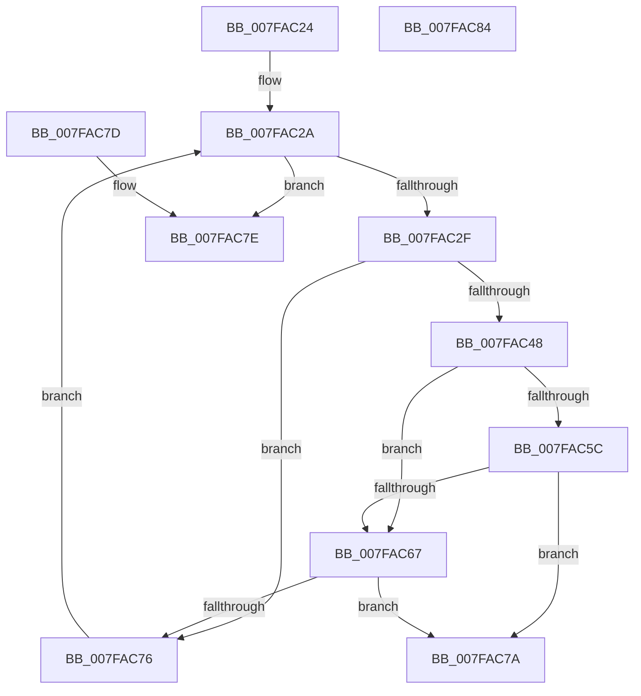

# MiNewPfnsSuitable

- RVA: `0x007FAC24`–`0x007FAC85` (길이 `97` bytes)
- VA: `0x00000001407FAC24`
- 실행 섹션: `PAGE`
- PDB 이름 있음: `예`; PDB Function 태그: `아니요`
- unwind 정보 RVA: `0x000DB714`
- 디코드: `30`개 명령, `97/97` bytes 표시
- 미해석 바이트: `0` (있으면 어셈블리에 `.byte`로 보존)

> 이 문서는 커널 이미지의 기계어와 PDB 기호를 분석해 생성했습니다. 4번과 5번은 함수 원형과 자료형을 바이너리 사용 방식에서 추정한 C 해석이며 원본 소스 복구 결과는 아닙니다.

## 1. Dependencies

- 직접 호출 지점: **0**; 고유 호출 대상: **0**
- 직접 호출자로 확인된 함수: **2**
- RIP 상대 이미지 참조: **2**

### Outgoing calls
- 직접 디코드된 call 명령이 없습니다.

### Direct callers
- [MiAllocateEntireImageFileExtents](../80/MiAllocateEntireImageFileExtents_function_008008DC.md) at `0x008009B5`
- [MiAllocateFileExtents](../AB/MiAllocateFileExtents_function_00ABDF54.md) at `0x00ABE1C0`

### Static image references
- `0x007FAC4D` → RVA `0x00E35C00` (`.data`; read)
- `0x007FAC67` → RVA `0x00E2DCE0` (`.data`; read)

## 2. Other-region calls and transfers

- 다른 실행 섹션으로 향하는 call: **0**
- 별도 외부 분기/꼬리 이동을 확인하지 못했습니다.

## 3. Assembly (complete function range)

```asm
007FAC24  44 8B 51 04                     mov r10d, dword ptr [rcx + 4]
007FAC28  33 D2                           xor edx, edx
007FAC2A  41 3B D2                        cmp edx, r10d
007FAC2D  73 4F                           jae 0x1407fac7e
007FAC2F  8B C2                           mov eax, edx
007FAC31  49 B9 00 00 00 00 00 00 00 80   movabs r9, 0x8000000000000000
007FAC3B  48 03 C0                        add rax, rax
007FAC3E  4C 8B 44 C1 08                  mov r8, qword ptr [rcx + rax*8 + 8]
007FAC43  4D 3B C1                        cmp r8, r9
007FAC46  74 2E                           je 0x1407fac76
007FAC48  4C 8B 4C C1 10                  mov r9, qword ptr [rcx + rax*8 + 0x10]
007FAC4D  48 8B 05 AC AF 63 00            mov rax, qword ptr [rip + 0x63afac]
007FAC54  4D 03 C8                        add r9, r8
007FAC57  4C 3B C8                        cmp r9, rax
007FAC5A  72 0B                           jb 0x1407fac67
007FAC5C  48 05 00 08 00 00               add rax, 0x800
007FAC62  4C 3B C0                        cmp r8, rax
007FAC65  72 13                           jb 0x1407fac7a
007FAC67  48 8B 05 72 30 63 00            mov rax, qword ptr [rip + 0x633072]
007FAC6E  48 FF C0                        inc rax
007FAC71  4C 3B C8                        cmp r9, rax
007FAC74  77 04                           ja 0x1407fac7a
007FAC76  FF C2                           inc edx
007FAC78  EB B0                           jmp 0x1407fac2a
007FAC7A  33 C0                           xor eax, eax
007FAC7C  C3                              ret
007FAC7D  CC                              int3
007FAC7E  B8 01 00 00 00                  mov eax, 1
007FAC83  C3                              ret
007FAC84  CC                              int3
```

## 4. C-style interpretation (structured pseudocode)

```c
__int64 __fastcall MiNewPfnsSuitable(__int64 a1, int a2)
{
    __int64 result;

    a2 = 0;
loc_007FAC2A:
    if (0 >= ((unsigned int)((unsigned int)(*(unsigned int *)(a1 + 4))))) goto loc_007FAC7E;
    result = (0) + (0);
    if ((*(unsigned __int64 *)(a1 + result * 8 + 8)) == a4) goto loc_007FAC76;
    a4 = (*(unsigned __int64 *)(a1 + result * 8 + 16)) + (*(unsigned __int64 *)(a1 + result * 8 + 8));
    if (a4 < (*(unsigned __int64 *)(v_rip + 6533036))) goto loc_007FAC67;
    result = (*(unsigned __int64 *)(v_rip + 6533036)) + (0x800ULL);
    if ((*(unsigned __int64 *)(a1 + result * 8 + 8)) < result) goto loc_007FAC7A;
loc_007FAC67:
    result = (*(unsigned __int64 *)(v_rip + 6500466)) + 1;
    if (a4 > result) goto loc_007FAC7A;
loc_007FAC76:
    a2 = (unsigned int)((a2) + 1);
    goto loc_007FAC2A;
loc_007FAC7A:
    result = 0;
    return result;
loc_007FAC7E:
    return 1;
}
```

## 5. (Beta) C Style

```c
int64_t MiNewPfnsSuitable(void *Arg1, int32_t Arg2)
{
    uint8_t *arg1 = (uint8_t *)Arg1;

    int64_t result;

    Arg2 = 0;
loc_007FAC2A:
    if (0 >= ((uint32_t)((uint32_t)(*(uint32_t *)(arg1 + 0x4))))) goto loc_007FAC7E;
    result = (0) + (0);
    if ((*(uint64_t *)(arg1 + result * 8 + 0x8)) == a4) goto loc_007FAC76;
    a4 = (*(uint64_t *)(arg1 + result * 8 + 0x10)) + (*(uint64_t *)(arg1 + result * 8 + 0x8));
    if (a4 < (*(uint64_t *)(v_rip + 0x63AFAC))) goto loc_007FAC67;
    result = (*(uint64_t *)(v_rip + 0x63AFAC)) + (0x800ULL);
    if ((*(uint64_t *)(arg1 + result * 8 + 0x8)) < result) goto loc_007FAC7A;
loc_007FAC67:
    result = (*(uint64_t *)(v_rip + 0x633072)) + 1;
    if (a4 > result) goto loc_007FAC7A;
loc_007FAC76:
    Arg2 = (uint32_t)((Arg2) + 1);
    goto loc_007FAC2A;
loc_007FAC7A:
    result = 0;
    return result;
loc_007FAC7E:
    return 1;
}
```

### 관측된 메모리 오프셋

구조체 형식이 확인되지 않은 접근은 인자 기준의 오프셋으로만 기록했습니다.

| 기준 인자 | 오프셋 표현 | 폭 (bit) | 접근 |
|---|---:|---:|---|
| `Arg1` | `+ 0x4` | `32` | `R` |
| `Arg1` | `+ 0x8 + rax*8` | `64` | `R` |
| `Arg1` | `+ 0x10 + rax*8` | `64` | `R` |

## 6. Execution-region graph

[열기: 2D/3D 그래프와 함수 탐색 컨트롤 패널](../../../control-panel.html?section=page&rva=0x007FAC24&view=graph)

- 2D 그래프는 위에서 아래로 흐르고, 3D 그래프는 빈 공간을 드래그해 회전합니다. Shift+드래그는 이동, 휠은 확대·축소, 함수 노드 선택은 대상 보고서 이동입니다.

### Static fallback


