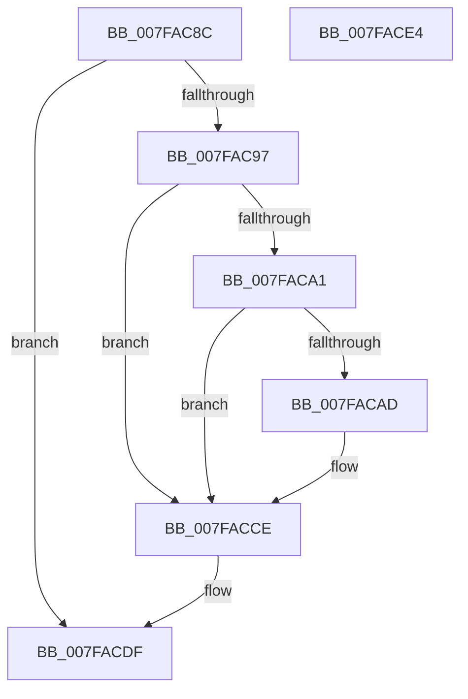

# MiNotifyMemoryChange

- RVA: `0x007FAC8C`–`0x007FACE5` (길이 `89` bytes)
- VA: `0x00000001407FAC8C`
- 실행 섹션: `PAGE`
- PDB 이름 있음: `예`; PDB Function 태그: `아니요`
- unwind 정보 RVA: `0x00063458`
- 디코드: `26`개 명령, `89/89` bytes 표시
- 미해석 바이트: `0` (있으면 어셈블리에 `.byte`로 보존)

> 이 문서는 커널 이미지의 기계어와 PDB 기호를 분석해 생성했습니다. 4번과 5번은 함수 원형과 자료형을 바이너리 사용 방식에서 추정한 C 해석이며 원본 소스 복구 결과는 아닙니다.

## 1. Dependencies

- 직접 호출 지점: **2**; 고유 호출 대상: **2**
- 직접 호출자로 확인된 함수: **2**
- RIP 상대 이미지 참조: **4**

### Outgoing calls
- `0x007FACC9` → [ZwUpdateWnfStateData](../../text/6B/ZwUpdateWnfStateData_function_006B0D10.md) (function, `0x006B0D10`)
- `0x007FACDA` → [KePulseEvent](../../text/35/KePulseEvent_function_00351EF0.md) (function, `0x00351EF0`)

### Direct callers
- [MiCompleteMemoryAddition](MiCompleteMemoryAddition_function_007F9FAC.md) at `0x007FA0F5`
- [MiRemovePhysicalMemory](MiRemovePhysicalMemory_function_007FAD3C.md) at `0x007FAFA9`

### Static image references
- `0x007FAC99` → RVA `0x00E2FFAC` (`.data`; read)
- `0x007FACA1` → RVA `0x00FC6A88` (`ALMOSTRO`; read)
- `0x007FACC2` → RVA `0x000208D0` (`.rdata`; read)
- `0x007FACCE` → RVA `0x00E38E48` (`.data`; read)

## 2. Other-region calls and transfers

- 다른 실행 섹션으로 향하는 call: **2**
  - `0x007FACC9` → [ZwUpdateWnfStateData](../../text/6B/ZwUpdateWnfStateData_function_006B0D10.md) (`PAGE` → `.text`)
  - `0x007FACDA` → [KePulseEvent](../../text/35/KePulseEvent_function_00351EF0.md) (`PAGE` → `.text`)
- 별도 외부 분기/꼬리 이동을 확인하지 못했습니다.

## 3. Assembly (complete function range)

```asm
007FAC8C  48 83 EC 48                     sub rsp, 0x48
007FAC90  8B 41 28                        mov eax, dword ptr [rcx + 0x28]
007FAC93  A8 02                           test al, 2
007FAC95  75 48                           jne 0x1407facdf
007FAC97  33 C9                           xor ecx, ecx
007FAC99  39 0D 0D 53 63 00               cmp dword ptr [rip + 0x63530d], ecx
007FAC9F  74 2D                           je 0x1407facce
007FACA1  8A 05 E1 BD 7C 00               mov al, byte ptr [rip + 0x7cbde1]
007FACA7  24 30                           and al, 0x30
007FACA9  3C 20                           cmp al, 0x20
007FACAB  72 21                           jb 0x1407facce
007FACAD  89 4C 24 30                     mov dword ptr [rsp + 0x30], ecx
007FACB1  45 33 C9                        xor r9d, r9d
007FACB4  89 4C 24 28                     mov dword ptr [rsp + 0x28], ecx
007FACB8  45 33 C0                        xor r8d, r8d
007FACBB  48 89 4C 24 20                  mov qword ptr [rsp + 0x20], rcx
007FACC0  33 D2                           xor edx, edx
007FACC2  48 8D 0D 07 5C 82 FF            lea rcx, [rip - 0x7da3f9]
007FACC9  E8 42 60 EB FF                  call 0x1406b0d10
007FACCE  48 8B 0D 73 E1 63 00            mov rcx, qword ptr [rip + 0x63e173]
007FACD5  45 33 C0                        xor r8d, r8d
007FACD8  33 D2                           xor edx, edx
007FACDA  E8 11 72 B5 FF                  call 0x140351ef0
007FACDF  48 83 C4 48                     add rsp, 0x48
007FACE3  C3                              ret
007FACE4  CC                              int3
```

## 4. C-style interpretation (structured pseudocode)

```c
__int64 __fastcall MiNotifyMemoryChange(__int64 a1, int a2, int a3, int a4)
{
    __int64 result;
    __int64 v_rsp;
    unsigned int v_stack_m18;
    unsigned int v_stack_m20;
    unsigned __int64 v_stack_m28;

    v_rsp = (v_rsp) - (72);
    if ((((unsigned __int8)((unsigned int)(*(unsigned int *)(a1 + 40)))) & (2)) != 0) goto loc_007FACDF;
    a1 = 0;
    if ((*(unsigned int *)(v_rip + 6509325)) == 0) goto loc_007FACCE;
    result = (unsigned __int8)((*(unsigned __int8 *)(v_rip + 8175073)) & (48));
    if (((unsigned __int8)(result)) >= 32) {
        v_stack_m18 = 0;
        a4 = 0;
        v_stack_m20 = 0;
        a3 = 0;
        v_stack_m28 = 0;
        a2 = 0;
        a1 = v_rip - 8233977;
        result = ZwUpdateWnfStateData(a1, a2, a3, a4);
    }
    a3 = 0;
    a2 = 0;
    result = KePulseEvent(*(unsigned __int64 *)(v_rip + 6545779), a2, a3, a4);
loc_007FACDF:
    v_rsp = (v_rsp) + (72);
    return result;
}
```

## 5. (Beta) C Style

```c
int64_t MiNotifyMemoryChange(void *Arg1, int32_t Arg2, int32_t Arg3, int32_t Arg4)
{
    uint8_t *arg1 = (uint8_t *)Arg1;

    int64_t result;
    int64_t local_rsp;
    uint32_t v_stack_m18;
    uint32_t v_stack_m20;
    uint64_t v_stack_m28;

    local_rsp = (local_rsp) - (72);
    if ((((uint8_t)((uint32_t)(*(uint32_t *)(arg1 + 0x28)))) & (2)) != 0) goto loc_007FACDF;
    Arg1 = 0;
    if ((*(uint32_t *)(v_rip + 0x63530D)) == 0) goto loc_007FACCE;
    result = (uint8_t)((*(uint8_t *)(v_rip + 0x7CBDE1)) & (48));
    if (((uint8_t)(result)) >= 32) {
        v_stack_m18 = 0;
        Arg4 = 0;
        v_stack_m20 = 0;
        Arg3 = 0;
        v_stack_m28 = 0;
        Arg2 = 0;
        Arg1 = v_rip - 8233977;
        result = ZwUpdateWnfStateData(Arg1, Arg2, Arg3, Arg4);
    }
    Arg3 = 0;
    Arg2 = 0;
    result = KePulseEvent(*(uint64_t *)(v_rip + 0x63E173), Arg2, Arg3, Arg4);
loc_007FACDF:
    local_rsp = (local_rsp) + (72);
    return result;
}
```

### 관측된 메모리 오프셋

구조체 형식이 확인되지 않은 접근은 인자 기준의 오프셋으로만 기록했습니다.

| 기준 인자 | 오프셋 표현 | 폭 (bit) | 접근 |
|---|---:|---:|---|
| `Arg1` | `+ 0x28` | `32` | `R` |

## 6. Execution-region graph

[열기: 2D/3D 그래프와 함수 탐색 컨트롤 패널](../../../control-panel.html?section=page&rva=0x007FAC8C&view=graph)

- 2D 그래프는 위에서 아래로 흐르고, 3D 그래프는 빈 공간을 드래그해 회전합니다. Shift+드래그는 이동, 휠은 확대·축소, 함수 노드 선택은 대상 보고서 이동입니다.

### Static fallback


