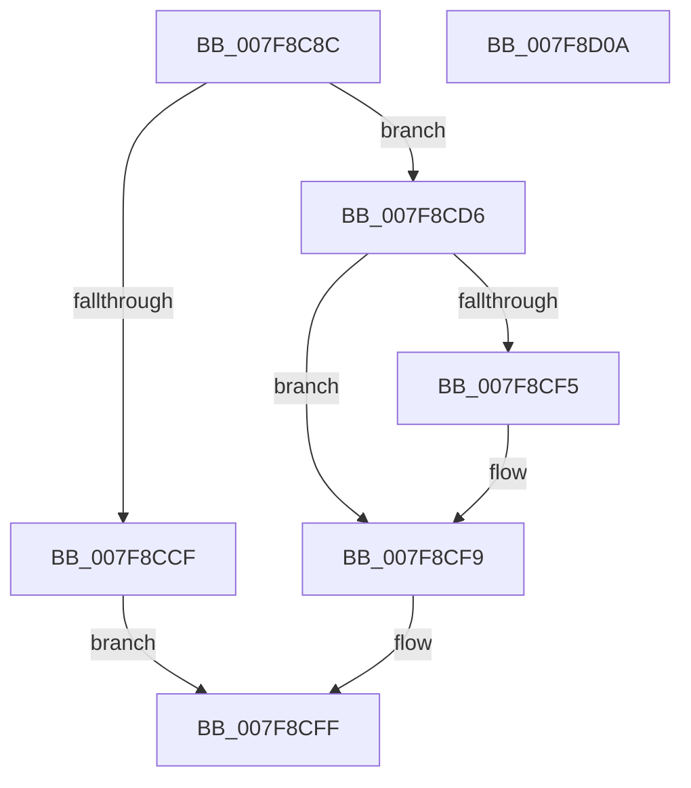

# MiPrepareDriverPatchState

- RVA: `0x007F8C8C`–`0x007F8D0B` (길이 `127` bytes)
- VA: `0x00000001407F8C8C`
- 실행 섹션: `PAGE`
- PDB 이름 있음: `예`; PDB Function 태그: `아니요`
- unwind 정보 RVA: `0x0005CAAC`
- 디코드: `37`개 명령, `127/127` bytes 표시
- 미해석 바이트: `0` (있으면 어셈블리에 `.byte`로 보존)

> 이 문서는 커널 이미지의 기계어와 PDB 기호를 분석해 생성했습니다. 4번과 5번은 함수 원형과 자료형을 바이너리 사용 방식에서 추정한 C 해석이며 원본 소스 복구 결과는 아닙니다.

## 1. Dependencies

- 직접 호출 지점: **2**; 고유 호출 대상: **2**
- 직접 호출자로 확인된 함수: **5**
- RIP 상대 이미지 참조: **0**

### Outgoing calls
- `0x007F8CC2` → [MiAllocatePool](../../text/35/MiAllocatePool_function_0035B540.md) (function, `0x0035B540`)
- `0x007F8CEC` → [MI_IS_PHYSICAL_ADDRESS](../../text/23/MI_IS_PHYSICAL_ADDRESS_function_0023B3A0.md) (function, `0x0023B3A0`)

### Direct callers
- [MiLockPatchIatForDV](../../text/68/MiLockPatchIatForDV_function_00682050.md) at `0x006820EA`
- [MmWriteSystemImageTracepoint](../../text/68/MmWriteSystemImageTracepoint_function_00684150.md) at `0x006841E0`
- [MiLockAndMapEntireDriver](../80/MiLockAndMapEntireDriver_function_008015C8.md) at `0x008015FF`
- [MiApplyDriverHotPatch](../80/MiApplyDriverHotPatch_function_008018EC.md) at `0x00801AFE`
- [MiApplyDriverHotPatch](../80/MiApplyDriverHotPatch_function_008018EC.md) at `0x00801B14`
- [MmReapplyBootPatchImports](../../init/C6/MmReapplyBootPatchImports_function_00C67768.md) at `0x00C67826`
- [MmReapplyBootPatchImports](../../init/C6/MmReapplyBootPatchImports_function_00C67768.md) at `0x00C6783A`

### Static image references
- 디코드된 RIP-relative 메모리 참조가 없습니다.

## 2. Other-region calls and transfers

- 다른 실행 섹션으로 향하는 call: **2**
  - `0x007F8CC2` → [MiAllocatePool](../../text/35/MiAllocatePool_function_0035B540.md) (`PAGE` → `.text`)
  - `0x007F8CEC` → [MI_IS_PHYSICAL_ADDRESS](../../text/23/MI_IS_PHYSICAL_ADDRESS_function_0023B3A0.md) (`PAGE` → `.text`)
- 별도 외부 분기/꼬리 이동을 확인하지 못했습니다.

## 3. Assembly (complete function range)

```asm
007F8C8C  48 89 5C 24 08                  mov qword ptr [rsp + 8], rbx
007F8C91  57                              push rdi
007F8C92  48 83 EC 20                     sub rsp, 0x20
007F8C96  44 8B 41 18                     mov r8d, dword ptr [rcx + 0x18]
007F8C9A  B8 00 00 00 00                  mov eax, 0
007F8C9F  41 F6 C0 3F                     test r8b, 0x3f
007F8CA3  48 8B FA                        mov rdi, rdx
007F8CA6  48 8B D9                        mov rbx, rcx
007F8CA9  B9 40 00 00 00                  mov ecx, 0x40
007F8CAE  0F 95 C0                        setne al
007F8CB1  41 C1 E8 06                     shr r8d, 6
007F8CB5  41 8D 14 00                     lea edx, [r8 + rax]
007F8CB9  41 B8 44 50 42 4D               mov r8d, 0x4d425044
007F8CBF  C1 E2 03                        shl edx, 3
007F8CC2  E8 79 28 B6 FF                  call 0x14035b540
007F8CC7  48 8B C8                        mov rcx, rax
007F8CCA  48 85 C0                        test rax, rax
007F8CCD  75 07                           jne 0x1407f8cd6
007F8CCF  B8 9A 00 00 C0                  mov eax, 0xc000009a
007F8CD4  EB 29                           jmp 0x1407f8cff
007F8CD6  8B 43 18                        mov eax, dword ptr [rbx + 0x18]
007F8CD9  48 89 43 20                     mov qword ptr [rbx + 0x20], rax
007F8CDD  48 89 4B 28                     mov qword ptr [rbx + 0x28], rcx
007F8CE1  48 8B 0B                        mov rcx, qword ptr [rbx]
007F8CE4  83 63 60 00                     and dword ptr [rbx + 0x60], 0
007F8CE8  48 8B 49 30                     mov rcx, qword ptr [rcx + 0x30]
007F8CEC  E8 AF 26 A4 FF                  call 0x14023b3a0
007F8CF1  85 C0                           test eax, eax
007F8CF3  74 04                           je 0x1407f8cf9
007F8CF5  83 4B 60 02                     or dword ptr [rbx + 0x60], 2
007F8CF9  48 89 7B 10                     mov qword ptr [rbx + 0x10], rdi
007F8CFD  33 C0                           xor eax, eax
007F8CFF  48 8B 5C 24 30                  mov rbx, qword ptr [rsp + 0x30]
007F8D04  48 83 C4 20                     add rsp, 0x20
007F8D08  5F                              pop rdi
007F8D09  C3                              ret
007F8D0A  CC                              int3
```

## 4. C-style interpretation (structured pseudocode)

```c
__int64 __fastcall MiPrepareDriverPatchState(__int64 a1, __int64 a2)
{
    __int64 result;
    __int64 v_rsp;
    unsigned __int64 v_stack_p8;

    v_stack_p8 = v_rbx;
    v_rsp = (v_rsp) - (32);
    result = ((((unsigned __int8)((unsigned int)(*(unsigned int *)(a1 + 24)))) & (63)) != 0) ? 1 : 0;
    a3 = (unsigned int)(((unsigned int)(*(unsigned int *)(a1 + 24))) >> (6));
    a2 = (unsigned int)((a3 + result * 1) << (3));
    result = MiAllocatePool(64, a2, (unsigned int)(0x4D425044ULL), a4);
    if (result != 0) goto loc_007F8CD6;
    goto loc_007F8CFF;
loc_007F8CD6:
    *(unsigned __int64 *)(a1 + 32) = (unsigned int)(*(unsigned int *)(a1 + 24));
    *(unsigned __int64 *)(a1 + 40) = result;
    result = MI_IS_PHYSICAL_ADDRESS(*(unsigned __int64 *)(*(unsigned __int64 *)(a1) + 48), a2, (unsigned int)(0x4D425044ULL), a4);
    if ((unsigned int)(result) != 0) {
    }
    *(unsigned __int64 *)(a1 + 16) = a2;
    result = 0;
loc_007F8CFF:
    v_rsp = (v_rsp) + (32);
    return result;
}
```

## 5. (Beta) C Style

```c
int64_t MiPrepareDriverPatchState(void *Arg1, int64_t Arg2)
{
    uint8_t *arg1 = (uint8_t *)Arg1;

    int64_t result;
    int64_t local_rsp;
    uint64_t v_stack_p8;

    v_stack_p8 = local_rbx;
    local_rsp = (local_rsp) - (32);
    result = ((((uint8_t)((uint32_t)(*(uint32_t *)(arg1 + 0x18)))) & (63)) != 0) ? 1 : 0;
    a3 = (uint32_t)(((uint32_t)(*(uint32_t *)(arg1 + 0x18))) >> (6));
    Arg2 = (uint32_t)((a3 + result * 1) << (3));
    result = MiAllocatePool(64, Arg2, (uint32_t)(0x4D425044ULL), a4);
    if (result != 0) goto loc_007F8CD6;
    goto loc_007F8CFF;
loc_007F8CD6:
    *(uint64_t *)(arg1 + 0x20) = (uint32_t)(*(uint32_t *)(arg1 + 0x18));
    *(uint64_t *)(arg1 + 0x28) = result;
    result = MI_IS_PHYSICAL_ADDRESS(*(uint64_t *)(*(uint64_t *)(arg1) + 0x30), Arg2, (uint32_t)(0x4D425044ULL), a4);
    if ((uint32_t)(result) != 0) {
    }
    *(uint64_t *)(arg1 + 0x10) = Arg2;
    result = 0;
loc_007F8CFF:
    local_rsp = (local_rsp) + (32);
    return result;
}
```

### 관측된 메모리 오프셋

구조체 형식이 확인되지 않은 접근은 인자 기준의 오프셋으로만 기록했습니다.

| 기준 인자 | 오프셋 표현 | 폭 (bit) | 접근 |
|---|---:|---:|---|
| `Arg1` | `+ 0x0` | `64` | `R` |
| `Arg1` | `+ 0x10` | `64` | `W` |
| `Arg1` | `+ 0x18` | `32` | `R` |
| `Arg1` | `+ 0x20` | `64` | `W` |
| `Arg1` | `+ 0x28` | `64` | `W` |
| `Arg1` | `+ 0x60` | `32` | `R/W` |

## 6. Execution-region graph

[열기: 2D/3D 그래프와 함수 탐색 컨트롤 패널](../../../control-panel.html?section=page&rva=0x007F8C8C&view=graph)

- 2D 그래프는 위에서 아래로 흐르고, 3D 그래프는 빈 공간을 드래그해 회전합니다. Shift+드래그는 이동, 휠은 확대·축소, 함수 노드 선택은 대상 보고서 이동입니다.

### Static fallback


