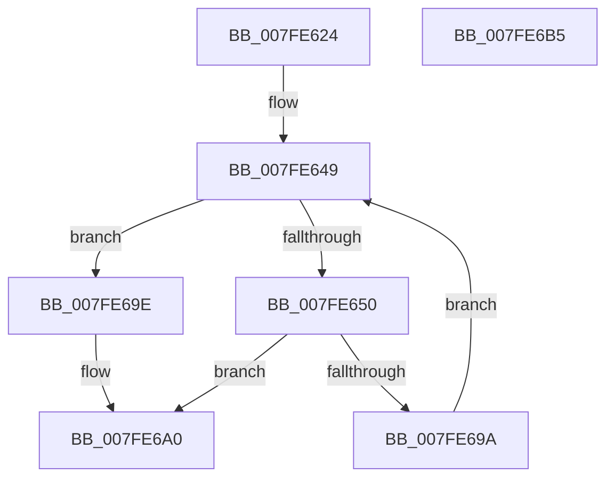

# MiProcessRemoveFromWorkingSet

- RVA: `0x007FE624`–`0x007FE6B6` (길이 `146` bytes)
- VA: `0x00000001407FE624`
- 실행 섹션: `PAGE`
- PDB 이름 있음: `예`; PDB Function 태그: `아니요`
- unwind 정보 RVA: `0x0005C954`
- 디코드: `39`개 명령, `146/146` bytes 표시
- 미해석 바이트: `0` (있으면 어셈블리에 `.byte`로 보존)

> 이 문서는 커널 이미지의 기계어와 PDB 기호를 분석해 생성했습니다. 4번과 5번은 함수 원형과 자료형을 바이너리 사용 방식에서 추정한 C 해석이며 원본 소스 복구 결과는 아닙니다.

## 1. Dependencies

- 직접 호출 지점: **1**; 고유 호출 대상: **1**
- 직접 호출자로 확인된 함수: **1**
- RIP 상대 이미지 참조: **0**

### Outgoing calls
- `0x007FE691` → [MiEmptyWorkingSetInitiate](../../text/2A/MiEmptyWorkingSetInitiate_function_002A7128.md) (function, `0x002A7128`)

### Direct callers
- [sub_00B31388](../B3/Unknown_function_00B31388.md) at `0x00B313F1`

### Static image references
- 디코드된 RIP-relative 메모리 참조가 없습니다.

## 2. Other-region calls and transfers

- 다른 실행 섹션으로 향하는 call: **1**
  - `0x007FE691` → [MiEmptyWorkingSetInitiate](../../text/2A/MiEmptyWorkingSetInitiate_function_002A7128.md) (`PAGE` → `.text`)
- 별도 외부 분기/꼬리 이동을 확인하지 못했습니다.

## 3. Assembly (complete function range)

```asm
007FE624  48 89 5C 24 08                  mov qword ptr [rsp + 8], rbx
007FE629  48 89 6C 24 10                  mov qword ptr [rsp + 0x10], rbp
007FE62E  48 89 74 24 18                  mov qword ptr [rsp + 0x18], rsi
007FE633  57                              push rdi
007FE634  48 83 EC 20                     sub rsp, 0x20
007FE638  41 8B D8                        mov ebx, r8d
007FE63B  48 8B EA                        mov rbp, rdx
007FE63E  83 E3 01                        and ebx, 1
007FE641  48 8B F1                        mov rsi, rcx
007FE644  C1 E3 02                        shl ebx, 2
007FE647  33 FF                           xor edi, edi
007FE649  8B C7                           mov eax, edi
007FE64B  48 3B C6                        cmp rax, rsi
007FE64E  73 4E                           jae 0x1407fe69e
007FE650  48 03 C0                        add rax, rax
007FE653  8B D3                           mov edx, ebx
007FE655  4C 8B 44 C5 00                  mov r8, qword ptr [rbp + rax*8]
007FE65A  4C 8B 4C C5 08                  mov r9, qword ptr [rbp + rax*8 + 8]
007FE65F  65 48 8B 04 25 88 01 00 00      mov rax, qword ptr gs:[0x188]
007FE668  49 81 C1 FF 0F 00 00            add r9, 0xfff
007FE66F  4D 03 C8                        add r9, r8
007FE672  49 81 E0 00 F0 FF FF            and r8, 0xfffffffffffff000
007FE679  49 81 E1 00 F0 FF FF            and r9, 0xfffffffffffff000
007FE680  49 FF C9                        dec r9
007FE683  48 8B 88 B8 00 00 00            mov rcx, qword ptr [rax + 0xb8]
007FE68A  48 81 C1 00 04 00 00            add rcx, 0x400
007FE691  E8 92 8A AA FF                  call 0x1402a7128
007FE696  85 C0                           test eax, eax
007FE698  78 06                           js 0x1407fe6a0
007FE69A  FF C7                           inc edi
007FE69C  EB AB                           jmp 0x1407fe649
007FE69E  33 C0                           xor eax, eax
007FE6A0  48 8B 5C 24 30                  mov rbx, qword ptr [rsp + 0x30]
007FE6A5  48 8B 6C 24 38                  mov rbp, qword ptr [rsp + 0x38]
007FE6AA  48 8B 74 24 40                  mov rsi, qword ptr [rsp + 0x40]
007FE6AF  48 83 C4 20                     add rsp, 0x20
007FE6B3  5F                              pop rdi
007FE6B4  C3                              ret
007FE6B5  CC                              int3
```

## 4. C-style interpretation (structured pseudocode)

```c
__int64 __fastcall MiProcessRemoveFromWorkingSet(__int64 a1, __int64 a2, int a3)
{
    __int64 result;
    __int64 v_rbx;
    __int64 v_rdi;
    __int64 v_rsp;
    unsigned __int64 v_stack_p10;
    unsigned __int64 v_stack_p18;
    unsigned __int64 v_stack_p8;

    v_stack_p8 = v_rbx;
    v_stack_p10 = v_rbp;
    v_stack_p18 = v_rsi;
    v_rsp = (v_rsp) - (32);
    v_rbx = (unsigned int)(((unsigned int)(a3)) & (1));
    v_rbx = (unsigned int)((v_rbx) << (2));
    v_rdi = 0;
loc_007FE649:
    if (0 >= a1) goto loc_007FE69E;
    result = (0) + (0);
    a4 = (*(unsigned __int64 *)(a2 + result * 8 + 8)) + (0xFFFULL);
    a4 = (a4) + (*(unsigned __int64 *)(a2 + result * 8));
    a3 = (*(unsigned __int64 *)(a2 + result * 8)) & (0xFFFFFFFFFFFFF000ULL);
    a4 = (a4) & (0xFFFFFFFFFFFFF000ULL);
    a4 = (a4) - 1;
    a1 = (*(unsigned __int64 *)(*(unsigned __int64 *)(gs_base + (0 + 392)) + 184)) + (0x400ULL);
    result = MiEmptyWorkingSetInitiate(a1, (unsigned int)((unsigned int)(v_rbx)), a3, a4);
    if (sign_flag) goto loc_007FE6A0;
    v_rdi = (unsigned int)((v_rdi) + 1);
    goto loc_007FE649;
loc_007FE69E:
    result = 0;
loc_007FE6A0:
    v_rsp = (v_rsp) + (32);
    return result;
}
```

## 5. (Beta) C Style

```c
int64_t MiProcessRemoveFromWorkingSet(int64_t Arg1, void *Arg2, int32_t Arg3)
{
    uint8_t *arg2 = (uint8_t *)Arg2;

    int64_t result;
    int64_t local_rbx;
    int64_t local_rdi;
    int64_t local_rsp;
    uint64_t v_stack_p10;
    uint64_t v_stack_p18;
    uint64_t v_stack_p8;

    v_stack_p8 = local_rbx;
    v_stack_p10 = local_rbp;
    v_stack_p18 = local_rsi;
    local_rsp = (local_rsp) - (32);
    local_rbx = (uint32_t)(((uint32_t)(Arg3)) & (1));
    local_rbx = (uint32_t)((local_rbx) << (2));
    local_rdi = 0;
loc_007FE649:
    if (0 >= Arg1) goto loc_007FE69E;
    result = (0) + (0);
    a4 = (*(uint64_t *)(arg2 + result * 8 + 0x8)) + (0xFFFULL);
    a4 = (a4) + (*(uint64_t *)(arg2 + result * 8));
    Arg3 = (*(uint64_t *)(arg2 + result * 8)) & (0xFFFFFFFFFFFFF000ULL);
    a4 = (a4) & (0xFFFFFFFFFFFFF000ULL);
    a4 = (a4) - 1;
    Arg1 = (*(uint64_t *)(*(uint64_t *)(gs_base + (0 + 0x188)) + 0xB8)) + (0x400ULL);
    result = MiEmptyWorkingSetInitiate(Arg1, (uint32_t)((uint32_t)(local_rbx)), Arg3, a4);
    if (sign_flag) goto loc_007FE6A0;
    local_rdi = (uint32_t)((local_rdi) + 1);
    goto loc_007FE649;
loc_007FE69E:
    result = 0;
loc_007FE6A0:
    local_rsp = (local_rsp) + (32);
    return result;
}
```

### 관측된 메모리 오프셋

구조체 형식이 확인되지 않은 접근은 인자 기준의 오프셋으로만 기록했습니다.

| 기준 인자 | 오프셋 표현 | 폭 (bit) | 접근 |
|---|---:|---:|---|
| `Arg2` | `+ 0x0 + rax*8` | `64` | `R` |
| `Arg2` | `+ 0x8 + rax*8` | `64` | `R` |

## 6. Execution-region graph

[열기: 2D/3D 그래프와 함수 탐색 컨트롤 패널](../../../control-panel.html?section=page&rva=0x007FE624&view=graph)

- 2D 그래프는 위에서 아래로 흐르고, 3D 그래프는 빈 공간을 드래그해 회전합니다. Shift+드래그는 이동, 휠은 확대·축소, 함수 노드 선택은 대상 보고서 이동입니다.

### Static fallback


