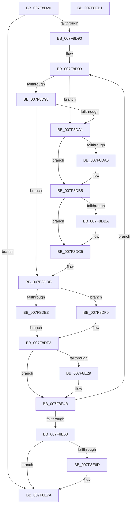

# MiProtectLargeKernelHalRange

- RVA: `0x007F8D20`–`0x007F8EB2` (길이 `402` bytes)
- VA: `0x00000001407F8D20`
- 실행 섹션: `PAGE`
- PDB 이름 있음: `예`; PDB Function 태그: `아니요`
- unwind 정보 RVA: `0x000AC264`
- 디코드: `117`개 명령, `402/402` bytes 표시
- 미해석 바이트: `0` (있으면 어셈블리에 `.byte`로 보존)

> 이 문서는 커널 이미지의 기계어와 PDB 기호를 분석해 생성했습니다. 4번과 5번은 함수 원형과 자료형을 바이너리 사용 방식에서 추정한 C 해석이며 원본 소스 복구 결과는 아닙니다.

## 1. Dependencies

- 직접 호출 지점: **20**; 고유 호출 대상: **16**
- 직접 호출자로 확인된 함수: **1**
- RIP 상대 이미지 참조: **0**

### Outgoing calls
- `0x007F8D4A` → [MiComputeDriverProtection](../AA/MiComputeDriverProtection_function_00AA80A8.md) (function, `0x00AA80A8`)
- `0x007F8D5A` → [MiGetLargePteAddress](../../text/3D/MiGetLargePteAddress_function_003D3300.md) (function, `0x003D3300`)
- `0x007F8D67` → [MiGetLargePteAddress](../../text/3D/MiGetLargePteAddress_function_003D3300.md) (function, `0x003D3300`)
- `0x007F8D73` → [MiGetAnyMultiplexedVm](../../text/44/MiGetAnyMultiplexedVm_function_00448BD0.md) (function, `0x00448BD0`)
- `0x007F8D7E` → [MiLockWorkingSetShared](../../text/27/MiLockWorkingSetShared_function_0027CBF0.md) (function, `0x0027CBF0`)
- `0x007F8DA9` → [MiFlushTbList](../../text/31/MiFlushTbList_function_00311FC0.md) (function, `0x00311FC0`)
- `0x007F8DAE` → [MiReleaseProcessorFlushList](../../text/31/MiReleaseProcessorFlushList_function_00313C70.md) (function, `0x00313C70`)
- `0x007F8DC0` → [MiUnlockPageTable](../../text/21/MiUnlockPageTable_function_00216EC0.md) (function, `0x00216EC0`)
- `0x007F8DC8` → [MiGetPteAddress](../../text/43/MiGetPteAddress_function_0043E130.md) (function, `0x0043E130`)
- `0x007F8DD6` → [MiLockNestedPageTable](../../text/23/MiLockNestedPageTable_function_0023E890.md) (function, `0x0023E890`)
- `0x007F8DE9` → [MiRestrictSystemCodeProtection](../../text/4F/MiRestrictSystemCodeProtection_function_004FD248.md) (function, `0x004FD248`)
- `0x007F8E0F` → [MiMakeValidPte](../../text/2C/MiMakeValidPte_function_002C5590.md) (function, `0x002C5590`)
- `0x007F8E1F` → [MiRewritePteWithLockBit](../../text/32/MiRewritePteWithLockBit_function_00322FEC.md) (function, `0x00322FEC`)
- `0x007F8E29` → [MiGetProcessorFlushList](../../text/24/MiGetProcessorFlushList_function_00242C90.md) (function, `0x00242C90`)
- `0x007F8E46` → [MiInitializeTbFlushList](../../text/29/MiInitializeTbFlushList_function_00294F00.md) (function, `0x00294F00`)
- `0x007F8E56` → [MiInsertLargeTbFlushEntry](../../text/37/MiInsertLargeTbFlushEntry_function_0037827C.md) (function, `0x0037827C`)
- `0x007F8E70` → [MiFlushTbList](../../text/31/MiFlushTbList_function_00311FC0.md) (function, `0x00311FC0`)
- `0x007F8E75` → [MiReleaseProcessorFlushList](../../text/31/MiReleaseProcessorFlushList_function_00313C70.md) (function, `0x00313C70`)
- `0x007F8E80` → [MiUnlockPageTable](../../text/21/MiUnlockPageTable_function_00216EC0.md) (function, `0x00216EC0`)
- `0x007F8E8C` → [MiUnlockWorkingSetShared](../../text/27/MiUnlockWorkingSetShared_function_0027D690.md) (function, `0x0027D690`)

### Direct callers
- [MiProtectKernelCfgData](../../init/C5/MiProtectKernelCfgData_function_00C5F5E0.md) at `0x00C5F684`

### Static image references
- 디코드된 RIP-relative 메모리 참조가 없습니다.

## 2. Other-region calls and transfers

- 다른 실행 섹션으로 향하는 call: **19**
  - `0x007F8D5A` → [MiGetLargePteAddress](../../text/3D/MiGetLargePteAddress_function_003D3300.md) (`PAGE` → `.text`)
  - `0x007F8D67` → [MiGetLargePteAddress](../../text/3D/MiGetLargePteAddress_function_003D3300.md) (`PAGE` → `.text`)
  - `0x007F8D73` → [MiGetAnyMultiplexedVm](../../text/44/MiGetAnyMultiplexedVm_function_00448BD0.md) (`PAGE` → `.text`)
  - `0x007F8D7E` → [MiLockWorkingSetShared](../../text/27/MiLockWorkingSetShared_function_0027CBF0.md) (`PAGE` → `.text`)
  - `0x007F8DA9` → [MiFlushTbList](../../text/31/MiFlushTbList_function_00311FC0.md) (`PAGE` → `.text`)
  - `0x007F8DAE` → [MiReleaseProcessorFlushList](../../text/31/MiReleaseProcessorFlushList_function_00313C70.md) (`PAGE` → `.text`)
  - `0x007F8DC0` → [MiUnlockPageTable](../../text/21/MiUnlockPageTable_function_00216EC0.md) (`PAGE` → `.text`)
  - `0x007F8DC8` → [MiGetPteAddress](../../text/43/MiGetPteAddress_function_0043E130.md) (`PAGE` → `.text`)
  - `0x007F8DD6` → [MiLockNestedPageTable](../../text/23/MiLockNestedPageTable_function_0023E890.md) (`PAGE` → `.text`)
  - `0x007F8DE9` → [MiRestrictSystemCodeProtection](../../text/4F/MiRestrictSystemCodeProtection_function_004FD248.md) (`PAGE` → `.text`)
  - `0x007F8E0F` → [MiMakeValidPte](../../text/2C/MiMakeValidPte_function_002C5590.md) (`PAGE` → `.text`)
  - `0x007F8E1F` → [MiRewritePteWithLockBit](../../text/32/MiRewritePteWithLockBit_function_00322FEC.md) (`PAGE` → `.text`)
  - `0x007F8E29` → [MiGetProcessorFlushList](../../text/24/MiGetProcessorFlushList_function_00242C90.md) (`PAGE` → `.text`)
  - `0x007F8E46` → [MiInitializeTbFlushList](../../text/29/MiInitializeTbFlushList_function_00294F00.md) (`PAGE` → `.text`)
  - `0x007F8E56` → [MiInsertLargeTbFlushEntry](../../text/37/MiInsertLargeTbFlushEntry_function_0037827C.md) (`PAGE` → `.text`)
  - `0x007F8E70` → [MiFlushTbList](../../text/31/MiFlushTbList_function_00311FC0.md) (`PAGE` → `.text`)
  - `0x007F8E75` → [MiReleaseProcessorFlushList](../../text/31/MiReleaseProcessorFlushList_function_00313C70.md) (`PAGE` → `.text`)
  - `0x007F8E80` → [MiUnlockPageTable](../../text/21/MiUnlockPageTable_function_00216EC0.md) (`PAGE` → `.text`)
  - `0x007F8E8C` → [MiUnlockWorkingSetShared](../../text/27/MiUnlockWorkingSetShared_function_0027D690.md) (`PAGE` → `.text`)
- 별도 외부 분기/꼬리 이동을 확인하지 못했습니다.

## 3. Assembly (complete function range)

```asm
007F8D20  48 89 5C 24 08                  mov qword ptr [rsp + 8], rbx
007F8D25  48 89 6C 24 10                  mov qword ptr [rsp + 0x10], rbp
007F8D2A  48 89 74 24 18                  mov qword ptr [rsp + 0x18], rsi
007F8D2F  57                              push rdi
007F8D30  41 54                           push r12
007F8D32  41 55                           push r13
007F8D34  41 56                           push r14
007F8D36  41 57                           push r15
007F8D38  48 83 EC 40                     sub rsp, 0x40
007F8D3C  4C 8B D1                        mov r10, rcx
007F8D3F  45 8B F9                        mov r15d, r9d
007F8D42  41 8B C8                        mov ecx, r8d
007F8D45  4C 8B DA                        mov r11, rdx
007F8D48  33 FF                           xor edi, edi
007F8D4A  E8 59 F3 2A 00                  call 0x140aa80a8
007F8D4F  8D 5F 01                        lea ebx, [rdi + 1]
007F8D52  49 8B CA                        mov rcx, r10
007F8D55  8B D3                           mov edx, ebx
007F8D57  44 8B E0                        mov r12d, eax
007F8D5A  E8 A1 A5 BD FF                  call 0x1403d3300
007F8D5F  8B D3                           mov edx, ebx
007F8D61  49 8B CB                        mov rcx, r11
007F8D64  48 8B F0                        mov rsi, rax
007F8D67  E8 94 A5 BD FF                  call 0x1403d3300
007F8D6C  8B CB                           mov ecx, ebx
007F8D6E  4C 8B E8                        mov r13, rax
007F8D71  33 ED                           xor ebp, ebp
007F8D73  E8 58 FE C4 FF                  call 0x140448bd0
007F8D78  48 8B C8                        mov rcx, rax
007F8D7B  4C 8B F0                        mov r14, rax
007F8D7E  E8 6D 3E A8 FF                  call 0x14027cbf0
007F8D83  88 44 24 30                     mov byte ptr [rsp + 0x30], al
007F8D87  49 3B F5                        cmp rsi, r13
007F8D8A  0F 83 EA 00 00 00               jae 0x1407f8e7a
007F8D90  44 23 FB                        and r15d, ebx
007F8D93  48 85 ED                        test rbp, rbp
007F8D96  74 09                           je 0x1407f8da1
007F8D98  48 F7 C6 FF 0F 00 00            test rsi, 0xfff
007F8D9F  75 3A                           jne 0x1407f8ddb
007F8DA1  48 85 FF                        test rdi, rdi
007F8DA4  74 0F                           je 0x1407f8db5
007F8DA6  48 8B CF                        mov rcx, rdi
007F8DA9  E8 12 92 B1 FF                  call 0x140311fc0
007F8DAE  E8 BD AE B1 FF                  call 0x140313c70
007F8DB3  33 FF                           xor edi, edi
007F8DB5  48 85 ED                        test rbp, rbp
007F8DB8  74 0B                           je 0x1407f8dc5
007F8DBA  48 8B D5                        mov rdx, rbp
007F8DBD  49 8B CE                        mov rcx, r14
007F8DC0  E8 FB E0 A1 FF                  call 0x140216ec0
007F8DC5  48 8B CE                        mov rcx, rsi
007F8DC8  E8 63 53 C4 FF                  call 0x14043e130
007F8DCD  48 8B D0                        mov rdx, rax
007F8DD0  49 8B CE                        mov rcx, r14
007F8DD3  48 8B E8                        mov rbp, rax
007F8DD6  E8 B5 5A A4 FF                  call 0x14023e890
007F8DDB  48 8B 1E                        mov rbx, qword ptr [rsi]
007F8DDE  45 85 FF                        test r15d, r15d
007F8DE1  74 0D                           je 0x1407f8df0
007F8DE3  41 8B D4                        mov edx, r12d
007F8DE6  48 8B CB                        mov rcx, rbx
007F8DE9  E8 5A 44 D0 FF                  call 0x1404fd248
007F8DEE  EB 03                           jmp 0x1407f8df3
007F8DF0  41 8B C4                        mov eax, r12d
007F8DF3  0D 00 00 00 A4                  or eax, 0xa4000000
007F8DF8  48 C1 EB 0C                     shr rbx, 0xc
007F8DFC  48 BA FF FF FF FF FF 00 00 00   movabs rdx, 0xffffffffff
007F8E06  44 8B C0                        mov r8d, eax
007F8E09  48 23 D3                        and rdx, rbx
007F8E0C  48 8B CE                        mov rcx, rsi
007F8E0F  E8 7C C7 AC FF                  call 0x1402c5590
007F8E14  4C 8B C8                        mov r9, rax
007F8E17  4C 8B C6                        mov r8, rsi
007F8E1A  33 D2                           xor edx, edx
007F8E1C  49 8B CE                        mov rcx, r14
007F8E1F  E8 C8 A1 B2 FF                  call 0x140322fec
007F8E24  48 85 FF                        test rdi, rdi
007F8E27  75 22                           jne 0x1407f8e4b
007F8E29  E8 62 9E A4 FF                  call 0x140242c90
007F8E2E  45 33 C9                        xor r9d, r9d
007F8E31  C7 44 24 20 20 00 00 00         mov dword ptr [rsp + 0x20], 0x20
007F8E39  49 8B D6                        mov rdx, r14
007F8E3C  48 8B C8                        mov rcx, rax
007F8E3F  48 8B F8                        mov rdi, rax
007F8E42  44 8B 40 0C                     mov r8d, dword ptr [rax + 0xc]
007F8E46  E8 B5 C0 A9 FF                  call 0x140294f00
007F8E4B  4C 8B C6                        mov r8, rsi
007F8E4E  BA 01 00 00 00                  mov edx, 1
007F8E53  48 8B CF                        mov rcx, rdi
007F8E56  E8 21 F4 B7 FF                  call 0x14037827c
007F8E5B  48 83 C6 08                     add rsi, 8
007F8E5F  49 3B F5                        cmp rsi, r13
007F8E62  0F 82 2B FF FF FF               jb 0x1407f8d93
007F8E68  48 85 FF                        test rdi, rdi
007F8E6B  74 0D                           je 0x1407f8e7a
007F8E6D  48 8B CF                        mov rcx, rdi
007F8E70  E8 4B 91 B1 FF                  call 0x140311fc0
007F8E75  E8 F6 AD B1 FF                  call 0x140313c70
007F8E7A  48 8B D5                        mov rdx, rbp
007F8E7D  49 8B CE                        mov rcx, r14
007F8E80  E8 3B E0 A1 FF                  call 0x140216ec0
007F8E85  8A 54 24 30                     mov dl, byte ptr [rsp + 0x30]
007F8E89  49 8B CE                        mov rcx, r14
007F8E8C  E8 FF 47 A8 FF                  call 0x14027d690
007F8E91  4C 8D 5C 24 40                  lea r11, [rsp + 0x40]
007F8E96  33 C0                           xor eax, eax
007F8E98  49 8B 5B 30                     mov rbx, qword ptr [r11 + 0x30]
007F8E9C  49 8B 6B 38                     mov rbp, qword ptr [r11 + 0x38]
007F8EA0  49 8B 73 40                     mov rsi, qword ptr [r11 + 0x40]
007F8EA4  49 8B E3                        mov rsp, r11
007F8EA7  41 5F                           pop r15
007F8EA9  41 5E                           pop r14
007F8EAB  41 5D                           pop r13
007F8EAD  41 5C                           pop r12
007F8EAF  5F                              pop rdi
007F8EB0  C3                              ret
007F8EB1  CC                              int3
```

## 4. C-style interpretation (structured pseudocode)

```c
__int64 __fastcall MiProtectLargeKernelHalRange(__int64 a1, __int64 a2, int a3, int a4)
{
    __int64 result;
    __int64 v_r15;
    __int64 v_rbp;
    __int64 v_rbx;
    __int64 v_rdi;
    __int64 v_rsi;
    __int64 v_rsp;
    unsigned __int64 v_stack_m28;
    unsigned __int8 v_stack_m38;
    unsigned int v_stack_m48;
    unsigned __int64 v_stack_p10;
    unsigned __int64 v_stack_p18;
    unsigned __int64 v_stack_p8;

    v_stack_p8 = v_rbx;
    v_stack_p10 = v_rbp;
    v_stack_p18 = v_rsi;
    v_rsp = (v_rsp) - (64);
    v_rdi = 0;
    result = MiComputeDriverProtection((unsigned int)(a3), a2, a3, a4);
    result = MiGetLargePteAddress(a1, (unsigned int)((unsigned int)(v_rdi + 1)), a3, a4);
    result = MiGetLargePteAddress(a2, (unsigned int)((unsigned int)(v_rdi + 1)), a3, a4);
    v_rbp = 0;
    result = MiGetAnyMultiplexedVm((unsigned int)((unsigned int)(v_rdi + 1)), (unsigned int)((unsigned int)(v_rdi + 1)), a3, a4);
    result = MiLockWorkingSetShared(result, (unsigned int)((unsigned int)(v_rdi + 1)), a3, a4);
    v_stack_m38 = (unsigned __int8)(result);
    if (result >= result) goto loc_007F8E7A;
    v_r15 = (unsigned int)(((unsigned int)(a4)) & ((unsigned int)(v_rdi + 1)));
loc_007F8D93:
    if (0 == 0) goto loc_007F8DA1;
    if (((result) & (0xFFFULL)) != 0) goto loc_007F8DDB;
loc_007F8DA1:
    if (0 != 0) {
        a1 = 0;
        result = MiFlushTbList(a1, (unsigned int)((unsigned int)(v_rdi + 1)), a3, a4);
        result = MiReleaseProcessorFlushList(a1, (unsigned int)((unsigned int)(v_rdi + 1)), a3, a4);
        v_rdi = 0;
    }
    if (0 != 0) {
        a2 = 0;
        a1 = result;
        result = MiUnlockPageTable(a1, a2, a3, a4);
    }
    result = MiGetPteAddress(result, a2, a3, a4);
    result = MiLockNestedPageTable(result, result, a3, a4);
loc_007F8DDB:
    if ((unsigned int)(v_r15) == 0) goto loc_007F8DF0;
    result = MiRestrictSystemCodeProtection(*(unsigned __int64 *)(result), (unsigned int)((unsigned int)((unsigned int)((unsigned int)(result)))), a3, a4);
    goto loc_007F8DF3;
loc_007F8DF0:
loc_007F8DF3:
    result = (unsigned int)(((unsigned int)((unsigned int)((unsigned int)((unsigned int)(result))))) | (0xA4000000ULL));
    v_rbx = (*(unsigned __int64 *)(result)) >> (12);
    a2 = ((unsigned int)((unsigned int)((unsigned int)((unsigned int)(result))))) & (v_rbx);
    result = MiMakeValidPte(result, a2, (unsigned int)((unsigned int)(result)), a4);
    a2 = 0;
    result = MiRewritePteWithLockBit(result, a2, result, result);
    if (0 == 0) {
        result = MiGetProcessorFlushList(result, a2, result, result);
        a4 = 0;
        v_stack_m48 = 32;
        a2 = result;
        a1 = result;
        v_rdi = result;
        a3 = *(unsigned int *)(result + 12);
        result = MiInitializeTbFlushList(a1, a2, a3, a4);
    }
    result = MiInsertLargeTbFlushEntry(v_rdi, 1, result, a4);
    v_rsi = (result) + (8);
    if (v_rsi < result) goto loc_007F8D93;
    if (v_rdi != 0) {
        a1 = v_rdi;
        result = MiFlushTbList(a1, 1, result, a4);
        result = MiReleaseProcessorFlushList(a1, 1, result, a4);
    }
    result = MiUnlockPageTable(result, result, result, a4);
    result = MiUnlockWorkingSetShared(result, v_stack_m38, result, a4);
    result = 0;
    return result;
}
```

## 5. (Beta) C Style

```c
int64_t MiProtectLargeKernelHalRange(int64_t Arg1, int64_t Arg2, int32_t Arg3, int32_t Arg4)
{
    int64_t result;
    int64_t local_r15;
    int64_t local_rbp;
    int64_t local_rbx;
    int64_t local_rdi;
    int64_t local_rsi;
    int64_t local_rsp;
    uint64_t v_stack_m28;
    uint8_t v_stack_m38;
    uint32_t v_stack_m48;
    uint64_t v_stack_p10;
    uint64_t v_stack_p18;
    uint64_t v_stack_p8;

    v_stack_p8 = local_rbx;
    v_stack_p10 = local_rbp;
    v_stack_p18 = local_rsi;
    local_rsp = (local_rsp) - (64);
    local_rdi = 0;
    result = MiComputeDriverProtection((uint32_t)(Arg3), Arg2, Arg3, Arg4);
    result = MiGetLargePteAddress(Arg1, (uint32_t)((uint32_t)(local_rdi + 1)), Arg3, Arg4);
    result = MiGetLargePteAddress(Arg2, (uint32_t)((uint32_t)(local_rdi + 1)), Arg3, Arg4);
    local_rbp = 0;
    result = MiGetAnyMultiplexedVm((uint32_t)((uint32_t)(local_rdi + 1)), (uint32_t)((uint32_t)(local_rdi + 1)), Arg3, Arg4);
    result = MiLockWorkingSetShared(result, (uint32_t)((uint32_t)(local_rdi + 1)), Arg3, Arg4);
    v_stack_m38 = (uint8_t)(result);
    if (result >= result) goto loc_007F8E7A;
    local_r15 = (uint32_t)(((uint32_t)(Arg4)) & ((uint32_t)(local_rdi + 1)));
loc_007F8D93:
    if (0 == 0) goto loc_007F8DA1;
    if (((result) & (0xFFFULL)) != 0) goto loc_007F8DDB;
loc_007F8DA1:
    if (0 != 0) {
        Arg1 = 0;
        result = MiFlushTbList(Arg1, (uint32_t)((uint32_t)(local_rdi + 1)), Arg3, Arg4);
        result = MiReleaseProcessorFlushList(Arg1, (uint32_t)((uint32_t)(local_rdi + 1)), Arg3, Arg4);
        local_rdi = 0;
    }
    if (0 != 0) {
        Arg2 = 0;
        Arg1 = result;
        result = MiUnlockPageTable(Arg1, Arg2, Arg3, Arg4);
    }
    result = MiGetPteAddress(result, Arg2, Arg3, Arg4);
    result = MiLockNestedPageTable(result, result, Arg3, Arg4);
loc_007F8DDB:
    if ((uint32_t)(local_r15) == 0) goto loc_007F8DF0;
    result = MiRestrictSystemCodeProtection(*(uint64_t *)(result), (uint32_t)((uint32_t)((uint32_t)((uint32_t)(result)))), Arg3, Arg4);
    goto loc_007F8DF3;
loc_007F8DF0:
loc_007F8DF3:
    result = (uint32_t)(((uint32_t)((uint32_t)((uint32_t)((uint32_t)(result))))) | (0xA4000000ULL));
    local_rbx = (*(uint64_t *)(result)) >> (12);
    Arg2 = ((uint32_t)((uint32_t)((uint32_t)((uint32_t)(result))))) & (local_rbx);
    result = MiMakeValidPte(result, Arg2, (uint32_t)((uint32_t)(result)), Arg4);
    Arg2 = 0;
    result = MiRewritePteWithLockBit(result, Arg2, result, result);
    if (0 == 0) {
        result = MiGetProcessorFlushList(result, Arg2, result, result);
        Arg4 = 0;
        v_stack_m48 = 32;
        Arg2 = result;
        Arg1 = result;
        local_rdi = result;
        Arg3 = *(uint32_t *)(result + 0xC);
        result = MiInitializeTbFlushList(Arg1, Arg2, Arg3, Arg4);
    }
    result = MiInsertLargeTbFlushEntry(local_rdi, 1, result, Arg4);
    local_rsi = (result) + (8);
    if (local_rsi < result) goto loc_007F8D93;
    if (local_rdi != 0) {
        Arg1 = local_rdi;
        result = MiFlushTbList(Arg1, 1, result, Arg4);
        result = MiReleaseProcessorFlushList(Arg1, 1, result, Arg4);
    }
    result = MiUnlockPageTable(result, result, result, Arg4);
    result = MiUnlockWorkingSetShared(result, v_stack_m38, result, Arg4);
    result = 0;
    return result;
}
```

## 6. Execution-region graph

[열기: 2D/3D 그래프와 함수 탐색 컨트롤 패널](../../../control-panel.html?section=page&rva=0x007F8D20&view=graph)

- 2D 그래프는 위에서 아래로 흐르고, 3D 그래프는 빈 공간을 드래그해 회전합니다. Shift+드래그는 이동, 휠은 확대·축소, 함수 노드 선택은 대상 보고서 이동입니다.

### Static fallback


